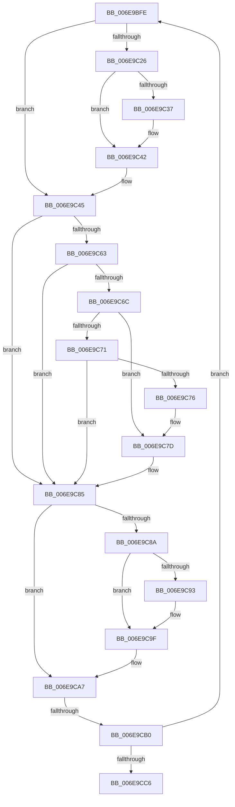

# sub_006E9BFE

- RVA: `0x006E9BFE`–`0x006E9CCB` (길이 `205` bytes)
- VA: `0x00000001406E9BFE`
- 실행 섹션: `.text`
- PDB 이름 있음: `아니요`; PDB Function 태그: `아니요`
- unwind 정보 RVA: `0x00093F94`
- 디코드: `53`개 명령, `205/205` bytes 표시
- 미해석 바이트: `0` (있으면 어셈블리에 `.byte`로 보존)

> 이 문서는 커널 이미지의 기계어와 PDB 기호를 분석해 생성했습니다. 4번과 5번은 함수 원형과 자료형을 바이너리 사용 방식에서 추정한 C 해석이며 원본 소스 복구 결과는 아닙니다.

## 1. Dependencies

- 직접 호출 지점: **5**; 고유 호출 대상: **5**
- 직접 호출자로 확인된 함수: **0**
- RIP 상대 이미지 참조: **1**

### Outgoing calls
- `0x006E9C3D` → [KiRaiseIrqlProcessIrqlFlags](../4F/KiRaiseIrqlProcessIrqlFlags_function_004F56FC.md) (function, `0x004F56FC`)
- `0x006E9C57` → [HalpAllocateDmaResourcesInternal](../3D/HalpAllocateDmaResourcesInternal_function_003DA7C4.md) (function, `0x003DA7C4`)
- `0x006E9C80` → [IoFreeAdapterChannelV3Internal](../3D/IoFreeAdapterChannelV3Internal_function_003DAA74.md) (function, `0x003DAA74`)
- `0x006E9C9A` → [KiLowerIrqlProcessIrqlFlags](../4F/KiLowerIrqlProcessIrqlFlags_function_004F5698.md) (function, `0x004F5698`)
- `0x006E9CB5` → [HalpDmaGetNextWcb](../3D/HalpDmaGetNextWcb_function_003DABF8.md) (function, `0x003DABF8`)

### Direct callers
- 이 함수 시작 RVA로 연결되는 직접 call은 확인되지 않았습니다. 간접 호출은 완전히 역산할 수 없습니다.

### Static image references
- `0x006E9C2E` → RVA `0x00FC6D20` (`ALMOSTRO`; read)

## 2. Other-region calls and transfers

- 다른 실행 섹션으로 향하는 call: **0**
- call이 아닌 외부 분기/꼬리 이동: **2**
  - `0x006E9CAA` → [HalpContinueProcessingWaitQueue + 0x2E](../3D/HalpContinueProcessingWaitQueue_function_003DAB9C.md) (`tail-transfer`)
  - `0x006E9CC6` → [HalpContinueProcessingWaitQueue + 0x2E](../3D/HalpContinueProcessingWaitQueue_function_003DAB9C.md) (`tail-transfer`)

## 3. Assembly (complete function range)

```asm
006E9BFE  48 89 8B 60 01 00 00            mov qword ptr [rbx + 0x160], rcx
006E9C05  40 32 ED                        xor bpl, bpl
006E9C08  8B 41 28                        mov eax, dword ptr [rcx + 0x28]
006E9C0B  89 83 F8 00 00 00               mov dword ptr [rbx + 0xf8], eax
006E9C11  8B 41 10                        mov eax, dword ptr [rcx + 0x10]
006E9C14  83 A3 70 02 00 00 00            and dword ptr [rbx + 0x270], 0
006E9C1B  89 83 84 01 00 00               mov dword ptr [rbx + 0x184], eax
006E9C21  41 3A FC                        cmp dil, r12b
006E9C24  73 1F                           jae 0x1406e9c45
006E9C26  44 0F 20 C7                     mov rdi, cr8
006E9C2A  45 0F 22 C4                     mov cr8, r12
006E9C2E  83 3D EB D0 8D 00 00            cmp dword ptr [rip + 0x8dd0eb], 0
006E9C35  74 0B                           je 0x1406e9c42
006E9C37  41 8A D4                        mov dl, r12b
006E9C3A  40 8A CF                        mov cl, dil
006E9C3D  E8 BA BA E0 FF                  call 0x1404f56fc
006E9C42  40 B5 01                        mov bpl, 1
006E9C45  4C 8D 44 24 48                  lea r8, [rsp + 0x48]
006E9C4A  C7 44 24 48 01 00 00 00         mov dword ptr [rsp + 0x48], 1
006E9C52  33 D2                           xor edx, edx
006E9C54  48 8B CB                        mov rcx, rbx
006E9C57  E8 68 0B CF FF                  call 0x1403da7c4
006E9C5C  44 8A F0                        mov r14b, al
006E9C5F  84 C0                           test al, al
006E9C61  74 22                           je 0x1406e9c85
006E9C63  8B 4C 24 48                     mov ecx, dword ptr [rsp + 0x48]
006E9C67  83 F9 01                        cmp ecx, 1
006E9C6A  74 19                           je 0x1406e9c85
006E9C6C  41 3B CC                        cmp ecx, r12d
006E9C6F  74 0C                           je 0x1406e9c7d
006E9C71  83 F9 03                        cmp ecx, 3
006E9C74  75 0F                           jne 0x1406e9c85
006E9C76  83 A3 F8 00 00 00 00            and dword ptr [rbx + 0xf8], 0
006E9C7D  48 8B CB                        mov rcx, rbx
006E9C80  E8 EF 0D CF FF                  call 0x1403daa74
006E9C85  40 84 ED                        test bpl, bpl
006E9C88  74 1D                           je 0x1406e9ca7
006E9C8A  83 3D 8F D0 8D 00 00            cmp dword ptr [rip + 0x8dd08f], 0
006E9C91  74 0C                           je 0x1406e9c9f
006E9C93  44 0F 20 C1                     mov rcx, cr8
006E9C97  40 8A D7                        mov dl, dil
006E9C9A  E8 F9 B9 E0 FF                  call 0x1404f5698
006E9C9F  40 0F B6 C7                     movzx eax, dil
006E9CA3  44 0F 22 C0                     mov cr8, rax
006E9CA7  45 84 F6                        test r14b, r14b
006E9CAA  0F 84 1A 0F CF FF               je 0x1403dabca
006E9CB0  48 8B CB                        mov rcx, rbx
006E9CB3  FF C6                           inc esi
006E9CB5  E8 3E 0F CF FF                  call 0x1403dabf8
006E9CBA  48 8B C8                        mov rcx, rax
006E9CBD  48 85 C0                        test rax, rax
006E9CC0  0F 85 38 FF FF FF               jne 0x1406e9bfe
006E9CC6  E9 FF 0E CF FF                  jmp 0x1403dabca
```

## 4. C-style interpretation (structured pseudocode)

```c
__int64 __fastcall sub_006E9BFE(__int64 a1, __int64 a2, __int64 a3, __int64 a4, __int64 a5, __int64 a6, __int64 a7, __int64 a8, unsigned int a9)
{
    __int64 result;
    __int64 v_rbp;
    __int64 v_rsi;
    unsigned int v_stack_p48;

    *(unsigned __int64 *)(v_rbx + 352) = a1;
    v_rbp = 0;
    *(unsigned int *)(v_rbx + 248) = (unsigned int)((unsigned int)(*(unsigned int *)(a1 + 40)));
    *(unsigned int *)(v_rbx + 388) = (unsigned int)((unsigned int)(*(unsigned int *)(a1 + 16)));
    if (((unsigned __int8)(v_rdi)) >= ((unsigned __int8)(v_r12))) goto loc_006E9C45;
    result = (unsigned int)(*(unsigned int *)(a1 + 16));
    if ((*(unsigned int *)(v_rip + 9294059)) != 0) {
        a2 = (unsigned __int8)(v_r12);
        a1 = (unsigned __int8)(v_cr8);
        result = KiRaiseIrqlProcessIrqlFlags(a1, a2, a3, a4);
    }
loc_006E9C45:
    v_stack_p48 = 1;
    a2 = 0;
    result = HalpAllocateDmaResourcesInternal(v_rbx, a2, a9, a4);
    if ((unsigned __int8)(result) == 0) goto loc_006E9C85;
    if (((unsigned int)((unsigned int)(a9))) == 1) goto loc_006E9C85;
    if (((unsigned int)((unsigned int)(a9))) == ((unsigned int)(v_r12))) goto loc_006E9C7D;
    if (((unsigned int)((unsigned int)(a9))) != 3) goto loc_006E9C85;
loc_006E9C7D:
    result = IoFreeAdapterChannelV3Internal(v_rbx, a2, a9, a4);
loc_006E9C85:
    if (1 == 0) goto loc_006E9CA7;
    if ((*(unsigned int *)(v_rip + 9293967)) != 0) {
        a1 = v_r12;
        a2 = (unsigned __int8)(v_cr8);
        result = KiLowerIrqlProcessIrqlFlags(a1, a2, a9, a4);
    }
loc_006E9CA7:
    v_rsi = (unsigned int)((v_rsi) + 1);
    result = HalpDmaGetNextWcb(v_rbx, a2, a9, a4);
    if (result != 0) goto loc_006E9BFE;
}
```

## 5. (Beta) C Style

```c
int64_t sub_006E9BFE(int64_t Arg1, int64_t Arg2, int64_t Arg3, int64_t Arg4, uint64_t Arg5, uint64_t Arg6, uint64_t Arg7, uint64_t Arg8, uint32_t Arg9)
{
    int64_t result;
    int64_t local_rbp;
    int64_t local_rsi;
    uint32_t v_stack_p48;

    *(uint64_t *)(local_rbx + 0x160) = Arg1;
    local_rbp = 0;
    *(uint32_t *)(local_rbx + 0xF8) = (uint32_t)((uint32_t)(*(uint32_t *)(Arg1 + 0x28)));
    *(uint32_t *)(local_rbx + 0x184) = (uint32_t)((uint32_t)(*(uint32_t *)(Arg1 + 0x10)));
    if (((uint8_t)(local_rdi)) >= ((uint8_t)(local_r12))) goto loc_006E9C45;
    result = (uint32_t)(*(uint32_t *)(Arg1 + 0x10));
    if ((*(uint32_t *)(v_rip + 0x8DD0EB)) != 0) {
        Arg2 = (uint8_t)(local_r12);
        Arg1 = (uint8_t)(v_cr8);
        result = KiRaiseIrqlProcessIrqlFlags(Arg1, Arg2, Arg3, Arg4);
    }
loc_006E9C45:
    v_stack_p48 = 1;
    Arg2 = 0;
    result = HalpAllocateDmaResourcesInternal(local_rbx, Arg2, Arg9, Arg4);
    if ((uint8_t)(result) == 0) goto loc_006E9C85;
    if (((uint32_t)((uint32_t)(Arg9))) == 1) goto loc_006E9C85;
    if (((uint32_t)((uint32_t)(Arg9))) == ((uint32_t)(local_r12))) goto loc_006E9C7D;
    if (((uint32_t)((uint32_t)(Arg9))) != 3) goto loc_006E9C85;
loc_006E9C7D:
    result = IoFreeAdapterChannelV3Internal(local_rbx, Arg2, Arg9, Arg4);
loc_006E9C85:
    if (1 == 0) goto loc_006E9CA7;
    if ((*(uint32_t *)(v_rip + 0x8DD08F)) != 0) {
        Arg1 = local_r12;
        Arg2 = (uint8_t)(v_cr8);
        result = KiLowerIrqlProcessIrqlFlags(Arg1, Arg2, Arg9, Arg4);
    }
loc_006E9CA7:
    local_rsi = (uint32_t)((local_rsi) + 1);
    result = HalpDmaGetNextWcb(local_rbx, Arg2, Arg9, Arg4);
    if (result != 0) goto loc_006E9BFE;
}
```

## 6. Execution-region graph

[열기: 2D/3D 그래프와 함수 탐색 컨트롤 패널](../../../control-panel.html?section=text&rva=0x006E9BFE&view=graph)

- 2D 그래프는 위에서 아래로 흐르고, 3D 그래프는 빈 공간을 드래그해 회전합니다. Shift+드래그는 이동, 휠은 확대·축소, 함수 노드 선택은 대상 보고서 이동입니다.

### Static fallback


