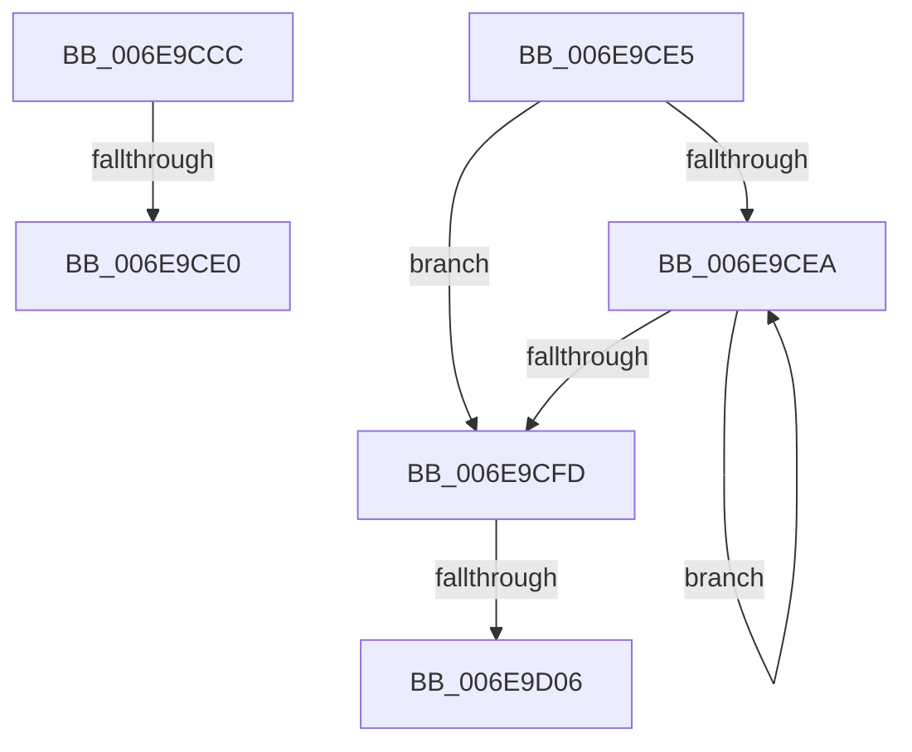

# sub_006E9CCC

- RVA: `0x006E9CCC`–`0x006E9D13` (길이 `71` bytes)
- VA: `0x00000001406E9CCC`
- 실행 섹션: `.text`
- PDB 이름 있음: `아니요`; PDB Function 태그: `아니요`
- unwind 정보 RVA: `0x00093FE0`
- 디코드: `18`개 명령, `71/71` bytes 표시
- 미해석 바이트: `0` (있으면 어셈블리에 `.byte`로 보존)

> 이 문서는 커널 이미지의 기계어와 PDB 기호를 분석해 생성했습니다. 4번과 5번은 함수 원형과 자료형을 바이너리 사용 방식에서 추정한 C 해석이며 원본 소스 복구 결과는 아닙니다.

## 1. Dependencies

- 직접 호출 지점: **2**; 고유 호출 대상: **1**
- 직접 호출자로 확인된 함수: **0**
- RIP 상대 이미지 참조: **0**

### Outgoing calls
- `0x006E9CCF` → [IoFreeMdl](../29/IoFreeMdl_function_0029EA80.md) (function, `0x0029EA80`)
- `0x006E9CF0` → [IoFreeMdl](../29/IoFreeMdl_function_0029EA80.md) (function, `0x0029EA80`)

### Direct callers
- 이 함수 시작 RVA로 연결되는 직접 call은 확인되지 않았습니다. 간접 호출은 완전히 역산할 수 없습니다.

### Static image references
- 디코드된 RIP-relative 메모리 참조가 없습니다.

## 2. Other-region calls and transfers

- 다른 실행 섹션으로 향하는 call: **0**
- call이 아닌 외부 분기/꼬리 이동: **4**
  - `0x006E9CDA` → [HalFlushAdapterBuffersEx + 0x21D](../3D/HalFlushAdapterBuffersEx_function_003DADE0.md) (`tail-transfer`)
  - `0x006E9CE0` → [HalFlushAdapterBuffersEx + 0x4E](../3D/HalFlushAdapterBuffersEx_function_003DADE0.md) (`tail-transfer`)
  - `0x006E9D00` → [HalFlushAdapterBuffersEx + 0x79](../3D/HalFlushAdapterBuffersEx_function_003DADE0.md) (`tail-transfer`)
  - `0x006E9D0E` → [HalFlushAdapterBuffersEx + 0x129](../3D/HalFlushAdapterBuffersEx_function_003DADE0.md) (`tail-transfer`)

## 3. Assembly (complete function range)

```asm
006E9CCC  48 8B CE                        mov rcx, rsi
006E9CCF  E8 AC 4D BB FF                  call 0x14029ea80
006E9CD4  49 8B F6                        mov rsi, r14
006E9CD7  4D 85 F6                        test r14, r14
006E9CDA  0F 85 1D 13 CF FF               jne 0x1403daffd
006E9CE0  E9 49 11 CF FF                  jmp 0x1403dae2e
006E9CE5  4D 85 FF                        test r15, r15
006E9CE8  74 13                           je 0x1406e9cfd
006E9CEA  49 8B 1F                        mov rbx, qword ptr [r15]
006E9CED  49 8B CF                        mov rcx, r15
006E9CF0  E8 8B 4D BB FF                  call 0x14029ea80
006E9CF5  4C 8B FB                        mov r15, rbx
006E9CF8  48 85 DB                        test rbx, rbx
006E9CFB  75 ED                           jne 0x1406e9cea
006E9CFD  48 85 ED                        test rbp, rbp
006E9D00  0F 84 53 11 CF FF               je 0x1403dae59
006E9D06  44 8A 84 24 90 00 00 00         mov r8b, byte ptr [rsp + 0x90]
006E9D0E  E9 F6 11 CF FF                  jmp 0x1403daf09
```

## 4. C-style interpretation (structured pseudocode)

```c
__int64 __fastcall sub_006E9CCC(void)
{
    __int64 result;
    unsigned __int8 v_stack_p90;

    result = IoFreeMdl(v_rsi, a2, a3, a4);
}
```

## 5. (Beta) C Style

```c
void sub_006E9CCC(void)
{
    int64_t result;
    uint8_t v_stack_p90;

    result = IoFreeMdl(local_rsi, a2, a3, a4);
}
```

## 6. Execution-region graph

[열기: 2D/3D 그래프와 함수 탐색 컨트롤 패널](../../../control-panel.html?section=text&rva=0x006E9CCC&view=graph)

- 2D 그래프는 위에서 아래로 흐르고, 3D 그래프는 빈 공간을 드래그해 회전합니다. Shift+드래그는 이동, 휠은 확대·축소, 함수 노드 선택은 대상 보고서 이동입니다.

### Static fallback


