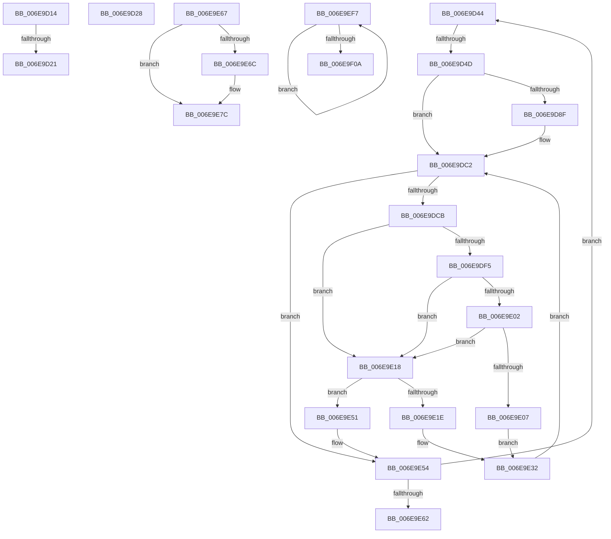

# sub_006E9D14

- RVA: `0x006E9D14`–`0x006E9F12` (길이 `510` bytes)
- VA: `0x00000001406E9D14`
- 실행 섹션: `.text`
- PDB 이름 있음: `아니요`; PDB Function 태그: `아니요`
- unwind 정보 RVA: `0x0009406C`
- 디코드: `137`개 명령, `510/510` bytes 표시
- 미해석 바이트: `0` (있으면 어셈블리에 `.byte`로 보존)

> 이 문서는 커널 이미지의 기계어와 PDB 기호를 분석해 생성했습니다. 4번과 5번은 함수 원형과 자료형을 바이너리 사용 방식에서 추정한 C 해석이며 원본 소스 복구 결과는 아닙니다.

## 1. Dependencies

- 직접 호출 지점: **3**; 고유 호출 대상: **3**
- 직접 호출자로 확인된 함수: **0**
- RIP 상대 이미지 참조: **1**

### Outgoing calls
- `0x006E9DAD` → [HalpDmaFlushBuffer](../3D/HalpDmaFlushBuffer_function_003DC1DC.md) (function, `0x003DC1DC`)
- `0x006E9ED0` → [guard_dispatch_icall](../6B/guard_dispatch_icall_function_006BAAD0.md) (function, `0x006BAAD0`)
- `0x006E9EFD` → [IoFreeMdl](../29/IoFreeMdl_function_0029EA80.md) (function, `0x0029EA80`)

### Direct callers
- 이 함수 시작 RVA로 연결되는 직접 call은 확인되지 않았습니다. 간접 호출은 완전히 역산할 수 없습니다.

### Static image references
- `0x006E9EA3` → RVA `0x00FC1778` (`.data`; read)

## 2. Other-region calls and transfers

- 다른 실행 섹션으로 향하는 call: **0**
- call이 아닌 외부 분기/꼬리 이동: **7**
  - `0x006E9D1B` → [HalMapTransferEx + 0x8D](../3D/HalMapTransferEx_function_003DB450.md) (`tail-transfer`)
  - `0x006E9D23` → [HalMapTransferEx + 0x92](../3D/HalMapTransferEx_function_003DB450.md) (`tail-transfer`)
  - `0x006E9D3F` → [HalMapTransferEx + 0x15B](../3D/HalMapTransferEx_function_003DB450.md) (`tail-transfer`)
  - `0x006E9D47` → [HalMapTransferEx + 0x28C](../3D/HalMapTransferEx_function_003DB450.md) (`tail-transfer`)
  - `0x006E9E62` → [HalMapTransferEx + 0x322](../3D/HalMapTransferEx_function_003DB450.md) (`tail-transfer`)
  - `0x006E9EF2` → [HalMapTransferEx + 0x23E](../3D/HalMapTransferEx_function_003DB450.md) (`tail-transfer`)
  - `0x006E9F0D` → [HalMapTransferEx + 0x2B9](../3D/HalMapTransferEx_function_003DB450.md) (`tail-transfer`)

## 3. Assembly (complete function range)

```asm
006E9D14  44 38 AF B9 01 00 00            cmp byte ptr [rdi + 0x1b9], r13b
006E9D1B  0F 85 BC 17 CF FF               jne 0x1403db4dd
006E9D21  33 C0                           xor eax, eax
006E9D23  E9 BA 17 CF FF                  jmp 0x1403db4e2
006E9D28  48 8B 4D 57                     mov rcx, qword ptr [rbp + 0x57]
006E9D2C  48 8B 41 18                     mov rax, qword ptr [rcx + 0x18]
006E9D30  48 89 45 AF                     mov qword ptr [rbp - 0x51], rax
006E9D34  4C 8B 28                        mov r13, qword ptr [rax]
006E9D37  4C 21 71 28                     and qword ptr [rcx + 0x28], r14
006E9D3B  4C 21 71 20                     and qword ptr [rcx + 0x20], r14
006E9D3F  E9 67 18 CF FF                  jmp 0x1403db5ab
006E9D44  45 85 E4                        test r12d, r12d
006E9D47  0F 84 8F 19 CF FF               je 0x1403db6dc
006E9D4D  8B 46 28                        mov eax, dword ptr [rsi + 0x28]
006E9D50  45 8B EC                        mov r13d, r12d
006E9D53  8B 56 2C                        mov edx, dword ptr [rsi + 0x2c]
006E9D56  2B C3                           sub eax, ebx
006E9D58  41 3B C4                        cmp eax, r12d
006E9D5B  44 0F 46 E8                     cmovbe r13d, eax
006E9D5F  8D 04 1A                        lea eax, [rdx + rbx]
006E9D62  45 2B E5                        sub r12d, r13d
006E9D65  44 8B D8                        mov r11d, eax
006E9D68  44 8B D0                        mov r10d, eax
006E9D6B  49 C1 EB 0C                     shr r11, 0xc
006E9D6F  41 81 E2 FF 0F 00 00            and r10d, 0xfff
006E9D76  49 83 C3 06                     add r11, 6
006E9D7A  44 89 55 9F                     mov dword ptr [rbp - 0x61], r10d
006E9D7E  80 BF BD 01 00 00 00            cmp byte ptr [rdi + 0x1bd], 0
006E9D85  4E 8D 1C DE                     lea r11, [rsi + r11*8]
006E9D89  4C 89 5D AF                     mov qword ptr [rbp - 0x51], r11
006E9D8D  75 33                           jne 0x1406e9dc2
006E9D8F  8A 45 47                        mov al, byte ptr [rbp + 0x47]
006E9D92  45 8B CD                        mov r9d, r13d
006E9D95  4C 8B 46 20                     mov r8, qword ptr [rsi + 0x20]
006E9D99  4C 03 C2                        add r8, rdx
006E9D9C  88 44 24 28                     mov byte ptr [rsp + 0x28], al
006E9DA0  8A 45 77                        mov al, byte ptr [rbp + 0x77]
006E9DA3  4C 03 C3                        add r8, rbx
006E9DA6  48 8B D6                        mov rdx, rsi
006E9DA9  88 44 24 20                     mov byte ptr [rsp + 0x20], al
006E9DAD  E8 2A 24 CF FF                  call 0x1403dc1dc
006E9DB2  44 8B 4D 97                     mov r9d, dword ptr [rbp - 0x69]
006E9DB6  44 8B 55 9F                     mov r10d, dword ptr [rbp - 0x61]
006E9DBA  48 8B 4D A7                     mov rcx, qword ptr [rbp - 0x59]
006E9DBE  4C 8B 5D AF                     mov r11, qword ptr [rbp - 0x51]
006E9DC2  45 85 ED                        test r13d, r13d
006E9DC5  0F 84 89 00 00 00               je 0x1406e9e54
006E9DCB  4D 8B 03                        mov r8, qword ptr [r11]
006E9DCE  41 8B D5                        mov edx, r13d
006E9DD1  41 8B C2                        mov eax, r10d
006E9DD4  49 C1 E0 0C                     shl r8, 0xc
006E9DD8  4C 03 C0                        add r8, rax
006E9DDB  B8 00 10 00 00                  mov eax, 0x1000
006E9DE0  41 2B C2                        sub eax, r10d
006E9DE3  45 33 D2                        xor r10d, r10d
006E9DE6  41 3B C5                        cmp eax, r13d
006E9DE9  0F 46 D0                        cmovbe edx, eax
006E9DEC  48 8D 41 01                     lea rax, [rcx + 1]
006E9DF0  4C 3B C0                        cmp r8, rax
006E9DF3  75 23                           jne 0x1406e9e18
006E9DF5  48 8B C1                        mov rax, rcx
006E9DF8  49 33 C0                        xor rax, r8
006E9DFB  48 0F BA E0 20                  bt rax, 0x20
006E9E00  72 16                           jb 0x1406e9e18
006E9E02  45 85 F6                        test r14d, r14d
006E9E05  74 11                           je 0x1406e9e18
006E9E07  41 8D 4E FF                     lea ecx, [r14 - 1]
006E9E0B  48 FF C1                        inc rcx
006E9E0E  48 8D 04 49                     lea rax, [rcx + rcx*2]
006E9E12  41 01 14 C7                     add dword ptr [r15 + rax*8], edx
006E9E16  EB 1A                           jmp 0x1406e9e32
006E9E18  44 3B 75 B7                     cmp r14d, dword ptr [rbp - 0x49]
006E9E1C  73 33                           jae 0x1406e9e51
006E9E1E  41 8B C6                        mov eax, r14d
006E9E21  41 FF C6                        inc r14d
006E9E24  48 8D 0C 40                     lea rcx, [rax + rax*2]
006E9E28  4D 89 44 CF 10                  mov qword ptr [r15 + rcx*8 + 0x10], r8
006E9E2D  41 89 54 CF 18                  mov dword ptr [r15 + rcx*8 + 0x18], edx
006E9E32  44 03 CA                        add r9d, edx
006E9E35  8B CA                           mov ecx, edx
006E9E37  48 FF C9                        dec rcx
006E9E3A  44 89 4D 97                     mov dword ptr [rbp - 0x69], r9d
006E9E3E  49 03 C8                        add rcx, r8
006E9E41  44 2B EA                        sub r13d, edx
006E9E44  48 89 4D A7                     mov qword ptr [rbp - 0x59], rcx
006E9E48  49 83 C3 08                     add r11, 8
006E9E4C  E9 71 FF FF FF                  jmp 0x1406e9dc2
006E9E51  45 33 E4                        xor r12d, r12d
006E9E54  48 8B 36                        mov rsi, qword ptr [rsi]
006E9E57  33 DB                           xor ebx, ebx
006E9E59  48 85 F6                        test rsi, rsi
006E9E5C  0F 85 E2 FE FF FF               jne 0x1406e9d44
006E9E62  E9 0B 19 CF FF                  jmp 0x1403db772
006E9E67  45 85 E8                        test r8d, r13d
006E9E6A  74 10                           je 0x1406e9e7c
006E9E6C  49 81 C5 00 10 00 00            add r13, 0x1000
006E9E73  49 8B C5                        mov rax, r13
006E9E76  49 23 C0                        and rax, r8
006E9E79  4C 2B E8                        sub r13, rax
006E9E7C  41 8B C6                        mov eax, r14d
006E9E7F  48 8D 48 01                     lea rcx, [rax + 1]
006E9E83  48 8D 0C 48                     lea rcx, [rax + rcx*2]
006E9E87  48 8B 45 A7                     mov rax, qword ptr [rbp - 0x59]
006E9E8B  49 8D 0C CF                     lea rcx, [r15 + rcx*8]
006E9E8F  49 23 C0                        and rax, r8
006E9E92  49 03 C5                        add rax, r13
006E9E95  48 89 4D BF                     mov qword ptr [rbp - 0x41], rcx
006E9E99  48 89 01                        mov qword ptr [rcx], rax
006E9E9C  48 89 71 10                     mov qword ptr [rcx + 0x10], rsi
006E9EA0  89 51 08                        mov dword ptr [rcx + 8], edx
006E9EA3  48 8B 05 CE 78 8D 00            mov rax, qword ptr [rip + 0x8d78ce]
006E9EAA  48 8D 4D EF                     lea rcx, [rbp - 0x11]
006E9EAE  48 8B 55 57                     mov rdx, qword ptr [rbp + 0x57]
006E9EB2  4C 8D 4D CF                     lea r9, [rbp - 0x31]
006E9EB6  48 89 4C 24 20                  mov qword ptr [rsp + 0x20], rcx
006E9EBB  41 B8 03 00 00 00               mov r8d, 3
006E9EC1  48 8B 4D AF                     mov rcx, qword ptr [rbp - 0x51]
006E9EC5  48 8B 80 90 00 00 00            mov rax, qword ptr [rax + 0x90]
006E9ECC  48 8B 52 28                     mov rdx, qword ptr [rdx + 0x28]
006E9ED0  E8 FB 0B FD FF                  call 0x1406baad0
006E9ED5  48 8B 4D DF                     mov rcx, qword ptr [rbp - 0x21]
006E9ED9  81 E3 FF 0F 00 00               and ebx, 0xfff
006E9EDF  03 5D 9B                        add ebx, dword ptr [rbp - 0x65]
006E9EE2  89 45 A3                        mov dword ptr [rbp - 0x5d], eax
006E9EE5  48 8B 45 57                     mov rax, qword ptr [rbp + 0x57]
006E9EE9  48 01 48 28                     add qword ptr [rax + 0x28], rcx
006E9EED  8B CB                           mov ecx, ebx
006E9EEF  4C 03 E9                        add r13, rcx
006E9EF2  E9 97 17 CF FF                  jmp 0x1403db68e
006E9EF7  48 8B 1E                        mov rbx, qword ptr [rsi]
006E9EFA  48 8B CE                        mov rcx, rsi
006E9EFD  E8 7E 4B BB FF                  call 0x14029ea80
006E9F02  48 8B F3                        mov rsi, rbx
006E9F05  48 85 DB                        test rbx, rbx
006E9F08  75 ED                           jne 0x1406e9ef7
006E9F0A  8A 5D 77                        mov bl, byte ptr [rbp + 0x77]
006E9F0D  E9 F7 17 CF FF                  jmp 0x1403db709
```

## 4. C-style interpretation (structured pseudocode)

```c
__int64 __fastcall sub_006E9D14(void)
{
    __int64 result;
    unsigned __int8 v_stack_p20;
    unsigned __int8 v_stack_p28;

    result = 0;
}
```

## 5. (Beta) C Style

```c
void sub_006E9D14(void)
{
    int64_t result;
    uint8_t v_stack_p20;
    uint8_t v_stack_p28;

    result = 0;
}
```

## 6. Execution-region graph

[열기: 2D/3D 그래프와 함수 탐색 컨트롤 패널](../../../control-panel.html?section=text&rva=0x006E9D14&view=graph)

- 2D 그래프는 위에서 아래로 흐르고, 3D 그래프는 빈 공간을 드래그해 회전합니다. Shift+드래그는 이동, 휠은 확대·축소, 함수 노드 선택은 대상 보고서 이동입니다.

### Static fallback


