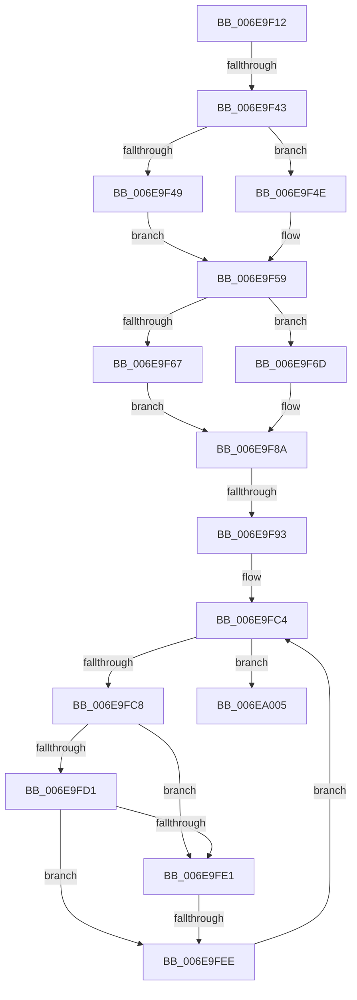

# sub_006E9F12

- RVA: `0x006E9F12`–`0x006EA010` (길이 `254` bytes)
- VA: `0x00000001406E9F12`
- 실행 섹션: `.text`
- PDB 이름 있음: `아니요`; PDB Function 태그: `아니요`
- unwind 정보 RVA: `0x0009409C`
- 디코드: `66`개 명령, `254/254` bytes 표시
- 미해석 바이트: `0` (있으면 어셈블리에 `.byte`로 보존)

> 이 문서는 커널 이미지의 기계어와 PDB 기호를 분석해 생성했습니다. 4번과 5번은 함수 원형과 자료형을 바이너리 사용 방식에서 추정한 C 해석이며 원본 소스 복구 결과는 아닙니다.

## 1. Dependencies

- 직접 호출 지점: **3**; 고유 호출 대상: **3**
- 직접 호출자로 확인된 함수: **0**
- RIP 상대 이미지 참조: **1**

### Outgoing calls
- `0x006E9F32` → [IoAllocateMdl](../29/IoAllocateMdl_function_0029EBF0.md) (function, `0x0029EBF0`)
- `0x006E9F85` → [MmMapLockedPagesSpecifyCache](../31/MmMapLockedPagesSpecifyCache_function_00318800.md) (function, `0x00318800`)
- `0x006E9FA1` → [IoBuildPartialMdl](../26/IoBuildPartialMdl_function_00267BE0.md) (function, `0x00267BE0`)

### Direct callers
- 이 함수 시작 RVA로 연결되는 직접 call은 확인되지 않았습니다. 간접 호출은 완전히 역산할 수 없습니다.

### Static image references
- `0x006E9FC8` → RVA `0x00FC18A0` (`.data`; read)

## 2. Other-region calls and transfers

- 다른 실행 섹션으로 향하는 call: **0**
- call이 아닌 외부 분기/꼬리 이동: **4**
  - `0x006E9F3D` → [HalpDmaCheckMdlAccessibility + 0x4B](../3D/HalpDmaCheckMdlAccessibility_function_003DB8A0.md) (`tail-transfer`)
  - `0x006E9F8D` → [HalpDmaCheckMdlAccessibility + 0x4B](../3D/HalpDmaCheckMdlAccessibility_function_003DB8A0.md) (`tail-transfer`)
  - `0x006E9FE8` → [HalpDmaCheckMdlAccessibility + 0x4B](../3D/HalpDmaCheckMdlAccessibility_function_003DB8A0.md) (`tail-transfer`)
  - `0x006EA00B` → [HalpDmaCheckMdlAccessibility + 0x9B](../3D/HalpDmaCheckMdlAccessibility_function_003DB8A0.md) (`tail-transfer`)

## 3. Assembly (complete function range)

```asm
006E9F12  48 8B 4F 20                     mov rcx, qword ptr [rdi + 0x20]
006E9F16  8B D3                           mov edx, ebx
006E9F18  48 83 64 24 20 00               and qword ptr [rsp + 0x20], 0
006E9F1E  49 03 C9                        add rcx, r9
006E9F21  41 8B C0                        mov eax, r8d
006E9F24  45 33 C9                        xor r9d, r9d
006E9F27  48 03 C8                        add rcx, rax
006E9F2A  45 33 C0                        xor r8d, r8d
006E9F2D  48 89 4C 24 30                  mov qword ptr [rsp + 0x30], rcx
006E9F32  E8 B9 4C BB FF                  call 0x14029ebf0
006E9F37  4C 8B F0                        mov r14, rax
006E9F3A  48 85 C0                        test rax, rax
006E9F3D  0F 84 A8 19 CF FF               je 0x1403db8eb
006E9F43  48 83 3E 00                     cmp qword ptr [rsi], 0
006E9F47  75 05                           jne 0x1406e9f4e
006E9F49  48 89 06                        mov qword ptr [rsi], rax
006E9F4C  EB 0B                           jmp 0x1406e9f59
006E9F4E  48 8B 84 24 98 00 00 00         mov rax, qword ptr [rsp + 0x98]
006E9F56  4C 89 30                        mov qword ptr [rax], r14
006E9F59  F6 47 0A 05                     test byte ptr [rdi + 0xa], 5
006E9F5D  4C 89 B4 24 98 00 00 00         mov qword ptr [rsp + 0x98], r14
006E9F65  74 06                           je 0x1406e9f6d
006E9F67  48 8B 47 18                     mov rax, qword ptr [rdi + 0x18]
006E9F6B  EB 1D                           jmp 0x1406e9f8a
006E9F6D  C7 44 24 28 20 00 00 40         mov dword ptr [rsp + 0x28], 0x40000020
006E9F75  45 33 C9                        xor r9d, r9d
006E9F78  83 64 24 20 00                  and dword ptr [rsp + 0x20], 0
006E9F7D  45 8B C4                        mov r8d, r12d
006E9F80  33 D2                           xor edx, edx
006E9F82  48 8B CF                        mov rcx, rdi
006E9F85  E8 76 E8 C2 FF                  call 0x140318800
006E9F8A  48 85 C0                        test rax, rax
006E9F8D  0F 84 58 19 CF FF               je 0x1403db8eb
006E9F93  4C 8B 44 24 30                  mov r8, qword ptr [rsp + 0x30]
006E9F98  44 8B CB                        mov r9d, ebx
006E9F9B  49 8B D6                        mov rdx, r14
006E9F9E  48 8B CF                        mov rcx, rdi
006E9FA1  E8 3A DC B7 FF                  call 0x140267be0
006E9FA6  41 8B D5                        mov edx, r13d
006E9FA9  B9 00 10 00 00                  mov ecx, 0x1000
006E9FAE  48 C1 EA 0C                     shr rdx, 0xc
006E9FB2  41 81 E5 FF 0F 00 00            and r13d, 0xfff
006E9FB9  48 83 C2 06                     add rdx, 6
006E9FBD  41 2B CD                        sub ecx, r13d
006E9FC0  48 8D 14 D7                     lea rdx, [rdi + rdx*8]
006E9FC4  85 DB                           test ebx, ebx
006E9FC6  74 3D                           je 0x1406ea005
006E9FC8  80 3D D1 78 8D 00 00            cmp byte ptr [rip + 0x8d78d1], 0
006E9FCF  75 10                           jne 0x1406e9fe1
006E9FD1  48 8B 02                        mov rax, qword ptr [rdx]
006E9FD4  48 C1 E0 0C                     shl rax, 0xc
006E9FD8  48 39 85 90 00 00 00            cmp qword ptr [rbp + 0x90], rax
006E9FDF  73 0D                           jae 0x1406e9fee
006E9FE1  83 BD 08 02 00 00 03            cmp dword ptr [rbp + 0x208], 3
006E9FE8  0F 85 FD 18 CF FF               jne 0x1403db8eb
006E9FEE  48 83 C2 08                     add rdx, 8
006E9FF2  8B C3                           mov eax, ebx
006E9FF4  3B D9                           cmp ebx, ecx
006E9FF6  0F 43 C1                        cmovae eax, ecx
006E9FF9  B9 00 10 00 00                  mov ecx, 0x1000
006E9FFE  2B D8                           sub ebx, eax
006EA000  44 2B F8                        sub r15d, eax
006EA003  EB BF                           jmp 0x1406e9fc4
006EA005  48 8B 3F                        mov rdi, qword ptr [rdi]
006EA008  45 33 C0                        xor r8d, r8d
006EA00B  E9 2B 19 CF FF                  jmp 0x1403db93b
```

## 4. C-style interpretation (structured pseudocode)

```c
__int64 __fastcall sub_006E9F12(__int64 a1, __int64 a2, int a3, __int64 a4, __int64 a5, __int64 a6, __int64 a7, __int64 a8, __int64 a9, __int64 a10, __int64 a11, __int64 a12, __int64 a13, __int64 a14, __int64 a15, __int64 a16, __int64 a17, __int64 a18, __int64 a19)
{
    __int64 result;
    __int64 v_r13;
    __int64 v_r15;
    __int64 v_rbx;
    unsigned __int64 v_stack_p20;
    unsigned int v_stack_p28;
    unsigned __int64 v_stack_p30;
    unsigned __int64 v_stack_p98;

    a1 = (*(unsigned __int64 *)(v_rdi + 32)) + (a4);
    a4 = 0;
    a1 = (a1) + ((unsigned int)(a3));
    a3 = 0;
    v_stack_p30 = a1;
    result = IoAllocateMdl(a1, (unsigned int)((unsigned int)(v_rbx)), a3, a4);
    if ((*(unsigned __int64 *)(v_rsi)) != 0) goto loc_006E9F4E;
    *(unsigned __int64 *)(v_rsi) = result;
    goto loc_006E9F59;
loc_006E9F4E:
    *(unsigned __int64 *)(a19) = result;
loc_006E9F59:
    v_stack_p98 = result;
    if (((*(unsigned __int8 *)(v_rdi + 10)) & (5)) == 0) goto loc_006E9F6D;
    goto loc_006E9F8A;
loc_006E9F6D:
    v_stack_p28 = 0x40000020ULL;
    a4 = 0;
    a2 = 0;
    result = MmMapLockedPagesSpecifyCache(v_rdi, a2, (unsigned int)((unsigned int)(v_r12)), a4);
loc_006E9F8A:
    result = IoBuildPartialMdl(v_rdi, result, a6, (unsigned int)((unsigned int)(v_rbx)));
    a2 = ((unsigned int)((unsigned int)(v_r13))) >> (12);
    v_r13 = (unsigned int)((v_r13) & (0xFFFULL));
    a2 = (a2) + (6);
    a1 = (unsigned int)(((unsigned int)(0x1000ULL)) - ((unsigned int)(v_r13)));
loc_006E9FC4:
    if ((unsigned int)(v_rbx) == 0) goto loc_006EA005;
    if ((*(unsigned __int8 *)(v_rip + 9271505)) != 0) goto loc_006E9FE1;
    result = (*(unsigned __int64 *)(v_rdi + a2 * 8)) << (12);
    if ((*(unsigned __int64 *)(v_rbp + 144)) >= result) goto loc_006E9FEE;
loc_006E9FE1:
loc_006E9FEE:
    a2 = (v_rdi + a2 * 8) + (8);
    result = (unsigned int)((unsigned int)(v_rbx));
    if (((unsigned int)(v_rbx)) >= ((unsigned int)(a1))) { result = (unsigned int)(a1); }
    v_rbx = (unsigned int)((v_rbx) - ((unsigned int)(result)));
    v_r15 = (unsigned int)((v_r15) - ((unsigned int)(result)));
    goto loc_006E9FC4;
loc_006EA005:
    a3 = 0;
}
```

## 5. (Beta) C Style

```c
int64_t sub_006E9F12(int64_t Arg1, int64_t Arg2, int32_t Arg3, int64_t Arg4, uint64_t Arg5, int64_t Arg6, uint64_t Arg7, uint64_t Arg8, uint64_t Arg9, uint64_t Arg10, uint64_t Arg11, uint64_t Arg12, uint64_t Arg13, uint64_t Arg14, uint64_t Arg15, uint64_t Arg16, uint64_t Arg17, uint64_t Arg18, void *Arg19)
{
    uint8_t *arg19 = (uint8_t *)Arg19;

    int64_t result;
    int64_t local_r13;
    int64_t local_r15;
    int64_t local_rbx;
    uint64_t v_stack_p20;
    uint32_t v_stack_p28;
    uint64_t v_stack_p30;
    uint64_t v_stack_p98;

    Arg1 = (*(uint64_t *)(local_rdi + 0x20)) + (Arg4);
    Arg4 = 0;
    Arg1 = (Arg1) + ((uint32_t)(Arg3));
    Arg3 = 0;
    v_stack_p30 = Arg1;
    result = IoAllocateMdl(Arg1, (uint32_t)((uint32_t)(local_rbx)), Arg3, Arg4);
    if ((*(uint64_t *)(local_rsi)) != 0) goto loc_006E9F4E;
    *(uint64_t *)(local_rsi) = result;
    goto loc_006E9F59;
loc_006E9F4E:
    *(uint64_t *)(arg19) = result;
loc_006E9F59:
    v_stack_p98 = result;
    if (((*(uint8_t *)(local_rdi + 0xA)) & (5)) == 0) goto loc_006E9F6D;
    goto loc_006E9F8A;
loc_006E9F6D:
    v_stack_p28 = 0x40000020ULL;
    Arg4 = 0;
    Arg2 = 0;
    result = MmMapLockedPagesSpecifyCache(local_rdi, Arg2, (uint32_t)((uint32_t)(local_r12)), Arg4);
loc_006E9F8A:
    result = IoBuildPartialMdl(local_rdi, result, Arg6, (uint32_t)((uint32_t)(local_rbx)));
    Arg2 = ((uint32_t)((uint32_t)(local_r13))) >> (12);
    local_r13 = (uint32_t)((local_r13) & (0xFFFULL));
    Arg2 = (Arg2) + (6);
    Arg1 = (uint32_t)(((uint32_t)(0x1000ULL)) - ((uint32_t)(local_r13)));
loc_006E9FC4:
    if ((uint32_t)(local_rbx) == 0) goto loc_006EA005;
    if ((*(uint8_t *)(v_rip + 0x8D78D1)) != 0) goto loc_006E9FE1;
    result = (*(uint64_t *)(local_rdi + Arg2 * 8)) << (12);
    if ((*(uint64_t *)(local_rbp + 0x90)) >= result) goto loc_006E9FEE;
loc_006E9FE1:
loc_006E9FEE:
    Arg2 = (local_rdi + Arg2 * 8) + (8);
    result = (uint32_t)((uint32_t)(local_rbx));
    if (((uint32_t)(local_rbx)) >= ((uint32_t)(Arg1))) { result = (uint32_t)(Arg1); }
    local_rbx = (uint32_t)((local_rbx) - ((uint32_t)(result)));
    local_r15 = (uint32_t)((local_r15) - ((uint32_t)(result)));
    goto loc_006E9FC4;
loc_006EA005:
    Arg3 = 0;
}
```

### 관측된 메모리 오프셋

구조체 형식이 확인되지 않은 접근은 인자 기준의 오프셋으로만 기록했습니다.

| 기준 인자 | 오프셋 표현 | 폭 (bit) | 접근 |
|---|---:|---:|---|
| `Arg19` | `+ 0x0` | `64` | `W` |

## 6. Execution-region graph

[열기: 2D/3D 그래프와 함수 탐색 컨트롤 패널](../../../control-panel.html?section=text&rva=0x006E9F12&view=graph)

- 2D 그래프는 위에서 아래로 흐르고, 3D 그래프는 빈 공간을 드래그해 회전합니다. Shift+드래그는 이동, 휠은 확대·축소, 함수 노드 선택은 대상 보고서 이동입니다.

### Static fallback


