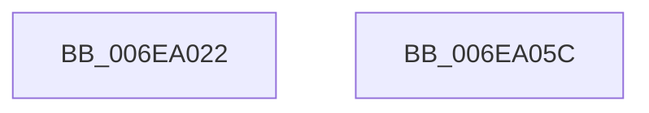

# sub_006EA022

- RVA: `0x006EA022`–`0x006EA075` (길이 `83` bytes)
- VA: `0x00000001406EA022`
- 실행 섹션: `.text`
- PDB 이름 있음: `아니요`; PDB Function 태그: `아니요`
- unwind 정보 RVA: `0x000940FC`
- 디코드: `18`개 명령, `83/83` bytes 표시
- 미해석 바이트: `0` (있으면 어셈블리에 `.byte`로 보존)

> 이 문서는 커널 이미지의 기계어와 PDB 기호를 분석해 생성했습니다. 4번과 5번은 함수 원형과 자료형을 바이너리 사용 방식에서 추정한 C 해석이며 원본 소스 복구 결과는 아닙니다.

## 1. Dependencies

- 직접 호출 지점: **1**; 고유 호출 대상: **1**
- 직접 호출자로 확인된 함수: **0**
- RIP 상대 이미지 참조: **0**

### Outgoing calls
- `0x006EA069` → [HalpAllocateAdapterCallbackV3](../3D/HalpAllocateAdapterCallbackV3_function_003DB380.md) (function, `0x003DB380`)

### Direct callers
- 이 함수 시작 RVA로 연결되는 직접 call은 확인되지 않았습니다. 간접 호출은 완전히 역산할 수 없습니다.

### Static image references
- 디코드된 RIP-relative 메모리 참조가 없습니다.

## 2. Other-region calls and transfers

- 다른 실행 섹션으로 향하는 call: **0**
- call이 아닌 외부 분기/꼬리 이동: **2**
  - `0x006EA057` → [HalpBuildScatterGatherList + 0xEE](../3D/HalpBuildScatterGatherList_function_003DBAF8.md) (`tail-transfer`)
  - `0x006EA070` → [HalpBuildScatterGatherList + 0x1CD](../3D/HalpBuildScatterGatherList_function_003DBAF8.md) (`tail-transfer`)

## 3. Assembly (complete function range)

```asm
006EA022  8B 44 24 38                     mov eax, dword ptr [rsp + 0x38]
006EA026  41 BB 01 00 00 00               mov r11d, 1
006EA02C  44 8B 84 24 B0 00 00 00         mov r8d, dword ptr [rsp + 0xb0]
006EA034  48 8D 1C 45 05 00 00 00         lea rbx, [rax*2 + 5]
006EA03C  48 03 D8                        add rbx, rax
006EA03F  8B 44 24 3C                     mov eax, dword ptr [rsp + 0x3c]
006EA043  48 8D 1C DA                     lea rbx, [rdx + rbx*8]
006EA047  44 89 13                        mov dword ptr [rbx], r10d
006EA04A  48 89 93 A0 00 00 00            mov qword ptr [rbx + 0xa0], rdx
006EA051  89 83 9C 00 00 00               mov dword ptr [rbx + 0x9c], eax
006EA057  E9 8A 1B CF FF                  jmp 0x1403dbbe6
006EA05C  49 8B 57 20                     mov rdx, qword ptr [r15 + 0x20]
006EA060  4C 8B CB                        mov r9, rbx
006EA063  45 33 C0                        xor r8d, r8d
006EA066  49 8B CF                        mov rcx, r15
006EA069  E8 12 13 CF FF                  call 0x1403db380
006EA06E  33 C0                           xor eax, eax
006EA070  E9 50 1C CF FF                  jmp 0x1403dbcc5
```

## 4. C-style interpretation (structured pseudocode)

```c
__int64 __fastcall sub_006EA022(__int64 a1, __int64 a2, __int64 a3, __int64 a4, __int64 a5, __int64 a6, unsigned int a7, __int64 a8, __int64 a9, __int64 a10, __int64 a11, __int64 a12, __int64 a13, __int64 a14, __int64 a15, __int64 a16, __int64 a17, __int64 a18, __int64 a19, __int64 a20, __int64 a21, unsigned int a22)
{
    __int64 v_rbx;
    unsigned int v_stack_p3C;

    v_rbx = ((unsigned int)(a7) * 2 + 5) + ((unsigned int)(a7));
    *(unsigned int *)(a2 + v_rbx * 8) = (unsigned int)(v_r10);
    *(unsigned __int64 *)(a2 + v_rbx * 8 + 160) = a2;
    *(unsigned int *)(a2 + v_rbx * 8 + 156) = (unsigned int)((unsigned int)(v_stack_p3C));
}
```

## 5. (Beta) C Style

```c
int64_t sub_006EA022(int64_t Arg1, void *Arg2, int64_t Arg3, int64_t Arg4, uint64_t Arg5, uint64_t Arg6, uint32_t Arg7, uint64_t Arg8, uint64_t Arg9, uint64_t Arg10, uint64_t Arg11, uint64_t Arg12, uint64_t Arg13, uint64_t Arg14, uint64_t Arg15, uint64_t Arg16, uint64_t Arg17, uint64_t Arg18, uint64_t Arg19, uint64_t Arg20, uint64_t Arg21, uint32_t Arg22)
{
    uint8_t *arg2 = (uint8_t *)Arg2;

    int64_t local_rbx;
    uint32_t v_stack_p3C;

    local_rbx = ((uint32_t)(Arg7) * 2 + 5) + ((uint32_t)(Arg7));
    *(uint32_t *)(arg2 + local_rbx * 8) = (uint32_t)(local_r10);
    *(void **)(arg2 + local_rbx * 8 + 0xA0) = Arg2;
    *(uint32_t *)(arg2 + local_rbx * 8 + 0x9C) = (uint32_t)((uint32_t)(v_stack_p3C));
}
```

### 관측된 메모리 오프셋

구조체 형식이 확인되지 않은 접근은 인자 기준의 오프셋으로만 기록했습니다.

| 기준 인자 | 오프셋 표현 | 폭 (bit) | 접근 |
|---|---:|---:|---|
| `Arg2` | `+ 0x0` | `32` | `W` |
| `Arg2` | `+ 0x0 + rbx*8` | `64` | `R` |
| `Arg2` | `+ 0x9C` | `32` | `W` |
| `Arg2` | `+ 0xA0` | `64` | `W` |

## 6. Execution-region graph

[열기: 2D/3D 그래프와 함수 탐색 컨트롤 패널](../../../control-panel.html?section=text&rva=0x006EA022&view=graph)

- 2D 그래프는 위에서 아래로 흐르고, 3D 그래프는 빈 공간을 드래그해 회전합니다. Shift+드래그는 이동, 휠은 확대·축소, 함수 노드 선택은 대상 보고서 이동입니다.

### Static fallback


