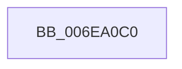

# sub_006EA0C0

- RVA: `0x006EA0C0`–`0x006EA10F` (길이 `79` bytes)
- VA: `0x00000001406EA0C0`
- 실행 섹션: `.text`
- PDB 이름 있음: `아니요`; PDB Function 태그: `아니요`
- unwind 정보 RVA: `0x00094260`
- 디코드: `17`개 명령, `79/79` bytes 표시
- 미해석 바이트: `0` (있으면 어셈블리에 `.byte`로 보존)

> 이 문서는 커널 이미지의 기계어와 PDB 기호를 분석해 생성했습니다. 4번과 5번은 함수 원형과 자료형을 바이너리 사용 방식에서 추정한 C 해석이며 원본 소스 복구 결과는 아닙니다.

## 1. Dependencies

- 직접 호출 지점: **3**; 고유 호출 대상: **3**
- 직접 호출자로 확인된 함수: **0**
- RIP 상대 이미지 참조: **1**

### Outgoing calls
- `0x006EA0D0` → [KeAcquireInStackQueuedSpinLock](../27/KeAcquireInStackQueuedSpinLock_function_002757A0.md) (function, `0x002757A0`)
- `0x006EA0FA` → [guard_dispatch_icall](../6B/guard_dispatch_icall_function_006BAAD0.md) (function, `0x006BAAD0`)
- `0x006EA104` → [KeReleaseInStackQueuedSpinLock](../34/KeReleaseInStackQueuedSpinLock_function_00342CE0.md) (function, `0x00342CE0`)

### Direct callers
- 이 함수 시작 RVA로 연결되는 직접 call은 확인되지 않았습니다. 간접 호출은 완전히 역산할 수 없습니다.

### Static image references
- `0x006EA0D5` → RVA `0x00FC3E58` (`.data`; read)

## 2. Other-region calls and transfers

- 다른 실행 섹션으로 향하는 call: **0**
- call이 아닌 외부 분기/꼬리 이동: **1**
  - `0x006EA10A` → [IoMapTransferInternal + 0x194](../3D/IoMapTransferInternal_function_003DC910.md) (`tail-transfer`)

## 3. Assembly (complete function range)

```asm
006EA0C0  48 8B 8E A0 00 00 00            mov rcx, qword ptr [rsi + 0xa0]
006EA0C7  48 8D 54 24 50                  lea rdx, [rsp + 0x50]
006EA0CC  48 83 E9 80                     sub rcx, -0x80
006EA0D0  E8 CB B6 B8 FF                  call 0x1402757a0
006EA0D5  48 8B 05 7C 9D 8D 00            mov rax, qword ptr [rip + 0x8d9d7c]
006EA0DC  4C 8B CD                        mov r9, rbp
006EA0DF  48 8B 8E B0 01 00 00            mov rcx, qword ptr [rsi + 0x1b0]
006EA0E6  45 8A C7                        mov r8b, r15b
006EA0E9  44 89 64 24 28                  mov dword ptr [rsp + 0x28], r12d
006EA0EE  49 8B D6                        mov rdx, r14
006EA0F1  48 89 7C 24 20                  mov qword ptr [rsp + 0x20], rdi
006EA0F6  48 8B 40 28                     mov rax, qword ptr [rax + 0x28]
006EA0FA  E8 D1 09 FD FF                  call 0x1406baad0
006EA0FF  48 8D 4C 24 50                  lea rcx, [rsp + 0x50]
006EA104  E8 D7 8B C5 FF                  call 0x140342ce0
006EA109  90                              nop
006EA10A  E9 95 29 CF FF                  jmp 0x1403dcaa4
```

## 4. C-style interpretation (structured pseudocode)

```c
__int64 __fastcall sub_006EA0C0(__int64 a1, __int64 a2, __int64 a3, __int64 a4, __int64 a5, __int64 a6, __int64 a7, __int64 a8, __int64 a9, __int64 a10)
{
    __int64 result;
    unsigned __int64 v_stack_p20;
    unsigned int v_stack_p28;

    a1 = (*(unsigned __int64 *)(v_rsi + 160)) - (-128);
    result = KeAcquireInStackQueuedSpinLock(a1, a10, a3, a4);
    v_stack_p28 = (unsigned int)(v_r12);
    v_stack_p20 = v_rdi;
    result = guard_dispatch_icall(*(unsigned __int64 *)(v_rsi + 432), v_r14, (unsigned __int8)(v_r15), v_rbp);
    result = KeReleaseInStackQueuedSpinLock(a10, v_r14, (unsigned __int8)(v_r15), v_rbp);
}
```

## 5. (Beta) C Style

```c
int64_t sub_006EA0C0(int64_t Arg1, int64_t Arg2, int64_t Arg3, int64_t Arg4, uint64_t Arg5, uint64_t Arg6, uint64_t Arg7, uint64_t Arg8, uint64_t Arg9, int64_t Arg10)
{
    int64_t result;
    uint64_t v_stack_p20;
    uint32_t v_stack_p28;

    Arg1 = (*(uint64_t *)(local_rsi + 0xA0)) - (-128);
    result = KeAcquireInStackQueuedSpinLock(Arg1, Arg10, Arg3, Arg4);
    v_stack_p28 = (uint32_t)(local_r12);
    v_stack_p20 = local_rdi;
    result = guard_dispatch_icall(*(uint64_t *)(local_rsi + 0x1B0), local_r14, (uint8_t)(local_r15), local_rbp);
    result = KeReleaseInStackQueuedSpinLock(Arg10, local_r14, (uint8_t)(local_r15), local_rbp);
}
```

## 6. Execution-region graph

[열기: 2D/3D 그래프와 함수 탐색 컨트롤 패널](../../../control-panel.html?section=text&rva=0x006EA0C0&view=graph)

- 2D 그래프는 위에서 아래로 흐르고, 3D 그래프는 빈 공간을 드래그해 회전합니다. Shift+드래그는 이동, 휠은 확대·축소, 함수 노드 선택은 대상 보고서 이동입니다.

### Static fallback


