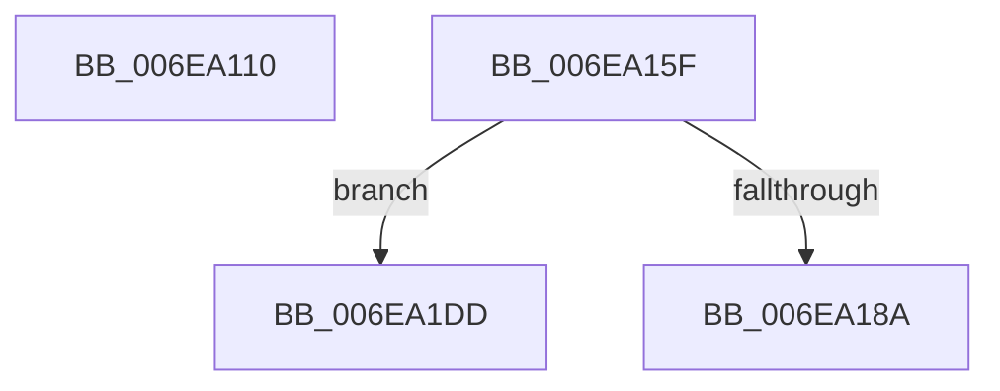

# sub_006EA110

- RVA: `0x006EA110`–`0x006EA1F8` (길이 `232` bytes)
- VA: `0x00000001406EA110`
- 실행 섹션: `.text`
- PDB 이름 있음: `아니요`; PDB Function 태그: `아니요`
- unwind 정보 RVA: `0x000942AC`
- 디코드: `54`개 명령, `232/232` bytes 표시
- 미해석 바이트: `0` (있으면 어셈블리에 `.byte`로 보존)

> 이 문서는 커널 이미지의 기계어와 PDB 기호를 분석해 생성했습니다. 4번과 5번은 함수 원형과 자료형을 바이너리 사용 방식에서 추정한 C 해석이며 원본 소스 복구 결과는 아닙니다.

## 1. Dependencies

- 직접 호출 지점: **4**; 고유 호출 대상: **3**
- 직접 호출자로 확인된 함수: **0**
- RIP 상대 이미지 참조: **2**

### Outgoing calls
- `0x006EA11F` → [KeAcquireInStackQueuedSpinLock](../27/KeAcquireInStackQueuedSpinLock_function_002757A0.md) (function, `0x002757A0`)
- `0x006EA14B` → [guard_dispatch_icall](../6B/guard_dispatch_icall_function_006BAAD0.md) (function, `0x006BAAD0`)
- `0x006EA154` → [KeReleaseInStackQueuedSpinLock](../34/KeReleaseInStackQueuedSpinLock_function_00342CE0.md) (function, `0x00342CE0`)
- `0x006EA1C1` → [guard_dispatch_icall](../6B/guard_dispatch_icall_function_006BAAD0.md) (function, `0x006BAAD0`)

### Direct callers
- 이 함수 시작 RVA로 연결되는 직접 call은 확인되지 않았습니다. 간접 호출은 완전히 역산할 수 없습니다.

### Static image references
- `0x006EA124` → RVA `0x00FC3E58` (`.data`; read)
- `0x006EA194` → RVA `0x00FC1778` (`.data`; read)

## 2. Other-region calls and transfers

- 다른 실행 섹션으로 향하는 call: **0**
- call이 아닌 외부 분기/꼬리 이동: **3**
  - `0x006EA15A` → [IopMapTransfer + 0x198](../3D/IopMapTransfer_function_003DCD80.md) (`tail-transfer`)
  - `0x006EA1D8` → [IopMapTransfer + 0x1A5](../3D/IopMapTransfer_function_003DCD80.md) (`tail-transfer`)
  - `0x006EA1F3` → [IopMapTransfer + 0x1A5](../3D/IopMapTransfer_function_003DCD80.md) (`tail-transfer`)

## 3. Assembly (complete function range)

```asm
006EA110  48 8B 8F A0 00 00 00            mov rcx, qword ptr [rdi + 0xa0]
006EA117  48 8D 55 F7                     lea rdx, [rbp - 9]
006EA11B  48 83 E9 80                     sub rcx, -0x80
006EA11F  E8 7C B6 B8 FF                  call 0x1402757a0
006EA124  48 8B 05 2D 9D 8D 00            mov rax, qword ptr [rip + 0x8d9d2d]
006EA12B  4D 8B CE                        mov r9, r14
006EA12E  8B 4D 67                        mov ecx, dword ptr [rbp + 0x67]
006EA131  45 8A C7                        mov r8b, r15b
006EA134  89 4C 24 28                     mov dword ptr [rsp + 0x28], ecx
006EA138  49 8B D4                        mov rdx, r12
006EA13B  48 8B 8F B0 01 00 00            mov rcx, qword ptr [rdi + 0x1b0]
006EA142  48 8B 40 28                     mov rax, qword ptr [rax + 0x28]
006EA146  48 89 5C 24 20                  mov qword ptr [rsp + 0x20], rbx
006EA14B  E8 80 09 FD FF                  call 0x1406baad0
006EA150  48 8D 4D F7                     lea rcx, [rbp - 9]
006EA154  E8 87 8B C5 FF                  call 0x140342ce0
006EA159  90                              nop
006EA15A  E9 B9 2D CF FF                  jmp 0x1403dcf18
006EA15F  45 8B 75 00                     mov r14d, dword ptr [r13]
006EA163  48 8B FB                        mov rdi, rbx
006EA166  48 8B 4E 18                     mov rcx, qword ptr [rsi + 0x18]
006EA16A  49 81 C6 FF 0F 00 00            add r14, 0xfff
006EA171  81 E7 FF 0F 00 00               and edi, 0xfff
006EA177  48 C7 C0 00 F0 FF FF            mov rax, 0xfffffffffffff000
006EA17E  4C 03 F7                        add r14, rdi
006EA181  4C 23 F0                        and r14, rax
006EA184  80 7E 40 00                     cmp byte ptr [rsi + 0x40], 0
006EA188  75 53                           jne 0x1406ea1dd
006EA18A  48 23 D8                        and rbx, rax
006EA18D  C7 45 C7 01 00 00 00            mov dword ptr [rbp - 0x39], 1
006EA194  48 8B 05 DD 75 8D 00            mov rax, qword ptr [rip + 0x8d75dd]
006EA19B  48 8D 55 DF                     lea rdx, [rbp - 0x21]
006EA19F  48 89 5D CF                     mov qword ptr [rbp - 0x31], rbx
006EA1A3  4C 8D 4D C7                     lea r9, [rbp - 0x39]
006EA1A7  4C 89 75 D7                     mov qword ptr [rbp - 0x29], r14
006EA1AB  41 B8 03 00 00 00               mov r8d, 3
006EA1B1  48 89 54 24 20                  mov qword ptr [rsp + 0x20], rdx
006EA1B6  48 8B 80 90 00 00 00            mov rax, qword ptr [rax + 0x90]
006EA1BD  48 8B 56 28                     mov rdx, qword ptr [rsi + 0x28]
006EA1C1  E8 0A 09 FD FF                  call 0x1406baad0
006EA1C6  48 8B 45 DF                     mov rax, qword ptr [rbp - 0x21]
006EA1CA  48 8B 5D E7                     mov rbx, qword ptr [rbp - 0x19]
006EA1CE  4C 01 76 28                     add qword ptr [rsi + 0x28], r14
006EA1D2  48 03 DF                        add rbx, rdi
006EA1D5  48 03 18                        add rbx, qword ptr [rax]
006EA1D8  E9 48 2D CF FF                  jmp 0x1403dcf25
006EA1DD  8B 46 10                        mov eax, dword ptr [rsi + 0x10]
006EA1E0  48 8B 5E 20                     mov rbx, qword ptr [rsi + 0x20]
006EA1E4  48 03 D8                        add rbx, rax
006EA1E7  48 03 DF                        add rbx, rdi
006EA1EA  48 03 19                        add rbx, qword ptr [rcx]
006EA1ED  41 03 C6                        add eax, r14d
006EA1F0  89 46 10                        mov dword ptr [rsi + 0x10], eax
006EA1F3  E9 2D 2D CF FF                  jmp 0x1403dcf25
```

## 4. C-style interpretation (structured pseudocode)

```c
__int64 __fastcall sub_006EA110(void)
{
    __int64 result;
    unsigned __int64 v_stack_p20;
    unsigned int v_stack_p28;

    a1 = (*(unsigned __int64 *)(v_rdi + 160)) - (-128);
    result = KeAcquireInStackQueuedSpinLock(a1, v_rbp - 9, a3, a4);
    v_stack_p28 = (unsigned int)((unsigned int)(*(unsigned int *)(v_rbp + 103)));
    v_stack_p20 = v_rbx;
    result = guard_dispatch_icall(*(unsigned __int64 *)(v_rdi + 432), v_r12, (unsigned __int8)(v_r15), v_r14);
    result = KeReleaseInStackQueuedSpinLock(v_rbp - 9, v_r12, (unsigned __int8)(v_r15), v_r14);
}
```

## 5. (Beta) C Style

```c
void sub_006EA110(void)
{
    int64_t result;
    uint64_t v_stack_p20;
    uint32_t v_stack_p28;

    a1 = (*(uint64_t *)(local_rdi + 0xA0)) - (-128);
    result = KeAcquireInStackQueuedSpinLock(a1, local_rbp - 9, a3, a4);
    v_stack_p28 = (uint32_t)((uint32_t)(*(uint32_t *)(local_rbp + 0x67)));
    v_stack_p20 = local_rbx;
    result = guard_dispatch_icall(*(uint64_t *)(local_rdi + 0x1B0), local_r12, (uint8_t)(local_r15), local_r14);
    result = KeReleaseInStackQueuedSpinLock(local_rbp - 9, local_r12, (uint8_t)(local_r15), local_r14);
}
```

## 6. Execution-region graph

[열기: 2D/3D 그래프와 함수 탐색 컨트롤 패널](../../../control-panel.html?section=text&rva=0x006EA110&view=graph)

- 2D 그래프는 위에서 아래로 흐르고, 3D 그래프는 빈 공간을 드래그해 회전합니다. Shift+드래그는 이동, 휠은 확대·축소, 함수 노드 선택은 대상 보고서 이동입니다.

### Static fallback


