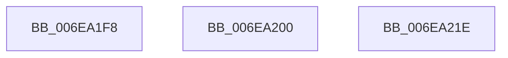

# sub_006EA1F8

- RVA: `0x006EA1F8`–`0x006EA22B` (길이 `51` bytes)
- VA: `0x00000001406EA1F8`
- 실행 섹션: `.text`
- PDB 이름 있음: `아니요`; PDB Function 태그: `아니요`
- unwind 정보 RVA: `0x00094368`
- 디코드: `13`개 명령, `51/51` bytes 표시
- 미해석 바이트: `0` (있으면 어셈블리에 `.byte`로 보존)

> 이 문서는 커널 이미지의 기계어와 PDB 기호를 분석해 생성했습니다. 4번과 5번은 함수 원형과 자료형을 바이너리 사용 방식에서 추정한 C 해석이며 원본 소스 복구 결과는 아닙니다.

## 1. Dependencies

- 직접 호출 지점: **1**; 고유 호출 대상: **1**
- 직접 호출자로 확인된 함수: **0**
- RIP 상대 이미지 참조: **0**

### Outgoing calls
- `0x006EA213` → [ExFreePoolWithTag](../../poolcode/B8/ExFreePoolWithTag_function_00B82870.md) (function, `0x00B82870`)

### Direct callers
- 이 함수 시작 RVA로 연결되는 직접 call은 확인되지 않았습니다. 간접 호출은 완전히 역산할 수 없습니다.

### Static image references
- 디코드된 RIP-relative 메모리 참조가 없습니다.

## 2. Other-region calls and transfers

- 다른 실행 섹션으로 향하는 call: **1**
  - `0x006EA213` → [ExFreePoolWithTag](../../poolcode/B8/ExFreePoolWithTag_function_00B82870.md) (`.text` → `POOLCODE`)
- call이 아닌 외부 분기/꼬리 이동: **3**
  - `0x006EA1FB` → [sub_003DD362 + 0x103](../3D/Unknown_function_003DD362.md) (`tail-transfer`)
  - `0x006EA219` → [sub_003DD362 + 0x1BA](../3D/Unknown_function_003DD362.md) (`tail-transfer`)
  - `0x006EA226` → [sub_003DD362 + 0x1BA](../3D/Unknown_function_003DD362.md) (`tail-transfer`)

## 3. Assembly (complete function range)

```asm
006EA1F8  40 B5 01                        mov bpl, 1
006EA1FB  E9 65 32 CF FF                  jmp 0x1403dd465
006EA200  41 0F B6 C5                     movzx eax, r13b
006EA204  44 0F 22 C0                     mov cr8, rax
006EA208  33 D2                           xor edx, edx
006EA20A  48 8B CB                        mov rcx, rbx
006EA20D  41 BE 9A 00 00 C0               mov r14d, 0xc000009a
006EA213  E8 58 86 49 00                  call 0x140b82870
006EA218  90                              nop
006EA219  E9 FE 32 CF FF                  jmp 0x1403dd51c
006EA21E  41 0F B6 CD                     movzx ecx, r13b
006EA222  44 0F 22 C1                     mov cr8, rcx
006EA226  E9 F1 32 CF FF                  jmp 0x1403dd51c
```

## 4. C-style interpretation (structured pseudocode)

```c
__int64 __fastcall sub_006EA1F8(__int64 a1, int a2)
{
}
```

## 5. (Beta) C Style

```c
int64_t sub_006EA1F8(int64_t Arg1, int32_t Arg2)
{
}
```

## 6. Execution-region graph

[열기: 2D/3D 그래프와 함수 탐색 컨트롤 패널](../../../control-panel.html?section=text&rva=0x006EA1F8&view=graph)

- 2D 그래프는 위에서 아래로 흐르고, 3D 그래프는 빈 공간을 드래그해 회전합니다. Shift+드래그는 이동, 휠은 확대·축소, 함수 노드 선택은 대상 보고서 이동입니다.

### Static fallback


