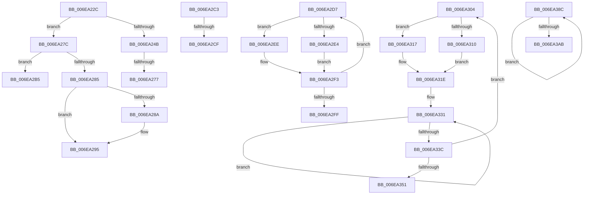

# sub_006EA22C

- RVA: `0x006EA22C`–`0x006EA3B0` (길이 `388` bytes)
- VA: `0x00000001406EA22C`
- 실행 섹션: `.text`
- PDB 이름 있음: `아니요`; PDB Function 태그: `아니요`
- unwind 정보 RVA: `0x00094434`
- 디코드: `101`개 명령, `388/388` bytes 표시
- 미해석 바이트: `0` (있으면 어셈블리에 `.byte`로 보존)

> 이 문서는 커널 이미지의 기계어와 PDB 기호를 분석해 생성했습니다. 4번과 5번은 함수 원형과 자료형을 바이너리 사용 방식에서 추정한 C 해석이며 원본 소스 복구 결과는 아닙니다.

## 1. Dependencies

- 직접 호출 지점: **14**; 고유 호출 대상: **12**
- 직접 호출자로 확인된 함수: **0**
- RIP 상대 이미지 참조: **1**

### Outgoing calls
- `0x006EA241` → [HalpDmaCommitContiguousMapBuffers](../55/HalpDmaCommitContiguousMapBuffers_function_00550A84.md) (function, `0x00550A84`)
- `0x006EA269` → [HalpDmaAllocateContiguousPagesFromContiguousPool](../3E/HalpDmaAllocateContiguousPagesFromContiguousPool_function_003E024C.md) (function, `0x003E024C`)
- `0x006EA290` → [MmUnmapLockedPages](../24/MmUnmapLockedPages_function_00246E60.md) (function, `0x00246E60`)
- `0x006EA2A0` → [MiFreePagesFromMdl](../3F/MiFreePagesFromMdl_function_003F8300.md) (function, `0x003F8300`)
- `0x006EA2AA` → [ExFreePoolWithTag](../../poolcode/B8/ExFreePoolWithTag_function_00B82870.md) (function, `0x00B82870`)
- `0x006EA2B8` → [MmFreeContiguousMemory](../3F/MmFreeContiguousMemory_function_003F6F60.md) (function, `0x003F6F60`)
- `0x006EA2E7` → [HalpDmaFreeMapRegisterFrame](../55/HalpDmaFreeMapRegisterFrame_function_005510D4.md) (function, `0x005510D4`)
- `0x006EA2EE` → [HalpMmAllocCtxFree](../3E/HalpMmAllocCtxFree_function_003E1904.md) (function, `0x003E1904`)
- `0x006EA310` → [MmGetPhysicalAddress](../23/MmGetPhysicalAddress_function_0023A500.md) (function, `0x0023A500`)
- `0x006EA317` → [MmGetPhysicalAddress](../23/MmGetPhysicalAddress_function_0023A500.md) (function, `0x0023A500`)
- `0x006EA360` → [KeAcquireInStackQueuedSpinLock](../27/KeAcquireInStackQueuedSpinLock_function_002757A0.md) (function, `0x002757A0`)
- `0x006EA377` → [KeReleaseInStackQueuedSpinLock](../34/KeReleaseInStackQueuedSpinLock_function_00342CE0.md) (function, `0x00342CE0`)
- `0x006EA37F` → [HalpMmAllocCtxFree](../3E/HalpMmAllocCtxFree_function_003E1904.md) (function, `0x003E1904`)
- `0x006EA39D` → [HalpDmaReturnPageToOwner](../3D/HalpDmaReturnPageToOwner_function_003DFB94.md) (function, `0x003DFB94`)

### Direct callers
- 이 함수 시작 RVA로 연결되는 직접 call은 확인되지 않았습니다. 간접 호출은 완전히 역산할 수 없습니다.

### Static image references
- `0x006EA2D7` → RVA `0x00FC18A0` (`.data`; read)

## 2. Other-region calls and transfers

- 다른 실행 섹션으로 향하는 call: **1**
  - `0x006EA2AA` → [ExFreePoolWithTag](../../poolcode/B8/ExFreePoolWithTag_function_00B82870.md) (`.text` → `POOLCODE`)
- call이 아닌 외부 분기/꼬리 이동: **9**
  - `0x006EA271` → [HalpDmaAllocateMapRegisters + 0x242](../3D/HalpDmaAllocateMapRegisters_function_003DDA0C.md) (`tail-transfer`)
  - `0x006EA277` → [HalpDmaAllocateMapRegisters + 0xE4](../3D/HalpDmaAllocateMapRegisters_function_003DDA0C.md) (`tail-transfer`)
  - `0x006EA2B0` → [HalpDmaAllocateMapRegisters + 0x242](../3D/HalpDmaAllocateMapRegisters_function_003DDA0C.md) (`tail-transfer`)
  - `0x006EA2BE` → [HalpDmaAllocateMapRegisters + 0x242](../3D/HalpDmaAllocateMapRegisters_function_003DDA0C.md) (`tail-transfer`)
  - `0x006EA2C9` → [HalpDmaAllocateMapRegisters + 0x226](../3D/HalpDmaAllocateMapRegisters_function_003DDA0C.md) (`tail-transfer`)
  - `0x006EA2D2` → [HalpDmaAllocateMapRegisters + 0x200](../3D/HalpDmaAllocateMapRegisters_function_003DDA0C.md) (`tail-transfer`)
  - `0x006EA2FF` → [HalpDmaAllocateMapRegisters + 0x232](../3D/HalpDmaAllocateMapRegisters_function_003DDA0C.md) (`tail-transfer`)
  - `0x006EA387` → [HalpDmaAllocateMapRegisters + 0xE4](../3D/HalpDmaAllocateMapRegisters_function_003DDA0C.md) (`tail-transfer`)
  - `0x006EA3AB` → [HalpDmaAllocateMapRegisters + 0x242](../3D/HalpDmaAllocateMapRegisters_function_003DDA0C.md) (`tail-transfer`)

## 3. Assembly (complete function range)

```asm
006EA22C  48 8B 7D C7                     mov rdi, qword ptr [rbp - 0x39]
006EA230  44 8B C8                        mov r9d, eax
006EA233  4C 8B 45 7F                     mov r8, qword ptr [rbp + 0x7f]
006EA237  48 8B D7                        mov rdx, rdi
006EA23A  48 8B 8E A0 00 00 00            mov rcx, qword ptr [rsi + 0xa0]
006EA241  E8 3E 68 E6 FF                  call 0x140550a84
006EA246  48 85 C0                        test rax, rax
006EA249  74 31                           je 0x1406ea27c
006EA24B  48 8B 96 A0 00 00 00            mov rdx, qword ptr [rsi + 0xa0]
006EA252  48 8D 45 67                     lea rax, [rbp + 0x67]
006EA256  48 89 44 24 28                  mov qword ptr [rsp + 0x28], rax
006EA25B  41 B1 01                        mov r9b, 1
006EA25E  45 8B C6                        mov r8d, r14d
006EA261  44 88 64 24 20                  mov byte ptr [rsp + 0x20], r12b
006EA266  48 8B CE                        mov rcx, rsi
006EA269  E8 DE 5F CF FF                  call 0x1403e024c
006EA26E  48 85 C0                        test rax, rax
006EA271  0F 84 D7 39 CF FF               je 0x1403ddc4e
006EA277  E9 74 38 CF FF                  jmp 0x1403ddaf0
006EA27C  48 8B 5D CF                     mov rbx, qword ptr [rbp - 0x31]
006EA280  48 85 DB                        test rbx, rbx
006EA283  74 30                           je 0x1406ea2b5
006EA285  48 85 FF                        test rdi, rdi
006EA288  74 0B                           je 0x1406ea295
006EA28A  48 8B D3                        mov rdx, rbx
006EA28D  48 8B CF                        mov rcx, rdi
006EA290  E8 CB CB B5 FF                  call 0x140246e60
006EA295  45 33 C9                        xor r9d, r9d
006EA298  45 33 C0                        xor r8d, r8d
006EA29B  33 D2                           xor edx, edx
006EA29D  48 8B CB                        mov rcx, rbx
006EA2A0  E8 5B E0 D0 FF                  call 0x1403f8300
006EA2A5  33 D2                           xor edx, edx
006EA2A7  48 8B CB                        mov rcx, rbx
006EA2AA  E8 C1 85 49 00                  call 0x140b82870
006EA2AF  90                              nop
006EA2B0  E9 99 39 CF FF                  jmp 0x1403ddc4e
006EA2B5  48 8B CF                        mov rcx, rdi
006EA2B8  E8 A3 CC D0 FF                  call 0x1403f6f60
006EA2BD  90                              nop
006EA2BE  E9 8B 39 CF FF                  jmp 0x1403ddc4e
006EA2C3  48 C1 E8 20                     shr rax, 0x20
006EA2C7  85 C0                           test eax, eax
006EA2C9  0F 85 63 39 CF FF               jne 0x1403ddc32
006EA2CF  41 FF C7                        inc r15d
006EA2D2  E9 35 39 CF FF                  jmp 0x1403ddc0c
006EA2D7  80 3D C2 75 8D 00 00            cmp byte ptr [rip + 0x8d75c2], 0
006EA2DE  49 8B 14 24                     mov rdx, qword ptr [r12]
006EA2E2  74 0A                           je 0x1406ea2ee
006EA2E4  48 8B CA                        mov rcx, rdx
006EA2E7  E8 E8 6D E6 FF                  call 0x1405510d4
006EA2EC  EB 05                           jmp 0x1406ea2f3
006EA2EE  E8 11 76 CF FF                  call 0x1403e1904
006EA2F3  41 FF C6                        inc r14d
006EA2F6  49 83 C4 08                     add r12, 8
006EA2FA  45 3B F7                        cmp r14d, r15d
006EA2FD  72 D8                           jb 0x1406ea2d7
006EA2FF  E9 3A 39 CF FF                  jmp 0x1403ddc3e
006EA304  80 3D 95 75 8D 00 00            cmp byte ptr [rip + 0x8d7595], 0
006EA30B  48 8B 0B                        mov rcx, qword ptr [rbx]
006EA30E  74 07                           je 0x1406ea317
006EA310  E8 EB 01 B5 FF                  call 0x14023a500
006EA315  EB 07                           jmp 0x1406ea31e
006EA317  E8 E4 01 B5 FF                  call 0x14023a500
006EA31C  8B C0                           mov eax, eax
006EA31E  41 B8 01 00 00 00               mov r8d, 1
006EA324  48 89 07                        mov qword ptr [rdi], rax
006EA327  48 8B 03                        mov rax, qword ptr [rbx]
006EA32A  41 8B C8                        mov ecx, r8d
006EA32D  41 8D 50 01                     lea edx, [r8 + 1]
006EA331  48 0B C1                        or rax, rcx
006EA334  49 03 C8                        add rcx, r8
006EA337  49 2B D0                        sub rdx, r8
006EA33A  75 F5                           jne 0x1406ea331
006EA33C  48 83 C8 0C                     or rax, 0xc
006EA340  48 83 C3 08                     add rbx, 8
006EA344  48 89 47 30                     mov qword ptr [rdi + 0x30], rax
006EA348  48 8B 7F 08                     mov rdi, qword ptr [rdi + 8]
006EA34C  4D 2B E0                        sub r12, r8
006EA34F  75 B3                           jne 0x1406ea304
006EA351  48 8B 8E A0 00 00 00            mov rcx, qword ptr [rsi + 0xa0]
006EA358  48 8D 55 07                     lea rdx, [rbp + 7]
006EA35C  48 83 E9 80                     sub rcx, -0x80
006EA360  E8 3B B4 B8 FF                  call 0x1402757a0
006EA365  48 8B 86 A0 00 00 00            mov rax, qword ptr [rsi + 0xa0]
006EA36C  48 8D 4D 07                     lea rcx, [rbp + 7]
006EA370  44 01 B0 E0 00 00 00            add dword ptr [rax + 0xe0], r14d
006EA377  E8 64 89 C5 FF                  call 0x140342ce0
006EA37C  49 8B D5                        mov rdx, r13
006EA37F  E8 80 75 CF FF                  call 0x1403e1904
006EA384  49 8B C7                        mov rax, r15
006EA387  E9 64 37 CF FF                  jmp 0x1403ddaf0
006EA38C  48 8B 96 A0 00 00 00            mov rdx, qword ptr [rsi + 0xa0]
006EA393  4C 8B C7                        mov r8, rdi
006EA396  48 8B 5F 08                     mov rbx, qword ptr [rdi + 8]
006EA39A  48 8B CE                        mov rcx, rsi
006EA39D  E8 F2 57 CF FF                  call 0x1403dfb94
006EA3A2  48 8B FB                        mov rdi, rbx
006EA3A5  49 83 EE 01                     sub r14, 1
006EA3A9  75 E1                           jne 0x1406ea38c
006EA3AB  E9 9E 38 CF FF                  jmp 0x1403ddc4e
```

## 4. C-style interpretation (structured pseudocode)

```c
__int64 __fastcall sub_006EA22C(void)
{
    __int64 result;
    unsigned __int8 v_stack_p20;
    unsigned __int64 v_stack_p28;

    result = HalpDmaCommitContiguousMapBuffers(*(unsigned __int64 *)(v_rsi + 160), *(unsigned __int64 *)(v_rbp - 57), *(unsigned __int64 *)(v_rbp + 127), (unsigned int)((unsigned int)(result)));
    if (result == 0) goto loc_006EA27C;
    v_stack_p28 = v_rbp + 103;
    v_stack_p20 = (unsigned __int8)(v_r12);
    result = HalpDmaAllocateContiguousPagesFromContiguousPool(v_rsi, *(unsigned __int64 *)(v_rsi + 160), (unsigned int)((unsigned int)(v_r14)), 1);
loc_006EA27C:
    if (*(unsigned __int64 *)(v_rbp - 49) == 0) goto loc_006EA2B5;
    if (*(unsigned __int64 *)(v_rbp - 57) != 0) {
        a2 = *(unsigned __int64 *)(v_rbp - 49);
        a1 = *(unsigned __int64 *)(v_rbp - 57);
        result = MmUnmapLockedPages(a1, a2, (unsigned int)((unsigned int)(v_r14)), 1);
    }
    a4 = 0;
    a3 = 0;
    a2 = 0;
    result = MiFreePagesFromMdl(*(unsigned __int64 *)(v_rbp - 49), a2, a3, a4);
    a2 = 0;
    result = ExFreePoolWithTag(*(unsigned __int64 *)(v_rbp - 49), a2, a3, a4);
loc_006EA2B5:
    result = MmFreeContiguousMemory(*(unsigned __int64 *)(v_rbp - 57), a2, a3, a4);
}
```

## 5. (Beta) C Style

```c
void sub_006EA22C(void)
{
    int64_t result;
    uint8_t v_stack_p20;
    uint64_t v_stack_p28;

    result = HalpDmaCommitContiguousMapBuffers(*(uint64_t *)(local_rsi + 0xA0), *(uint64_t *)(local_rbp - 0x39), *(uint64_t *)(local_rbp + 0x7F), (uint32_t)((uint32_t)(result)));
    if (result == 0) goto loc_006EA27C;
    v_stack_p28 = local_rbp + 103;
    v_stack_p20 = (uint8_t)(local_r12);
    result = HalpDmaAllocateContiguousPagesFromContiguousPool(local_rsi, *(uint64_t *)(local_rsi + 0xA0), (uint32_t)((uint32_t)(local_r14)), 1);
loc_006EA27C:
    if (*(uint64_t *)(local_rbp - 0x31) == 0) goto loc_006EA2B5;
    if (*(uint64_t *)(local_rbp - 0x39) != 0) {
        a2 = *(uint64_t *)(local_rbp - 0x31);
        a1 = *(uint64_t *)(local_rbp - 0x39);
        result = MmUnmapLockedPages(a1, a2, (uint32_t)((uint32_t)(local_r14)), 1);
    }
    a4 = 0;
    a3 = 0;
    a2 = 0;
    result = MiFreePagesFromMdl(*(uint64_t *)(local_rbp - 0x31), a2, a3, a4);
    a2 = 0;
    result = ExFreePoolWithTag(*(uint64_t *)(local_rbp - 0x31), a2, a3, a4);
loc_006EA2B5:
    result = MmFreeContiguousMemory(*(uint64_t *)(local_rbp - 0x39), a2, a3, a4);
}
```

## 6. Execution-region graph

[열기: 2D/3D 그래프와 함수 탐색 컨트롤 패널](../../../control-panel.html?section=text&rva=0x006EA22C&view=graph)

- 2D 그래프는 위에서 아래로 흐르고, 3D 그래프는 빈 공간을 드래그해 회전합니다. Shift+드래그는 이동, 휠은 확대·축소, 함수 노드 선택은 대상 보고서 이동입니다.

### Static fallback


