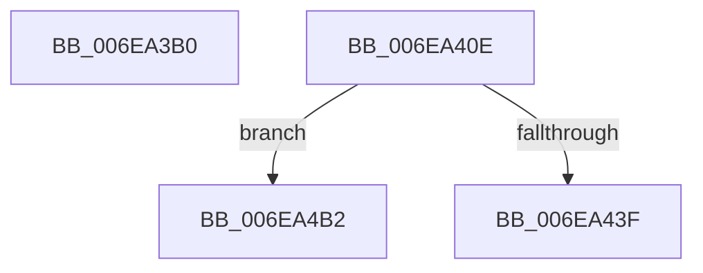

# sub_006EA3B0

- RVA: `0x006EA3B0`–`0x006EA4D1` (길이 `289` bytes)
- VA: `0x00000001406EA3B0`
- 실행 섹션: `.text`
- PDB 이름 있음: `아니요`; PDB Function 태그: `아니요`
- unwind 정보 RVA: `0x0009449C`
- 디코드: `56`개 명령, `289/289` bytes 표시
- 미해석 바이트: `0` (있으면 어셈블리에 `.byte`로 보존)

> 이 문서는 커널 이미지의 기계어와 PDB 기호를 분석해 생성했습니다. 4번과 5번은 함수 원형과 자료형을 바이너리 사용 방식에서 추정한 C 해석이며 원본 소스 복구 결과는 아닙니다.

## 1. Dependencies

- 직접 호출 지점: **4**; 고유 호출 대상: **3**
- 직접 호출자로 확인된 함수: **0**
- RIP 상대 이미지 참조: **2**

### Outgoing calls
- `0x006EA3C3` → [KeAcquireInStackQueuedSpinLock](../27/KeAcquireInStackQueuedSpinLock_function_002757A0.md) (function, `0x002757A0`)
- `0x006EA3F6` → [guard_dispatch_icall](../6B/guard_dispatch_icall_function_006BAAD0.md) (function, `0x006BAAD0`)
- `0x006EA403` → [KeReleaseInStackQueuedSpinLock](../34/KeReleaseInStackQueuedSpinLock_function_00342CE0.md) (function, `0x00342CE0`)
- `0x006EA486` → [guard_dispatch_icall](../6B/guard_dispatch_icall_function_006BAAD0.md) (function, `0x006BAAD0`)

### Direct callers
- 이 함수 시작 RVA로 연결되는 직접 call은 확인되지 않았습니다. 간접 호출은 완전히 역산할 수 없습니다.

### Static image references
- `0x006EA3C8` → RVA `0x00FC3E58` (`.data`; read)
- `0x006EA43F` → RVA `0x00FC1778` (`.data`; read)

## 2. Other-region calls and transfers

- 다른 실행 섹션으로 향하는 call: **0**
- call이 아닌 외부 분기/꼬리 이동: **3**
  - `0x006EA409` → [sub_003DDEB6 + 0x1F6](../3D/Unknown_function_003DDEB6.md) (`tail-transfer`)
  - `0x006EA4AD` → [sub_003DDEB6 + 0x205](../3D/Unknown_function_003DDEB6.md) (`tail-transfer`)
  - `0x006EA4CC` → [sub_003DDEB6 + 0x205](../3D/Unknown_function_003DDEB6.md) (`tail-transfer`)

## 3. Assembly (complete function range)

```asm
006EA3B0  48 8B 8D A0 00 00 00            mov rcx, qword ptr [rbp + 0xa0]
006EA3B7  48 8D 94 24 B8 00 00 00         lea rdx, [rsp + 0xb8]
006EA3BF  48 83 E9 80                     sub rcx, -0x80
006EA3C3  E8 D8 B3 B8 FF                  call 0x1402757a0
006EA3C8  48 8B 05 89 9A 8D 00            mov rax, qword ptr [rip + 0x8d9a89]
006EA3CF  4D 8B CD                        mov r9, r13
006EA3D2  8B 4C 24 48                     mov ecx, dword ptr [rsp + 0x48]
006EA3D6  48 8B D6                        mov rdx, rsi
006EA3D9  44 0F B6 84 24 28 01 00 00      movzx r8d, byte ptr [rsp + 0x128]
006EA3E2  89 4C 24 28                     mov dword ptr [rsp + 0x28], ecx
006EA3E6  48 8B 40 28                     mov rax, qword ptr [rax + 0x28]
006EA3EA  48 8B 8D B0 01 00 00            mov rcx, qword ptr [rbp + 0x1b0]
006EA3F1  48 89 5C 24 20                  mov qword ptr [rsp + 0x20], rbx
006EA3F6  E8 D5 06 FD FF                  call 0x1406baad0
006EA3FB  48 8D 8C 24 B8 00 00 00         lea rcx, [rsp + 0xb8]
006EA403  E8 D8 88 C5 FF                  call 0x140342ce0
006EA408  90                              nop
006EA409  E9 9E 3C CF FF                  jmp 0x1403de0ac
006EA40E  41 8B 07                        mov eax, dword ptr [r15]
006EA411  81 E1 FF 0F 00 00               and ecx, 0xfff
006EA417  4D 8B 54 24 18                  mov r10, qword ptr [r12 + 0x18]
006EA41C  48 89 4C 24 58                  mov qword ptr [rsp + 0x58], rcx
006EA421  48 8D 91 FF 0F 00 00            lea rdx, [rcx + 0xfff]
006EA428  48 03 D0                        add rdx, rax
006EA42B  48 81 E2 00 F0 FF FF            and rdx, 0xfffffffffffff000
006EA432  41 80 7C 24 40 00               cmp byte ptr [r12 + 0x40], 0
006EA438  48 89 54 24 60                  mov qword ptr [rsp + 0x60], rdx
006EA43D  75 73                           jne 0x1406ea4b2
006EA43F  48 8B 05 32 73 8D 00            mov rax, qword ptr [rip + 0x8d7332]
006EA446  48 8D 8C 24 A0 00 00 00         lea rcx, [rsp + 0xa0]
006EA44E  48 89 54 24 78                  mov qword ptr [rsp + 0x78], rdx
006EA453  4C 8D 4C 24 68                  lea r9, [rsp + 0x68]
006EA458  49 8B 54 24 28                  mov rdx, qword ptr [r12 + 0x28]
006EA45D  48 81 E3 00 F0 FF FF            and rbx, 0xfffffffffffff000
006EA464  C7 44 24 68 01 00 00 00         mov dword ptr [rsp + 0x68], 1
006EA46C  41 B8 03 00 00 00               mov r8d, 3
006EA472  48 89 5C 24 70                  mov qword ptr [rsp + 0x70], rbx
006EA477  48 8B 80 90 00 00 00            mov rax, qword ptr [rax + 0x90]
006EA47E  48 89 4C 24 20                  mov qword ptr [rsp + 0x20], rcx
006EA483  49 8B CA                        mov rcx, r10
006EA486  E8 45 06 FD FF                  call 0x1406baad0
006EA48B  48 8B 44 24 60                  mov rax, qword ptr [rsp + 0x60]
006EA490  49 01 44 24 28                  add qword ptr [r12 + 0x28], rax
006EA495  48 8B 84 24 A0 00 00 00         mov rax, qword ptr [rsp + 0xa0]
006EA49D  48 8B 5C 24 58                  mov rbx, qword ptr [rsp + 0x58]
006EA4A2  48 03 9C 24 A8 00 00 00         add rbx, qword ptr [rsp + 0xa8]
006EA4AA  48 03 18                        add rbx, qword ptr [rax]
006EA4AD  E9 09 3C CF FF                  jmp 0x1403de0bb
006EA4B2  41 8B 44 24 10                  mov eax, dword ptr [r12 + 0x10]
006EA4B7  49 8B 5C 24 20                  mov rbx, qword ptr [r12 + 0x20]
006EA4BC  48 03 D8                        add rbx, rax
006EA4BF  49 03 1A                        add rbx, qword ptr [r10]
006EA4C2  48 03 D9                        add rbx, rcx
006EA4C5  03 C2                           add eax, edx
006EA4C7  41 89 44 24 10                  mov dword ptr [r12 + 0x10], eax
006EA4CC  E9 EA 3B CF FF                  jmp 0x1403de0bb
```

## 4. C-style interpretation (structured pseudocode)

```c
__int64 __fastcall sub_006EA3B0(__int64 a1, __int64 a2, __int64 a3, __int64 a4, __int64 a5, __int64 a6, __int64 a7, __int64 a8, unsigned int a9, __int64 a10, __int64 a11, __int64 a12, __int64 a13, __int64 a14, __int64 a15, __int64 a16, __int64 a17, __int64 a18, __int64 a19, __int64 a20, __int64 a21, __int64 a22, __int64 a23, __int64 a24, __int64 a25, __int64 a26, __int64 a27, __int64 a28, __int64 a29, __int64 a30, __int64 a31, __int64 a32, __int64 a33, __int64 a34, __int64 a35, __int64 a36, unsigned __int8 a37)
{
    __int64 result;
    unsigned __int64 v_stack_p20;
    unsigned int v_stack_p28;
    unsigned __int64 v_stack_p58;
    unsigned __int64 v_stack_p60;
    unsigned __int64 v_stack_p68;
    unsigned __int64 v_stack_p70;
    unsigned __int64 v_stack_p78;
    unsigned __int64 v_stack_pA0;
    unsigned __int64 v_stack_pA8;

    a1 = (*(unsigned __int64 *)(v_rbp + 160)) - (-128);
    result = KeAcquireInStackQueuedSpinLock(a1, a23, a3, a4);
    v_stack_p28 = (unsigned int)((unsigned int)(a9));
    v_stack_p20 = v_rbx;
    result = guard_dispatch_icall(*(unsigned __int64 *)(v_rbp + 432), v_rsi, a37, v_r13);
    result = KeReleaseInStackQueuedSpinLock(a23, v_rsi, a37, v_r13);
}
```

## 5. (Beta) C Style

```c
int64_t sub_006EA3B0(int64_t Arg1, int64_t Arg2, int64_t Arg3, int64_t Arg4, uint64_t Arg5, uint64_t Arg6, uint64_t Arg7, uint64_t Arg8, uint32_t Arg9, uint64_t Arg10, uint64_t Arg11, uint64_t Arg12, uint64_t Arg13, uint64_t Arg14, uint64_t Arg15, uint64_t Arg16, uint64_t Arg17, uint64_t Arg18, uint64_t Arg19, uint64_t Arg20, uint64_t Arg21, uint64_t Arg22, int64_t Arg23, uint64_t Arg24, uint64_t Arg25, uint64_t Arg26, uint64_t Arg27, uint64_t Arg28, uint64_t Arg29, uint64_t Arg30, uint64_t Arg31, uint64_t Arg32, uint64_t Arg33, uint64_t Arg34, uint64_t Arg35, uint64_t Arg36, uint8_t Arg37)
{
    int64_t result;
    uint64_t v_stack_p20;
    uint32_t v_stack_p28;
    uint64_t v_stack_p58;
    uint64_t v_stack_p60;
    uint64_t v_stack_p68;
    uint64_t v_stack_p70;
    uint64_t v_stack_p78;
    uint64_t v_stack_pA0;
    uint64_t v_stack_pA8;

    Arg1 = (*(uint64_t *)(local_rbp + 0xA0)) - (-128);
    result = KeAcquireInStackQueuedSpinLock(Arg1, Arg23, Arg3, Arg4);
    v_stack_p28 = (uint32_t)((uint32_t)(Arg9));
    v_stack_p20 = local_rbx;
    result = guard_dispatch_icall(*(uint64_t *)(local_rbp + 0x1B0), local_rsi, Arg37, local_r13);
    result = KeReleaseInStackQueuedSpinLock(Arg23, local_rsi, Arg37, local_r13);
}
```

## 6. Execution-region graph

[열기: 2D/3D 그래프와 함수 탐색 컨트롤 패널](../../../control-panel.html?section=text&rva=0x006EA3B0&view=graph)

- 2D 그래프는 위에서 아래로 흐르고, 3D 그래프는 빈 공간을 드래그해 회전합니다. Shift+드래그는 이동, 휠은 확대·축소, 함수 노드 선택은 대상 보고서 이동입니다.

### Static fallback


