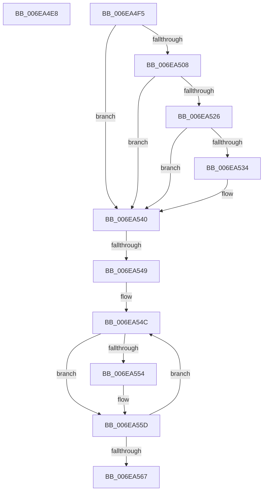

# sub_006EA4E8

- RVA: `0x006EA4E8`–`0x006EA56C` (길이 `132` bytes)
- VA: `0x00000001406EA4E8`
- 실행 섹션: `.text`
- PDB 이름 있음: `아니요`; PDB Function 태그: `아니요`
- unwind 정보 RVA: `0x000947D8`
- 디코드: `31`개 명령, `132/132` bytes 표시
- 미해석 바이트: `0` (있으면 어셈블리에 `.byte`로 보존)

> 이 문서는 커널 이미지의 기계어와 PDB 기호를 분석해 생성했습니다. 4번과 5번은 함수 원형과 자료형을 바이너리 사용 방식에서 추정한 C 해석이며 원본 소스 복구 결과는 아닙니다.

## 1. Dependencies

- 직접 호출 지점: **3**; 고유 호출 대상: **3**
- 직접 호출자로 확인된 함수: **0**
- RIP 상대 이미지 참조: **2**

### Outgoing calls
- `0x006EA4FA` → [MmUnmapReservedMapping](../3E/MmUnmapReservedMapping_function_003E7BE0.md) (function, `0x003E7BE0`)
- `0x006EA50D` → [KeReleaseInStackQueuedSpinLockFromDpcLevel](../21/KeReleaseInStackQueuedSpinLockFromDpcLevel_function_002171B0.md) (function, `0x002171B0`)
- `0x006EA53B` → [ExpInterlockedPushEntrySList](../6B/ExpInterlockedPushEntrySList_function_006BA5B0.md) (function, `0x006BA5B0`)

### Direct callers
- 이 함수 시작 RVA로 연결되는 직접 call은 확인되지 않았습니다. 간접 호출은 완전히 역산할 수 없습니다.

### Static image references
- `0x006EA4FF` → RVA `0x00E3EC38` (`.data`; read)
- `0x006EA534` → RVA `0x00E3EC40` (`.data`; read)

## 2. Other-region calls and transfers

- 다른 실행 섹션으로 향하는 call: **0**
- call이 아닌 외부 분기/꼬리 이동: **3**
  - `0x006EA4F0` → [sub_003DF02A + 0x47](../3D/Unknown_function_003DF02A.md) (`tail-transfer`)
  - `0x006EA543` → [sub_003DF173 + 0x14](../3D/Unknown_function_003DF173.md) (`tail-transfer`)
  - `0x006EA567` → [sub_003DF173 + 0x14](../3D/Unknown_function_003DF173.md) (`tail-transfer`)

## 3. Assembly (complete function range)

```asm
006EA4E8  C6 84 24 C8 00 00 00 01         mov byte ptr [rsp + 0xc8], 1
006EA4F0  E9 7C 4B CF FF                  jmp 0x1403df071
006EA4F5  BA 48 61 6C 44                  mov edx, 0x446c6148
006EA4FA  E8 E1 D6 CF FF                  call 0x1403e7be0
006EA4FF  80 3D 32 47 75 00 00            cmp byte ptr [rip + 0x754732], 0
006EA506  75 38                           jne 0x1406ea540
006EA508  48 8D 4C 24 60                  lea rcx, [rsp + 0x60]
006EA50D  E8 9E CC B2 FF                  call 0x1402171b0
006EA512  48 8B 54 24 58                  mov rdx, qword ptr [rsp + 0x58]
006EA517  B8 FF FF FF FF                  mov eax, 0xffffffff
006EA51C  F0 0F C1 42 18                  lock xadd dword ptr [rdx + 0x18], eax
006EA521  83 F8 01                        cmp eax, 1
006EA524  75 1A                           jne 0x1406ea540
006EA526  33 C0                           xor eax, eax
006EA528  B9 01 00 00 00                  mov ecx, 1
006EA52D  F0 0F B1 4A 1C                  lock cmpxchg dword ptr [rdx + 0x1c], ecx
006EA532  75 0C                           jne 0x1406ea540
006EA534  48 8D 0D 05 47 75 00            lea rcx, [rip + 0x754705]
006EA53B  E8 70 00 FD FF                  call 0x1406ba5b0
006EA540  45 85 F6                        test r14d, r14d
006EA543  0F 84 3E 4C CF FF               je 0x1403df187
006EA549  41 8B CE                        mov ecx, r14d
006EA54C  48 8B 43 30                     mov rax, qword ptr [rbx + 0x30]
006EA550  A8 10                           test al, 0x10
006EA552  74 09                           je 0x1406ea55d
006EA554  25 EF 0F 00 00                  and eax, 0xfef
006EA559  48 89 43 30                     mov qword ptr [rbx + 0x30], rax
006EA55D  48 8B 5B 08                     mov rbx, qword ptr [rbx + 8]
006EA561  48 83 E9 01                     sub rcx, 1
006EA565  75 E5                           jne 0x1406ea54c
006EA567  E9 1B 4C CF FF                  jmp 0x1403df187
```

## 4. C-style interpretation (structured pseudocode)

```c
__int64 __fastcall sub_006EA4E8(void)
{
    unsigned __int64 v_stack_p58;
    unsigned __int64 v_stack_p60;
    unsigned __int8 v_stack_pC8;

    v_stack_pC8 = 1;
}
```

## 5. (Beta) C Style

```c
void sub_006EA4E8(void)
{
    uint64_t v_stack_p58;
    uint64_t v_stack_p60;
    uint8_t v_stack_pC8;

    v_stack_pC8 = 1;
}
```

## 6. Execution-region graph

[열기: 2D/3D 그래프와 함수 탐색 컨트롤 패널](../../../control-panel.html?section=text&rva=0x006EA4E8&view=graph)

- 2D 그래프는 위에서 아래로 흐르고, 3D 그래프는 빈 공간을 드래그해 회전합니다. Shift+드래그는 이동, 휠은 확대·축소, 함수 노드 선택은 대상 보고서 이동입니다.

### Static fallback


