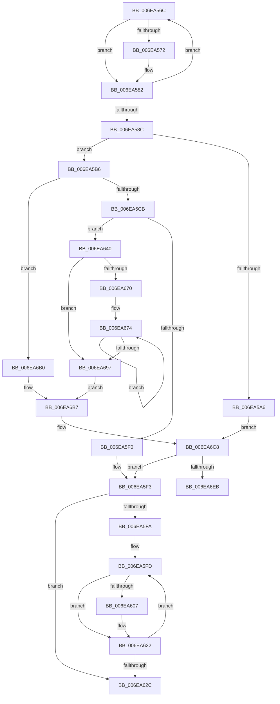

# sub_006EA56C

- RVA: `0x006EA56C`–`0x006EA709` (길이 `413` bytes)
- VA: `0x00000001406EA56C`
- 실행 섹션: `.text`
- PDB 이름 있음: `아니요`; PDB Function 태그: `아니요`
- unwind 정보 RVA: `0x0009480C`
- 디코드: `107`개 명령, `413/413` bytes 표시
- 미해석 바이트: `0` (있으면 어셈블리에 `.byte`로 보존)

> 이 문서는 커널 이미지의 기계어와 PDB 기호를 분석해 생성했습니다. 4번과 5번은 함수 원형과 자료형을 바이너리 사용 방식에서 추정한 C 해석이며 원본 소스 복구 결과는 아닙니다.

## 1. Dependencies

- 직접 호출 지점: **7**; 고유 호출 대상: **6**
- 직접 호출자로 확인된 함수: **0**
- RIP 상대 이미지 참조: **5**

### Outgoing calls
- `0x006EA5BD` → [ExpInterlockedPopEntrySList](../6B/ExpInterlockedPopEntrySList_function_006BA570.md) (function, `0x006BA570`)
- `0x006EA5E3` → [MmMapLockedPagesSpecifyCache](../31/MmMapLockedPagesSpecifyCache_function_00318800.md) (function, `0x00318800`)
- `0x006EA64C` → [KeAcquireInStackQueuedSpinLockAtDpcLevel](../27/KeAcquireInStackQueuedSpinLockAtDpcLevel_function_00275740.md) (function, `0x00275740`)
- `0x006EA69C` → [KeReleaseInStackQueuedSpinLockFromDpcLevel](../21/KeReleaseInStackQueuedSpinLockFromDpcLevel_function_002171B0.md) (function, `0x002171B0`)
- `0x006EA6C3` → [KeAcquireInStackQueuedSpinLockAtDpcLevel](../27/KeAcquireInStackQueuedSpinLockAtDpcLevel_function_00275740.md) (function, `0x00275740`)
- `0x006EA6DA` → [MmMapLockedPagesWithReservedMapping](../3E/MmMapLockedPagesWithReservedMapping_function_003E8910.md) (function, `0x003E8910`)
- `0x006EA703` → [KeBugCheckEx](../4F/KeBugCheckEx_function_004FD660.md) (function, `0x004FD660`)

### Direct callers
- 이 함수 시작 RVA로 연결되는 직접 call은 확인되지 않았습니다. 간접 호출은 완전히 역산할 수 없습니다.

### Static image references
- `0x006EA59B` → RVA `0x00E3EC38` (`.data`; read)
- `0x006EA5A6` → RVA `0x00E3EC70` (`.data`; read)
- `0x006EA5B6` → RVA `0x00E3EC40` (`.data`; read)
- `0x006EA645` → RVA `0x00E3EC28` (`.data`; read)
- `0x006EA65E` → RVA `0x00E3EC78` (`.data`; read)

## 2. Other-region calls and transfers

- 다른 실행 섹션으로 향하는 call: **0**
- call이 아닌 외부 분기/꼬리 이동: **1**
  - `0x006EA63B` → [HalpDmaAcquireBufferMappings + 0x54](../3D/HalpDmaAcquireBufferMappings_function_003DF38C.md) (`tail-transfer`)

## 3. Assembly (complete function range)

```asm
006EA56C  4C 85 5A 30                     test qword ptr [rdx + 0x30], r11
006EA570  75 10                           jne 0x1406ea582
006EA572  48 8B 02                        mov rax, qword ptr [rdx]
006EA575  FF C1                           inc ecx
006EA577  48 C1 E8 0C                     shr rax, 0xc
006EA57B  49 89 00                        mov qword ptr [r8], rax
006EA57E  49 83 C0 08                     add r8, 8
006EA582  48 8B 52 08                     mov rdx, qword ptr [rdx + 8]
006EA586  49 83 E9 01                     sub r9, 1
006EA58A  75 E0                           jne 0x1406ea56c
006EA58C  33 DB                           xor ebx, ebx
006EA58E  C1 E1 0C                        shl ecx, 0xc
006EA591  48 21 5D 20                     and qword ptr [rbp + 0x20], rbx
006EA595  41 B7 01                        mov r15b, 1
006EA598  21 5D 2C                        and dword ptr [rbp + 0x2c], ebx
006EA59B  38 1D 97 46 75 00               cmp byte ptr [rip + 0x754697], bl
006EA5A1  89 4D 28                        mov dword ptr [rbp + 0x28], ecx
006EA5A4  74 10                           je 0x1406ea5b6
006EA5A6  48 8B 05 C3 46 75 00            mov rax, qword ptr [rip + 0x7546c3]
006EA5AD  4A 8B 1C D0                     mov rbx, qword ptr [rax + r10*8]
006EA5B1  E9 12 01 00 00                  jmp 0x1406ea6c8
006EA5B6  48 8D 0D 83 46 75 00            lea rcx, [rip + 0x754683]
006EA5BD  E8 AE FF FC FF                  call 0x1406ba570
006EA5C2  48 85 C0                        test rax, rax
006EA5C5  0F 85 E5 00 00 00               jne 0x1406ea6b0
006EA5CB  C7 44 24 28 20 00 00 40         mov dword ptr [rsp + 0x28], 0x40000020
006EA5D3  44 8D 40 01                     lea r8d, [rax + 1]
006EA5D7  21 5C 24 20                     and dword ptr [rsp + 0x20], ebx
006EA5DB  45 33 C9                        xor r9d, r9d
006EA5DE  33 D2                           xor edx, edx
006EA5E0  48 8B CD                        mov rcx, rbp
006EA5E3  E8 18 E2 C2 FF                  call 0x140318800
006EA5E8  48 8B C8                        mov rcx, rax
006EA5EB  48 85 C0                        test rax, rax
006EA5EE  74 50                           je 0x1406ea640
006EA5F0  45 32 FF                        xor r15b, r15b
006EA5F3  48 8B D1                        mov rdx, rcx
006EA5F6  85 F6                           test esi, esi
006EA5F8  74 32                           je 0x1406ea62c
006EA5FA  4C 8B C6                        mov r8, rsi
006EA5FD  49 F7 46 30 00 F0 FF FF         test qword ptr [r14 + 0x30], -0x1000
006EA605  75 1B                           jne 0x1406ea622
006EA607  41 8B 46 30                     mov eax, dword ptr [r14 + 0x30]
006EA60B  25 EF 0F 00 00                  and eax, 0xfef
006EA610  48 0B C2                        or rax, rdx
006EA613  48 83 C8 10                     or rax, 0x10
006EA617  49 89 46 30                     mov qword ptr [r14 + 0x30], rax
006EA61B  48 81 C2 00 10 00 00            add rdx, 0x1000
006EA622  4D 8B 76 08                     mov r14, qword ptr [r14 + 8]
006EA626  49 83 E8 01                     sub r8, 1
006EA62A  75 D1                           jne 0x1406ea5fd
006EA62C  48 89 2F                        mov qword ptr [rdi], rbp
006EA62F  48 89 4F 08                     mov qword ptr [rdi + 8], rcx
006EA633  48 89 5F 10                     mov qword ptr [rdi + 0x10], rbx
006EA637  44 88 7F 30                     mov byte ptr [rdi + 0x30], r15b
006EA63B  E9 A0 4D CF FF                  jmp 0x1403df3e0
006EA640  48 8D 54 24 30                  lea rdx, [rsp + 0x30]
006EA645  48 8D 0D DC 45 75 00            lea rcx, [rip + 0x7545dc]
006EA64C  E8 EF B0 B8 FF                  call 0x140275740
006EA651  48 8B 0D 18 46 75 00            mov rcx, qword ptr [rip + 0x754618]
006EA658  41 B9 01 00 00 00               mov r9d, 1
006EA65E  44 8B 05 13 46 75 00            mov r8d, dword ptr [rip + 0x754613]
006EA665  48 8B 01                        mov rax, qword ptr [rcx]
006EA668  8B 50 18                        mov edx, dword ptr [rax + 0x18]
006EA66B  45 3B C1                        cmp r8d, r9d
006EA66E  76 27                           jbe 0x1406ea697
006EA670  4C 8D 51 08                     lea r10, [rcx + 8]
006EA674  49 8B 02                        mov rax, qword ptr [r10]
006EA677  8B CA                           mov ecx, edx
006EA679  4D 8D 52 08                     lea r10, [r10 + 8]
006EA67D  8B 50 18                        mov edx, dword ptr [rax + 0x18]
006EA680  3B D1                           cmp edx, ecx
006EA682  41 8B C1                        mov eax, r9d
006EA685  0F 4D C3                        cmovge eax, ebx
006EA688  41 FF C1                        inc r9d
006EA68B  3B D1                           cmp edx, ecx
006EA68D  8B D8                           mov ebx, eax
006EA68F  0F 4D D1                        cmovge edx, ecx
006EA692  45 3B C8                        cmp r9d, r8d
006EA695  72 DD                           jb 0x1406ea674
006EA697  48 8D 4C 24 30                  lea rcx, [rsp + 0x30]
006EA69C  E8 0F CB B2 FF                  call 0x1402171b0
006EA6A1  48 8B 05 C8 45 75 00            mov rax, qword ptr [rip + 0x7545c8]
006EA6A8  8B CB                           mov ecx, ebx
006EA6AA  48 8B 1C C8                     mov rbx, qword ptr [rax + rcx*8]
006EA6AE  EB 07                           jmp 0x1406ea6b7
006EA6B0  83 60 1C 00                     and dword ptr [rax + 0x1c], 0
006EA6B4  48 8B D8                        mov rbx, rax
006EA6B7  F0 FF 43 18                     lock inc dword ptr [rbx + 0x18]
006EA6BB  48 8D 57 18                     lea rdx, [rdi + 0x18]
006EA6BF  48 8D 4B 20                     lea rcx, [rbx + 0x20]
006EA6C3  E8 78 B0 B8 FF                  call 0x140275740
006EA6C8  48 8B 4B 10                     mov rcx, qword ptr [rbx + 0x10]
006EA6CC  41 B9 01 00 00 00               mov r9d, 1
006EA6D2  4C 8B C5                        mov r8, rbp
006EA6D5  BA 48 61 6C 44                  mov edx, 0x446c6148
006EA6DA  E8 31 E2 CF FF                  call 0x1403e8910
006EA6DF  48 8B C8                        mov rcx, rax
006EA6E2  48 85 C0                        test rax, rax
006EA6E5  0F 85 08 FF FF FF               jne 0x1406ea5f3
006EA6EB  48 21 44 24 20                  and qword ptr [rsp + 0x20], rax
006EA6F0  45 33 C9                        xor r9d, r9d
006EA6F3  BA 00 10 00 00                  mov edx, 0x1000
006EA6F8  B9 AC 00 00 00                  mov ecx, 0xac
006EA6FD  41 B8 02 EF 00 00               mov r8d, 0xef02
006EA703  E8 58 2F E1 FF                  call 0x1404fd660
006EA708  CC                              int3
```

## 4. C-style interpretation (structured pseudocode)

```c
__int64 __fastcall sub_006EA56C(int a1, __int64 a2, __int64 a3, __int64 a4, __int64 a5, __int64 a6)
{
    __int64 result;
    __int64 v_r15;
    __int64 v_rbx;
    unsigned int v_stack_p20;
    unsigned int v_stack_p28;

    if (((*(unsigned __int64 *)(a2 + 48)) & (v_r11)) == 0) {
        result = *(unsigned __int64 *)(a2);
        a1 = (unsigned int)((a1) + 1);
        result = (result) >> (12);
        *(unsigned __int64 *)(a3) = result;
        a3 = (a3) + (8);
    }
    a4 = (a4) - (1);
    if (condition_is_not_equal) goto loc_006EA56C;
    v_rbx = 0;
    a1 = (unsigned int)((a1) << (12));
    *(unsigned int *)(v_rbp + 40) = a1;
    if ((*(unsigned __int8 *)(v_rip + 7685783)) == 0) goto loc_006EA5B6;
    goto loc_006EA6C8;
loc_006EA5B6:
    result = ExpInterlockedPopEntrySList(v_rip + 7685763, *(unsigned __int64 *)(a2 + 8), a3, a4);
    if (result != 0) goto loc_006EA6B0;
    v_stack_p28 = 0x40000020ULL;
    a4 = 0;
    a2 = 0;
    result = MmMapLockedPagesSpecifyCache(v_rbp, a2, result + 1, a4);
    if (result == 0) goto loc_006EA640;
    v_r15 = 0;
loc_006EA5F3:
    if ((unsigned int)(v_rsi) == 0) goto loc_006EA62C;
loc_006EA5FD:
    if (((*(unsigned __int64 *)(v_r14 + 48)) & (0xFFFFFFFFFFFFF000ULL)) == 0) {
        result = *(unsigned int *)(v_r14 + 48);
        result = (unsigned int)((result) & (0xFEFULL));
        result = (result) | (result);
        result = (result) | (16);
        *(unsigned __int64 *)(v_r14 + 48) = result;
        a2 = (result) + (0x1000ULL);
    }
    a3 = (v_rsi) - (1);
    if (condition_is_not_equal) goto loc_006EA5FD;
loc_006EA62C:
    *(unsigned __int64 *)(v_rdi) = v_rbp;
    *(unsigned __int64 *)(v_rdi + 8) = result;
    *(unsigned __int64 *)(v_rdi + 16) = *(unsigned __int64 *)(*(unsigned __int64 *)(v_rip + 7685827) + v_r10 * 8);
    *(unsigned __int8 *)(v_rdi + 48) = 0;
loc_006EA640:
    result = KeAcquireInStackQueuedSpinLockAtDpcLevel(v_rip + 7685596, a6, a3, a4);
    if (((unsigned int)((unsigned int)(*(unsigned int *)(v_rip + 7685651)))) <= 1) goto loc_006EA697;
loc_006EA674:
    result = 1;
    if (((unsigned int)((unsigned int)(*(unsigned int *)(*(unsigned __int64 *)(*(unsigned __int64 *)(v_rip + 7685656) + 8) + 24)))) >= ((unsigned int)((unsigned int)((unsigned int)((unsigned int)(*(unsigned int *)(*(unsigned __int64 *)(*(unsigned __int64 *)(v_rip + 7685656)) + 24))))))) { result = (unsigned int)(*(unsigned __int64 *)(*(unsigned __int64 *)(v_rip + 7685827) + v_r10 * 8)); }
    a4 = (unsigned int)((1) + 1);
    a2 = (unsigned int)(*(unsigned int *)(*(unsigned __int64 *)(*(unsigned __int64 *)(v_rip + 7685656) + 8) + 24));
    if (((unsigned int)((unsigned int)(*(unsigned int *)(*(unsigned __int64 *)(*(unsigned __int64 *)(v_rip + 7685656) + 8) + 24)))) >= ((unsigned int)((unsigned int)((unsigned int)((unsigned int)(*(unsigned int *)(*(unsigned __int64 *)(*(unsigned __int64 *)(v_rip + 7685656)) + 24))))))) { a2 = (unsigned int)((unsigned int)((unsigned int)((unsigned int)(*(unsigned int *)(*(unsigned __int64 *)(*(unsigned __int64 *)(v_rip + 7685656)) + 24))))); }
    if (((unsigned int)(a4)) < ((unsigned int)((unsigned int)(*(unsigned int *)(v_rip + 7685651))))) goto loc_006EA674;
loc_006EA697:
    result = KeReleaseInStackQueuedSpinLockFromDpcLevel(a6, a2, (unsigned int)(*(unsigned int *)(v_rip + 7685651)), a4);
    goto loc_006EA6B7;
loc_006EA6B0:
loc_006EA6B7:
    result = KeAcquireInStackQueuedSpinLockAtDpcLevel(*(unsigned __int64 *)(v_rip + 7685576) + 32, v_rdi + 24, (unsigned int)(*(unsigned int *)(v_rip + 7685651)), a4);
loc_006EA6C8:
    result = MmMapLockedPagesWithReservedMapping(*(unsigned __int64 *)(*(unsigned __int64 *)(v_rip + 7685576) + 16), (unsigned int)(0x446C6148ULL), v_rbp, 1);
    if (result != 0) goto loc_006EA5F3;
    a4 = 0;
    result = KeBugCheckEx(172, (unsigned int)(0x1000ULL), (unsigned int)(0xEF02ULL), a4);
    return result;
}
```

## 5. (Beta) C Style

```c
int64_t sub_006EA56C(int32_t Arg1, int64_t Arg2, void *Arg3, int64_t Arg4, uint64_t Arg5, int64_t Arg6)
{
    uint8_t *arg3 = (uint8_t *)Arg3;

    int64_t result;
    int64_t local_r15;
    int64_t local_rbx;
    uint32_t v_stack_p20;
    uint32_t v_stack_p28;

    if (((*(uint64_t *)(Arg2 + 0x30)) & (local_r11)) == 0) {
        result = *(uint64_t *)(Arg2);
        Arg1 = (uint32_t)((Arg1) + 1);
        result = (result) >> (12);
        *(uint64_t *)(arg3) = result;
        Arg3 = (Arg3) + (8);
    }
    Arg4 = (Arg4) - (1);
    if (condition_is_not_equal) goto loc_006EA56C;
    local_rbx = 0;
    Arg1 = (uint32_t)((Arg1) << (12));
    *(uint32_t *)(local_rbp + 0x28) = Arg1;
    if ((*(uint8_t *)(v_rip + 0x754697)) == 0) goto loc_006EA5B6;
    goto loc_006EA6C8;
loc_006EA5B6:
    result = ExpInterlockedPopEntrySList(v_rip + 7685763, *(uint64_t *)(Arg2 + 0x8), Arg3, Arg4);
    if (result != 0) goto loc_006EA6B0;
    v_stack_p28 = 0x40000020ULL;
    Arg4 = 0;
    Arg2 = 0;
    result = MmMapLockedPagesSpecifyCache(local_rbp, Arg2, result + 1, Arg4);
    if (result == 0) goto loc_006EA640;
    local_r15 = 0;
loc_006EA5F3:
    if ((uint32_t)(local_rsi) == 0) goto loc_006EA62C;
loc_006EA5FD:
    if (((*(uint64_t *)(local_r14 + 0x30)) & (0xFFFFFFFFFFFFF000ULL)) == 0) {
        result = *(uint32_t *)(local_r14 + 0x30);
        result = (uint32_t)((result) & (0xFEFULL));
        result = (result) | (result);
        result = (result) | (16);
        *(uint64_t *)(local_r14 + 0x30) = result;
        Arg2 = (result) + (0x1000ULL);
    }
    Arg3 = (local_rsi) - (1);
    if (condition_is_not_equal) goto loc_006EA5FD;
loc_006EA62C:
    *(uint64_t *)(local_rdi) = local_rbp;
    *(uint64_t *)(local_rdi + 0x8) = result;
    *(uint64_t *)(local_rdi + 0x10) = *(uint64_t *)(*(uint64_t *)(v_rip + 0x7546C3) + local_r10 * 8);
    *(uint8_t *)(local_rdi + 0x30) = 0;
loc_006EA640:
    result = KeAcquireInStackQueuedSpinLockAtDpcLevel(v_rip + 7685596, Arg6, Arg3, Arg4);
    if (((uint32_t)((uint32_t)(*(uint32_t *)(v_rip + 0x754613)))) <= 1) goto loc_006EA697;
loc_006EA674:
    result = 1;
    if (((uint32_t)((uint32_t)(*(uint32_t *)(*(uint64_t *)(*(uint64_t *)(v_rip + 0x754618) + 0x8) + 0x18)))) >= ((uint32_t)((uint32_t)((uint32_t)((uint32_t)(*(uint32_t *)(*(uint64_t *)(*(uint64_t *)(v_rip + 0x754618)) + 0x18))))))) { result = (uint32_t)(*(uint64_t *)(*(uint64_t *)(v_rip + 0x7546C3) + local_r10 * 8)); }
    Arg4 = (uint32_t)((1) + 1);
    Arg2 = (uint32_t)(*(uint32_t *)(*(uint64_t *)(*(uint64_t *)(v_rip + 0x754618) + 0x8) + 0x18));
    if (((uint32_t)((uint32_t)(*(uint32_t *)(*(uint64_t *)(*(uint64_t *)(v_rip + 0x754618) + 0x8) + 0x18)))) >= ((uint32_t)((uint32_t)((uint32_t)((uint32_t)(*(uint32_t *)(*(uint64_t *)(*(uint64_t *)(v_rip + 0x754618)) + 0x18))))))) { Arg2 = (uint32_t)((uint32_t)((uint32_t)((uint32_t)(*(uint32_t *)(*(uint64_t *)(*(uint64_t *)(v_rip + 0x754618)) + 0x18))))); }
    if (((uint32_t)(Arg4)) < ((uint32_t)((uint32_t)(*(uint32_t *)(v_rip + 0x754613))))) goto loc_006EA674;
loc_006EA697:
    result = KeReleaseInStackQueuedSpinLockFromDpcLevel(Arg6, Arg2, (uint32_t)(*(uint32_t *)(v_rip + 0x754613)), Arg4);
    goto loc_006EA6B7;
loc_006EA6B0:
loc_006EA6B7:
    result = KeAcquireInStackQueuedSpinLockAtDpcLevel(*(uint64_t *)(v_rip + 0x7545C8) + 32, local_rdi + 24, (uint32_t)(*(uint32_t *)(v_rip + 0x754613)), Arg4);
loc_006EA6C8:
    result = MmMapLockedPagesWithReservedMapping(*(uint64_t *)(*(uint64_t *)(v_rip + 0x7545C8) + 0x10), (uint32_t)(0x446C6148ULL), local_rbp, 1);
    if (result != 0) goto loc_006EA5F3;
    Arg4 = 0;
    result = KeBugCheckEx(172, (uint32_t)(0x1000ULL), (uint32_t)(0xEF02ULL), Arg4);
    return result;
}
```

### 관측된 메모리 오프셋

구조체 형식이 확인되지 않은 접근은 인자 기준의 오프셋으로만 기록했습니다.

| 기준 인자 | 오프셋 표현 | 폭 (bit) | 접근 |
|---|---:|---:|---|
| `Arg3` | `+ 0x0` | `64` | `W` |

## 6. Execution-region graph

[열기: 2D/3D 그래프와 함수 탐색 컨트롤 패널](../../../control-panel.html?section=text&rva=0x006EA56C&view=graph)

- 2D 그래프는 위에서 아래로 흐르고, 3D 그래프는 빈 공간을 드래그해 회전합니다. Shift+드래그는 이동, 휠은 확대·축소, 함수 노드 선택은 대상 보고서 이동입니다.

### Static fallback


