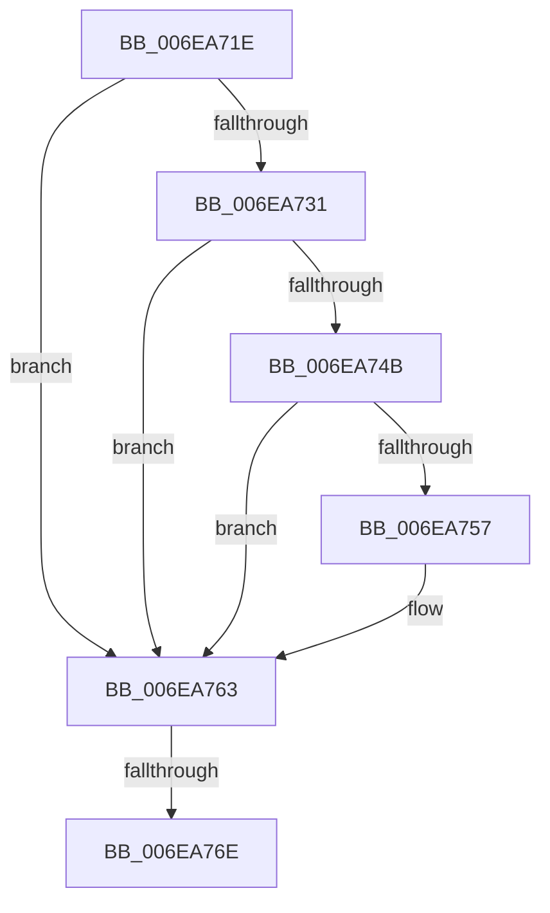

# sub_006EA71E

- RVA: `0x006EA71E`–`0x006EA780` (길이 `98` bytes)
- VA: `0x00000001406EA71E`
- 실행 섹션: `.text`
- PDB 이름 있음: `아니요`; PDB Function 태그: `아니요`
- unwind 정보 RVA: `0x00094860`
- 디코드: `23`개 명령, `98/98` bytes 표시
- 미해석 바이트: `0` (있으면 어셈블리에 `.byte`로 보존)

> 이 문서는 커널 이미지의 기계어와 PDB 기호를 분석해 생성했습니다. 4번과 5번은 함수 원형과 자료형을 바이너리 사용 방식에서 추정한 C 해석이며 원본 소스 복구 결과는 아닙니다.

## 1. Dependencies

- 직접 호출 지점: **3**; 고유 호출 대상: **3**
- 직접 호출자로 확인된 함수: **0**
- RIP 상대 이미지 참조: **2**

### Outgoing calls
- `0x006EA723` → [MmUnmapReservedMapping](../3E/MmUnmapReservedMapping_function_003E7BE0.md) (function, `0x003E7BE0`)
- `0x006EA735` → [KeReleaseInStackQueuedSpinLockFromDpcLevel](../21/KeReleaseInStackQueuedSpinLockFromDpcLevel_function_002171B0.md) (function, `0x002171B0`)
- `0x006EA75E` → [ExpInterlockedPushEntrySList](../6B/ExpInterlockedPushEntrySList_function_006BA5B0.md) (function, `0x006BA5B0`)

### Direct callers
- 이 함수 시작 RVA로 연결되는 직접 call은 확인되지 않았습니다. 간접 호출은 완전히 역산할 수 없습니다.

### Static image references
- `0x006EA728` → RVA `0x00E3EC38` (`.data`; read)
- `0x006EA757` → RVA `0x00E3EC40` (`.data`; read)

## 2. Other-region calls and transfers

- 다른 실행 섹션으로 향하는 call: **0**
- call이 아닌 외부 분기/꼬리 이동: **2**
  - `0x006EA768` → [HalpDmaFreeMapRegisters + 0x215](../3D/HalpDmaFreeMapRegisters_function_003DF5F4.md) (`tail-transfer`)
  - `0x006EA77B` → [HalpDmaFreeMapRegisters + 0x215](../3D/HalpDmaFreeMapRegisters_function_003DF5F4.md) (`tail-transfer`)

## 3. Assembly (complete function range)

```asm
006EA71E  BA 48 61 6C 44                  mov edx, 0x446c6148
006EA723  E8 B8 D4 CF FF                  call 0x1403e7be0
006EA728  80 3D 09 45 75 00 00            cmp byte ptr [rip + 0x754509], 0
006EA72F  75 32                           jne 0x1406ea763
006EA731  48 8D 4D E0                     lea rcx, [rbp - 0x20]
006EA735  E8 76 CA B2 FF                  call 0x1402171b0
006EA73A  48 8B 55 D8                     mov rdx, qword ptr [rbp - 0x28]
006EA73E  83 C8 FF                        or eax, 0xffffffff
006EA741  F0 0F C1 42 18                  lock xadd dword ptr [rdx + 0x18], eax
006EA746  83 F8 01                        cmp eax, 1
006EA749  75 18                           jne 0x1406ea763
006EA74B  33 C0                           xor eax, eax
006EA74D  8D 48 01                        lea ecx, [rax + 1]
006EA750  F0 0F B1 4A 1C                  lock cmpxchg dword ptr [rdx + 0x1c], ecx
006EA755  75 0C                           jne 0x1406ea763
006EA757  48 8D 0D E2 44 75 00            lea rcx, [rip + 0x7544e2]
006EA75E  E8 4D FE FC FF                  call 0x1406ba5b0
006EA763  41 F6 45 30 10                  test byte ptr [r13 + 0x30], 0x10
006EA768  0F 84 9B 50 CF FF               je 0x1403df809
006EA76E  41 8B 45 30                     mov eax, dword ptr [r13 + 0x30]
006EA772  25 EF 0F 00 00                  and eax, 0xfef
006EA777  49 89 45 30                     mov qword ptr [r13 + 0x30], rax
006EA77B  E9 89 50 CF FF                  jmp 0x1403df809
```

## 4. C-style interpretation (structured pseudocode)

```c
__int64 __fastcall sub_006EA71E(void)
{
    __int64 result;

    result = MmUnmapReservedMapping(a1, (unsigned int)(0x446C6148ULL), a3, a4);
    if ((*(unsigned __int8 *)(v_rip + 7685385)) != 0) goto loc_006EA763;
    result = KeReleaseInStackQueuedSpinLockFromDpcLevel(v_rbp - 32, (unsigned int)(0x446C6148ULL), a3, a4);
    result = (unsigned int)((result) | (0xFFFFFFFFULL));
    if (((unsigned int)(result)) != 1) goto loc_006EA763;
    result = 0;
    if (!(condition_is_not_equal)) {
        a1 = v_rip + 7685346;
        result = ExpInterlockedPushEntrySList(a1, *(unsigned __int64 *)(v_rbp - 40), a3, a4);
    }
    result = (unsigned int)(((unsigned int)(*(unsigned int *)(v_r13 + 48))) & (0xFEFULL));
    *(unsigned __int64 *)(v_r13 + 48) = result;
}
```

## 5. (Beta) C Style

```c
void sub_006EA71E(void)
{
    int64_t result;

    result = MmUnmapReservedMapping(a1, (uint32_t)(0x446C6148ULL), a3, a4);
    if ((*(uint8_t *)(v_rip + 0x754509)) != 0) goto loc_006EA763;
    result = KeReleaseInStackQueuedSpinLockFromDpcLevel(local_rbp - 32, (uint32_t)(0x446C6148ULL), a3, a4);
    result = (uint32_t)((result) | (0xFFFFFFFFULL));
    if (((uint32_t)(result)) != 1) goto loc_006EA763;
    result = 0;
    if (!(condition_is_not_equal)) {
        a1 = v_rip + 7685346;
        result = ExpInterlockedPushEntrySList(a1, *(uint64_t *)(local_rbp - 0x28), a3, a4);
    }
    result = (uint32_t)(((uint32_t)(*(uint32_t *)(local_r13 + 0x30))) & (0xFEFULL));
    *(uint64_t *)(local_r13 + 0x30) = result;
}
```

## 6. Execution-region graph

[열기: 2D/3D 그래프와 함수 탐색 컨트롤 패널](../../../control-panel.html?section=text&rva=0x006EA71E&view=graph)

- 2D 그래프는 위에서 아래로 흐르고, 3D 그래프는 빈 공간을 드래그해 회전합니다. Shift+드래그는 이동, 휠은 확대·축소, 함수 노드 선택은 대상 보고서 이동입니다.

### Static fallback


