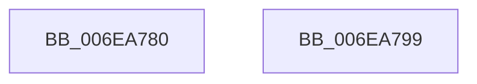

# sub_006EA780

- RVA: `0x006EA780`–`0x006EA7A0` (길이 `32` bytes)
- VA: `0x00000001406EA780`
- 실행 섹션: `.text`
- PDB 이름 있음: `아니요`; PDB Function 태그: `아니요`
- unwind 정보 RVA: `0x00094894`
- 디코드: `7`개 명령, `32/32` bytes 표시
- 미해석 바이트: `0` (있으면 어셈블리에 `.byte`로 보존)

> 이 문서는 커널 이미지의 기계어와 PDB 기호를 분석해 생성했습니다. 4번과 5번은 함수 원형과 자료형을 바이너리 사용 방식에서 추정한 C 해석이며 원본 소스 복구 결과는 아닙니다.

## 1. Dependencies

- 직접 호출 지점: **1**; 고유 호출 대상: **1**
- 직접 호출자로 확인된 함수: **0**
- RIP 상대 이미지 참조: **0**

### Outgoing calls
- `0x006EA78C` → [KeReleaseInStackQueuedSpinLock](../34/KeReleaseInStackQueuedSpinLock_function_00342CE0.md) (function, `0x00342CE0`)

### Direct callers
- 이 함수 시작 RVA로 연결되는 직접 call은 확인되지 않았습니다. 간접 호출은 완전히 역산할 수 없습니다.

### Static image references
- 디코드된 RIP-relative 메모리 참조가 없습니다.

## 2. Other-region calls and transfers

- 다른 실행 섹션으로 향하는 call: **0**
- call이 아닌 외부 분기/꼬리 이동: **1**
  - `0x006EA794` → [HalpDmaDequeueAdapter + 0x90](../3D/HalpDmaDequeueAdapter_function_003DF9C0.md) (`tail-transfer`)

## 3. Assembly (complete function range)

```asm
006EA780  48 8D B8 58 FF FF FF            lea rdi, [rax - 0xa8]
006EA787  48 8D 4C 24 20                  lea rcx, [rsp + 0x20]
006EA78C  E8 4F 85 C5 FF                  call 0x140342ce0
006EA791  48 8B C7                        mov rax, rdi
006EA794  E9 B7 52 CF FF                  jmp 0x1403dfa50
006EA799  B9 03 00 00 00                  mov ecx, 3
006EA79E  CD 29                           int 0x29
```

## 4. C-style interpretation (structured pseudocode)

```c
__int64 __fastcall sub_006EA780(void)
{
    __int64 result;
    unsigned __int64 v_stack_p20;

    result = KeReleaseInStackQueuedSpinLock(v_stack_p20, a2, a3, a4);
}
```

## 5. (Beta) C Style

```c
void sub_006EA780(void)
{
    int64_t result;
    uint64_t v_stack_p20;

    result = KeReleaseInStackQueuedSpinLock(v_stack_p20, a2, a3, a4);
}
```

## 6. Execution-region graph

[열기: 2D/3D 그래프와 함수 탐색 컨트롤 패널](../../../control-panel.html?section=text&rva=0x006EA780&view=graph)

- 2D 그래프는 위에서 아래로 흐르고, 3D 그래프는 빈 공간을 드래그해 회전합니다. Shift+드래그는 이동, 휠은 확대·축소, 함수 노드 선택은 대상 보고서 이동입니다.

### Static fallback


