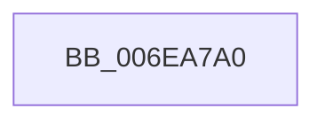

# sub_006EA7A0

- RVA: `0x006EA7A0`–`0x006EA7BC` (길이 `28` bytes)
- VA: `0x00000001406EA7A0`
- 실행 섹션: `.text`
- PDB 이름 있음: `아니요`; PDB Function 태그: `아니요`
- unwind 정보 RVA: `0x00094904`
- 디코드: `8`개 명령, `28/28` bytes 표시
- 미해석 바이트: `0` (있으면 어셈블리에 `.byte`로 보존)

> 이 문서는 커널 이미지의 기계어와 PDB 기호를 분석해 생성했습니다. 4번과 5번은 함수 원형과 자료형을 바이너리 사용 방식에서 추정한 C 해석이며 원본 소스 복구 결과는 아닙니다.

## 1. Dependencies

- 직접 호출 지점: **1**; 고유 호출 대상: **1**
- 직접 호출자로 확인된 함수: **0**
- RIP 상대 이미지 참조: **0**

### Outgoing calls
- `0x006EA7B1` → [HalpDmaSyncMapBuffers](../3D/HalpDmaSyncMapBuffers_function_003DEFD0.md) (function, `0x003DEFD0`)

### Direct callers
- 이 함수 시작 RVA로 연결되는 직접 call은 확인되지 않았습니다. 간접 호출은 완전히 역산할 수 없습니다.

### Static image references
- 디코드된 RIP-relative 메모리 참조가 없습니다.

## 2. Other-region calls and transfers

- 다른 실행 섹션으로 향하는 call: **0**
- call이 아닌 외부 분기/꼬리 이동: **1**
  - `0x006EA7B7` → [HalpDmaMapContiguousTransferV2 + 0x9A](../3D/HalpDmaMapContiguousTransferV2_function_003DFDF4.md) (`tail-transfer`)

## 3. Assembly (complete function range)

```asm
006EA7A0  4D 8B CF                        mov r9, r15
006EA7A3  44 89 74 24 20                  mov dword ptr [rsp + 0x20], r14d
006EA7A8  4C 8B C6                        mov r8, rsi
006EA7AB  48 8B D5                        mov rdx, rbp
006EA7AE  48 8B CB                        mov rcx, rbx
006EA7B1  E8 1A 48 CF FF                  call 0x1403defd0
006EA7B6  90                              nop
006EA7B7  E9 D2 56 CF FF                  jmp 0x1403dfe8e
```

## 4. C-style interpretation (structured pseudocode)

```c
__int64 __fastcall sub_006EA7A0(void)
{
    __int64 result;
    unsigned int v_stack_p20;

    v_stack_p20 = (unsigned int)(v_r14);
    result = HalpDmaSyncMapBuffers(v_rbx, v_rbp, v_rsi, v_r15);
}
```

## 5. (Beta) C Style

```c
void sub_006EA7A0(void)
{
    int64_t result;
    uint32_t v_stack_p20;

    v_stack_p20 = (uint32_t)(local_r14);
    result = HalpDmaSyncMapBuffers(local_rbx, local_rbp, local_rsi, local_r15);
}
```

## 6. Execution-region graph

[열기: 2D/3D 그래프와 함수 탐색 컨트롤 패널](../../../control-panel.html?section=text&rva=0x006EA7A0&view=graph)

- 2D 그래프는 위에서 아래로 흐르고, 3D 그래프는 빈 공간을 드래그해 회전합니다. Shift+드래그는 이동, 휠은 확대·축소, 함수 노드 선택은 대상 보고서 이동입니다.

### Static fallback


