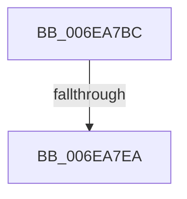

# sub_006EA7BC

- RVA: `0x006EA7BC`–`0x006EA81B` (길이 `95` bytes)
- VA: `0x00000001406EA7BC`
- 실행 섹션: `.text`
- PDB 이름 있음: `아니요`; PDB Function 태그: `아니요`
- unwind 정보 RVA: `0x00094BD8`
- 디코드: `23`개 명령, `95/95` bytes 표시
- 미해석 바이트: `0` (있으면 어셈블리에 `.byte`로 보존)

> 이 문서는 커널 이미지의 기계어와 PDB 기호를 분석해 생성했습니다. 4번과 5번은 함수 원형과 자료형을 바이너리 사용 방식에서 추정한 C 해석이며 원본 소스 복구 결과는 아닙니다.

## 1. Dependencies

- 직접 호출 지점: **1**; 고유 호출 대상: **1**
- 직접 호출자로 확인된 함수: **0**
- RIP 상대 이미지 참조: **2**

### Outgoing calls
- `0x006EA7D8` → [MiLockHugePfnInternal](../3F/MiLockHugePfnInternal_function_003FBC80.md) (function, `0x003FBC80`)

### Direct callers
- 이 함수 시작 RVA로 연결되는 직접 call은 확인되지 않았습니다. 간접 호출은 완전히 역산할 수 없습니다.

### Static image references
- `0x006EA7BC` → RVA `0x00E300C0` (`.data`; read)
- `0x006EA807` → RVA `0x00E300C8` (`.data`; read)

## 2. Other-region calls and transfers

- 다른 실행 섹션으로 향하는 call: **0**
- call이 아닌 외부 분기/꼬리 이동: **2**
  - `0x006EA7E4` → [MiJoinHugeContext + 0x129](../3E/MiJoinHugeContext_function_003E2748.md) (`tail-transfer`)
  - `0x006EA816` → [MiJoinHugeContext + 0x16C](../3E/MiJoinHugeContext_function_003E2748.md) (`tail-transfer`)

## 3. Assembly (complete function range)

```asm
006EA7BC  48 8B 05 FD 58 74 00            mov rax, qword ptr [rip + 0x7458fd]
006EA7C3  41 BE FF FF 3F 00               mov r14d, 0x3fffff
006EA7C9  49 23 CE                        and rcx, r14
006EA7CC  C6 45 E8 00                     mov byte ptr [rbp - 0x18], 0
006EA7D0  48 8D 0C C8                     lea rcx, [rax + rcx*8]
006EA7D4  48 89 4D E0                     mov qword ptr [rbp - 0x20], rcx
006EA7D8  E8 A3 14 D1 FF                  call 0x1403fbc80
006EA7DD  48 8B 46 18                     mov rax, qword ptr [rsi + 0x18]
006EA7E1  40 84 C7                        test dil, al
006EA7E4  0F 84 87 80 CF FF               je 0x1403e2871
006EA7EA  48 8B 45 E0                     mov rax, qword ptr [rbp - 0x20]
006EA7EE  48 2B 05 CB 58 74 00            sub rax, qword ptr [rip + 0x7458cb]
006EA7F5  48 C1 F8 03                     sar rax, 3
006EA7F9  41 23 C6                        and eax, r14d
006EA7FC  8B C8                           mov ecx, eax
006EA7FE  83 E1 1F                        and ecx, 0x1f
006EA801  D3 E7                           shl edi, cl
006EA803  8B C8                           mov ecx, eax
006EA805  F7 D7                           not edi
006EA807  48 8B 05 BA 58 74 00            mov rax, qword ptr [rip + 0x7458ba]
006EA80E  48 C1 E9 05                     shr rcx, 5
006EA812  F0 21 3C 88                     lock and dword ptr [rax + rcx*4], edi
006EA816  E9 99 80 CF FF                  jmp 0x1403e28b4
```

## 4. C-style interpretation (structured pseudocode)

```c
__int64 __fastcall sub_006EA7BC(__int64 a1)
{
    __int64 result;
    __int64 v_rdi;

    a1 = (a1) & ((unsigned int)(0x3FFFFFULL));
    *(unsigned __int8 *)(v_rbp - 24) = 0;
    *(unsigned __int64 *)(v_rbp - 32) = *(unsigned __int64 *)(v_rip + 7624957) + a1 * 8;
    result = MiLockHugePfnInternal(*(unsigned __int64 *)(v_rip + 7624957) + a1 * 8, a2, a3, a4);
    result = (*(unsigned __int64 *)(v_rbp - 32)) - (*(unsigned __int64 *)(v_rip + 7624907));
    result = (result) >> (3);
    result = (unsigned int)((result) & ((unsigned int)((unsigned int)(0x3FFFFFULL))));
    a1 = (unsigned int)(((unsigned int)((unsigned int)(result))) & (31));
    v_rdi = (unsigned int)((v_rdi) << ((unsigned __int8)(a1)));
    v_rdi = (unsigned int)(~(v_rdi));
    a1 = ((unsigned int)((unsigned int)(result))) >> (5);
}
```

## 5. (Beta) C Style

```c
int64_t sub_006EA7BC(int64_t Arg1)
{
    int64_t result;
    int64_t local_rdi;

    Arg1 = (Arg1) & ((uint32_t)(0x3FFFFFULL));
    *(uint8_t *)(local_rbp - 0x18) = 0;
    *(uint64_t *)(local_rbp - 0x20) = *(uint64_t *)(v_rip + 0x7458FD) + Arg1 * 8;
    result = MiLockHugePfnInternal(*(uint64_t *)(v_rip + 0x7458FD) + Arg1 * 8, a2, a3, a4);
    result = (*(uint64_t *)(local_rbp - 0x20)) - (*(uint64_t *)(v_rip + 0x7458CB));
    result = (result) >> (3);
    result = (uint32_t)((result) & ((uint32_t)((uint32_t)(0x3FFFFFULL))));
    Arg1 = (uint32_t)(((uint32_t)((uint32_t)(result))) & (31));
    local_rdi = (uint32_t)((local_rdi) << ((uint8_t)(Arg1)));
    local_rdi = (uint32_t)(~(local_rdi));
    Arg1 = ((uint32_t)((uint32_t)(result))) >> (5);
}
```

## 6. Execution-region graph

[열기: 2D/3D 그래프와 함수 탐색 컨트롤 패널](../../../control-panel.html?section=text&rva=0x006EA7BC&view=graph)

- 2D 그래프는 위에서 아래로 흐르고, 3D 그래프는 빈 공간을 드래그해 회전합니다. Shift+드래그는 이동, 휠은 확대·축소, 함수 노드 선택은 대상 보고서 이동입니다.

### Static fallback


