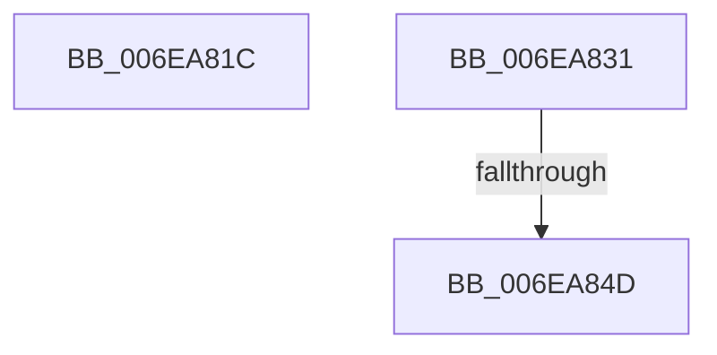

# sub_006EA81C

- RVA: `0x006EA81C`–`0x006EA85D` (길이 `65` bytes)
- VA: `0x00000001406EA81C`
- 실행 섹션: `.text`
- PDB 이름 있음: `아니요`; PDB Function 태그: `아니요`
- unwind 정보 RVA: `0x00094C24`
- 디코드: `21`개 명령, `65/65` bytes 표시
- 미해석 바이트: `0` (있으면 어셈블리에 `.byte`로 보존)

> 이 문서는 커널 이미지의 기계어와 PDB 기호를 분석해 생성했습니다. 4번과 5번은 함수 원형과 자료형을 바이너리 사용 방식에서 추정한 C 해석이며 원본 소스 복구 결과는 아닙니다.

## 1. Dependencies

- 직접 호출 지점: **2**; 고유 호출 대상: **2**
- 직접 호출자로 확인된 함수: **0**
- RIP 상대 이미지 참조: **0**

### Outgoing calls
- `0x006EA83F` → [MiDerefPageFileSpaceBitmaps](../47/MiDerefPageFileSpaceBitmaps_function_0047B478.md) (function, `0x0047B478`)
- `0x006EA852` → [ExFreePoolWithTag](../../poolcode/B8/ExFreePoolWithTag_function_00B82870.md) (function, `0x00B82870`)

### Direct callers
- 이 함수 시작 RVA로 연결되는 직접 call은 확인되지 않았습니다. 간접 호출은 완전히 역산할 수 없습니다.

### Static image references
- 디코드된 RIP-relative 메모리 참조가 없습니다.

## 2. Other-region calls and transfers

- 다른 실행 섹션으로 향하는 call: **1**
  - `0x006EA852` → [ExFreePoolWithTag](../../poolcode/B8/ExFreePoolWithTag_function_00B82870.md) (`.text` → `POOLCODE`)
- call이 아닌 외부 분기/꼬리 이동: **3**
  - `0x006EA82C` → [MiFindPageFileWriteCluster + 0x130](../3E/MiFindPageFileWriteCluster_function_003E2B00.md) (`tail-transfer`)
  - `0x006EA847` → [MiFindPageFileWriteCluster + 0xB6](../3E/MiFindPageFileWriteCluster_function_003E2B00.md) (`tail-transfer`)
  - `0x006EA858` → [MiFindPageFileWriteCluster + 0xB6](../3E/MiFindPageFileWriteCluster_function_003E2B00.md) (`tail-transfer`)

## 3. Assembly (complete function range)

```asm
006EA81C  8B CF                           mov ecx, edi
006EA81E  D1 E9                           shr ecx, 1
006EA820  03 CF                           add ecx, edi
006EA822  8B FA                           mov edi, edx
006EA824  3B CA                           cmp ecx, edx
006EA826  0F 42 F9                        cmovb edi, ecx
006EA829  89 7E 5C                        mov dword ptr [rsi + 0x5c], edi
006EA82C  E9 FF 83 CF FF                  jmp 0x1403e2c30
006EA831  03 C3                           add eax, ebx
006EA833  89 46 58                        mov dword ptr [rsi + 0x58], eax
006EA836  45 33 C0                        xor r8d, r8d
006EA839  49 8B D5                        mov rdx, r13
006EA83C  48 8B CE                        mov rcx, rsi
006EA83F  E8 34 0C D9 FF                  call 0x14047b478
006EA844  48 85 C0                        test rax, rax
006EA847  0F 84 69 83 CF FF               je 0x1403e2bb6
006EA84D  33 D2                           xor edx, edx
006EA84F  48 8B C8                        mov rcx, rax
006EA852  E8 19 80 49 00                  call 0x140b82870
006EA857  90                              nop
006EA858  E9 59 83 CF FF                  jmp 0x1403e2bb6
```

## 4. C-style interpretation (structured pseudocode)

```c
__int64 __fastcall sub_006EA81C(__int64 a1, int a2, int a3)
{
    __int64 v_rdi;

    a1 = (unsigned int)(((unsigned int)((unsigned int)(v_rdi))) >> (1));
    a1 = (unsigned int)((a1) + ((unsigned int)(v_rdi)));
    v_rdi = (unsigned int)(a2);
    if (((unsigned int)(a1)) < a2) { v_rdi = (unsigned int)(a1); }
    *(unsigned int *)(v_rsi + 92) = (unsigned int)(v_rdi);
}
```

## 5. (Beta) C Style

```c
int64_t sub_006EA81C(int64_t Arg1, int32_t Arg2, int32_t Arg3)
{
    int64_t local_rdi;

    Arg1 = (uint32_t)(((uint32_t)((uint32_t)(local_rdi))) >> (1));
    Arg1 = (uint32_t)((Arg1) + ((uint32_t)(local_rdi)));
    local_rdi = (uint32_t)(Arg2);
    if (((uint32_t)(Arg1)) < Arg2) { local_rdi = (uint32_t)(Arg1); }
    *(uint32_t *)(local_rsi + 0x5C) = (uint32_t)(local_rdi);
}
```

## 6. Execution-region graph

[열기: 2D/3D 그래프와 함수 탐색 컨트롤 패널](../../../control-panel.html?section=text&rva=0x006EA81C&view=graph)

- 2D 그래프는 위에서 아래로 흐르고, 3D 그래프는 빈 공간을 드래그해 회전합니다. Shift+드래그는 이동, 휠은 확대·축소, 함수 노드 선택은 대상 보고서 이동입니다.

### Static fallback


