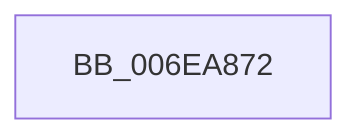

# sub_006EA872

- RVA: `0x006EA872`–`0x006EA897` (길이 `37` bytes)
- VA: `0x00000001406EA872`
- 실행 섹션: `.text`
- PDB 이름 있음: `아니요`; PDB Function 태그: `아니요`
- unwind 정보 RVA: `0x00094C78`
- 디코드: `11`개 명령, `37/37` bytes 표시
- 미해석 바이트: `0` (있으면 어셈블리에 `.byte`로 보존)

> 이 문서는 커널 이미지의 기계어와 PDB 기호를 분석해 생성했습니다. 4번과 5번은 함수 원형과 자료형을 바이너리 사용 방식에서 추정한 C 해석이며 원본 소스 복구 결과는 아닙니다.

## 1. Dependencies

- 직접 호출 지점: **0**; 고유 호출 대상: **0**
- 직접 호출자로 확인된 함수: **0**
- RIP 상대 이미지 참조: **0**

### Outgoing calls
- 직접 디코드된 call 명령이 없습니다.

### Direct callers
- 이 함수 시작 RVA로 연결되는 직접 call은 확인되지 않았습니다. 간접 호출은 완전히 역산할 수 없습니다.

### Static image references
- 디코드된 RIP-relative 메모리 참조가 없습니다.

## 2. Other-region calls and transfers

- 다른 실행 섹션으로 향하는 call: **0**
- call이 아닌 외부 분기/꼬리 이동: **1**
  - `0x006EA892` → [MiInvalidatePageFileBitmapsCache + 0xC0](../3E/MiInvalidatePageFileBitmapsCache_function_003E3240.md) (`tail-transfer`)

## 3. Assembly (complete function range)

```asm
006EA872  89 0A                           mov dword ptr [rdx], ecx
006EA874  41 8B C9                        mov ecx, r9d
006EA877  44 89 5F 30                     mov dword ptr [rdi + 0x30], r11d
006EA87B  8B 46 6C                        mov eax, dword ptr [rsi + 0x6c]
006EA87E  41 3B C1                        cmp eax, r9d
006EA881  0F 47 C8                        cmova ecx, eax
006EA884  48 8B D6                        mov rdx, rsi
006EA887  B8 6C 00 00 00                  mov eax, 0x6c
006EA88C  89 0C 10                        mov dword ptr [rax + rdx], ecx
006EA88F  48 8B D7                        mov rdx, rdi
006EA892  E9 69 8A CF FF                  jmp 0x1403e3300
```

## 4. C-style interpretation (structured pseudocode)

```c
__int64 __fastcall sub_006EA872(int a1, __int64 a2, __int64 a3, int a4)
{
    *(unsigned int *)(a2) = a1;
    *(unsigned int *)(v_rdi + 48) = (unsigned int)(v_r11);
    a1 = (unsigned int)(a4);
    if (((unsigned int)((unsigned int)(*(unsigned int *)(v_rsi + 108)))) > a4) { a1 = (unsigned int)((unsigned int)(*(unsigned int *)(v_rsi + 108))); }
    *(unsigned int *)(108 + v_rsi * 1) = a1;
}
```

## 5. (Beta) C Style

```c
int64_t sub_006EA872(int32_t Arg1, void *Arg2, int64_t Arg3, int32_t Arg4)
{
    uint8_t *arg2 = (uint8_t *)Arg2;

    *(uint32_t *)(arg2) = Arg1;
    *(uint32_t *)(local_rdi + 0x30) = (uint32_t)(local_r11);
    Arg1 = (uint32_t)(Arg4);
    if (((uint32_t)((uint32_t)(*(uint32_t *)(local_rsi + 0x6C)))) > Arg4) { Arg1 = (uint32_t)((uint32_t)(*(uint32_t *)(local_rsi + 0x6C))); }
    *(uint32_t *)(108 + local_rsi * 1) = Arg1;
}
```

### 관측된 메모리 오프셋

구조체 형식이 확인되지 않은 접근은 인자 기준의 오프셋으로만 기록했습니다.

| 기준 인자 | 오프셋 표현 | 폭 (bit) | 접근 |
|---|---:|---:|---|
| `Arg2` | `+ 0x0` | `32` | `W` |

## 6. Execution-region graph

[열기: 2D/3D 그래프와 함수 탐색 컨트롤 패널](../../../control-panel.html?section=text&rva=0x006EA872&view=graph)

- 2D 그래프는 위에서 아래로 흐르고, 3D 그래프는 빈 공간을 드래그해 회전합니다. Shift+드래그는 이동, 휠은 확대·축소, 함수 노드 선택은 대상 보고서 이동입니다.

### Static fallback


