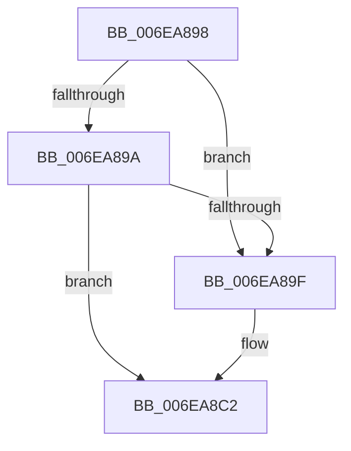

# sub_006EA898

- RVA: `0x006EA898`–`0x006EA8C9` (길이 `49` bytes)
- VA: `0x00000001406EA898`
- 실행 섹션: `.text`
- PDB 이름 있음: `아니요`; PDB Function 태그: `아니요`
- unwind 정보 RVA: `0x00094CEC`
- 디코드: `16`개 명령, `49/49` bytes 표시
- 미해석 바이트: `0` (있으면 어셈블리에 `.byte`로 보존)

> 이 문서는 커널 이미지의 기계어와 PDB 기호를 분석해 생성했습니다. 4번과 5번은 함수 원형과 자료형을 바이너리 사용 방식에서 추정한 C 해석이며 원본 소스 복구 결과는 아닙니다.

## 1. Dependencies

- 직접 호출 지점: **0**; 고유 호출 대상: **0**
- 직접 호출자로 확인된 함수: **0**
- RIP 상대 이미지 참조: **0**

### Outgoing calls
- 직접 디코드된 call 명령이 없습니다.

### Direct callers
- 이 함수 시작 RVA로 연결되는 직접 call은 확인되지 않았습니다. 간접 호출은 완전히 역산할 수 없습니다.

### Static image references
- 디코드된 RIP-relative 메모리 참조가 없습니다.

## 2. Other-region calls and transfers

- 다른 실행 섹션으로 향하는 call: **0**
- call이 아닌 외부 분기/꼬리 이동: **1**
  - `0x006EA8C4` → [RaspTestIntersection + 0x12B](../3E/RaspTestIntersection_function_003E3BBC.md) (`tail-transfer`)

## 3. Assembly (complete function range)

```asm
006EA898  7D 05                           jge 0x1406ea89f
006EA89A  4C 3B C2                        cmp r8, rdx
006EA89D  7C 23                           jl 0x1406ea8c2
006EA89F  49 2B D1                        sub rdx, r9
006EA8A2  4D 2B C1                        sub r8, r9
006EA8A5  48 2B F5                        sub rsi, rbp
006EA8A8  41 B9 00 00 01 00               mov r9d, 0x10000
006EA8AE  48 0F AF D6                     imul rdx, rsi
006EA8B2  48 8B C2                        mov rax, rdx
006EA8B5  48 99                           cqo
006EA8B7  49 F7 F8                        idiv r8
006EA8BA  48 03 C5                        add rax, rbp
006EA8BD  48 99                           cqo
006EA8BF  49 F7 F9                        idiv r9
006EA8C2  89 03                           mov dword ptr [rbx], eax
006EA8C4  E9 1E 94 CF FF                  jmp 0x1403e3ce7
```

## 4. C-style interpretation (structured pseudocode)

```c
__int64 __fastcall sub_006EA898(__int64 a1, __int64 a2, __int64 a3, __int64 a4)
{
    __int64 result;
    __int64 v_rsi;

    if (condition_is_greater_or_equal) goto loc_006EA89F;
    if (a3 >= a2) {
        a2 = (a2) - (a4);
        a3 = (a3) - (a4);
        v_rsi = (v_rsi) - (v_rbp);
        a4 = 0x10000ULL;
        a2 = (a2) * (v_rsi);
        result = a2;
        result = (result) + (v_rbp);
    }
    *(unsigned int *)(v_rbx) = (unsigned int)(result);
}
```

## 5. (Beta) C Style

```c
int64_t sub_006EA898(int64_t Arg1, int64_t Arg2, int64_t Arg3, int64_t Arg4)
{
    int64_t result;
    int64_t local_rsi;

    if (condition_is_greater_or_equal) goto loc_006EA89F;
    if (Arg3 >= Arg2) {
        Arg2 = (Arg2) - (Arg4);
        Arg3 = (Arg3) - (Arg4);
        local_rsi = (local_rsi) - (local_rbp);
        Arg4 = 0x10000ULL;
        Arg2 = (Arg2) * (local_rsi);
        result = Arg2;
        result = (result) + (local_rbp);
    }
    *(uint32_t *)(local_rbx) = (uint32_t)(result);
}
```

## 6. Execution-region graph

[열기: 2D/3D 그래프와 함수 탐색 컨트롤 패널](../../../control-panel.html?section=text&rva=0x006EA898&view=graph)

- 2D 그래프는 위에서 아래로 흐르고, 3D 그래프는 빈 공간을 드래그해 회전합니다. Shift+드래그는 이동, 휠은 확대·축소, 함수 노드 선택은 대상 보고서 이동입니다.

### Static fallback


