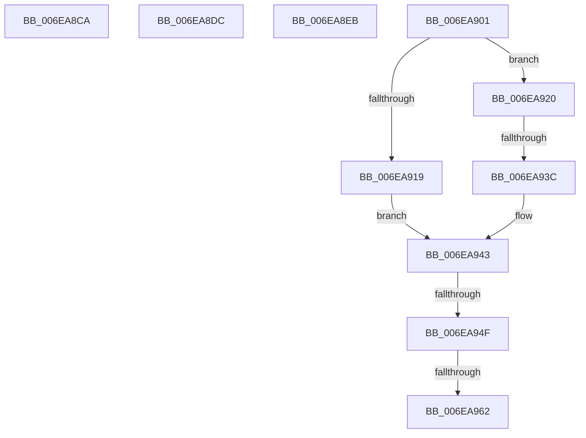

# sub_006EA8CA

- RVA: `0x006EA8CA`–`0x006EA969` (길이 `159` bytes)
- VA: `0x00000001406EA8CA`
- 실행 섹션: `.text`
- PDB 이름 있음: `아니요`; PDB Function 태그: `아니요`
- unwind 정보 RVA: `0x00094D18`
- 디코드: `44`개 명령, `159/159` bytes 표시
- 미해석 바이트: `0` (있으면 어셈블리에 `.byte`로 보존)

> 이 문서는 커널 이미지의 기계어와 PDB 기호를 분석해 생성했습니다. 4번과 5번은 함수 원형과 자료형을 바이너리 사용 방식에서 추정한 C 해석이며 원본 소스 복구 결과는 아닙니다.

## 1. Dependencies

- 직접 호출 지점: **1**; 고유 호출 대상: **1**
- 직접 호출자로 확인된 함수: **0**
- RIP 상대 이미지 참조: **0**

### Outgoing calls
- `0x006EA92B` → [RaspInterpolatePoint](../3E/RaspInterpolatePoint_function_003E36D8.md) (function, `0x003E36D8`)

### Direct callers
- 이 함수 시작 RVA로 연결되는 직접 call은 확인되지 않았습니다. 간접 호출은 완전히 역산할 수 없습니다.

### Static image references
- 디코드된 RIP-relative 메모리 참조가 없습니다.

## 2. Other-region calls and transfers

- 다른 실행 섹션으로 향하는 call: **0**
- call이 아닌 외부 분기/꼬리 이동: **7**
  - `0x006EA8D7` → [RaspCreateSegmentList + 0x7C](../3E/RaspCreateSegmentList_function_003E3ED8.md) (`tail-transfer`)
  - `0x006EA8E6` → [RaspCreateSegmentList + 0x11B](../3E/RaspCreateSegmentList_function_003E3ED8.md) (`tail-transfer`)
  - `0x006EA8FC` → [RaspCreateSegmentList + 0x124](../3E/RaspCreateSegmentList_function_003E3ED8.md) (`tail-transfer`)
  - `0x006EA936` → [RaspCreateSegmentList + 0x315](../3E/RaspCreateSegmentList_function_003E3ED8.md) (`tail-transfer`)
  - `0x006EA949` → [RaspCreateSegmentList + 0x1BC](../3E/RaspCreateSegmentList_function_003E3ED8.md) (`tail-transfer`)
  - `0x006EA95C` → [RaspCreateSegmentList + 0x1BC](../3E/RaspCreateSegmentList_function_003E3ED8.md) (`tail-transfer`)
  - `0x006EA964` → [RaspCreateSegmentList + 0x1BC](../3E/RaspCreateSegmentList_function_003E3ED8.md) (`tail-transfer`)

## 3. Assembly (complete function range)

```asm
006EA8CA  8D 42 FF                        lea eax, [rdx - 1]
006EA8CD  45 0F B7 04 44                  movzx r8d, word ptr [r12 + rax*2]
006EA8D2  41 FF C0                        inc r8d
006EA8D5  FF C2                           inc edx
006EA8D7  E9 78 96 CF FF                  jmp 0x1403e3f54
006EA8DC  8D 45 FF                        lea eax, [rbp - 1]
006EA8DF  41 0F B7 14 44                  movzx edx, word ptr [r12 + rax*2]
006EA8E4  FF C2                           inc edx
006EA8E6  E9 08 97 CF FF                  jmp 0x1403e3ff3
006EA8EB  8D 45 FF                        lea eax, [rbp - 1]
006EA8EE  41 0F B7 04 44                  movzx eax, word ptr [r12 + rax*2]
006EA8F3  44 8D 70 01                     lea r14d, [rax + 1]
006EA8F7  8D 50 02                        lea edx, [rax + 2]
006EA8FA  FF C5                           inc ebp
006EA8FC  E9 FB 96 CF FF                  jmp 0x1403e3ffc
006EA901  8B C2                           mov eax, edx
006EA903  48 6B D0 11                     imul rdx, rax, 0x11
006EA907  49 03 D7                        add rdx, r15
006EA90A  8A 42 10                        mov al, byte ptr [rdx + 0x10]
006EA90D  4C 89 46 F0                     mov qword ptr [rsi - 0x10], r8
006EA911  4C 89 4E F8                     mov qword ptr [rsi - 8], r9
006EA915  A8 01                           test al, 1
006EA917  74 07                           je 0x1406ea920
006EA919  48 89 16                        mov qword ptr [rsi], rdx
006EA91C  B0 02                           mov al, 2
006EA91E  EB 23                           jmp 0x1406ea943
006EA920  4C 8B 84 24 98 00 00 00         mov r8, qword ptr [rsp + 0x98]
006EA928  49 8B C9                        mov rcx, r9
006EA92B  E8 A8 8D CF FF                  call 0x1403e36d8
006EA930  48 89 06                        mov qword ptr [rsi], rax
006EA933  48 85 C0                        test rax, rax
006EA936  0F 84 B1 98 CF FF               je 0x1403e41ed
006EA93C  44 8B 5C 24 20                  mov r11d, dword ptr [rsp + 0x20]
006EA941  B0 04                           mov al, 4
006EA943  88 46 08                        mov byte ptr [rsi + 8], al
006EA946  44 3B F7                        cmp r14d, edi
006EA949  0F 86 45 97 CF FF               jbe 0x1403e4094
006EA94F  8B C5                           mov eax, ebp
006EA951  41 8B FB                        mov edi, r11d
006EA954  41 0F B7 0C 44                  movzx ecx, word ptr [r12 + rax*2]
006EA959  44 3B D9                        cmp r11d, ecx
006EA95C  0F 85 32 97 CF FF               jne 0x1403e4094
006EA962  FF C5                           inc ebp
006EA964  E9 2B 97 CF FF                  jmp 0x1403e4094
```

## 4. C-style interpretation (structured pseudocode)

```c
__int64 __fastcall sub_006EA8CA(__int64 a1, __int64 a2, __int64 a3, __int64 a4)
{
    unsigned int v_stack_p20;
    unsigned __int64 v_stack_p98;

    a3 = (unsigned int)((*(unsigned __int16 *)(v_r12 + a2 - 1 * 2)) + 1);
    a2 = (unsigned int)((a2) + 1);
}
```

## 5. (Beta) C Style

```c
int64_t sub_006EA8CA(int64_t Arg1, void *Arg2, int64_t Arg3, int64_t Arg4)
{
    uint8_t *arg2 = (uint8_t *)Arg2;

    uint32_t v_stack_p20;
    uint64_t v_stack_p98;

    Arg3 = (uint32_t)((*(uint16_t *)(local_r12 + arg2 - 0x1 * 2)) + 1);
    Arg2 = (uint32_t)((Arg2) + 1);
}
```

### 관측된 메모리 오프셋

구조체 형식이 확인되지 않은 접근은 인자 기준의 오프셋으로만 기록했습니다.

| 기준 인자 | 오프셋 표현 | 폭 (bit) | 접근 |
|---|---:|---:|---|
| `Arg2` | `- 0x1` | `32` | `R` |

## 6. Execution-region graph

[열기: 2D/3D 그래프와 함수 탐색 컨트롤 패널](../../../control-panel.html?section=text&rva=0x006EA8CA&view=graph)

- 2D 그래프는 위에서 아래로 흐르고, 3D 그래프는 빈 공간을 드래그해 회전합니다. Shift+드래그는 이동, 휠은 확대·축소, 함수 노드 선택은 대상 보고서 이동입니다.

### Static fallback


