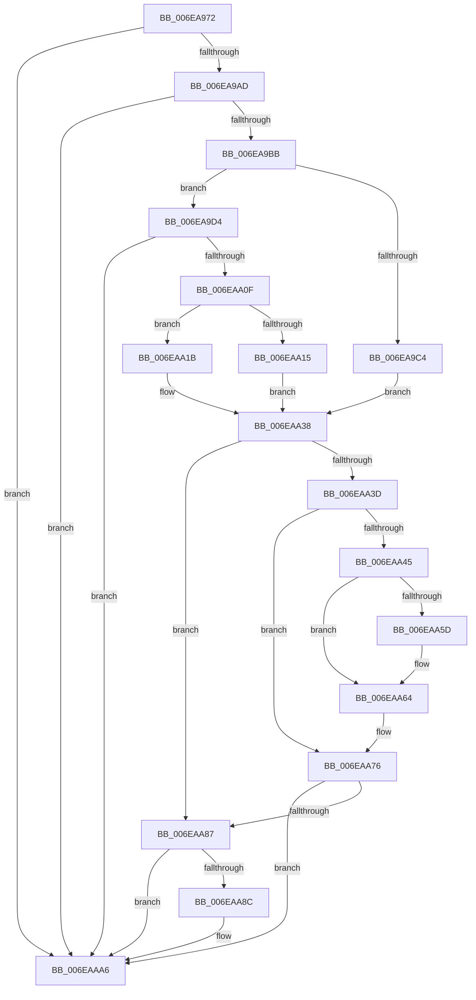

# sub_006EA972

- RVA: `0x006EA972`–`0x006EAAAE` (길이 `316` bytes)
- VA: `0x00000001406EA972`
- 실행 섹션: `.text`
- PDB 이름 있음: `아니요`; PDB Function 태그: `아니요`
- unwind 정보 RVA: `0x00094D54`
- 디코드: `82`개 명령, `316/316` bytes 표시
- 미해석 바이트: `0` (있으면 어셈블리에 `.byte`로 보존)

> 이 문서는 커널 이미지의 기계어와 PDB 기호를 분석해 생성했습니다. 4번과 5번은 함수 원형과 자료형을 바이너리 사용 방식에서 추정한 C 해석이며 원본 소스 복구 결과는 아닙니다.

## 1. Dependencies

- 직접 호출 지점: **5**; 고유 호출 대상: **5**
- 직접 호출자로 확인된 함수: **0**
- RIP 상대 이미지 참조: **2**

### Outgoing calls
- `0x006EA9CD` → [ExAllocatePool2](../../poolcode/B8/ExAllocatePool2_function_00B820F0.md) (function, `0x00B820F0`)
- `0x006EA9FE` → [MmAllocatePagesForMdlEx](../3E/MmAllocatePagesForMdlEx_function_003EA8C0.md) (function, `0x003EA8C0`)
- `0x006EAA33` → [MmMapLockedPagesSpecifyCache](../31/MmMapLockedPagesSpecifyCache_function_00318800.md) (function, `0x00318800`)
- `0x006EAA97` → [MiFreePagesFromMdl](../3F/MiFreePagesFromMdl_function_003F8300.md) (function, `0x003F8300`)
- `0x006EAAA1` → [ExFreePoolWithTag](../../poolcode/B8/ExFreePoolWithTag_function_00B82870.md) (function, `0x00B82870`)

### Direct callers
- 이 함수 시작 RVA로 연결되는 직접 call은 확인되지 않았습니다. 간접 호출은 완전히 역산할 수 없습니다.

### Static image references
- `0x006EAA45` → RVA `0x00EF0520` (`.data`; read)
- `0x006EAA6F` → RVA `0x00EF0520` (`.data`; write)

## 2. Other-region calls and transfers

- 다른 실행 섹션으로 향하는 call: **2**
  - `0x006EA9CD` → [ExAllocatePool2](../../poolcode/B8/ExAllocatePool2_function_00B820F0.md) (`.text` → `POOLCODE`)
  - `0x006EAAA1` → [ExFreePoolWithTag](../../poolcode/B8/ExFreePoolWithTag_function_00B82870.md) (`.text` → `POOLCODE`)
- call이 아닌 외부 분기/꼬리 이동: **1**
  - `0x006EAAA9` → [BgpFwAllocateMemory + 0x32](../3E/BgpFwAllocateMemory_function_003E4374.md) (`tail-transfer`)

## 3. Assembly (complete function range)

```asm
006EA972  81 E5 00 80 00 00               and ebp, 0x8000
006EA978  33 FF                           xor edi, edi
006EA97A  33 DB                           xor ebx, ebx
006EA97C  8B C5                           mov eax, ebp
006EA97E  F7 D8                           neg eax
006EA980  8B C5                           mov eax, ebp
006EA982  45 1B F6                        sbb r14d, r14d
006EA985  41 81 E6 00 00 F9 FF            and r14d, 0xfff90000
006EA98C  41 81 C6 42 47 49 4B            add r14d, 0x4b494742
006EA993  F7 D8                           neg eax
006EA995  4D 1B FF                        sbb r15, r15
006EA998  41 83 E7 10                     and r15d, 0x10
006EA99C  49 83 C7 20                     add r15, 0x20
006EA9A0  49 8D 34 0F                     lea rsi, [r15 + rcx]
006EA9A4  48 3B F1                        cmp rsi, rcx
006EA9A7  0F 82 F9 00 00 00               jb 0x1406eaaa6
006EA9AD  B8 FF EF FF FF                  mov eax, 0xffffefff
006EA9B2  48 3B F0                        cmp rsi, rax
006EA9B5  0F 83 EB 00 00 00               jae 0x1406eaaa6
006EA9BB  48 81 FE 00 10 00 00            cmp rsi, 0x1000
006EA9C2  73 10                           jae 0x1406ea9d4
006EA9C4  45 8B C6                        mov r8d, r14d
006EA9C7  8D 4F 40                        lea ecx, [rdi + 0x40]
006EA9CA  48 8B D6                        mov rdx, rsi
006EA9CD  E8 1E 77 49 00                  call 0x140b820f0
006EA9D2  EB 64                           jmp 0x1406eaa38
006EA9D4  48 81 C6 FF 0F 00 00            add rsi, 0xfff
006EA9DB  C7 44 24 28 05 00 00 00         mov dword ptr [rsp + 0x28], 5
006EA9E3  48 81 E6 00 F0 FF FF            and rsi, 0xfffffffffffff000
006EA9EA  C7 44 24 20 01 00 00 00         mov dword ptr [rsp + 0x20], 1
006EA9F2  4C 8B CE                        mov r9, rsi
006EA9F5  45 33 C0                        xor r8d, r8d
006EA9F8  48 83 CA FF                     or rdx, 0xffffffffffffffff
006EA9FC  33 C9                           xor ecx, ecx
006EA9FE  E8 BD FE CF FF                  call 0x1403ea8c0
006EAA03  48 8B D8                        mov rbx, rax
006EAA06  48 85 C0                        test rax, rax
006EAA09  0F 84 97 00 00 00               je 0x1406eaaa6
006EAA0F  F6 40 0A 05                     test byte ptr [rax + 0xa], 5
006EAA13  74 06                           je 0x1406eaa1b
006EAA15  48 8B 40 18                     mov rax, qword ptr [rax + 0x18]
006EAA19  EB 1D                           jmp 0x1406eaa38
006EAA1B  45 33 C9                        xor r9d, r9d
006EAA1E  C7 44 24 28 10 00 00 40         mov dword ptr [rsp + 0x28], 0x40000010
006EAA26  21 7C 24 20                     and dword ptr [rsp + 0x20], edi
006EAA2A  33 D2                           xor edx, edx
006EAA2C  48 8B C8                        mov rcx, rax
006EAA2F  45 8D 41 01                     lea r8d, [r9 + 1]
006EAA33  E8 C8 DD C2 FF                  call 0x140318800
006EAA38  48 85 C0                        test rax, rax
006EAA3B  74 4A                           je 0x1406eaa87
006EAA3D  49 8D 3C 07                     lea rdi, [r15 + rax]
006EAA41  85 ED                           test ebp, ebp
006EAA43  74 31                           je 0x1406eaa76
006EAA45  48 8B 0D D4 5A 80 00            mov rcx, qword ptr [rip + 0x805ad4]
006EAA4C  48 8D 15 CD 5A 80 00            lea rdx, [rip + 0x805acd]
006EAA53  48 8D 47 D8                     lea rax, [rdi - 0x28]
006EAA57  48 39 51 08                     cmp qword ptr [rcx + 8], rdx
006EAA5B  74 07                           je 0x1406eaa64
006EAA5D  B9 03 00 00 00                  mov ecx, 3
006EAA62  CD 29                           int 0x29
006EAA64  48 89 08                        mov qword ptr [rax], rcx
006EAA67  48 89 50 08                     mov qword ptr [rax + 8], rdx
006EAA6B  48 89 41 08                     mov qword ptr [rcx + 8], rax
006EAA6F  48 89 05 AA 5A 80 00            mov qword ptr [rip + 0x805aaa], rax
006EAA76  44 89 77 E8                     mov dword ptr [rdi - 0x18], r14d
006EAA7A  48 89 77 F0                     mov qword ptr [rdi - 0x10], rsi
006EAA7E  48 89 5F F8                     mov qword ptr [rdi - 8], rbx
006EAA82  48 85 FF                        test rdi, rdi
006EAA85  75 1F                           jne 0x1406eaaa6
006EAA87  48 85 DB                        test rbx, rbx
006EAA8A  74 1A                           je 0x1406eaaa6
006EAA8C  45 33 C9                        xor r9d, r9d
006EAA8F  45 33 C0                        xor r8d, r8d
006EAA92  33 D2                           xor edx, edx
006EAA94  48 8B CB                        mov rcx, rbx
006EAA97  E8 64 D8 D0 FF                  call 0x1403f8300
006EAA9C  33 D2                           xor edx, edx
006EAA9E  48 8B CB                        mov rcx, rbx
006EAAA1  E8 CA 7D 49 00                  call 0x140b82870
006EAAA6  48 8B C7                        mov rax, rdi
006EAAA9  E9 F8 98 CF FF                  jmp 0x1403e43a6
```

## 4. C-style interpretation (structured pseudocode)

```c
__int64 __fastcall sub_006EA972(__int64 a1)
{
    __int64 result;
    __int64 v_r14;
    __int64 v_r15;
    __int64 v_rbp;
    __int64 v_rbx;
    __int64 v_rdi;
    __int64 v_rsi;
    unsigned int v_stack_p20;
    unsigned int v_stack_p28;

    v_rbp = (unsigned int)((v_rbp) & (0x8000ULL));
    v_rdi = 0;
    v_rbx = 0;
    result = (unsigned int)(-((unsigned int)((unsigned int)(v_rbp))));
    v_r14 = (unsigned int)((v_r14) & (0xFFF90000ULL));
    v_r14 = (unsigned int)((v_r14) + (0x4B494742ULL));
    result = (unsigned int)(-((unsigned int)((unsigned int)(v_rbp))));
    v_r15 = (unsigned int)((v_r15) & (16));
    v_r15 = (v_r15) + (32);
    if ((v_r15 + a1 * 1) < a1) goto loc_006EAAA6;
    if ((v_r15 + a1 * 1) >= ((unsigned int)(0xFFFFEFFFULL))) goto loc_006EAAA6;
    if ((v_r15 + a1 * 1) >= 0x1000ULL) goto loc_006EA9D4;
    result = ExAllocatePool2(v_rdi + 64, v_r15 + a1 * 1, (unsigned int)((unsigned int)(v_r14)), a4);
    goto loc_006EAA38;
loc_006EA9D4:
    v_rsi = (v_r15 + a1 * 1) + (0xFFFULL);
    v_stack_p28 = 5;
    v_rsi = (v_rsi) & (0xFFFFFFFFFFFFF000ULL);
    v_stack_p20 = 1;
    a3 = 0;
    a2 = (v_r15 + a1 * 1) | (-1);
    a1 = 0;
    result = MmAllocatePagesForMdlEx(a1, a2, a3, v_rsi);
    if (result == 0) goto loc_006EAAA6;
    if (((*(unsigned __int8 *)(result + 10)) & (5)) == 0) goto loc_006EAA1B;
    goto loc_006EAA38;
loc_006EAA1B:
    a4 = 0;
    v_stack_p28 = 0x40000010ULL;
    a2 = 0;
    result = MmMapLockedPagesSpecifyCache(*(unsigned __int64 *)(result + 24), a2, a4 + 1, a4);
loc_006EAA38:
    if (result == 0) goto loc_006EAA87;
    if ((unsigned int)(v_rbp) == 0) goto loc_006EAA76;
    if ((*(unsigned __int64 *)(*(unsigned __int64 *)(v_rip + 8411860) + 8)) != (v_rip + 8411853)) {
        a1 = 3;
    }
    *(unsigned __int64 *)(v_r15 + result * 1 - 40) = a1;
    *(unsigned __int64 *)(v_r15 + result * 1 - 40 + 8) = v_rip + 8411853;
    *(unsigned __int64 *)(a1 + 8) = v_r15 + result * 1 - 40;
    *(unsigned __int64 *)(v_rip + 8411818) = v_r15 + result * 1 - 40;
loc_006EAA76:
    *(unsigned int *)(v_r15 + result * 1 - 24) = (unsigned int)(v_r14);
    *(unsigned __int64 *)(v_r15 + result * 1 - 16) = v_rsi;
    *(unsigned __int64 *)(v_r15 + result * 1 - 8) = result;
    if (v_r15 + result * 1 != 0) goto loc_006EAAA6;
loc_006EAA87:
    result = v_r15 + result * 1 - 40;
    if (result != 0) {
        a4 = 0;
        a3 = 0;
        a2 = 0;
        a1 = result;
        result = MiFreePagesFromMdl(a1, a2, a3, a4);
        a2 = 0;
        a1 = result;
        result = ExFreePoolWithTag(a1, a2, a3, a4);
    }
}
```

## 5. (Beta) C Style

```c
int64_t sub_006EA972(int64_t Arg1)
{
    int64_t result;
    int64_t local_r14;
    int64_t local_r15;
    int64_t local_rbp;
    int64_t local_rbx;
    int64_t local_rdi;
    int64_t local_rsi;
    uint32_t v_stack_p20;
    uint32_t v_stack_p28;

    local_rbp = (uint32_t)((local_rbp) & (0x8000ULL));
    local_rdi = 0;
    local_rbx = 0;
    result = (uint32_t)(-((uint32_t)((uint32_t)(local_rbp))));
    local_r14 = (uint32_t)((local_r14) & (0xFFF90000ULL));
    local_r14 = (uint32_t)((local_r14) + (0x4B494742ULL));
    result = (uint32_t)(-((uint32_t)((uint32_t)(local_rbp))));
    local_r15 = (uint32_t)((local_r15) & (16));
    local_r15 = (local_r15) + (32);
    if ((local_r15 + Arg1 * 1) < Arg1) goto loc_006EAAA6;
    if ((local_r15 + Arg1 * 1) >= ((uint32_t)(0xFFFFEFFFULL))) goto loc_006EAAA6;
    if ((local_r15 + Arg1 * 1) >= 0x1000ULL) goto loc_006EA9D4;
    result = ExAllocatePool2(local_rdi + 64, local_r15 + Arg1 * 1, (uint32_t)((uint32_t)(local_r14)), a4);
    goto loc_006EAA38;
loc_006EA9D4:
    local_rsi = (local_r15 + Arg1 * 1) + (0xFFFULL);
    v_stack_p28 = 5;
    local_rsi = (local_rsi) & (0xFFFFFFFFFFFFF000ULL);
    v_stack_p20 = 1;
    a3 = 0;
    a2 = (local_r15 + Arg1 * 1) | (-1);
    Arg1 = 0;
    result = MmAllocatePagesForMdlEx(Arg1, a2, a3, local_rsi);
    if (result == 0) goto loc_006EAAA6;
    if (((*(uint8_t *)(result + 0xA)) & (5)) == 0) goto loc_006EAA1B;
    goto loc_006EAA38;
loc_006EAA1B:
    a4 = 0;
    v_stack_p28 = 0x40000010ULL;
    a2 = 0;
    result = MmMapLockedPagesSpecifyCache(*(uint64_t *)(result + 0x18), a2, a4 + 1, a4);
loc_006EAA38:
    if (result == 0) goto loc_006EAA87;
    if ((uint32_t)(local_rbp) == 0) goto loc_006EAA76;
    if ((*(uint64_t *)(*(uint64_t *)(v_rip + 0x805AD4) + 0x8)) != (v_rip + 8411853)) {
        Arg1 = 3;
    }
    *(uint64_t *)(local_r15 + result * 1 - 0x28) = Arg1;
    *(uint64_t *)(local_r15 + result * 1 - 0x28 + 0x8) = v_rip + 8411853;
    *(uint64_t *)(Arg1 + 0x8) = local_r15 + result * 1 - 40;
    *(uint64_t *)(v_rip + 0x805AAA) = local_r15 + result * 1 - 40;
loc_006EAA76:
    *(uint32_t *)(local_r15 + result * 1 - 0x18) = (uint32_t)(local_r14);
    *(uint64_t *)(local_r15 + result * 1 - 0x10) = local_rsi;
    *(uint64_t *)(local_r15 + result * 1 - 0x8) = result;
    if (local_r15 + result * 1 != 0) goto loc_006EAAA6;
loc_006EAA87:
    result = local_r15 + result * 1 - 40;
    if (result != 0) {
        a4 = 0;
        a3 = 0;
        a2 = 0;
        Arg1 = result;
        result = MiFreePagesFromMdl(Arg1, a2, a3, a4);
        a2 = 0;
        Arg1 = result;
        result = ExFreePoolWithTag(Arg1, a2, a3, a4);
    }
}
```

## 6. Execution-region graph

[열기: 2D/3D 그래프와 함수 탐색 컨트롤 패널](../../../control-panel.html?section=text&rva=0x006EA972&view=graph)

- 2D 그래프는 위에서 아래로 흐르고, 3D 그래프는 빈 공간을 드래그해 회전합니다. Shift+드래그는 이동, 휠은 확대·축소, 함수 노드 선택은 대상 보고서 이동입니다.

### Static fallback


