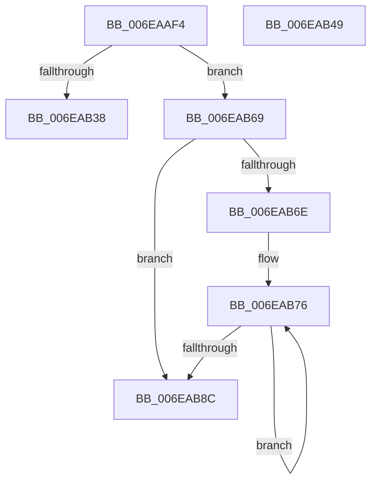

# sub_006EAAF4

- RVA: `0x006EAAF4`–`0x006EABA1` (길이 `173` bytes)
- VA: `0x00000001406EAAF4`
- 실행 섹션: `.text`
- PDB 이름 있음: `아니요`; PDB Function 태그: `아니요`
- unwind 정보 RVA: `0x00095794`
- 디코드: `47`개 명령, `173/173` bytes 표시
- 미해석 바이트: `0` (있으면 어셈블리에 `.byte`로 보존)

> 이 문서는 커널 이미지의 기계어와 PDB 기호를 분석해 생성했습니다. 4번과 5번은 함수 원형과 자료형을 바이너리 사용 방식에서 추정한 C 해석이며 원본 소스 복구 결과는 아닙니다.

## 1. Dependencies

- 직접 호출 지점: **3**; 고유 호출 대상: **3**
- 직접 호출자로 확인된 함수: **0**
- RIP 상대 이미지 참조: **1**

### Outgoing calls
- `0x006EAB2D` → [guard_dispatch_icall](../6B/guard_dispatch_icall_function_006BAAD0.md) (function, `0x006BAAD0`)
- `0x006EAB54` → [MiFreePagesFromMdl](../3F/MiFreePagesFromMdl_function_003F8300.md) (function, `0x003F8300`)
- `0x006EAB5E` → [ExFreePoolWithTag](../../poolcode/B8/ExFreePoolWithTag_function_00B82870.md) (function, `0x00B82870`)

### Direct callers
- 이 함수 시작 RVA로 연결되는 직접 call은 확인되지 않았습니다. 간접 호출은 완전히 역산할 수 없습니다.

### Static image references
- `0x006EAAF4` → RVA `0x00FC1778` (`.data`; read)

## 2. Other-region calls and transfers

- 다른 실행 섹션으로 향하는 call: **1**
  - `0x006EAB5E` → [ExFreePoolWithTag](../../poolcode/B8/ExFreePoolWithTag_function_00B82870.md) (`.text` → `POOLCODE`)
- call이 아닌 외부 분기/꼬리 이동: **3**
  - `0x006EAB44` → [HalpAllocateCommonBufferVectorInternal + 0x2DD](../3E/HalpAllocateCommonBufferVectorInternal_function_003E848C.md) (`tail-transfer`)
  - `0x006EAB64` → [HalpAllocateCommonBufferVectorInternal + 0x301](../3E/HalpAllocateCommonBufferVectorInternal_function_003E848C.md) (`tail-transfer`)
  - `0x006EAB9C` → [HalpAllocateCommonBufferVectorInternal + 0x1F1](../3E/HalpAllocateCommonBufferVectorInternal_function_003E848C.md) (`tail-transfer`)

## 3. Assembly (complete function range)

```asm
006EAAF4  48 8B 05 7D 6C 8D 00            mov rax, qword ptr [rip + 0x8d6c7d]
006EAAFB  48 8D 4D C7                     lea rcx, [rbp - 0x39]
006EAAFF  48 89 4C 24 30                  mov qword ptr [rsp + 0x30], rcx
006EAB04  4C 8D 45 DF                     lea r8, [rbp - 0x21]
006EAB08  4C 89 6D E7                     mov qword ptr [rbp - 0x19], r13
006EAB0C  48 8D 4D 5F                     lea rcx, [rbp + 0x5f]
006EAB10  48 89 4C 24 28                  mov qword ptr [rsp + 0x28], rcx
006EAB15  45 33 C9                        xor r9d, r9d
006EAB18  48 8B 40 38                     mov rax, qword ptr [rax + 0x38]
006EAB1C  48 8D 4D 57                     lea rcx, [rbp + 0x57]
006EAB20  48 89 4C 24 20                  mov qword ptr [rsp + 0x20], rcx
006EAB25  48 8B 4F 28                     mov rcx, qword ptr [rdi + 0x28]
006EAB29  41 8D 51 03                     lea edx, [r9 + 3]
006EAB2D  E8 9E FF FC FF                  call 0x1406baad0
006EAB32  8B F8                           mov edi, eax
006EAB34  85 C0                           test eax, eax
006EAB36  79 31                           jns 0x1406eab69
006EAB38  4C 8B 65 D7                     mov r12, qword ptr [rbp - 0x29]
006EAB3C  4C 8B 7D CF                     mov r15, qword ptr [rbp - 0x31]
006EAB40  4C 8B 75 B7                     mov r14, qword ptr [rbp - 0x49]
006EAB44  E9 20 DC CF FF                  jmp 0x1403e8769
006EAB49  45 33 C9                        xor r9d, r9d
006EAB4C  45 33 C0                        xor r8d, r8d
006EAB4F  33 D2                           xor edx, edx
006EAB51  49 8B CD                        mov rcx, r13
006EAB54  E8 A7 D7 D0 FF                  call 0x1403f8300
006EAB59  33 D2                           xor edx, edx
006EAB5B  49 8B CD                        mov rcx, r13
006EAB5E  E8 0D 7D 49 00                  call 0x140b82870
006EAB63  90                              nop
006EAB64  E9 24 DC CF FF                  jmp 0x1403e878d
006EAB69  4D 85 FF                        test r15, r15
006EAB6C  74 1E                           je 0x1406eab8c
006EAB6E  48 8B 55 B7                     mov rdx, qword ptr [rbp - 0x49]
006EAB72  48 83 C2 08                     add rdx, 8
006EAB76  48 8B 4D C7                     mov rcx, qword ptr [rbp - 0x39]
006EAB7A  48 03 CB                        add rcx, rbx
006EAB7D  49 03 DE                        add rbx, r14
006EAB80  48 89 0A                        mov qword ptr [rdx], rcx
006EAB83  48 8D 52 10                     lea rdx, [rdx + 0x10]
006EAB87  4D 2B FC                        sub r15, r12
006EAB8A  75 EA                           jne 0x1406eab76
006EAB8C  48 8B 45 C7                     mov rax, qword ptr [rbp - 0x39]
006EAB90  48 8B 7D BF                     mov rdi, qword ptr [rbp - 0x41]
006EAB94  48 89 46 38                     mov qword ptr [rsi + 0x38], rax
006EAB98  44 88 66 48                     mov byte ptr [rsi + 0x48], r12b
006EAB9C  E9 DC DA CF FF                  jmp 0x1403e867d
```

## 4. C-style interpretation (structured pseudocode)

```c
__int64 __fastcall sub_006EAAF4(__int64 a1, __int64 a2, __int64 a3, int a4)
{
    __int64 result;
    __int64 v_r15;
    __int64 v_rbx;
    unsigned __int64 v_stack_p20;
    unsigned __int64 v_stack_p28;
    unsigned __int64 v_stack_p30;

    v_stack_p30 = v_rbp - 57;
    *(unsigned __int64 *)(v_rbp - 25) = v_r13;
    v_stack_p28 = v_rbp + 95;
    a4 = 0;
    v_stack_p20 = v_rbp + 87;
    result = guard_dispatch_icall(*(unsigned __int64 *)(v_rdi + 40), a4 + 3, v_rbp - 33, a4);
    if (!sign_flag) goto loc_006EAB69;
loc_006EAB69:
    if (*(unsigned __int64 *)(v_rbp - 49) == 0) goto loc_006EAB8C;
    a2 = (*(unsigned __int64 *)(v_rbp - 73)) + (8);
loc_006EAB76:
    a1 = (*(unsigned __int64 *)(v_rbp - 57)) + (v_rbx);
    v_rbx = (v_rbx) + (*(unsigned __int64 *)(v_rbp - 73));
    *(unsigned __int64 *)(a2) = a1;
    v_r15 = (*(unsigned __int64 *)(v_rbp - 49)) - (*(unsigned __int64 *)(v_rbp - 41));
    if (condition_is_not_equal) goto loc_006EAB76;
loc_006EAB8C:
    *(unsigned __int64 *)(v_rsi + 56) = *(unsigned __int64 *)(v_rbp - 57);
    *(unsigned __int8 *)(v_rsi + 72) = (unsigned __int8)(*(unsigned __int64 *)(v_rbp - 41));
}
```

## 5. (Beta) C Style

```c
int64_t sub_006EAAF4(int64_t Arg1, int64_t Arg2, int64_t Arg3, int32_t Arg4)
{
    int64_t result;
    int64_t local_r15;
    int64_t local_rbx;
    uint64_t v_stack_p20;
    uint64_t v_stack_p28;
    uint64_t v_stack_p30;

    v_stack_p30 = local_rbp - 57;
    *(uint64_t *)(local_rbp - 0x19) = local_r13;
    v_stack_p28 = local_rbp + 95;
    Arg4 = 0;
    v_stack_p20 = local_rbp + 87;
    result = guard_dispatch_icall(*(uint64_t *)(local_rdi + 0x28), Arg4 + 3, local_rbp - 33, Arg4);
    if (!sign_flag) goto loc_006EAB69;
loc_006EAB69:
    if (*(uint64_t *)(local_rbp - 0x31) == 0) goto loc_006EAB8C;
    Arg2 = (*(uint64_t *)(local_rbp - 0x49)) + (8);
loc_006EAB76:
    Arg1 = (*(uint64_t *)(local_rbp - 0x39)) + (local_rbx);
    local_rbx = (local_rbx) + (*(uint64_t *)(local_rbp - 0x49));
    *(uint64_t *)(Arg2) = Arg1;
    local_r15 = (*(uint64_t *)(local_rbp - 0x31)) - (*(uint64_t *)(local_rbp - 0x29));
    if (condition_is_not_equal) goto loc_006EAB76;
loc_006EAB8C:
    *(uint64_t *)(local_rsi + 0x38) = *(uint64_t *)(local_rbp - 0x39);
    *(uint8_t *)(local_rsi + 0x48) = (uint8_t)(*(uint64_t *)(local_rbp - 0x29));
}
```

## 6. Execution-region graph

[열기: 2D/3D 그래프와 함수 탐색 컨트롤 패널](../../../control-panel.html?section=text&rva=0x006EAAF4&view=graph)

- 2D 그래프는 위에서 아래로 흐르고, 3D 그래프는 빈 공간을 드래그해 회전합니다. Shift+드래그는 이동, 휠은 확대·축소, 함수 노드 선택은 대상 보고서 이동입니다.

### Static fallback


