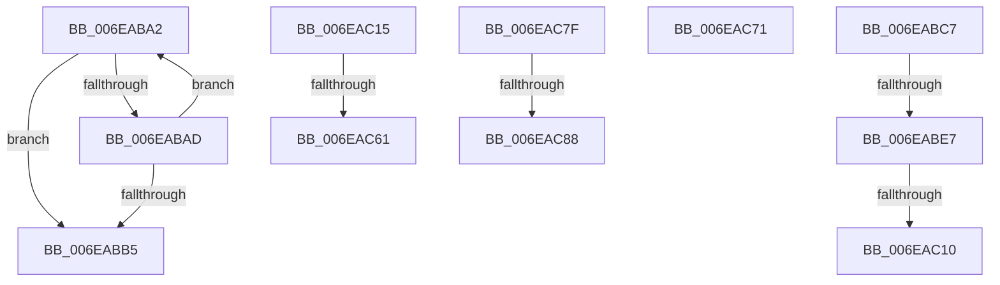

# sub_006EABA2

- RVA: `0x006EABA2`–`0x006EACA8` (길이 `262` bytes)
- VA: `0x00000001406EABA2`
- 실행 섹션: `.text`
- PDB 이름 있음: `아니요`; PDB Function 태그: `아니요`
- unwind 정보 RVA: `0x00095894`
- 디코드: `68`개 명령, `262/262` bytes 표시
- 미해석 바이트: `0` (있으면 어셈블리에 `.byte`로 보존)

> 이 문서는 커널 이미지의 기계어와 PDB 기호를 분석해 생성했습니다. 4번과 5번은 함수 원형과 자료형을 바이너리 사용 방식에서 추정한 C 해석이며 원본 소스 복구 결과는 아닙니다.

## 1. Dependencies

- 직접 호출 지점: **6**; 고유 호출 대상: **6**
- 직접 호출자로 확인된 함수: **0**
- RIP 상대 이미지 참조: **1**

### Outgoing calls
- `0x006EABD6` → [MmAllocateNodePagesForMdlEx](../3E/MmAllocateNodePagesForMdlEx_function_003EA920.md) (function, `0x003EA920`)
- `0x006EABFF` → [MmMapLockedPagesSpecifyCache](../31/MmMapLockedPagesSpecifyCache_function_00318800.md) (function, `0x00318800`)
- `0x006EAC52` → [guard_dispatch_icall](../6B/guard_dispatch_icall_function_006BAAD0.md) (function, `0x006BAAD0`)
- `0x006EAC74` → [MmFreeContiguousMemory](../3F/MmFreeContiguousMemory_function_003F6F60.md) (function, `0x003F6F60`)
- `0x006EAC93` → [MiFreePagesFromMdl](../3F/MiFreePagesFromMdl_function_003F8300.md) (function, `0x003F8300`)
- `0x006EAC9D` → [ExFreePoolWithTag](../../poolcode/B8/ExFreePoolWithTag_function_00B82870.md) (function, `0x00B82870`)

### Direct callers
- 이 함수 시작 RVA로 연결되는 직접 call은 확인되지 않았습니다. 간접 호출은 완전히 역산할 수 없습니다.

### Static image references
- `0x006EAC1D` → RVA `0x00FC1778` (`.data`; read)

## 2. Other-region calls and transfers

- 다른 실행 섹션으로 향하는 call: **1**
  - `0x006EAC9D` → [ExFreePoolWithTag](../../poolcode/B8/ExFreePoolWithTag_function_00B82870.md) (`.text` → `POOLCODE`)
- call이 아닌 외부 분기/꼬리 이동: **9**
  - `0x006EABC2` → [HalpAllocateCommonBufferDmaThin + 0xE5](../3E/HalpAllocateCommonBufferDmaThin_function_003E9788.md) (`tail-transfer`)
  - `0x006EABE1` → [HalpAllocateCommonBufferDmaThin + 0x1A4](../3E/HalpAllocateCommonBufferDmaThin_function_003E9788.md) (`tail-transfer`)
  - `0x006EAC0A` → [HalpAllocateCommonBufferDmaThin + 0x1A4](../3E/HalpAllocateCommonBufferDmaThin_function_003E9788.md) (`tail-transfer`)
  - `0x006EAC10` → [HalpAllocateCommonBufferDmaThin + 0x13B](../3E/HalpAllocateCommonBufferDmaThin_function_003E9788.md) (`tail-transfer`)
  - `0x006EAC5B` → [HalpAllocateCommonBufferDmaThin + 0x1A9](../3E/HalpAllocateCommonBufferDmaThin_function_003E9788.md) (`tail-transfer`)
  - `0x006EAC6C` → [HalpAllocateCommonBufferDmaThin + 0x153](../3E/HalpAllocateCommonBufferDmaThin_function_003E9788.md) (`tail-transfer`)
  - `0x006EAC7A` → [HalpAllocateCommonBufferDmaThin + 0x187](../3E/HalpAllocateCommonBufferDmaThin_function_003E9788.md) (`tail-transfer`)
  - `0x006EAC82` → [HalpAllocateCommonBufferDmaThin + 0x187](../3E/HalpAllocateCommonBufferDmaThin_function_003E9788.md) (`tail-transfer`)
  - `0x006EACA3` → [HalpAllocateCommonBufferDmaThin + 0x187](../3E/HalpAllocateCommonBufferDmaThin_function_003E9788.md) (`tail-transfer`)

## 3. Assembly (complete function range)

```asm
006EABA2  49 8B C2                        mov rax, r10
006EABA5  48 D3 E0                        shl rax, cl
006EABA8  49 3B C1                        cmp rax, r9
006EABAB  73 08                           jae 0x1406eabb5
006EABAD  41 03 CA                        add ecx, r10d
006EABB0  83 F9 3F                        cmp ecx, 0x3f
006EABB3  72 ED                           jb 0x1406eaba2
006EABB5  4D 8B CA                        mov r9, r10
006EABB8  C7 45 C7 65 00 00 00            mov dword ptr [rbp - 0x39], 0x65
006EABBF  49 D3 E1                        shl r9, cl
006EABC2  E9 A6 EC CF FF                  jmp 0x1403e986d
006EABC7  89 4C 24 30                     mov dword ptr [rsp + 0x30], ecx
006EABCB  48 8B CF                        mov rcx, rdi
006EABCE  89 44 24 28                     mov dword ptr [rsp + 0x28], eax
006EABD2  89 74 24 20                     mov dword ptr [rsp + 0x20], esi
006EABD6  E8 45 FD CF FF                  call 0x1403ea920
006EABDB  4C 8B F0                        mov r14, rax
006EABDE  48 85 C0                        test rax, rax
006EABE1  0F 84 45 ED CF FF               je 0x1403e992c
006EABE7  C7 44 24 28 10 00 00 40         mov dword ptr [rsp + 0x28], 0x40000010
006EABEF  45 33 C9                        xor r9d, r9d
006EABF2  83 64 24 20 00                  and dword ptr [rsp + 0x20], 0
006EABF7  44 8B C6                        mov r8d, esi
006EABFA  33 D2                           xor edx, edx
006EABFC  48 8B C8                        mov rcx, rax
006EABFF  E8 FC DB C2 FF                  call 0x140318800
006EAC04  4C 8B F8                        mov r15, rax
006EAC07  48 85 C0                        test rax, rax
006EAC0A  0F 84 1C ED CF FF               je 0x1403e992c
006EAC10  E9 AE EC CF FF                  jmp 0x1403e98c3
006EAC15  48 8B 55 4F                     mov rdx, qword ptr [rbp + 0x4f]
006EAC19  48 8D 4D CF                     lea rcx, [rbp - 0x31]
006EAC1D  48 8B 05 54 6B 8D 00            mov rax, qword ptr [rip + 0x8d6b54]
006EAC24  45 33 C9                        xor r9d, r9d
006EAC27  4C 8B 45 57                     mov r8, qword ptr [rbp + 0x57]
006EAC2B  83 65 E7 00                     and dword ptr [rbp - 0x19], 0
006EAC2F  48 89 4C 24 30                  mov qword ptr [rsp + 0x30], rcx
006EAC34  49 8B 4D 28                     mov rcx, qword ptr [r13 + 0x28]
006EAC38  4C 89 44 24 28                  mov qword ptr [rsp + 0x28], r8
006EAC3D  4C 8D 45 E7                     lea r8, [rbp - 0x19]
006EAC41  48 89 54 24 20                  mov qword ptr [rsp + 0x20], rdx
006EAC46  41 8D 51 03                     lea edx, [r9 + 3]
006EAC4A  4C 89 75 EF                     mov qword ptr [rbp - 0x11], r14
006EAC4E  48 8B 40 38                     mov rax, qword ptr [rax + 0x38]
006EAC52  E8 79 FE FC FF                  call 0x1406baad0
006EAC57  8B F0                           mov esi, eax
006EAC59  85 C0                           test eax, eax
006EAC5B  0F 88 D0 EC CF FF               js 0x1403e9931
006EAC61  4C 8B 45 CF                     mov r8, qword ptr [rbp - 0x31]
006EAC65  49 8B F8                        mov rdi, r8
006EAC68  C6 45 5F 01                     mov byte ptr [rbp + 0x5f], 1
006EAC6C  E9 6A EC CF FF                  jmp 0x1403e98db
006EAC71  48 8B CF                        mov rcx, rdi
006EAC74  E8 E7 C2 D0 FF                  call 0x1403f6f60
006EAC79  90                              nop
006EAC7A  E9 90 EC CF FF                  jmp 0x1403e990f
006EAC7F  4D 85 F6                        test r14, r14
006EAC82  0F 84 87 EC CF FF               je 0x1403e990f
006EAC88  45 33 C9                        xor r9d, r9d
006EAC8B  45 33 C0                        xor r8d, r8d
006EAC8E  33 D2                           xor edx, edx
006EAC90  49 8B CE                        mov rcx, r14
006EAC93  E8 68 D6 D0 FF                  call 0x1403f8300
006EAC98  33 D2                           xor edx, edx
006EAC9A  49 8B CE                        mov rcx, r14
006EAC9D  E8 CE 7B 49 00                  call 0x140b82870
006EACA2  90                              nop
006EACA3  E9 67 EC CF FF                  jmp 0x1403e990f
```

## 4. C-style interpretation (structured pseudocode)

```c
__int64 __fastcall sub_006EABA2(int a1, int a2, __int64 a3, __int64 a4)
{
    __int64 result;
    unsigned int v_stack_p20;
    unsigned int v_stack_p28;
    unsigned int v_stack_p30;

    result = (v_r10) << ((unsigned __int8)(a1));
    if (result >= a4) goto loc_006EABB5;
    a1 = (unsigned int)((a1) + ((unsigned int)(v_r10)));
    if (a1 < 63) goto loc_006EABA2;
loc_006EABB5:
    *(unsigned int *)(v_rbp - 57) = 101;
    a4 = (v_r10) << ((unsigned __int8)(a1));
}
```

## 5. (Beta) C Style

```c
int64_t sub_006EABA2(int32_t Arg1, int32_t Arg2, int64_t Arg3, int64_t Arg4)
{
    int64_t result;
    uint32_t v_stack_p20;
    uint32_t v_stack_p28;
    uint32_t v_stack_p30;

    result = (local_r10) << ((uint8_t)(Arg1));
    if (result >= Arg4) goto loc_006EABB5;
    Arg1 = (uint32_t)((Arg1) + ((uint32_t)(local_r10)));
    if (Arg1 < 63) goto loc_006EABA2;
loc_006EABB5:
    *(uint32_t *)(local_rbp - 0x39) = 101;
    Arg4 = (local_r10) << ((uint8_t)(Arg1));
}
```

## 6. Execution-region graph

[열기: 2D/3D 그래프와 함수 탐색 컨트롤 패널](../../../control-panel.html?section=text&rva=0x006EABA2&view=graph)

- 2D 그래프는 위에서 아래로 흐르고, 3D 그래프는 빈 공간을 드래그해 회전합니다. Shift+드래그는 이동, 휠은 확대·축소, 함수 노드 선택은 대상 보고서 이동입니다.

### Static fallback


