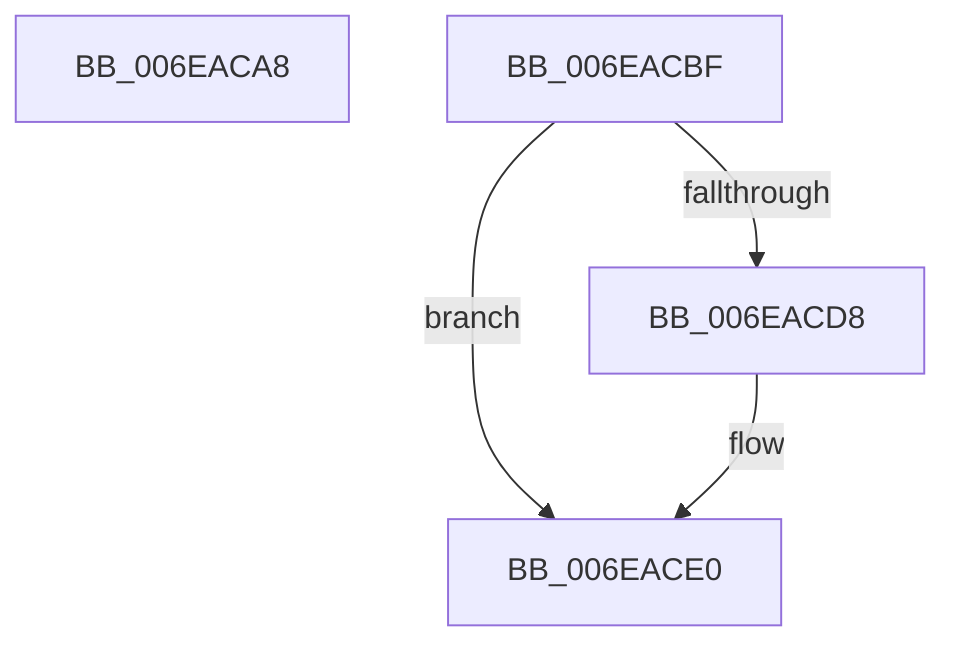

# sub_006EACA8

- RVA: `0x006EACA8`–`0x006EACEA` (길이 `66` bytes)
- VA: `0x00000001406EACA8`
- 실행 섹션: `.text`
- PDB 이름 있음: `아니요`; PDB Function 태그: `아니요`
- unwind 정보 RVA: `0x00095910`
- 디코드: `16`개 명령, `66/66` bytes 표시
- 미해석 바이트: `0` (있으면 어셈블리에 `.byte`로 보존)

> 이 문서는 커널 이미지의 기계어와 PDB 기호를 분석해 생성했습니다. 4번과 5번은 함수 원형과 자료형을 바이너리 사용 방식에서 추정한 C 해석이며 원본 소스 복구 결과는 아닙니다.

## 1. Dependencies

- 직접 호출 지점: **2**; 고유 호출 대상: **2**
- 직접 호출자로 확인된 함수: **0**
- RIP 상대 이미지 참조: **1**

### Outgoing calls
- `0x006EACAE` → [MiUnmapContiguousMemory](../3F/MiUnmapContiguousMemory_function_003F7908.md) (function, `0x003F7908`)
- `0x006EACDB` → [KiRaiseIrqlProcessIrqlFlags](../4F/KiRaiseIrqlProcessIrqlFlags_function_004F56FC.md) (function, `0x004F56FC`)

### Direct callers
- 이 함수 시작 RVA로 연결되는 직접 call은 확인되지 않았습니다. 간접 호출은 완전히 역산할 수 없습니다.

### Static image references
- `0x006EACCF` → RVA `0x00FC6D20` (`ALMOSTRO`; read)

## 2. Other-region calls and transfers

- 다른 실행 섹션으로 향하는 call: **0**
- call이 아닌 외부 분기/꼬리 이동: **2**
  - `0x006EACBA` → [MiAllocateContiguousMemory + 0x2DC](../3E/MiAllocateContiguousMemory_function_003E9FDC.md) (`tail-transfer`)
  - `0x006EACE5` → [MiAllocateContiguousMemory + 0x4A4](../3E/MiAllocateContiguousMemory_function_003E9FDC.md) (`tail-transfer`)

## 3. Assembly (complete function range)

```asm
006EACA8  41 B0 01                        mov r8b, 1
006EACAB  49 8B CC                        mov rcx, r12
006EACAE  E8 55 CC D0 FF                  call 0x1403f7908
006EACB3  45 33 E4                        xor r12d, r12d
006EACB6  4C 89 65 90                     mov qword ptr [rbp - 0x70], r12
006EACBA  E9 F9 F5 CF FF                  jmp 0x1403ea2b8
006EACBF  41 0F B6 C5                     movzx eax, r13b
006EACC3  44 0F 22 C0                     mov cr8, rax
006EACC7  44 0F 20 C1                     mov rcx, cr8
006EACCB  44 0F 22 C7                     mov cr8, rdi
006EACCF  83 3D 4A C0 8D 00 00            cmp dword ptr [rip + 0x8dc04a], 0
006EACD6  74 08                           je 0x1406eace0
006EACD8  40 8A D7                        mov dl, dil
006EACDB  E8 1C AA E0 FF                  call 0x1404f56fc
006EACE0  48 8B 4C 24 78                  mov rcx, qword ptr [rsp + 0x78]
006EACE5  E9 96 F7 CF FF                  jmp 0x1403ea480
```

## 4. C-style interpretation (structured pseudocode)

```c
__int64 __fastcall sub_006EACA8(void)
{
    __int64 result;
    __int64 v_r12;
    unsigned __int64 v_stack_p78;

    result = MiUnmapContiguousMemory(v_r12, a2, 1, a4);
    v_r12 = 0;
    *(unsigned __int64 *)(v_rbp - 112) = 0;
}
```

## 5. (Beta) C Style

```c
void sub_006EACA8(void)
{
    int64_t result;
    int64_t local_r12;
    uint64_t v_stack_p78;

    result = MiUnmapContiguousMemory(local_r12, a2, 1, a4);
    local_r12 = 0;
    *(uint64_t *)(local_rbp - 0x70) = 0;
}
```

## 6. Execution-region graph

[열기: 2D/3D 그래프와 함수 탐색 컨트롤 패널](../../../control-panel.html?section=text&rva=0x006EACA8&view=graph)

- 2D 그래프는 위에서 아래로 흐르고, 3D 그래프는 빈 공간을 드래그해 회전합니다. Shift+드래그는 이동, 휠은 확대·축소, 함수 노드 선택은 대상 보고서 이동입니다.

### Static fallback


