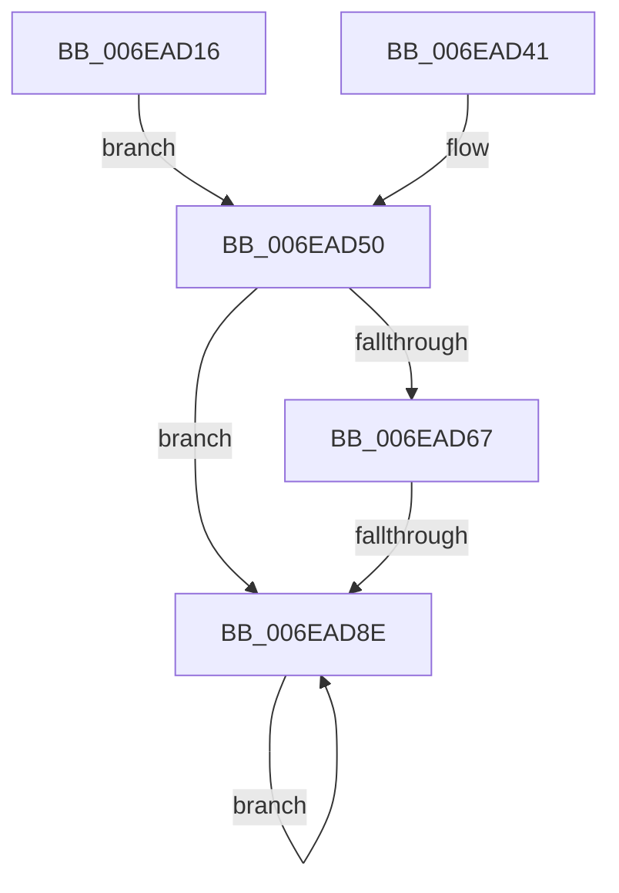

# sub_006EAD16

- RVA: `0x006EAD16`–`0x006EADA0` (길이 `138` bytes)
- VA: `0x00000001406EAD16`
- 실행 섹션: `.text`
- PDB 이름 있음: `아니요`; PDB Function 태그: `아니요`
- unwind 정보 RVA: `0x000959FC`
- 디코드: `35`개 명령, `138/138` bytes 표시
- 미해석 바이트: `0` (있으면 어셈블리에 `.byte`로 보존)

> 이 문서는 커널 이미지의 기계어와 PDB 기호를 분석해 생성했습니다. 4번과 5번은 함수 원형과 자료형을 바이너리 사용 방식에서 추정한 C 해석이며 원본 소스 복구 결과는 아닙니다.

## 1. Dependencies

- 직접 호출 지점: **5**; 고유 호출 대상: **5**
- 직접 호출자로 확인된 함수: **0**
- RIP 상대 이미지 참조: **0**

### Outgoing calls
- `0x006EAD2D` → [memcpy](../6C/memcpy_function_006C6840.md) (function, `0x006C6840`)
- `0x006EAD48` → [EtwpAllocatePhysicalPages](../../page/7B/EtwpAllocatePhysicalPages_function_007B57DC.md) (function, `0x007B57DC`)
- `0x006EAD5D` → [EtwpMdlInit](../../page/7B/EtwpMdlInit_function_007B7680.md) (function, `0x007B7680`)
- `0x006EAD80` → [MmMapLockedPagesSpecifyCache](../31/MmMapLockedPagesSpecifyCache_function_00318800.md) (function, `0x00318800`)
- `0x006EAD99` → [MiFreePagesFromMdl](../3F/MiFreePagesFromMdl_function_003F8300.md) (function, `0x003F8300`)

### Direct callers
- 이 함수 시작 RVA로 연결되는 직접 call은 확인되지 않았습니다. 간접 호출은 완전히 역산할 수 없습니다.

### Static image references
- 디코드된 RIP-relative 메모리 참조가 없습니다.

## 2. Other-region calls and transfers

- 다른 실행 섹션으로 향하는 call: **2**
  - `0x006EAD48` → [EtwpAllocatePhysicalPages](../../page/7B/EtwpAllocatePhysicalPages_function_007B57DC.md) (`.text` → `PAGE`)
  - `0x006EAD5D` → [EtwpMdlInit](../../page/7B/EtwpMdlInit_function_007B7680.md) (`.text` → `PAGE`)
- call이 아닌 외부 분기/꼬리 이동: **1**
  - `0x006EAD88` → [EtwpAllocateTraceBuffer + 0x51](../3E/EtwpAllocateTraceBuffer_function_003EB070.md) (`tail-transfer`)

## 3. Assembly (complete function range)

```asm
006EAD16  48 83 C1 08                     add rcx, 8
006EAD1A  4C 8D 04 ED 00 00 00 00         lea r8, [rbp*8]
006EAD22  48 2B C7                        sub rax, rdi
006EAD25  48 8D 14 C1                     lea rdx, [rcx + rax*8]
006EAD29  48 8D 4E 30                     lea rcx, [rsi + 0x30]
006EAD2D  E8 0E BB FD FF                  call 0x1406c6840
006EAD32  48 8B 83 50 06 00 00            mov rax, qword ptr [rbx + 0x650]
006EAD39  44 8B CD                        mov r9d, ebp
006EAD3C  48 29 38                        sub qword ptr [rax], rdi
006EAD3F  EB 0F                           jmp 0x1406ead50
006EAD41  48 8D 4E 30                     lea rcx, [rsi + 0x30]
006EAD45  48 8B D7                        mov rdx, rdi
006EAD48  E8 8F AA 0C 00                  call 0x1407b57dc
006EAD4D  4C 8B C8                        mov r9, rax
006EAD50  48 8B 8B 48 06 00 00            mov rcx, qword ptr [rbx + 0x648]
006EAD57  45 33 C0                        xor r8d, r8d
006EAD5A  41 8B D1                        mov edx, r9d
006EAD5D  E8 1E C9 0C 00                  call 0x1407b7680
006EAD62  44 3B CD                        cmp r9d, ebp
006EAD65  75 27                           jne 0x1406ead8e
006EAD67  45 33 C9                        xor r9d, r9d
006EAD6A  C7 44 24 28 20 00 00 40         mov dword ptr [rsp + 0x28], 0x40000020
006EAD72  44 21 44 24 20                  and dword ptr [rsp + 0x20], r8d
006EAD77  33 D2                           xor edx, edx
006EAD79  48 8B CE                        mov rcx, rsi
006EAD7C  45 8D 41 01                     lea r8d, [r9 + 1]
006EAD80  E8 7B DA C2 FF                  call 0x140318800
006EAD85  48 85 C0                        test rax, rax
006EAD88  0F 85 33 03 D0 FF               jne 0x1403eb0c1
006EAD8E  45 33 C9                        xor r9d, r9d
006EAD91  45 33 C0                        xor r8d, r8d
006EAD94  33 D2                           xor edx, edx
006EAD96  48 8B CE                        mov rcx, rsi
006EAD99  E8 62 D5 D0 FF                  call 0x1403f8300
006EAD9E  EB EE                           jmp 0x1406ead8e
```

## 4. C-style interpretation (structured pseudocode)

```c
__int64 __fastcall sub_006EAD16(__int64 a1)
{
    __int64 result;
    unsigned int v_stack_p20;
    unsigned int v_stack_p28;

    a1 = (a1) + (8);
    result = (result) - (v_rdi);
    result = memcpy(v_rsi + 48, a1 + result * 8, v_rbp * 8, a4);
    goto loc_006EAD50;
loc_006EAD50:
    a3 = 0;
    result = EtwpMdlInit(*(unsigned __int64 *)(v_rbx + 1608), (unsigned int)((unsigned int)((unsigned int)((unsigned int)(v_rbp)))), a3, (unsigned int)((unsigned int)(v_rbp)));
    if (((unsigned int)((unsigned int)((unsigned int)(v_rbp)))) != ((unsigned int)(v_rbp))) goto loc_006EAD8E;
    a4 = 0;
    v_stack_p28 = 0x40000020ULL;
    a2 = 0;
    result = MmMapLockedPagesSpecifyCache(v_rsi, a2, a4 + 1, a4);
loc_006EAD8E:
    a4 = 0;
    a3 = 0;
    a2 = 0;
    result = MiFreePagesFromMdl(v_rsi, a2, a3, a4);
    goto loc_006EAD8E;
}
```

## 5. (Beta) C Style

```c
int64_t sub_006EAD16(void *Arg1)
{
    uint8_t *arg1 = (uint8_t *)Arg1;

    int64_t result;
    uint32_t v_stack_p20;
    uint32_t v_stack_p28;

    Arg1 = (Arg1) + (8);
    result = (result) - (local_rdi);
    result = memcpy(local_rsi + 48, Arg1 + result * 8, local_rbp * 8, a4);
    goto loc_006EAD50;
loc_006EAD50:
    a3 = 0;
    result = EtwpMdlInit(*(uint64_t *)(local_rbx + 0x648), (uint32_t)((uint32_t)((uint32_t)((uint32_t)(local_rbp)))), a3, (uint32_t)((uint32_t)(local_rbp)));
    if (((uint32_t)((uint32_t)((uint32_t)(local_rbp)))) != ((uint32_t)(local_rbp))) goto loc_006EAD8E;
    a4 = 0;
    v_stack_p28 = 0x40000020ULL;
    a2 = 0;
    result = MmMapLockedPagesSpecifyCache(local_rsi, a2, a4 + 1, a4);
loc_006EAD8E:
    a4 = 0;
    a3 = 0;
    a2 = 0;
    result = MiFreePagesFromMdl(local_rsi, a2, a3, a4);
    goto loc_006EAD8E;
}
```

### 관측된 메모리 오프셋

구조체 형식이 확인되지 않은 접근은 인자 기준의 오프셋으로만 기록했습니다.

| 기준 인자 | 오프셋 표현 | 폭 (bit) | 접근 |
|---|---:|---:|---|
| `Arg1` | `+ 0x0 + rax*8` | `64` | `R` |

## 6. Execution-region graph

[열기: 2D/3D 그래프와 함수 탐색 컨트롤 패널](../../../control-panel.html?section=text&rva=0x006EAD16&view=graph)

- 2D 그래프는 위에서 아래로 흐르고, 3D 그래프는 빈 공간을 드래그해 회전합니다. Shift+드래그는 이동, 휠은 확대·축소, 함수 노드 선택은 대상 보고서 이동입니다.

### Static fallback


