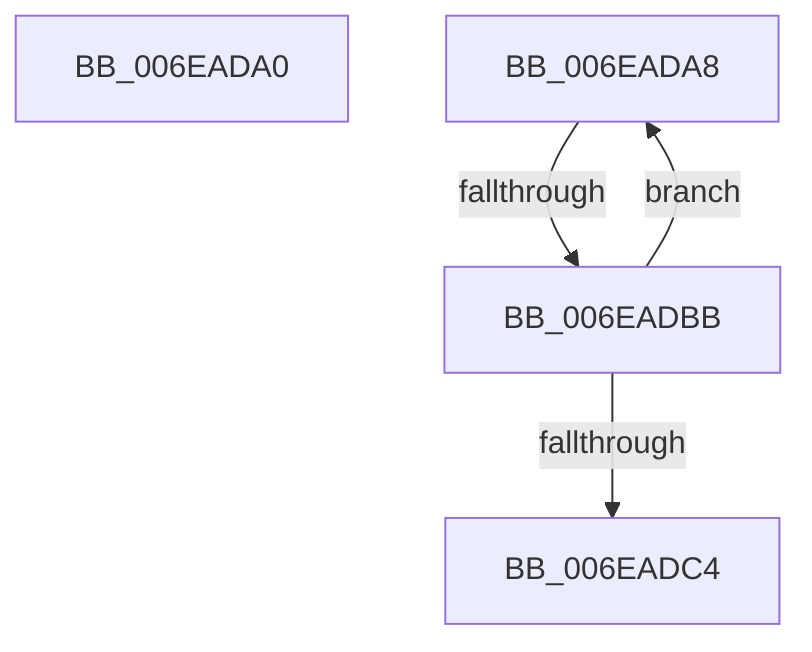

# sub_006EADA0

- RVA: `0x006EADA0`–`0x006EADC9` (길이 `41` bytes)
- VA: `0x00000001406EADA0`
- 실행 섹션: `.text`
- PDB 이름 있음: `아니요`; PDB Function 태그: `아니요`
- unwind 정보 RVA: `0x00095A34`
- 디코드: `9`개 명령, `41/41` bytes 표시
- 미해석 바이트: `0` (있으면 어셈블리에 `.byte`로 보존)

> 이 문서는 커널 이미지의 기계어와 PDB 기호를 분석해 생성했습니다. 4번과 5번은 함수 원형과 자료형을 바이너리 사용 방식에서 추정한 C 해석이며 원본 소스 복구 결과는 아닙니다.

## 1. Dependencies

- 직접 호출 지점: **0**; 고유 호출 대상: **0**
- 직접 호출자로 확인된 함수: **0**
- RIP 상대 이미지 참조: **0**

### Outgoing calls
- 직접 디코드된 call 명령이 없습니다.

### Direct callers
- 이 함수 시작 RVA로 연결되는 직접 call은 확인되지 않았습니다. 간접 호출은 완전히 역산할 수 없습니다.

### Static image references
- 디코드된 RIP-relative 메모리 참조가 없습니다.

## 2. Other-region calls and transfers

- 다른 실행 섹션으로 향하는 call: **0**
- call이 아닌 외부 분기/꼬리 이동: **3**
  - `0x006EADA3` → [EtwpDequeueFreeBuffer + 0xBE](../3E/EtwpDequeueFreeBuffer_function_003EB1F0.md) (`tail-transfer`)
  - `0x006EADB5` → [EtwpDequeueFreeBuffer + 0x17D](../3E/EtwpDequeueFreeBuffer_function_003EB1F0.md) (`tail-transfer`)
  - `0x006EADC4` → [EtwpDequeueFreeBuffer + 0x17D](../3E/EtwpDequeueFreeBuffer_function_003EB1F0.md) (`tail-transfer`)

## 3. Assembly (complete function range)

```asm
006EADA0  40 8A EE                        mov bpl, sil
006EADA3  E9 06 05 D0 FF                  jmp 0x1403eb2ae
006EADA8  48 8B 8B 30 06 00 00            mov rcx, qword ptr [rbx + 0x630]
006EADAF  F0 4A 0F B1 14 C1               lock cmpxchg qword ptr [rcx + r8*8], rdx
006EADB5  0F 84 B2 05 D0 FF               je 0x1403eb36d
006EADBB  48 8B 57 10                     mov rdx, qword ptr [rdi + 0x10]
006EADBF  48 3B D0                        cmp rdx, rax
006EADC2  7F E4                           jg 0x1406eada8
006EADC4  E9 A4 05 D0 FF                  jmp 0x1403eb36d
```

## 4. C-style interpretation (structured pseudocode)

```c
void __fastcall sub_006EADA0(__int64 a1, __int64 a2, __int64 a3)
{
}
```

## 5. (Beta) C Style

```c
void sub_006EADA0(int64_t Arg1, int64_t Arg2, int64_t Arg3)
{
}
```

## 6. Execution-region graph

[열기: 2D/3D 그래프와 함수 탐색 컨트롤 패널](../../../control-panel.html?section=text&rva=0x006EADA0&view=graph)

- 2D 그래프는 위에서 아래로 흐르고, 3D 그래프는 빈 공간을 드래그해 회전합니다. Shift+드래그는 이동, 휠은 확대·축소, 함수 노드 선택은 대상 보고서 이동입니다.

### Static fallback


