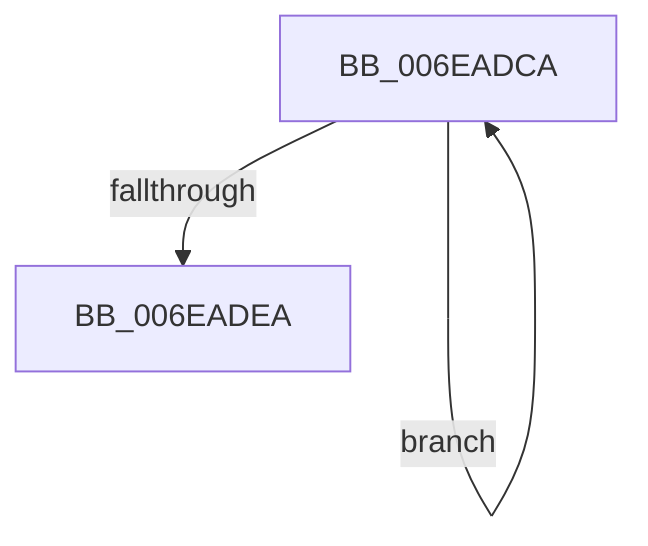

# sub_006EADCA

- RVA: `0x006EADCA`–`0x006EAE00` (길이 `54` bytes)
- VA: `0x00000001406EADCA`
- 실행 섹션: `.text`
- PDB 이름 있음: `아니요`; PDB Function 태그: `아니요`
- unwind 정보 RVA: `0x00095AB0`
- 디코드: `15`개 명령, `54/54` bytes 표시
- 미해석 바이트: `0` (있으면 어셈블리에 `.byte`로 보존)

> 이 문서는 커널 이미지의 기계어와 PDB 기호를 분석해 생성했습니다. 4번과 5번은 함수 원형과 자료형을 바이너리 사용 방식에서 추정한 C 해석이며 원본 소스 복구 결과는 아닙니다.

## 1. Dependencies

- 직접 호출 지점: **2**; 고유 호출 대상: **2**
- 직접 호출자로 확인된 함수: **0**
- RIP 상대 이미지 참조: **0**

### Outgoing calls
- `0x006EADCD` → [MmGetPhysicalAddress](../23/MmGetPhysicalAddress_function_0023A500.md) (function, `0x0023A500`)
- `0x006EADF5` → [MiFreePagesFromMdl](../3F/MiFreePagesFromMdl_function_003F8300.md) (function, `0x003F8300`)

### Direct callers
- 이 함수 시작 RVA로 연결되는 직접 call은 확인되지 않았습니다. 간접 호출은 완전히 역산할 수 없습니다.

### Static image references
- 디코드된 RIP-relative 메모리 참조가 없습니다.

## 2. Other-region calls and transfers

- 다른 실행 섹션으로 향하는 call: **0**
- call이 아닌 외부 분기/꼬리 이동: **1**
  - `0x006EADFB` → [EtwpFreeTraceBuffer + 0x3A](../3E/EtwpFreeTraceBuffer_function_003EB978.md) (`tail-transfer`)

## 3. Assembly (complete function range)

```asm
006EADCA  48 8B CB                        mov rcx, rbx
006EADCD  E8 2E F7 B4 FF                  call 0x14023a500
006EADD2  48 C1 E8 0C                     shr rax, 0xc
006EADD6  48 81 C3 00 10 00 00            add rbx, 0x1000
006EADDD  48 89 07                        mov qword ptr [rdi], rax
006EADE0  48 8D 7F 08                     lea rdi, [rdi + 8]
006EADE4  48 83 EE 01                     sub rsi, 1
006EADE8  75 E0                           jne 0x1406eadca
006EADEA  45 33 C9                        xor r9d, r9d
006EADED  45 33 C0                        xor r8d, r8d
006EADF0  33 D2                           xor edx, edx
006EADF2  48 8B CD                        mov rcx, rbp
006EADF5  E8 06 D5 D0 FF                  call 0x1403f8300
006EADFA  90                              nop
006EADFB  E9 B2 0B D0 FF                  jmp 0x1403eb9b2
```

## 4. C-style interpretation (structured pseudocode)

```c
__int64 __fastcall sub_006EADCA(__int64 a1, int a2, int a3, int a4)
{
    __int64 result;
    __int64 v_rbx;
    __int64 v_rsi;

    result = MmGetPhysicalAddress(v_rbx, a2, a3, a4);
    result = (result) >> (12);
    v_rbx = (v_rbx) + (0x1000ULL);
    *(unsigned __int64 *)(v_rdi) = result;
    v_rsi = (v_rsi) - (1);
    if (condition_is_not_equal) goto loc_006EADCA;
    a4 = 0;
    a3 = 0;
    a2 = 0;
    result = MiFreePagesFromMdl(v_rbp, a2, a3, a4);
}
```

## 5. (Beta) C Style

```c
int64_t sub_006EADCA(int64_t Arg1, int32_t Arg2, int32_t Arg3, int32_t Arg4)
{
    int64_t result;
    int64_t local_rbx;
    int64_t local_rsi;

    result = MmGetPhysicalAddress(local_rbx, Arg2, Arg3, Arg4);
    result = (result) >> (12);
    local_rbx = (local_rbx) + (0x1000ULL);
    *(uint64_t *)(local_rdi) = result;
    local_rsi = (local_rsi) - (1);
    if (condition_is_not_equal) goto loc_006EADCA;
    Arg4 = 0;
    Arg3 = 0;
    Arg2 = 0;
    result = MiFreePagesFromMdl(local_rbp, Arg2, Arg3, Arg4);
}
```

## 6. Execution-region graph

[열기: 2D/3D 그래프와 함수 탐색 컨트롤 패널](../../../control-panel.html?section=text&rva=0x006EADCA&view=graph)

- 2D 그래프는 위에서 아래로 흐르고, 3D 그래프는 빈 공간을 드래그해 회전합니다. Shift+드래그는 이동, 휠은 확대·축소, 함수 노드 선택은 대상 보고서 이동입니다.

### Static fallback


