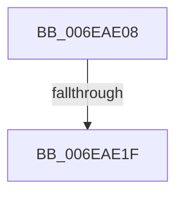

# sub_006EAE08

- RVA: `0x006EAE08`–`0x006EAE2F` (길이 `39` bytes)
- VA: `0x00000001406EAE08`
- 실행 섹션: `.text`
- PDB 이름 있음: `아니요`; PDB Function 태그: `아니요`
- unwind 정보 RVA: `0x00096A0C`
- 디코드: `11`개 명령, `39/39` bytes 표시
- 미해석 바이트: `0` (있으면 어셈블리에 `.byte`로 보존)

> 이 문서는 커널 이미지의 기계어와 PDB 기호를 분석해 생성했습니다. 4번과 5번은 함수 원형과 자료형을 바이너리 사용 방식에서 추정한 C 해석이며 원본 소스 복구 결과는 아닙니다.

## 1. Dependencies

- 직접 호출 지점: **2**; 고유 호출 대상: **2**
- 직접 호출자로 확인된 함수: **0**
- RIP 상대 이미지 참조: **0**

### Outgoing calls
- `0x006EAE12` → [DifAddPerDriverDataForPlugins](../61/DifAddPerDriverDataForPlugins_function_006198CC.md) (function, `0x006198CC`)
- `0x006EAE24` → [ViTargetDriversFreeVerifiedData](../61/ViTargetDriversFreeVerifiedData_function_00613354.md) (function, `0x00613354`)

### Direct callers
- 이 함수 시작 RVA로 연결되는 직접 call은 확인되지 않았습니다. 간접 호출은 완전히 역산할 수 없습니다.

### Static image references
- 디코드된 RIP-relative 메모리 참조가 없습니다.

## 2. Other-region calls and transfers

- 다른 실행 섹션으로 향하는 call: **0**
- call이 아닌 외부 분기/꼬리 이동: **2**
  - `0x006EAE19` → [VfTargetDriversAdd + 0x48](../3E/VfTargetDriversAdd_function_003EE2F4.md) (`tail-transfer`)
  - `0x006EAE2A` → [VfTargetDriversAdd + 0xC3](../3E/VfTargetDriversAdd_function_003EE2F4.md) (`tail-transfer`)

## 3. Assembly (complete function range)

```asm
006EAE08  83 E0 FD                        and eax, 0xfffffffd
006EAE0B  48 8D 4F 60                     lea rcx, [rdi + 0x60]
006EAE0F  89 47 20                        mov dword ptr [rdi + 0x20], eax
006EAE12  E8 B5 EA F2 FF                  call 0x1406198cc
006EAE17  85 C0                           test eax, eax
006EAE19  0F 89 1D 35 D0 FF               jns 0x1403ee33c
006EAE1F  33 DB                           xor ebx, ebx
006EAE21  48 8B CF                        mov rcx, rdi
006EAE24  E8 2B 85 F2 FF                  call 0x140613354
006EAE29  90                              nop
006EAE2A  E9 88 35 D0 FF                  jmp 0x1403ee3b7
```

## 4. C-style interpretation (structured pseudocode)

```c
__int64 __fastcall sub_006EAE08(void)
{
    __int64 result;
    __int64 v_rbx;

    result = (unsigned int)((result) & (0xFFFFFFFDULL));
    *(unsigned int *)(v_rdi + 32) = (unsigned int)(result);
    result = DifAddPerDriverDataForPlugins(v_rdi + 96, a2, a3, a4);
    v_rbx = 0;
    result = ViTargetDriversFreeVerifiedData(v_rdi, a2, a3, a4);
}
```

## 5. (Beta) C Style

```c
void sub_006EAE08(void)
{
    int64_t result;
    int64_t local_rbx;

    result = (uint32_t)((result) & (0xFFFFFFFDULL));
    *(uint32_t *)(local_rdi + 0x20) = (uint32_t)(result);
    result = DifAddPerDriverDataForPlugins(local_rdi + 96, a2, a3, a4);
    local_rbx = 0;
    result = ViTargetDriversFreeVerifiedData(local_rdi, a2, a3, a4);
}
```

## 6. Execution-region graph

[열기: 2D/3D 그래프와 함수 탐색 컨트롤 패널](../../../control-panel.html?section=text&rva=0x006EAE08&view=graph)

- 2D 그래프는 위에서 아래로 흐르고, 3D 그래프는 빈 공간을 드래그해 회전합니다. Shift+드래그는 이동, 휠은 확대·축소, 함수 노드 선택은 대상 보고서 이동입니다.

### Static fallback


