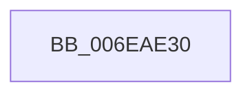

# sub_006EAE30

- RVA: `0x006EAE30`–`0x006EAE45` (길이 `21` bytes)
- VA: `0x00000001406EAE30`
- 실행 섹션: `.text`
- PDB 이름 있음: `아니요`; PDB Function 태그: `아니요`
- unwind 정보 RVA: `0x00096AC0`
- 디코드: `5`개 명령, `21/21` bytes 표시
- 미해석 바이트: `0` (있으면 어셈블리에 `.byte`로 보존)

> 이 문서는 커널 이미지의 기계어와 PDB 기호를 분석해 생성했습니다. 4번과 5번은 함수 원형과 자료형을 바이너리 사용 방식에서 추정한 C 해석이며 원본 소스 복구 결과는 아닙니다.

## 1. Dependencies

- 직접 호출 지점: **1**; 고유 호출 대상: **1**
- 직접 호출자로 확인된 함수: **0**
- RIP 상대 이미지 참조: **1**

### Outgoing calls
- `0x006EAE3A` → [VfAvlFreeNodeNoLock](../61/VfAvlFreeNodeNoLock_function_006126D8.md) (function, `0x006126D8`)

### Direct callers
- 이 함수 시작 RVA로 연결되는 직접 call은 확인되지 않았습니다. 간접 호출은 완전히 역산할 수 없습니다.

### Static image references
- `0x006EAE33` → RVA `0x00F049A0` (`.data`; read)

## 2. Other-region calls and transfers

- 다른 실행 섹션으로 향하는 call: **0**
- call이 아닌 외부 분기/꼬리 이동: **1**
  - `0x006EAE40` → [VfTargetDriversRemove + 0x172](../3E/VfTargetDriversRemove_function_003EEF9C.md) (`tail-transfer`)

## 3. Assembly (complete function range)

```asm
006EAE30  48 8B D6                        mov rdx, rsi
006EAE33  48 8D 0D 66 9B 81 00            lea rcx, [rip + 0x819b66]
006EAE3A  E8 99 78 F2 FF                  call 0x1406126d8
006EAE3F  90                              nop
006EAE40  E9 C9 42 D0 FF                  jmp 0x1403ef10e
```

## 4. C-style interpretation (structured pseudocode)

```c
__int64 __fastcall sub_006EAE30(void)
{
    __int64 result;

    result = VfAvlFreeNodeNoLock(v_rip + 8493926, v_rsi, a3, a4);
}
```

## 5. (Beta) C Style

```c
void sub_006EAE30(void)
{
    int64_t result;

    result = VfAvlFreeNodeNoLock(v_rip + 8493926, local_rsi, a3, a4);
}
```

## 6. Execution-region graph

[열기: 2D/3D 그래프와 함수 탐색 컨트롤 패널](../../../control-panel.html?section=text&rva=0x006EAE30&view=graph)

- 2D 그래프는 위에서 아래로 흐르고, 3D 그래프는 빈 공간을 드래그해 회전합니다. Shift+드래그는 이동, 휠은 확대·축소, 함수 노드 선택은 대상 보고서 이동입니다.

### Static fallback


