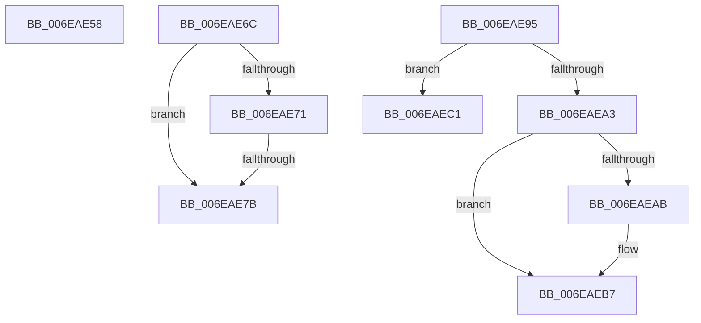

# sub_006EAE58

- RVA: `0x006EAE58`–`0x006EAED0` (길이 `120` bytes)
- VA: `0x00000001406EAE58`
- 실행 섹션: `.text`
- PDB 이름 있음: `아니요`; PDB Function 태그: `아니요`
- unwind 정보 RVA: `0x00096BAC`
- 디코드: `29`개 명령, `120/120` bytes 표시
- 미해석 바이트: `0` (있으면 어셈블리에 `.byte`로 보존)

> 이 문서는 커널 이미지의 기계어와 PDB 기호를 분석해 생성했습니다. 4번과 5번은 함수 원형과 자료형을 바이너리 사용 방식에서 추정한 C 해석이며 원본 소스 복구 결과는 아닙니다.

## 1. Dependencies

- 직접 호출 지점: **4**; 고유 호출 대상: **3**
- 직접 호출자로 확인된 함수: **0**
- RIP 상대 이미지 참조: **0**

### Outgoing calls
- `0x006EAE5E` → [MiLeapPrefetch](../4C/MiLeapPrefetch_function_004CAED0.md) (function, `0x004CAED0`)
- `0x006EAE82` → [MiUnlockVadTree](../29/MiUnlockVadTree_function_00297020.md) (function, `0x00297020`)
- `0x006EAE8A` → [MiAdvanceFaultList](../36/MiAdvanceFaultList_function_003637A0.md) (function, `0x003637A0`)
- `0x006EAEB2` → [MiUnlockVadTree](../29/MiUnlockVadTree_function_00297020.md) (function, `0x00297020`)

### Direct callers
- 이 함수 시작 RVA로 연결되는 직접 call은 확인되지 않았습니다. 간접 호출은 완전히 역산할 수 없습니다.

### Static image references
- 디코드된 RIP-relative 메모리 참조가 없습니다.

## 2. Other-region calls and transfers

- 다른 실행 섹션으로 향하는 call: **0**
- call이 아닌 외부 분기/꼬리 이동: **5**
  - `0x006EAE67` → [MiInPagePageTable + 0x379](../3E/MiInPagePageTable_function_003EF8DC.md) (`tail-transfer`)
  - `0x006EAE75` → [MiInPagePageTable + 0x143](../3E/MiInPagePageTable_function_003EF8DC.md) (`tail-transfer`)
  - `0x006EAE90` → [MiInPagePageTable + 0x64F](../3E/MiInPagePageTable_function_003EF8DC.md) (`tail-transfer`)
  - `0x006EAEBC` → [MiInPagePageTable + 0x64F](../3E/MiInPagePageTable_function_003EF8DC.md) (`tail-transfer`)
  - `0x006EAECB` → [MiInPagePageTable + 0x158](../3E/MiInPagePageTable_function_003EF8DC.md) (`tail-transfer`)

## 3. Assembly (complete function range)

```asm
006EAE58  48 8B D0                        mov rdx, rax
006EAE5B  48 8B CF                        mov rcx, rdi
006EAE5E  E8 6D 00 DE FF                  call 0x1404caed0
006EAE63  C6 47 01 01                     mov byte ptr [rdi + 1], 1
006EAE67  E9 E9 4D D0 FF                  jmp 0x1403efc55
006EAE6C  83 F8 01                        cmp eax, 1
006EAE6F  75 0A                           jne 0x1406eae7b
006EAE71  0F BA E1 0E                     bt ecx, 0xe
006EAE75  0F 82 A4 4B D0 FF               jb 0x1403efa1f
006EAE7B  B2 11                           mov dl, 0x11
006EAE7D  B9 01 00 00 00                  mov ecx, 1
006EAE82  E8 99 C1 BA FF                  call 0x140297020
006EAE87  48 8B CB                        mov rcx, rbx
006EAE8A  E8 11 89 C7 FF                  call 0x1403637a0
006EAE8F  90                              nop
006EAE90  E9 96 50 D0 FF                  jmp 0x1403eff2b
006EAE95  65 48 8B 04 25 88 01 00 00      mov rax, qword ptr gs:[0x188]
006EAE9E  48 3B C8                        cmp rcx, rax
006EAEA1  74 1E                           je 0x1406eaec1
006EAEA3  48 83 7C 24 30 00               cmp qword ptr [rsp + 0x30], 0
006EAEA9  74 0C                           je 0x1406eaeb7
006EAEAB  B2 11                           mov dl, 0x11
006EAEAD  B9 01 00 00 00                  mov ecx, 1
006EAEB2  E8 69 C1 BA FF                  call 0x140297020
006EAEB7  41 83 4F 50 02                  or dword ptr [r15 + 0x50], 2
006EAEBC  E9 6A 50 D0 FF                  jmp 0x1403eff2b
006EAEC1  4C 8B 74 24 30                  mov r14, qword ptr [rsp + 0x30]
006EAEC6  44 8B 6C 24 38                  mov r13d, dword ptr [rsp + 0x38]
006EAECB  E9 64 4B D0 FF                  jmp 0x1403efa34
```

## 4. C-style interpretation (structured pseudocode)

```c
__int64 __fastcall sub_006EAE58(void)
{
    __int64 result;
    unsigned __int64 v_stack_p30;
    unsigned int v_stack_p38;

    result = MiLeapPrefetch(v_rdi, result, a3, a4);
    *(unsigned __int8 *)(v_rdi + 1) = 1;
}
```

## 5. (Beta) C Style

```c
void sub_006EAE58(void)
{
    int64_t result;
    uint64_t v_stack_p30;
    uint32_t v_stack_p38;

    result = MiLeapPrefetch(local_rdi, result, a3, a4);
    *(uint8_t *)(local_rdi + 0x1) = 1;
}
```

## 6. Execution-region graph

[열기: 2D/3D 그래프와 함수 탐색 컨트롤 패널](../../../control-panel.html?section=text&rva=0x006EAE58&view=graph)

- 2D 그래프는 위에서 아래로 흐르고, 3D 그래프는 빈 공간을 드래그해 회전합니다. Shift+드래그는 이동, 휠은 확대·축소, 함수 노드 선택은 대상 보고서 이동입니다.

### Static fallback


