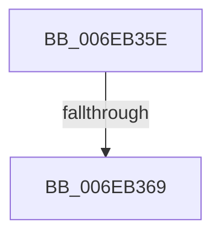

# sub_006EB35E

- RVA: `0x006EB35E`–`0x006EB37B` (길이 `29` bytes)
- VA: `0x00000001406EB35E`
- 실행 섹션: `.text`
- PDB 이름 있음: `아니요`; PDB Function 태그: `아니요`
- unwind 정보 RVA: `0x0009743C`
- 디코드: `7`개 명령, `29/29` bytes 표시
- 미해석 바이트: `0` (있으면 어셈블리에 `.byte`로 보존)

> 이 문서는 커널 이미지의 기계어와 PDB 기호를 분석해 생성했습니다. 4번과 5번은 함수 원형과 자료형을 바이너리 사용 방식에서 추정한 C 해석이며 원본 소스 복구 결과는 아닙니다.

## 1. Dependencies

- 직접 호출 지점: **1**; 고유 호출 대상: **1**
- 직접 호출자로 확인된 함수: **0**
- RIP 상대 이미지 참조: **0**

### Outgoing calls
- `0x006EB370` → [RtlpCopyLegacyContextArm64](../5E/RtlpCopyLegacyContextArm64_function_005E87E8.md) (function, `0x005E87E8`)

### Direct callers
- 이 함수 시작 RVA로 연결되는 직접 call은 확인되지 않았습니다. 간접 호출은 완전히 역산할 수 없습니다.

### Static image references
- 디코드된 RIP-relative 메모리 참조가 없습니다.

## 2. Other-region calls and transfers

- 다른 실행 섹션으로 향하는 call: **0**
- call이 아닌 외부 분기/꼬리 이동: **2**
  - `0x006EB363` → [sub_003F4E8A + 0x25C](../3F/Unknown_function_003F4E8A.md) (`tail-transfer`)
  - `0x006EB376` → [sub_003F4E8A + 0x25C](../3F/Unknown_function_003F4E8A.md) (`tail-transfer`)

## 3. Assembly (complete function range)

```asm
006EB35E  41 0F BA E2 16                  bt r10d, 0x16
006EB363  0F 83 7D 9D D0 FF               jae 0x1403f50e6
006EB369  45 8B C2                        mov r8d, r10d
006EB36C  40 0F B6 CD                     movzx ecx, bpl
006EB370  E8 73 D4 EF FF                  call 0x1405e87e8
006EB375  90                              nop
006EB376  E9 6B 9D D0 FF                  jmp 0x1403f50e6
```

## 4. C-style interpretation (structured pseudocode)

```c
__int64 __fastcall sub_006EB35E(void)
{
    __int64 result;

    result = RtlpCopyLegacyContextArm64((unsigned __int8)(v_rbp), a2, (unsigned int)((unsigned int)(v_r10)), a4);
}
```

## 5. (Beta) C Style

```c
void sub_006EB35E(void)
{
    int64_t result;

    result = RtlpCopyLegacyContextArm64((uint8_t)(local_rbp), a2, (uint32_t)((uint32_t)(local_r10)), a4);
}
```

## 6. Execution-region graph

[열기: 2D/3D 그래프와 함수 탐색 컨트롤 패널](../../../control-panel.html?section=text&rva=0x006EB35E&view=graph)

- 2D 그래프는 위에서 아래로 흐르고, 3D 그래프는 빈 공간을 드래그해 회전합니다. Shift+드래그는 이동, 휠은 확대·축소, 함수 노드 선택은 대상 보고서 이동입니다.

### Static fallback


