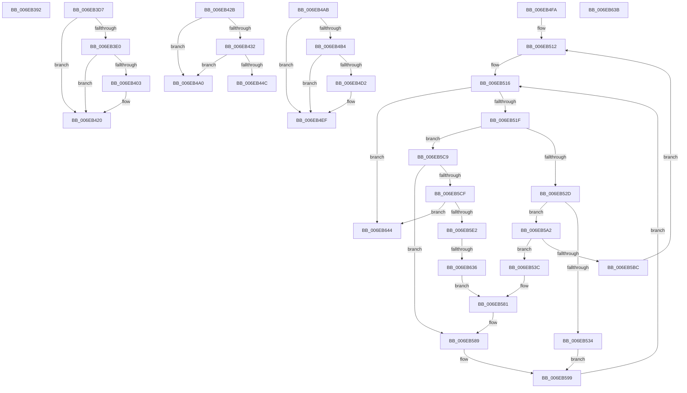

# sub_006EB392

- RVA: `0x006EB392`–`0x006EB64D` (길이 `699` bytes)
- VA: `0x00000001406EB392`
- 실행 섹션: `.text`
- PDB 이름 있음: `아니요`; PDB Function 태그: `아니요`
- unwind 정보 RVA: `0x00098038`
- 디코드: `161`개 명령, `699/699` bytes 표시
- 미해석 바이트: `0` (있으면 어셈블리에 `.byte`로 보존)

> 이 문서는 커널 이미지의 기계어와 PDB 기호를 분석해 생성했습니다. 4번과 5번은 함수 원형과 자료형을 바이너리 사용 방식에서 추정한 C 해석이며 원본 소스 복구 결과는 아닙니다.

## 1. Dependencies

- 직접 호출 지점: **10**; 고유 호출 대상: **6**
- 직접 호출자로 확인된 함수: **0**
- RIP 상대 이미지 참조: **5**

### Outgoing calls
- `0x006EB3CC` → [IopLiveDumpTraceEventGeneric](../5A/IopLiveDumpTraceEventGeneric_function_005A41E4.md) (function, `0x005A41E4`)
- `0x006EB3F5` → [IopLiveDumpAllocateFromIOSpace](../59/IopLiveDumpAllocateFromIOSpace_function_00599DEC.md) (function, `0x00599DEC`)
- `0x006EB43F` → [IopLiveDumpAllocateFromVMMemoryPartition](../59/IopLiveDumpAllocateFromVMMemoryPartition_function_0059A2D8.md) (function, `0x0059A2D8`)
- `0x006EB495` → [IopLiveDumpDiscardVirtualAddressRange](../29/IopLiveDumpDiscardVirtualAddressRange_function_002977F4.md) (function, `0x002977F4`)
- `0x006EB4C4` → [IopLiveDumpAllocateFromIOSpace](../59/IopLiveDumpAllocateFromIOSpace_function_00599DEC.md) (function, `0x00599DEC`)
- `0x006EB57C` → [IopLiveDumpDiscardVirtualAddressRange](../29/IopLiveDumpDiscardVirtualAddressRange_function_002977F4.md) (function, `0x002977F4`)
- `0x006EB5AF` → [IopLiveDumpAllocateFromVMMemoryPartition](../59/IopLiveDumpAllocateFromVMMemoryPartition_function_0059A2D8.md) (function, `0x0059A2D8`)
- `0x006EB5D8` → [MmAllocateIndependentPages](../../page/AA/MmAllocateIndependentPages_function_00AA0CE0.md) (function, `0x00AA0CE0`)
- `0x006EB621` → [IopLiveDumpDiscardVirtualAddressRange](../29/IopLiveDumpDiscardVirtualAddressRange_function_002977F4.md) (function, `0x002977F4`)
- `0x006EB629` → [IopLiveDumpIsUnderMemoryPressure](../3F/IopLiveDumpIsUnderMemoryPressure_function_003F5EB8.md) (function, `0x003F5EB8`)

### Direct callers
- 이 함수 시작 RVA로 연결되는 직접 call은 확인되지 않았습니다. 간접 호출은 완전히 역산할 수 없습니다.

### Static image references
- `0x006EB392` → RVA `0x006CB070` (` ?? ::FNODOBFM::`string'`; read)
- `0x006EB3A9` → RVA `0x006CAF80` (` ?? ::FNODOBFM::`string'`; read)
- `0x006EB3C5` → RVA `0x006C9F60` (` ?? ::FNODOBFM::`string'`; read)
- `0x006EB413` → RVA `0x00E0A9D4` (`.data`; read)
- `0x006EB432` → RVA `0x00E0A9D0` (`.data`; read)

## 2. Other-region calls and transfers

- 다른 실행 섹션으로 향하는 call: **1**
  - `0x006EB5D8` → [MmAllocateIndependentPages](../../page/AA/MmAllocateIndependentPages_function_00AA0CE0.md) (`.text` → `PAGE`)
- call이 아닌 외부 분기/꼬리 이동: **8**
  - `0x006EB3D2` → [IopLiveDumpAllocateDumpBuffers + 0x12C](../3F/IopLiveDumpAllocateDumpBuffers_function_003F5AE8.md) (`tail-transfer`)
  - `0x006EB426` → [IopLiveDumpAllocateDumpBuffers + 0x17A](../3F/IopLiveDumpAllocateDumpBuffers_function_003F5AE8.md) (`tail-transfer`)
  - `0x006EB49B` → [IopLiveDumpAllocateDumpBuffers + 0x17A](../3F/IopLiveDumpAllocateDumpBuffers_function_003F5AE8.md) (`tail-transfer`)
  - `0x006EB4A6` → [IopLiveDumpAllocateDumpBuffers + 0x17A](../3F/IopLiveDumpAllocateDumpBuffers_function_003F5AE8.md) (`tail-transfer`)
  - `0x006EB4F5` → [IopLiveDumpAllocateDumpBuffers + 0x17A](../3F/IopLiveDumpAllocateDumpBuffers_function_003F5AE8.md) (`tail-transfer`)
  - `0x006EB630` → [IopLiveDumpAllocateDumpBuffers + 0x227](../3F/IopLiveDumpAllocateDumpBuffers_function_003F5AE8.md) (`tail-transfer`)
  - `0x006EB63F` → [IopLiveDumpAllocateDumpBuffers + 0x38D](../3F/IopLiveDumpAllocateDumpBuffers_function_003F5AE8.md) (`tail-transfer`)
  - `0x006EB648` → [IopLiveDumpAllocateDumpBuffers + 0x244](../3F/IopLiveDumpAllocateDumpBuffers_function_003F5AE8.md) (`tail-transfer`)

## 3. Assembly (complete function range)

```asm
006EB392  48 8D 05 D7 FC FD FF            lea rax, [rip - 0x20329]
006EB399  48 C7 45 EF E0 1A 00 00         mov qword ptr [rbp - 0x11], 0x1ae0
006EB3A1  48 89 45 FF                     mov qword ptr [rbp - 1], rax
006EB3A5  4C 8D 4D EF                     lea r9, [rbp - 0x11]
006EB3A9  48 8D 05 D0 FB FD FF            lea rax, [rip - 0x20430]
006EB3B0  48 C7 45 F7 17 00 00 C0         mov qword ptr [rbp - 9], 0xffffffffc0000017
006EB3B8  4C 8D 45 FF                     lea r8, [rbp - 1]
006EB3BC  48 89 45 07                     mov qword ptr [rbp + 7], rax
006EB3C0  BA 02 00 00 00                  mov edx, 2
006EB3C5  48 8D 0D 94 EB FD FF            lea rcx, [rip - 0x2146c]
006EB3CC  E8 13 8E EB FF                  call 0x1405a41e4
006EB3D1  90                              nop
006EB3D2  E9 3D A8 D0 FF                  jmp 0x1403f5c14
006EB3D7  F7 43 50 00 08 00 00            test dword ptr [rbx + 0x50], 0x800
006EB3DE  74 40                           je 0x1406eb420
006EB3E0  4C 8B 45 D7                     mov r8, qword ptr [rbp - 0x29]
006EB3E4  4C 8D 4D 77                     lea r9, [rbp + 0x77]
006EB3E8  48 8B 93 50 04 00 00            mov rdx, qword ptr [rbx + 0x450]
006EB3EF  4C 2B C6                        sub r8, rsi
006EB3F2  48 8B CB                        mov rcx, rbx
006EB3F5  E8 F2 E9 EA FF                  call 0x140599dec
006EB3FA  4C 8B 75 77                     mov r14, qword ptr [rbp + 0x77]
006EB3FE  4C 3B F6                        cmp r14, rsi
006EB401  74 1D                           je 0x1406eb420
006EB403  49 8B C6                        mov rax, r14
006EB406  49 8B CE                        mov rcx, r14
006EB409  48 2B C6                        sub rax, rsi
006EB40C  48 2B CE                        sub rcx, rsi
006EB40F  48 01 45 CF                     add qword ptr [rbp - 0x31], rax
006EB413  8B 05 BB F5 71 00               mov eax, dword ptr [rip + 0x71f5bb]
006EB419  48 0F AF C8                     imul rcx, rax
006EB41D  4C 03 E1                        add r12, rcx
006EB420  41 BF 02 00 00 00               mov r15d, 2
006EB426  E9 37 A8 D0 FF                  jmp 0x1403f5c62
006EB42B  8B 43 50                        mov eax, dword ptr [rbx + 0x50]
006EB42E  A8 04                           test al, 4
006EB430  75 6E                           jne 0x1406eb4a0
006EB432  8B 15 98 F5 71 00               mov edx, dword ptr [rip + 0x71f598]
006EB438  4C 8D 45 7F                     lea r8, [rbp + 0x7f]
006EB43C  48 8B CB                        mov rcx, rbx
006EB43F  E8 94 EE EA FF                  call 0x14059a2d8
006EB444  4C 8B C8                        mov r9, rax
006EB447  48 85 C0                        test rax, rax
006EB44A  74 54                           je 0x1406eb4a0
006EB44C  48 8B 83 F0 02 00 00            mov rax, qword ptr [rbx + 0x2f0]
006EB453  8B 15 7B F5 71 00               mov edx, dword ptr [rip + 0x71f57b]
006EB459  48 FF 45 6F                     inc qword ptr [rbp + 0x6f]
006EB45D  4C 03 E2                        add r12, rdx
006EB460  44 8B 05 69 F5 71 00            mov r8d, dword ptr [rip + 0x71f569]
006EB467  4E 89 0C F0                     mov qword ptr [rax + r14*8], r9
006EB46B  48 8B 8B F8 02 00 00            mov rcx, qword ptr [rbx + 0x2f8]
006EB472  48 01 93 A8 02 00 00            add qword ptr [rbx + 0x2a8], rdx
006EB479  49 8B D1                        mov rdx, r9
006EB47C  48 8B 45 7F                     mov rax, qword ptr [rbp + 0x7f]
006EB480  48 FF 83 E8 02 00 00            inc qword ptr [rbx + 0x2e8]
006EB487  4A 89 04 F1                     mov qword ptr [rcx + r14*8], rax
006EB48B  49 FF C6                        inc r14
006EB48E  48 8B CB                        mov rcx, rbx
006EB491  4C 89 75 77                     mov qword ptr [rbp + 0x77], r14
006EB495  E8 5A C3 BA FF                  call 0x1402977f4
006EB49A  90                              nop
006EB49B  E9 C2 A7 D0 FF                  jmp 0x1403f5c62
006EB4A0  41 BF 03 00 00 00               mov r15d, 3
006EB4A6  E9 B7 A7 D0 FF                  jmp 0x1403f5c62
006EB4AB  F7 43 50 00 08 00 00            test dword ptr [rbx + 0x50], 0x800
006EB4B2  74 3B                           je 0x1406eb4ef
006EB4B4  4C 8B 45 D7                     mov r8, qword ptr [rbp - 0x29]
006EB4B8  4C 8D 4D 77                     lea r9, [rbp + 0x77]
006EB4BC  4C 2B C6                        sub r8, rsi
006EB4BF  33 D2                           xor edx, edx
006EB4C1  48 8B CB                        mov rcx, rbx
006EB4C4  E8 23 E9 EA FF                  call 0x140599dec
006EB4C9  4C 8B 75 77                     mov r14, qword ptr [rbp + 0x77]
006EB4CD  4C 3B F6                        cmp r14, rsi
006EB4D0  74 1D                           je 0x1406eb4ef
006EB4D2  49 8B C6                        mov rax, r14
006EB4D5  49 8B CE                        mov rcx, r14
006EB4D8  48 2B C6                        sub rax, rsi
006EB4DB  48 2B CE                        sub rcx, rsi
006EB4DE  48 01 45 C7                     add qword ptr [rbp - 0x39], rax
006EB4E2  8B 05 EC F4 71 00               mov eax, dword ptr [rip + 0x71f4ec]
006EB4E8  48 0F AF C8                     imul rcx, rax
006EB4EC  4C 03 E1                        add r12, rcx
006EB4EF  41 BF 04 00 00 00               mov r15d, 4
006EB4F5  E9 68 A7 D0 FF                  jmp 0x1403f5c62
006EB4FA  48 8B C7                        mov rax, rdi
006EB4FD  4C 89 B3 D8 00 00 00            mov qword ptr [rbx + 0xd8], r14
006EB504  48 89 45 67                     mov qword ptr [rbp + 0x67], rax
006EB508  41 BF 02 00 00 00               mov r15d, 2
006EB50E  49 C1 E6 03                     shl r14, 3
006EB512  48 8B 4D BF                     mov rcx, qword ptr [rbp - 0x41]
006EB516  48 3B C1                        cmp rax, rcx
006EB519  0F 83 25 01 00 00               jae 0x1406eb644
006EB51F  48 89 7D 7F                     mov qword ptr [rbp + 0x7f], rdi
006EB523  41 83 FF 02                     cmp r15d, 2
006EB527  0F 85 9C 00 00 00               jne 0x1406eb5c9
006EB52D  8B 43 50                        mov eax, dword ptr [rbx + 0x50]
006EB530  A8 04                           test al, 4
006EB532  74 6E                           je 0x1406eb5a2
006EB534  41 BF 04 00 00 00               mov r15d, 4
006EB53A  EB 5D                           jmp 0x1406eb599
006EB53C  48 8B 83 F0 02 00 00            mov rax, qword ptr [rbx + 0x2f0]
006EB543  48 FF 45 6F                     inc qword ptr [rbp + 0x6f]
006EB547  44 8B 05 82 F4 71 00            mov r8d, dword ptr [rip + 0x71f482]
006EB54E  49 89 14 06                     mov qword ptr [r14 + rax], rdx
006EB552  8B 05 7C F4 71 00               mov eax, dword ptr [rip + 0x71f47c]
006EB558  48 8B 8B F8 02 00 00            mov rcx, qword ptr [rbx + 0x2f8]
006EB55F  48 01 83 A8 02 00 00            add qword ptr [rbx + 0x2a8], rax
006EB566  48 8B 45 7F                     mov rax, qword ptr [rbp + 0x7f]
006EB56A  48 FF 83 E8 02 00 00            inc qword ptr [rbx + 0x2e8]
006EB571  49 89 04 0E                     mov qword ptr [r14 + rcx], rax
006EB575  49 83 C6 08                     add r14, 8
006EB579  48 8B CB                        mov rcx, rbx
006EB57C  E8 73 C2 BA FF                  call 0x1402977f4
006EB581  48 8B 4D BF                     mov rcx, qword ptr [rbp - 0x41]
006EB585  48 8B 45 67                     mov rax, qword ptr [rbp + 0x67]
006EB589  48 FF C0                        inc rax
006EB58C  48 89 45 67                     mov qword ptr [rbp + 0x67], rax
006EB590  8B 05 3E F4 71 00               mov eax, dword ptr [rip + 0x71f43e]
006EB596  4C 03 E8                        add r13, rax
006EB599  48 8B 45 67                     mov rax, qword ptr [rbp + 0x67]
006EB59D  E9 74 FF FF FF                  jmp 0x1406eb516
006EB5A2  8B 15 28 F4 71 00               mov edx, dword ptr [rip + 0x71f428]
006EB5A8  4C 8D 45 7F                     lea r8, [rbp + 0x7f]
006EB5AC  48 8B CB                        mov rcx, rbx
006EB5AF  E8 24 ED EA FF                  call 0x14059a2d8
006EB5B4  48 8B D0                        mov rdx, rax
006EB5B7  48 85 C0                        test rax, rax
006EB5BA  75 80                           jne 0x1406eb53c
006EB5BC  44 8D 78 04                     lea r15d, [rax + 4]
006EB5C0  48 8B 45 67                     mov rax, qword ptr [rbp + 0x67]
006EB5C4  E9 49 FF FF FF                  jmp 0x1406eb512
006EB5C9  41 83 FF 04                     cmp r15d, 4
006EB5CD  75 BA                           jne 0x1406eb589
006EB5CF  8B 0D FB F3 71 00               mov ecx, dword ptr [rip + 0x71f3fb]
006EB5D5  83 CA FF                        or edx, 0xffffffff
006EB5D8  E8 03 57 3B 00                  call 0x140aa0ce0
006EB5DD  48 85 C0                        test rax, rax
006EB5E0  74 62                           je 0x1406eb644
006EB5E2  48 8B 8B F0 02 00 00            mov rcx, qword ptr [rbx + 0x2f0]
006EB5E9  48 8B D0                        mov rdx, rax
006EB5EC  44 8B 05 DD F3 71 00            mov r8d, dword ptr [rip + 0x71f3dd]
006EB5F3  48 FF 45 B7                     inc qword ptr [rbp - 0x49]
006EB5F7  49 89 04 0E                     mov qword ptr [r14 + rcx], rax
006EB5FB  8B 0D D3 F3 71 00               mov ecx, dword ptr [rip + 0x71f3d3]
006EB601  48 01 8B A8 02 00 00            add qword ptr [rbx + 0x2a8], rcx
006EB608  48 8B 8B F8 02 00 00            mov rcx, qword ptr [rbx + 0x2f8]
006EB60F  48 FF 83 E8 02 00 00            inc qword ptr [rbx + 0x2e8]
006EB616  49 89 3C 0E                     mov qword ptr [r14 + rcx], rdi
006EB61A  48 8B CB                        mov rcx, rbx
006EB61D  49 83 C6 08                     add r14, 8
006EB621  E8 CE C1 BA FF                  call 0x1402977f4
006EB626  48 8B CB                        mov rcx, rbx
006EB629  E8 8A A8 D0 FF                  call 0x1403f5eb8
006EB62E  84 C0                           test al, al
006EB630  0F 85 D9 A6 D0 FF               jne 0x1403f5d0f
006EB636  E9 46 FF FF FF                  jmp 0x1406eb581
006EB63B  4C 8B 75 6F                     mov r14, qword ptr [rbp + 0x6f]
006EB63F  E9 31 A8 D0 FF                  jmp 0x1403f5e75
006EB644  4C 8B 75 6F                     mov r14, qword ptr [rbp + 0x6f]
006EB648  E9 DF A6 D0 FF                  jmp 0x1403f5d2c
```

## 4. C-style interpretation (structured pseudocode)

```c
__int64 __fastcall sub_006EB392(void)
{
    __int64 result;

    *(unsigned __int64 *)(v_rbp - 17) = 0x1AE0ULL;
    *(unsigned __int64 *)(v_rbp - 1) = v_rip - 131881;
    *(unsigned __int64 *)(v_rbp - 9) = 0xFFFFFFFFC0000017ULL;
    *(unsigned __int64 *)(v_rbp + 7) = v_rip - 132144;
    result = IopLiveDumpTraceEventGeneric(v_rip - 136300, 2, v_rbp - 1, v_rbp - 17);
}
```

## 5. (Beta) C Style

```c
void sub_006EB392(void)
{
    int64_t result;

    *(uint64_t *)(local_rbp - 0x11) = 0x1AE0ULL;
    *(uint64_t *)(local_rbp - 0x1) = v_rip - 131881;
    *(uint64_t *)(local_rbp - 0x9) = 0xFFFFFFFFC0000017ULL;
    *(uint64_t *)(local_rbp + 0x7) = v_rip - 132144;
    result = IopLiveDumpTraceEventGeneric(v_rip - 136300, 2, local_rbp - 1, local_rbp - 17);
}
```

## 6. Execution-region graph

[열기: 2D/3D 그래프와 함수 탐색 컨트롤 패널](../../../control-panel.html?section=text&rva=0x006EB392&view=graph)

- 2D 그래프는 위에서 아래로 흐르고, 3D 그래프는 빈 공간을 드래그해 회전합니다. Shift+드래그는 이동, 휠은 확대·축소, 함수 노드 선택은 대상 보고서 이동입니다.

### Static fallback


