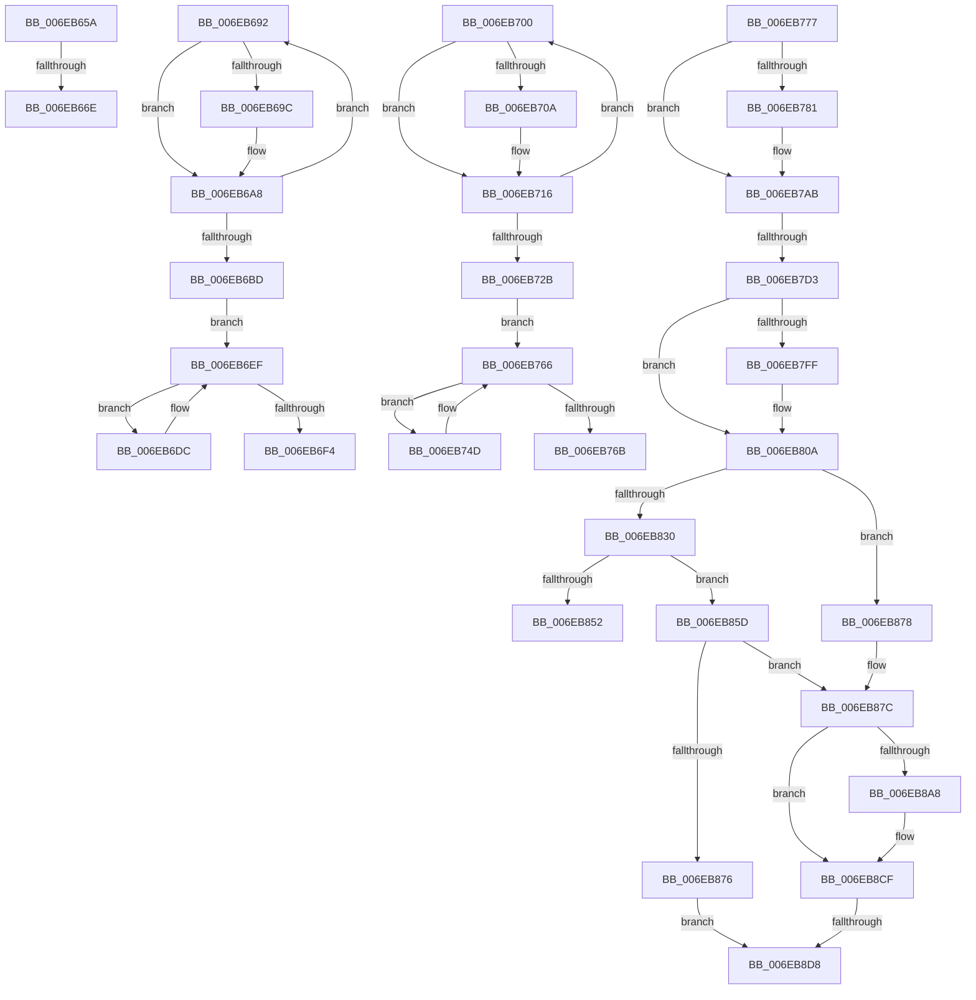

# sub_006EB65A

- RVA: `0x006EB65A`–`0x006EB8E8` (길이 `654` bytes)
- VA: `0x00000001406EB65A`
- 실행 섹션: `.text`
- PDB 이름 있음: `아니요`; PDB Function 태그: `아니요`
- unwind 정보 RVA: `0x0009809C`
- 디코드: `151`개 명령, `654/654` bytes 표시
- 미해석 바이트: `0` (있으면 어셈블리에 `.byte`로 보존)

> 이 문서는 커널 이미지의 기계어와 PDB 기호를 분석해 생성했습니다. 4번과 5번은 함수 원형과 자료형을 바이너리 사용 방식에서 추정한 C 해석이며 원본 소스 복구 결과는 아닙니다.

## 1. Dependencies

- 직접 호출 지점: **13**; 고유 호출 대상: **8**
- 직접 호출자로 확인된 함수: **0**
- RIP 상대 이미지 참조: **0**

### Outgoing calls
- `0x006EB687` → [IopLiveDumpTraceChunkCRCMismatchWrite](../5A/IopLiveDumpTraceChunkCRCMismatchWrite_function_005A40B4.md) (function, `0x005A40B4`)
- `0x006EB6A3` → [MmUnmapLockedPages](../24/MmUnmapLockedPages_function_00246E60.md) (function, `0x00246E60`)
- `0x006EB6B0` → [ExFreePoolWithTag](../../poolcode/B8/ExFreePoolWithTag_function_00B82870.md) (function, `0x00B82870`)
- `0x006EB6D1` → [IopLiveDumpFreeIoSpaceRanges](../59/IopLiveDumpFreeIoSpaceRanges_function_0059BEE4.md) (function, `0x0059BEE4`)
- `0x006EB711` → [MmUnmapLockedPages](../24/MmUnmapLockedPages_function_00246E60.md) (function, `0x00246E60`)
- `0x006EB71E` → [ExFreePoolWithTag](../../poolcode/B8/ExFreePoolWithTag_function_00B82870.md) (function, `0x00B82870`)
- `0x006EB73F` → [IopLiveDumpFreeIoSpaceRanges](../59/IopLiveDumpFreeIoSpaceRanges_function_0059BEE4.md) (function, `0x0059BEE4`)
- `0x006EB7C3` → [IopLiveDumpWriteSecondaryData](../5A/IopLiveDumpWriteSecondaryData_function_005A01DC.md) (function, `0x005A01DC`)
- `0x006EB845` → [ExAllocatePool2](../../poolcode/B8/ExAllocatePool2_function_00B820F0.md) (function, `0x00B820F0`)
- `0x006EB86A` → [SecureDump_Get_SecureDumpHeader](../5A/SecureDump_Get_SecureDumpHeader_function_005A2B60.md) (function, `0x005A2B60`)
- `0x006EB897` → [IopLiveDumpWriteBuffer](../3F/IopLiveDumpWriteBuffer_function_003F6688.md) (function, `0x003F6688`)
- `0x006EB8C7` → [IopLiveDumpWriteBuffer](../3F/IopLiveDumpWriteBuffer_function_003F6688.md) (function, `0x003F6688`)
- `0x006EB8DD` → [ExFreePoolWithTag](../../poolcode/B8/ExFreePoolWithTag_function_00B82870.md) (function, `0x00B82870`)

### Direct callers
- 이 함수 시작 RVA로 연결되는 직접 call은 확인되지 않았습니다. 간접 호출은 완전히 역산할 수 없습니다.

### Static image references
- 디코드된 RIP-relative 메모리 참조가 없습니다.

## 2. Other-region calls and transfers

- 다른 실행 섹션으로 향하는 call: **4**
  - `0x006EB6B0` → [ExFreePoolWithTag](../../poolcode/B8/ExFreePoolWithTag_function_00B82870.md) (`.text` → `POOLCODE`)
  - `0x006EB71E` → [ExFreePoolWithTag](../../poolcode/B8/ExFreePoolWithTag_function_00B82870.md) (`.text` → `POOLCODE`)
  - `0x006EB845` → [ExAllocatePool2](../../poolcode/B8/ExAllocatePool2_function_00B820F0.md) (`.text` → `POOLCODE`)
  - `0x006EB8DD` → [ExFreePoolWithTag](../../poolcode/B8/ExFreePoolWithTag_function_00B82870.md) (`.text` → `POOLCODE`)
- call이 아닌 외부 분기/꼬리 이동: **8**
  - `0x006EB668` → [IopLiveDumpWriteDumpFile + 0x12B](../3F/IopLiveDumpWriteDumpFile_function_003F6360.md) (`tail-transfer`)
  - `0x006EB68D` → [IopLiveDumpWriteDumpFile + 0x12B](../3F/IopLiveDumpWriteDumpFile_function_003F6360.md) (`tail-transfer`)
  - `0x006EB6FB` → [IopLiveDumpWriteDumpFile + 0x17C](../3F/IopLiveDumpWriteDumpFile_function_003F6360.md) (`tail-transfer`)
  - `0x006EB772` → [IopLiveDumpWriteDumpFile + 0x17C](../3F/IopLiveDumpWriteDumpFile_function_003F6360.md) (`tail-transfer`)
  - `0x006EB7CD` → [IopLiveDumpWriteDumpFile + 0x1C2](../3F/IopLiveDumpWriteDumpFile_function_003F6360.md) (`tail-transfer`)
  - `0x006EB858` → [IopLiveDumpWriteDumpFile + 0x1C2](../3F/IopLiveDumpWriteDumpFile_function_003F6360.md) (`tail-transfer`)
  - `0x006EB8D2` → [IopLiveDumpWriteDumpFile + 0x1C2](../3F/IopLiveDumpWriteDumpFile_function_003F6360.md) (`tail-transfer`)
  - `0x006EB8E3` → [IopLiveDumpWriteDumpFile + 0x1C2](../3F/IopLiveDumpWriteDumpFile_function_003F6360.md) (`tail-transfer`)

## 3. Assembly (complete function range)

```asm
006EB65A  48 8B 87 C8 00 00 00            mov rax, qword ptr [rdi + 0xc8]
006EB661  48 8B 14 F0                     mov rdx, qword ptr [rax + rsi*8]
006EB665  48 3B D1                        cmp rdx, rcx
006EB668  0F 84 1D AE D0 FF               je 0x1403f648b
006EB66E  48 8B 45 AF                     mov rax, qword ptr [rbp - 0x51]
006EB672  4C 8B C9                        mov r9, rcx
006EB675  44 0F B6 45 A7                  movzx r8d, byte ptr [rbp - 0x59]
006EB67A  48 8B CE                        mov rcx, rsi
006EB67D  48 89 44 24 28                  mov qword ptr [rsp + 0x28], rax
006EB682  44 89 64 24 20                  mov dword ptr [rsp + 0x20], r12d
006EB687  E8 28 8A EB FF                  call 0x1405a40b4
006EB68C  90                              nop
006EB68D  E9 F9 AD D0 FF                  jmp 0x1403f648b
006EB692  41 F6 46 0A 01                  test byte ptr [r14 + 0xa], 1
006EB697  4D 8B 26                        mov r12, qword ptr [r14]
006EB69A  74 0C                           je 0x1406eb6a8
006EB69C  49 8B 4E 18                     mov rcx, qword ptr [r14 + 0x18]
006EB6A0  49 8B D6                        mov rdx, r14
006EB6A3  E8 B8 B7 B5 FF                  call 0x140246e60
006EB6A8  BA 4C 64 6D 70                  mov edx, 0x706d644c
006EB6AD  49 8B CE                        mov rcx, r14
006EB6B0  E8 BB 71 49 00                  call 0x140b82870
006EB6B5  4D 8B F4                        mov r14, r12
006EB6B8  4D 85 E4                        test r12, r12
006EB6BB  75 D5                           jne 0x1406eb692
006EB6BD  4C 21 AF 88 00 00 00            and qword ptr [rdi + 0x88], r13
006EB6C4  48 8D 8F 90 00 00 00            lea rcx, [rdi + 0x90]
006EB6CB  8B 97 98 00 00 00               mov edx, dword ptr [rdi + 0x98]
006EB6D1  E8 0E 08 EB FF                  call 0x14059bee4
006EB6D6  48 8B 4F 78                     mov rcx, qword ptr [rdi + 0x78]
006EB6DA  EB 13                           jmp 0x1406eb6ef
006EB6DC  48 8B 47 48                     mov rax, qword ptr [rdi + 0x48]
006EB6E0  4C 21 2C C8                     and qword ptr [rax + rcx*8], r13
006EB6E4  48 8B 4F 78                     mov rcx, qword ptr [rdi + 0x78]
006EB6E8  48 FF C1                        inc rcx
006EB6EB  48 89 4F 78                     mov qword ptr [rdi + 0x78], rcx
006EB6EF  48 3B CE                        cmp rcx, rsi
006EB6F2  76 E8                           jbe 0x1406eb6dc
006EB6F4  4C 21 AF 80 00 00 00            and qword ptr [rdi + 0x80], r13
006EB6FB  E9 DC AD D0 FF                  jmp 0x1403f64dc
006EB700  41 F6 46 0A 01                  test byte ptr [r14 + 0xa], 1
006EB705  4D 8B 26                        mov r12, qword ptr [r14]
006EB708  74 0C                           je 0x1406eb716
006EB70A  49 8B 4E 18                     mov rcx, qword ptr [r14 + 0x18]
006EB70E  49 8B D6                        mov rdx, r14
006EB711  E8 4A B7 B5 FF                  call 0x140246e60
006EB716  BA 4C 64 6D 70                  mov edx, 0x706d644c
006EB71B  49 8B CE                        mov rcx, r14
006EB71E  E8 4D 71 49 00                  call 0x140b82870
006EB723  4D 8B F4                        mov r14, r12
006EB726  4D 85 E4                        test r12, r12
006EB729  75 D5                           jne 0x1406eb700
006EB72B  4C 21 AF B0 00 00 00            and qword ptr [rdi + 0xb0], r13
006EB732  48 8D 8F B8 00 00 00            lea rcx, [rdi + 0xb8]
006EB739  8B 97 C0 00 00 00               mov edx, dword ptr [rdi + 0xc0]
006EB73F  E8 A0 07 EB FF                  call 0x14059bee4
006EB744  48 8B 8F A0 00 00 00            mov rcx, qword ptr [rdi + 0xa0]
006EB74B  EB 19                           jmp 0x1406eb766
006EB74D  48 8B 47 48                     mov rax, qword ptr [rdi + 0x48]
006EB751  4C 21 2C C8                     and qword ptr [rax + rcx*8], r13
006EB755  48 8B 8F A0 00 00 00            mov rcx, qword ptr [rdi + 0xa0]
006EB75C  48 FF C1                        inc rcx
006EB75F  48 89 8F A0 00 00 00            mov qword ptr [rdi + 0xa0], rcx
006EB766  48 3B CE                        cmp rcx, rsi
006EB769  76 E2                           jbe 0x1406eb74d
006EB76B  4C 21 AF A8 00 00 00            and qword ptr [rdi + 0xa8], r13
006EB772  E9 65 AD D0 FF                  jmp 0x1403f64dc
006EB777  8B 8B 10 04 00 00               mov ecx, dword ptr [rbx + 0x410]
006EB77D  85 C9                           test ecx, ecx
006EB77F  74 2A                           je 0x1406eb7ab
006EB781  48 8B 83 08 04 00 00            mov rax, qword ptr [rbx + 0x408]
006EB788  0F 10 83 F8 03 00 00            movups xmm0, xmmword ptr [rbx + 0x3f8]
006EB78F  48 89 45 0F                     mov qword ptr [rbp + 0xf], rax
006EB793  48 8B 43 38                     mov rax, qword ptr [rbx + 0x38]
006EB797  48 89 45 1F                     mov qword ptr [rbp + 0x1f], rax
006EB79B  48 8D 45 FF                     lea rax, [rbp - 1]
006EB79F  48 89 43 38                     mov qword ptr [rbx + 0x38], rax
006EB7A3  F3 0F 7F 45 FF                  movdqu xmmword ptr [rbp - 1], xmm0
006EB7A8  89 4D 17                        mov dword ptr [rbp + 0x17], ecx
006EB7AB  4C 8B 65 BF                     mov r12, qword ptr [rbp - 0x41]
006EB7AF  48 8D 53 30                     lea rdx, [rbx + 0x30]
006EB7B3  49 8B CC                        mov rcx, r12
006EB7B6  48 89 5C 24 20                  mov qword ptr [rsp + 0x20], rbx
006EB7BB  4C 8D 4D CF                     lea r9, [rbp - 0x31]
006EB7BF  4C 8D 45 AF                     lea r8, [rbp - 0x51]
006EB7C3  E8 14 4A EB FF                  call 0x1405a01dc
006EB7C8  44 8B F0                        mov r14d, eax
006EB7CB  85 C0                           test eax, eax
006EB7CD  0F 88 4F AD D0 FF               js 0x1403f6522
006EB7D3  8B 83 E0 03 00 00               mov eax, dword ptr [rbx + 0x3e0]
006EB7D9  48 8B 4D AF                     mov rcx, qword ptr [rbp - 0x51]
006EB7DD  48 2B C8                        sub rcx, rax
006EB7E0  49 89 8F A0 0F 00 00            mov qword ptr [r15 + 0xfa0], rcx
006EB7E7  41 8B 8F 50 10 00 00            mov ecx, dword ptr [r15 + 0x1050]
006EB7EE  83 C9 10                        or ecx, 0x10
006EB7F1  41 89 8F 50 10 00 00            mov dword ptr [r15 + 0x1050], ecx
006EB7F8  8B 43 28                        mov eax, dword ptr [rbx + 0x28]
006EB7FB  A8 20                           test al, 0x20
006EB7FD  74 0B                           je 0x1406eb80a
006EB7FF  0F BA E9 0E                     bts ecx, 0xe
006EB803  41 89 8F 50 10 00 00            mov dword ptr [r15 + 0x1050], ecx
006EB80A  41 C7 87 00 20 00 00 53 44 4D 50  mov dword ptr [r15 + 0x2000], 0x504d4453
006EB815  41 C7 87 04 20 00 00 44 55 4D 50  mov dword ptr [r15 + 0x2004], 0x504d5544
006EB820  49 89 BF 28 20 00 00            mov qword ptr [r15 + 0x2028], rdi
006EB827  40 38 B3 D8 03 00 00            cmp byte ptr [rbx + 0x3d8], sil
006EB82E  74 48                           je 0x1406eb878
006EB830  8B 93 E0 03 00 00               mov edx, dword ptr [rbx + 0x3e0]
006EB836  B9 40 00 00 00                  mov ecx, 0x40
006EB83B  41 B8 4C 64 6D 70               mov r8d, 0x706d644c
006EB841  48 89 55 AF                     mov qword ptr [rbp - 0x51], rdx
006EB845  E8 A6 68 49 00                  call 0x140b820f0
006EB84A  4C 8B E8                        mov r13, rax
006EB84D  48 85 C0                        test rax, rax
006EB850  75 0B                           jne 0x1406eb85d
006EB852  41 BE 9A 00 00 C0               mov r14d, 0xc000009a
006EB858  E9 C5 AC D0 FF                  jmp 0x1403f6522
006EB85D  44 8B 83 E0 03 00 00            mov r8d, dword ptr [rbx + 0x3e0]
006EB864  48 8B D0                        mov rdx, rax
006EB867  49 8B CF                        mov rcx, r15
006EB86A  E8 F1 72 EB FF                  call 0x1405a2b60
006EB86F  44 8B F0                        mov r14d, eax
006EB872  85 C0                           test eax, eax
006EB874  79 06                           jns 0x1406eb87c
006EB876  EB 60                           jmp 0x1406eb8d8
006EB878  48 89 75 AF                     mov qword ptr [rbp - 0x51], rsi
006EB87C  45 8B 87 20 20 00 00            mov r8d, dword ptr [r15 + 0x2020]
006EB883  4C 8D 4D AF                     lea r9, [rbp - 0x51]
006EB887  40 88 74 24 28                  mov byte ptr [rsp + 0x28], sil
006EB88C  49 8B D7                        mov rdx, r15
006EB88F  49 8B CC                        mov rcx, r12
006EB892  48 89 5C 24 20                  mov qword ptr [rsp + 0x20], rbx
006EB897  E8 EC AD D0 FF                  call 0x1403f6688
006EB89C  44 8B F0                        mov r14d, eax
006EB89F  40 38 B3 D8 03 00 00            cmp byte ptr [rbx + 0x3d8], sil
006EB8A6  74 27                           je 0x1406eb8cf
006EB8A8  44 8B 83 E0 03 00 00            mov r8d, dword ptr [rbx + 0x3e0]
006EB8AF  4C 8D 4D AF                     lea r9, [rbp - 0x51]
006EB8B3  C6 44 24 28 01                  mov byte ptr [rsp + 0x28], 1
006EB8B8  49 8B D5                        mov rdx, r13
006EB8BB  49 8B CC                        mov rcx, r12
006EB8BE  48 89 5C 24 20                  mov qword ptr [rsp + 0x20], rbx
006EB8C3  48 89 75 AF                     mov qword ptr [rbp - 0x51], rsi
006EB8C7  E8 BC AD D0 FF                  call 0x1403f6688
006EB8CC  44 8B F0                        mov r14d, eax
006EB8CF  4D 85 ED                        test r13, r13
006EB8D2  0F 84 4A AC D0 FF               je 0x1403f6522
006EB8D8  33 D2                           xor edx, edx
006EB8DA  49 8B CD                        mov rcx, r13
006EB8DD  E8 8E 6F 49 00                  call 0x140b82870
006EB8E2  90                              nop
006EB8E3  E9 3A AC D0 FF                  jmp 0x1403f6522
```

## 4. C-style interpretation (structured pseudocode)

```c
__int64 __fastcall sub_006EB65A(__int64 a1)
{
    __int64 result;
    unsigned int v_stack_p20;
    unsigned __int64 v_stack_p28;

    v_stack_p28 = *(unsigned __int64 *)(v_rbp - 81);
    v_stack_p20 = (unsigned int)(v_r12);
    result = IopLiveDumpTraceChunkCRCMismatchWrite(v_rsi, *(unsigned __int64 *)(*(unsigned __int64 *)(v_rdi + 200) + v_rsi * 8), *(unsigned __int8 *)(v_rbp - 89), a1);
}
```

## 5. (Beta) C Style

```c
int64_t sub_006EB65A(int64_t Arg1)
{
    int64_t result;
    uint32_t v_stack_p20;
    uint64_t v_stack_p28;

    v_stack_p28 = *(uint64_t *)(local_rbp - 0x51);
    v_stack_p20 = (uint32_t)(local_r12);
    result = IopLiveDumpTraceChunkCRCMismatchWrite(local_rsi, *(uint64_t *)(*(uint64_t *)(local_rdi + 0xC8) + local_rsi * 8), *(uint8_t *)(local_rbp - 0x59), Arg1);
}
```

## 6. Execution-region graph

[열기: 2D/3D 그래프와 함수 탐색 컨트롤 패널](../../../control-panel.html?section=text&rva=0x006EB65A&view=graph)

- 2D 그래프는 위에서 아래로 흐르고, 3D 그래프는 빈 공간을 드래그해 회전합니다. Shift+드래그는 이동, 휠은 확대·축소, 함수 노드 선택은 대상 보고서 이동입니다.

### Static fallback


