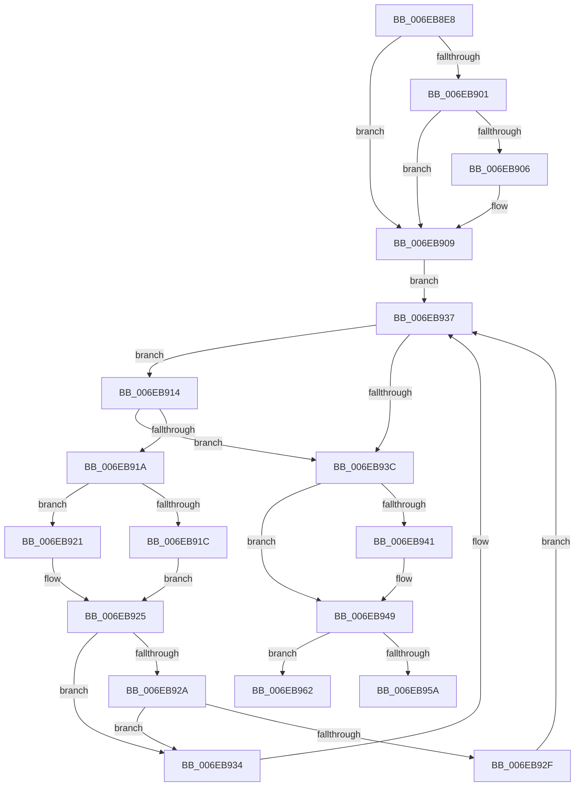

# sub_006EB8E8

- RVA: `0x006EB8E8`–`0x006EB977` (길이 `143` bytes)
- VA: `0x00000001406EB8E8`
- 실행 섹션: `.text`
- PDB 이름 있음: `아니요`; PDB Function 태그: `아니요`
- unwind 정보 RVA: `0x00098104`
- 디코드: `44`개 명령, `143/143` bytes 표시
- 미해석 바이트: `0` (있으면 어셈블리에 `.byte`로 보존)

> 이 문서는 커널 이미지의 기계어와 PDB 기호를 분석해 생성했습니다. 4번과 5번은 함수 원형과 자료형을 바이너리 사용 방식에서 추정한 C 해석이며 원본 소스 복구 결과는 아닙니다.

## 1. Dependencies

- 직접 호출 지점: **4**; 고유 호출 대상: **3**
- 직접 호출자로 확인된 함수: **0**
- RIP 상대 이미지 참조: **1**

### Outgoing calls
- `0x006EB8EC` → [KeAcquireSpinLockRaiseToDpc](../20/KeAcquireSpinLockRaiseToDpc_function_00208470.md) (function, `0x00208470`)
- `0x006EB944` → [RtlRbRemoveNode](../2E/RtlRbRemoveNode_function_002E4C10.md) (function, `0x002E4C10`)
- `0x006EB950` → [KeReleaseSpinLock](../39/KeReleaseSpinLock_function_00392BA0.md) (function, `0x00392BA0`)
- `0x006EB96C` → [KeReleaseSpinLock](../39/KeReleaseSpinLock_function_00392BA0.md) (function, `0x00392BA0`)

### Direct callers
- 이 함수 시작 RVA로 연결되는 직접 call은 확인되지 않았습니다. 간접 호출은 완전히 역산할 수 없습니다.

### Static image references
- `0x006EB965` → RVA `0x00FC1888` (`.data`; read)

## 2. Other-region calls and transfers

- 다른 실행 섹션으로 향하는 call: **0**
- call이 아닌 외부 분기/꼬리 이동: **2**
  - `0x006EB95D` → [HalpPopCommonBufferEntry + 0xDB](../3F/HalpPopCommonBufferEntry_function_003F68D4.md) (`tail-transfer`)
  - `0x006EB972` → [HalpPopCommonBufferEntry + 0x8D](../3F/HalpPopCommonBufferEntry_function_003F68D4.md) (`tail-transfer`)

## 3. Assembly (complete function range)

```asm
006EB8E8  48 8D 4B 50                     lea rcx, [rbx + 0x50]
006EB8EC  E8 7F CB B1 FF                  call 0x140208470
006EB8F1  48 8D 4B 40                     lea rcx, [rbx + 0x40]
006EB8F5  44 8A F8                        mov r15b, al
006EB8F8  F6 41 08 01                     test byte ptr [rcx + 8], 1
006EB8FC  48 8B 11                        mov rdx, qword ptr [rcx]
006EB8FF  74 08                           je 0x1406eb909
006EB901  48 85 D2                        test rdx, rdx
006EB904  74 03                           je 0x1406eb909
006EB906  48 33 D1                        xor rdx, rcx
006EB909  44 0F B6 41 08                  movzx r8d, byte ptr [rcx + 8]
006EB90E  41 83 E0 01                     and r8d, 1
006EB912  EB 23                           jmp 0x1406eb937
006EB914  4C 39 72 18                     cmp qword ptr [rdx + 0x18], r14
006EB918  74 22                           je 0x1406eb93c
006EB91A  76 05                           jbe 0x1406eb921
006EB91C  48 8B 02                        mov rax, qword ptr [rdx]
006EB91F  EB 04                           jmp 0x1406eb925
006EB921  48 8B 42 08                     mov rax, qword ptr [rdx + 8]
006EB925  45 85 C0                        test r8d, r8d
006EB928  74 0A                           je 0x1406eb934
006EB92A  48 85 C0                        test rax, rax
006EB92D  74 05                           je 0x1406eb934
006EB92F  48 33 D0                        xor rdx, rax
006EB932  EB 03                           jmp 0x1406eb937
006EB934  48 8B D0                        mov rdx, rax
006EB937  48 85 D2                        test rdx, rdx
006EB93A  75 D8                           jne 0x1406eb914
006EB93C  48 85 D2                        test rdx, rdx
006EB93F  74 08                           je 0x1406eb949
006EB941  48 8B FA                        mov rdi, rdx
006EB944  E8 C7 92 BF FF                  call 0x1402e4c10
006EB949  41 8A D7                        mov dl, r15b
006EB94C  48 8D 4B 50                     lea rcx, [rbx + 0x50]
006EB950  E8 4B 72 CA FF                  call 0x140392ba0
006EB955  48 85 FF                        test rdi, rdi
006EB958  75 08                           jne 0x1406eb962
006EB95A  48 8B 1B                        mov rbx, qword ptr [rbx]
006EB95D  E9 4D B0 D0 FF                  jmp 0x1403f69af
006EB962  40 8A D6                        mov dl, sil
006EB965  48 8D 0D 1C 5F 8D 00            lea rcx, [rip + 0x8d5f1c]
006EB96C  E8 2F 72 CA FF                  call 0x140392ba0
006EB971  90                              nop
006EB972  E9 EA AF D0 FF                  jmp 0x1403f6961
```

## 4. C-style interpretation (structured pseudocode)

```c
__int64 __fastcall sub_006EB8E8(void)
{
    __int64 result;
    __int64 v_rdi;

    result = KeAcquireSpinLockRaiseToDpc(v_rbx + 80, a2, a3, a4);
    if (((*(unsigned __int8 *)(v_rbx + 64 + 8)) & (1)) == 0) goto loc_006EB909;
    if (*(unsigned __int64 *)(v_rbx + 64) != 0) {
        a2 = (*(unsigned __int64 *)(v_rbx + 64)) ^ (v_rbx + 64);
    }
    a3 = (unsigned int)((*(unsigned __int8 *)(v_rbx + 64 + 8)) & (1));
    goto loc_006EB937;
loc_006EB914:
    if ((*(unsigned __int64 *)(a2 + 24)) == v_r14) goto loc_006EB93C;
    if ((*(unsigned __int64 *)(a2 + 24)) <= v_r14) goto loc_006EB921;
    goto loc_006EB925;
loc_006EB921:
loc_006EB925:
    if ((unsigned int)(a3) == 0) goto loc_006EB934;
    if (*(unsigned __int64 *)(a2 + 8) == 0) goto loc_006EB934;
    a2 = (a2) ^ (*(unsigned __int64 *)(a2 + 8));
    goto loc_006EB937;
loc_006EB934:
loc_006EB937:
    if (*(unsigned __int64 *)(a2 + 8) != 0) goto loc_006EB914;
loc_006EB93C:
    result = *(unsigned __int64 *)(a2 + 8);
    if (*(unsigned __int64 *)(a2 + 8) != 0) {
        v_rdi = *(unsigned __int64 *)(a2 + 8);
        result = RtlRbRemoveNode(v_rbx + 64, *(unsigned __int64 *)(a2 + 8), a3, a4);
    }
    result = KeReleaseSpinLock(v_rbx + 80, (unsigned __int8)((unsigned __int8)(result)), a3, a4);
    if (v_rdi != 0) goto loc_006EB962;
loc_006EB962:
    result = KeReleaseSpinLock(v_rip + 9264924, (unsigned __int8)(v_rsi), a3, a4);
}
```

## 5. (Beta) C Style

```c
void sub_006EB8E8(void)
{
    int64_t result;
    int64_t local_rdi;

    result = KeAcquireSpinLockRaiseToDpc(local_rbx + 80, a2, a3, a4);
    if (((*(uint8_t *)(local_rbx + 0x40 + 0x8)) & (1)) == 0) goto loc_006EB909;
    if (*(uint64_t *)(local_rbx + 0x40) != 0) {
        a2 = (*(uint64_t *)(local_rbx + 0x40)) ^ (local_rbx + 64);
    }
    a3 = (uint32_t)((*(uint8_t *)(local_rbx + 0x40 + 0x8)) & (1));
    goto loc_006EB937;
loc_006EB914:
    if ((*(uint64_t *)(a2 + 0x18)) == local_r14) goto loc_006EB93C;
    if ((*(uint64_t *)(a2 + 0x18)) <= local_r14) goto loc_006EB921;
    goto loc_006EB925;
loc_006EB921:
loc_006EB925:
    if ((uint32_t)(a3) == 0) goto loc_006EB934;
    if (*(uint64_t *)(a2 + 0x8) == 0) goto loc_006EB934;
    a2 = (a2) ^ (*(uint64_t *)(a2 + 0x8));
    goto loc_006EB937;
loc_006EB934:
loc_006EB937:
    if (*(uint64_t *)(a2 + 0x8) != 0) goto loc_006EB914;
loc_006EB93C:
    result = *(uint64_t *)(a2 + 0x8);
    if (*(uint64_t *)(a2 + 0x8) != 0) {
        local_rdi = *(uint64_t *)(a2 + 0x8);
        result = RtlRbRemoveNode(local_rbx + 64, *(uint64_t *)(a2 + 0x8), a3, a4);
    }
    result = KeReleaseSpinLock(local_rbx + 80, (uint8_t)((uint8_t)(result)), a3, a4);
    if (local_rdi != 0) goto loc_006EB962;
loc_006EB962:
    result = KeReleaseSpinLock(v_rip + 9264924, (uint8_t)(local_rsi), a3, a4);
}
```

## 6. Execution-region graph

[열기: 2D/3D 그래프와 함수 탐색 컨트롤 패널](../../../control-panel.html?section=text&rva=0x006EB8E8&view=graph)

- 2D 그래프는 위에서 아래로 흐르고, 3D 그래프는 빈 공간을 드래그해 회전합니다. Shift+드래그는 이동, 휠은 확대·축소, 함수 노드 선택은 대상 보고서 이동입니다.

### Static fallback


