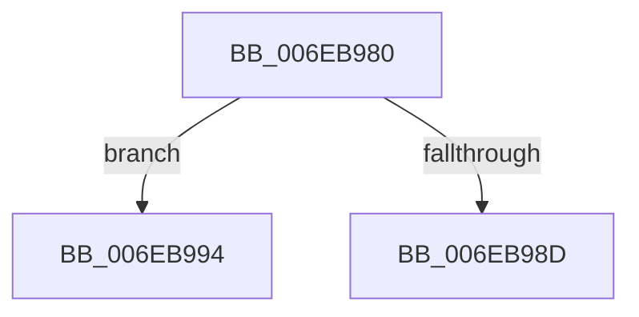

# sub_006EB980

- RVA: `0x006EB980`–`0x006EB9A7` (길이 `39` bytes)
- VA: `0x00000001406EB980`
- 실행 섹션: `.text`
- PDB 이름 있음: `아니요`; PDB Function 태그: `아니요`
- unwind 정보 RVA: `0x00098174`
- 디코드: `11`개 명령, `39/39` bytes 표시
- 미해석 바이트: `0` (있으면 어셈블리에 `.byte`로 보존)

> 이 문서는 커널 이미지의 기계어와 PDB 기호를 분석해 생성했습니다. 4번과 5번은 함수 원형과 자료형을 바이너리 사용 방식에서 추정한 C 해석이며 원본 소스 복구 결과는 아닙니다.

## 1. Dependencies

- 직접 호출 지점: **2**; 고유 호출 대상: **2**
- 직접 호출자로 확인된 함수: **0**
- RIP 상대 이미지 참조: **0**

### Outgoing calls
- `0x006EB983` → [MiUnmapContiguousMemory](../3F/MiUnmapContiguousMemory_function_003F7908.md) (function, `0x003F7908`)
- `0x006EB99A` → [HalpAcpiCacheTable](../53/HalpAcpiCacheTable_function_0053ED64.md) (function, `0x0053ED64`)

### Direct callers
- 이 함수 시작 RVA로 연결되는 직접 call은 확인되지 않았습니다. 간접 호출은 완전히 역산할 수 없습니다.

### Static image references
- 디코드된 RIP-relative 메모리 참조가 없습니다.

## 2. Other-region calls and transfers

- 다른 실행 섹션으로 향하는 call: **0**
- call이 아닌 외부 분기/꼬리 이동: **2**
  - `0x006EB98F` → [HalpAcpiGetTableWork + 0x5E](../3F/HalpAcpiGetTableWork_function_003F6CDC.md) (`tail-transfer`)
  - `0x006EB9A2` → [HalpAcpiGetTableWork + 0x5E](../3F/HalpAcpiGetTableWork_function_003F6CDC.md) (`tail-transfer`)

## 3. Assembly (complete function range)

```asm
006EB980  41 B0 01                        mov r8b, 1
006EB983  E8 80 BF D0 FF                  call 0x1403f7908
006EB988  48 85 FF                        test rdi, rdi
006EB98B  75 07                           jne 0x1406eb994
006EB98D  33 DB                           xor ebx, ebx
006EB98F  E9 A6 B3 D0 FF                  jmp 0x1403f6d3a
006EB994  48 8B D7                        mov rdx, rdi
006EB997  48 8B CE                        mov rcx, rsi
006EB99A  E8 C5 33 E5 FF                  call 0x14053ed64
006EB99F  48 8B DF                        mov rbx, rdi
006EB9A2  E9 93 B3 D0 FF                  jmp 0x1403f6d3a
```

## 4. C-style interpretation (structured pseudocode)

```c
__int64 __fastcall sub_006EB980(void)
{
    __int64 result;
    __int64 v_rbx;

    result = MiUnmapContiguousMemory(a1, a2, 1, a4);
    if (v_rdi != 0) goto loc_006EB994;
    v_rbx = 0;
loc_006EB994:
    result = HalpAcpiCacheTable(v_rsi, v_rdi, 1, a4);
}
```

## 5. (Beta) C Style

```c
void sub_006EB980(void)
{
    int64_t result;
    int64_t local_rbx;

    result = MiUnmapContiguousMemory(a1, a2, 1, a4);
    if (local_rdi != 0) goto loc_006EB994;
    local_rbx = 0;
loc_006EB994:
    result = HalpAcpiCacheTable(local_rsi, local_rdi, 1, a4);
}
```

## 6. Execution-region graph

[열기: 2D/3D 그래프와 함수 탐색 컨트롤 패널](../../../control-panel.html?section=text&rva=0x006EB980&view=graph)

- 2D 그래프는 위에서 아래로 흐르고, 3D 그래프는 빈 공간을 드래그해 회전합니다. Shift+드래그는 이동, 휠은 확대·축소, 함수 노드 선택은 대상 보고서 이동입니다.

### Static fallback


