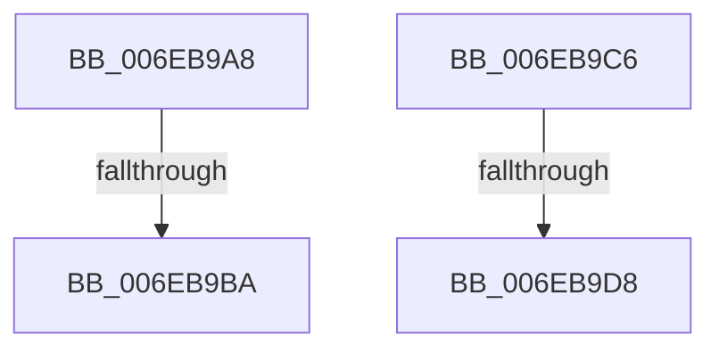

# sub_006EB9A8

- RVA: `0x006EB9A8`–`0x006EB9E4` (길이 `60` bytes)
- VA: `0x00000001406EB9A8`
- 실행 섹션: `.text`
- PDB 이름 있음: `아니요`; PDB Function 태그: `아니요`
- unwind 정보 RVA: `0x00098224`
- 디코드: `10`개 명령, `60/60` bytes 표시
- 미해석 바이트: `0` (있으면 어셈블리에 `.byte`로 보존)

> 이 문서는 커널 이미지의 기계어와 PDB 기호를 분석해 생성했습니다. 4번과 5번은 함수 원형과 자료형을 바이너리 사용 방식에서 추정한 C 해석이며 원본 소스 복구 결과는 아닙니다.

## 1. Dependencies

- 직접 호출 지점: **2**; 고유 호출 대상: **1**
- 직접 호출자로 확인된 함수: **0**
- RIP 상대 이미지 참조: **2**

### Outgoing calls
- `0x006EB9A8` → [HalpFlushTLB](../4F/HalpFlushTLB_function_004F5E9C.md) (function, `0x004F5E9C`)
- `0x006EB9C6` → [HalpFlushTLB](../4F/HalpFlushTLB_function_004F5E9C.md) (function, `0x004F5E9C`)

### Direct callers
- 이 함수 시작 RVA로 연결되는 직접 call은 확인되지 않았습니다. 간접 호출은 완전히 역산할 수 없습니다.

### Static image references
- `0x006EB9AD` → RVA `0x00E10220` (`.data`; read)
- `0x006EB9BA` → RVA `0x00E10220` (`.data`; write)

## 2. Other-region calls and transfers

- 다른 실행 섹션으로 향하는 call: **0**
- call이 아닌 외부 분기/꼬리 이동: **4**
  - `0x006EB9B4` → [HalpAcpiCheckAndMapTable + 0x245](../3F/HalpAcpiCheckAndMapTable_function_003F75D8.md) (`tail-transfer`)
  - `0x006EB9C1` → [HalpAcpiCheckAndMapTable + 0x245](../3F/HalpAcpiCheckAndMapTable_function_003F75D8.md) (`tail-transfer`)
  - `0x006EB9D2` → [HalpAcpiCheckAndMapTable + 0x97](../3F/HalpAcpiCheckAndMapTable_function_003F75D8.md) (`tail-transfer`)
  - `0x006EB9DF` → [HalpAcpiCheckAndMapTable + 0x97](../3F/HalpAcpiCheckAndMapTable_function_003F75D8.md) (`tail-transfer`)

## 3. Assembly (complete function range)

```asm
006EB9A8  E8 EF A4 E0 FF                  call 0x1404f5e9c
006EB9AD  48 39 3D 6C 48 72 00            cmp qword ptr [rip + 0x72486c], rdi
006EB9B4  0F 86 63 BE D0 FF               jbe 0x1403f781d
006EB9BA  48 89 3D 5F 48 72 00            mov qword ptr [rip + 0x72485f], rdi
006EB9C1  E9 57 BE D0 FF                  jmp 0x1403f781d
006EB9C6  E8 D1 A4 E0 FF                  call 0x1404f5e9c
006EB9CB  48 39 3D 4E 48 72 00            cmp qword ptr [rip + 0x72484e], rdi
006EB9D2  0F 86 97 BC D0 FF               jbe 0x1403f766f
006EB9D8  48 89 3D 41 48 72 00            mov qword ptr [rip + 0x724841], rdi
006EB9DF  E9 8B BC D0 FF                  jmp 0x1403f766f
```

## 4. C-style interpretation (structured pseudocode)

```c
__int64 __fastcall sub_006EB9A8(void)
{
    __int64 result;

    result = HalpFlushTLB(a1, a2, a3, a4);
    *(unsigned __int64 *)(v_rip + 7489631) = v_rdi;
}
```

## 5. (Beta) C Style

```c
void sub_006EB9A8(void)
{
    int64_t result;

    result = HalpFlushTLB(a1, a2, a3, a4);
    *(uint64_t *)(v_rip + 0x72485F) = local_rdi;
}
```

## 6. Execution-region graph

[열기: 2D/3D 그래프와 함수 탐색 컨트롤 패널](../../../control-panel.html?section=text&rva=0x006EB9A8&view=graph)

- 2D 그래프는 위에서 아래로 흐르고, 3D 그래프는 빈 공간을 드래그해 회전합니다. Shift+드래그는 이동, 휠은 확대·축소, 함수 노드 선택은 대상 보고서 이동입니다.

### Static fallback


