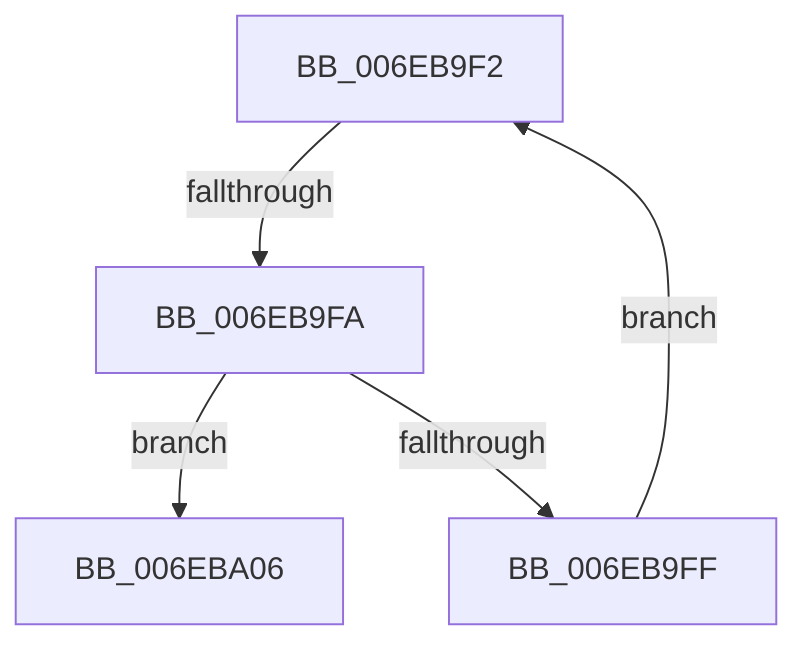

# sub_006EB9F2

- RVA: `0x006EB9F2`–`0x006EBA20` (길이 `46` bytes)
- VA: `0x00000001406EB9F2`
- 실행 섹션: `.text`
- PDB 이름 있음: `아니요`; PDB Function 태그: `아니요`
- unwind 정보 RVA: `0x00098294`
- 디코드: `14`개 명령, `46/46` bytes 표시
- 미해석 바이트: `0` (있으면 어셈블리에 `.byte`로 보존)

> 이 문서는 커널 이미지의 기계어와 PDB 기호를 분석해 생성했습니다. 4번과 5번은 함수 원형과 자료형을 바이너리 사용 방식에서 추정한 C 해석이며 원본 소스 복구 결과는 아닙니다.

## 1. Dependencies

- 직접 호출 지점: **1**; 고유 호출 대상: **1**
- 직접 호출자로 확인된 함수: **0**
- RIP 상대 이미지 참조: **0**

### Outgoing calls
- `0x006EBA1A` → [KeBugCheckEx](../4F/KeBugCheckEx_function_004FD660.md) (function, `0x004FD660`)

### Direct callers
- 이 함수 시작 RVA로 연결되는 직접 call은 확인되지 않았습니다. 간접 호출은 완전히 역산할 수 없습니다.

### Static image references
- 디코드된 RIP-relative 메모리 참조가 없습니다.

## 2. Other-region calls and transfers

- 다른 실행 섹션으로 향하는 call: **0**
- call이 아닌 외부 분기/꼬리 이동: **1**
  - `0x006EB9F4` → [ExRemovePoolTag + 0x1B4](../3F/ExRemovePoolTag_function_003F7CBC.md) (`tail-transfer`)

## 3. Assembly (complete function range)

```asm
006EB9F2  3B D8                           cmp ebx, eax
006EB9F4  0F 83 76 C4 D0 FF               jae 0x1403f7e70
006EB9FA  45 38 39                        cmp byte ptr [r9], r15b
006EB9FD  75 07                           jne 0x1406eba06
006EB9FF  49 FF C1                        inc r9
006EBA02  FF C3                           inc ebx
006EBA04  EB EC                           jmp 0x1406eb9f2
006EBA06  BA 62 00 00 00                  mov edx, 0x62
006EBA0B  41 0F B6 C7                     movzx eax, r15b
006EBA0F  4C 8B C6                        mov r8, rsi
006EBA12  48 89 44 24 20                  mov qword ptr [rsp + 0x20], rax
006EBA17  8D 4A 60                        lea ecx, [rdx + 0x60]
006EBA1A  E8 41 1C E1 FF                  call 0x1404fd660
006EBA1F  CC                              int3
```

## 4. C-style interpretation (structured pseudocode)

```c
__int64 __fastcall sub_006EB9F2(__int64 a1, __int64 a2, __int64 a3, __int64 a4)
{
    __int64 result;
    __int64 v_rbx;
    unsigned __int64 v_stack_p20;

    if ((*(unsigned __int8 *)(a4)) != ((unsigned __int8)(v_r15))) goto loc_006EBA06;
    a4 = (a4) + 1;
    v_rbx = (unsigned int)((v_rbx) + 1);
    goto loc_006EB9F2;
loc_006EBA06:
    v_stack_p20 = (unsigned __int8)(v_r15);
    result = KeBugCheckEx(98 + 96, 98, v_rsi, a4);
    return result;
}
```

## 5. (Beta) C Style

```c
int64_t sub_006EB9F2(int64_t Arg1, int64_t Arg2, int64_t Arg3, int64_t Arg4)
{
    int64_t result;
    int64_t local_rbx;
    uint64_t v_stack_p20;

    if ((*(uint8_t *)(Arg4)) != ((uint8_t)(local_r15))) goto loc_006EBA06;
    Arg4 = (Arg4) + 1;
    local_rbx = (uint32_t)((local_rbx) + 1);
    goto loc_006EB9F2;
loc_006EBA06:
    v_stack_p20 = (uint8_t)(local_r15);
    result = KeBugCheckEx(98 + 96, 98, local_rsi, Arg4);
    return result;
}
```

## 6. Execution-region graph

[열기: 2D/3D 그래프와 함수 탐색 컨트롤 패널](../../../control-panel.html?section=text&rva=0x006EB9F2&view=graph)

- 2D 그래프는 위에서 아래로 흐르고, 3D 그래프는 빈 공간을 드래그해 회전합니다. Shift+드래그는 이동, 휠은 확대·축소, 함수 노드 선택은 대상 보고서 이동입니다.

### Static fallback


