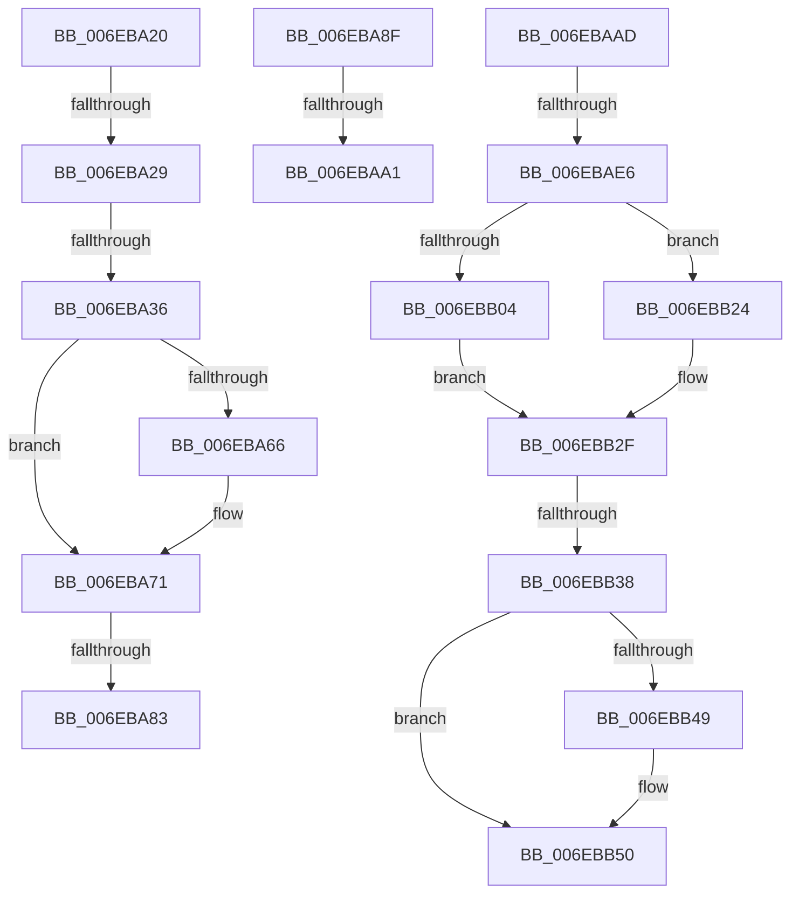

# sub_006EBA20

- RVA: `0x006EBA20`–`0x006EBB6A` (길이 `330` bytes)
- VA: `0x00000001406EBA20`
- 실행 섹션: `.text`
- PDB 이름 있음: `아니요`; PDB Function 태그: `아니요`
- unwind 정보 RVA: `0x000982C0`
- 디코드: `74`개 명령, `330/330` bytes 표시
- 미해석 바이트: `0` (있으면 어셈블리에 `.byte`로 보존)

> 이 문서는 커널 이미지의 기계어와 PDB 기호를 분석해 생성했습니다. 4번과 5번은 함수 원형과 자료형을 바이너리 사용 방식에서 추정한 C 해석이며 원본 소스 복구 결과는 아닙니다.

## 1. Dependencies

- 직접 호출 지점: **7**; 고유 호출 대상: **6**
- 직접 호출자로 확인된 함수: **0**
- RIP 상대 이미지 참조: **5**

### Outgoing calls
- `0x006EBA6C` → [memset](../6C/memset_function_006C6C40.md) (function, `0x006C6C40`)
- `0x006EBA71` → [HalpFlushTLB](../4F/HalpFlushTLB_function_004F5E9C.md) (function, `0x004F5E9C`)
- `0x006EBA8F` → [HalpFlushTLB](../4F/HalpFlushTLB_function_004F5E9C.md) (function, `0x004F5E9C`)
- `0x006EBAD5` → [HalpAcpiCheckAndMapTable](../3F/HalpAcpiCheckAndMapTable_function_003F75D8.md) (function, `0x003F75D8`)
- `0x006EBAF0` → [HalpAcpiCopyBiosTable](../53/HalpAcpiCopyBiosTable_function_0053EDD0.md) (function, `0x0053EDD0`)
- `0x006EBB1D` → [HalpUnmapVirtualAddress](../3F/HalpUnmapVirtualAddress_function_003F8C30.md) (function, `0x003F8C30`)
- `0x006EBB2A` → [MiUnmapContiguousMemory](../3F/MiUnmapContiguousMemory_function_003F7908.md) (function, `0x003F7908`)

### Direct callers
- 이 함수 시작 RVA로 연결되는 직접 call은 확인되지 않았습니다. 간접 호출은 완전히 역산할 수 없습니다.

### Static image references
- `0x006EBA29` → RVA `0x00E10228` (`.data`; read)
- `0x006EBA76` → RVA `0x00E10220` (`.data`; read)
- `0x006EBA83` → RVA `0x00E10220` (`.data`; write)
- `0x006EBB38` → RVA `0x00E0F660` (`.data`; read)
- `0x006EBB5E` → RVA `0x00E0F660` (`.data`; write)

## 2. Other-region calls and transfers

- 다른 실행 섹션으로 향하는 call: **0**
- call이 아닌 외부 분기/꼬리 이동: **9**
  - `0x006EBA23` → [HalpAcpiGetRsdt + 0xB4](../3F/HalpAcpiGetRsdt_function_003F806C.md) (`tail-transfer`)
  - `0x006EBA30` → [HalpAcpiGetRsdt + 0xB4](../3F/HalpAcpiGetRsdt_function_003F806C.md) (`tail-transfer`)
  - `0x006EBA7D` → [HalpAcpiGetRsdt + 0xB4](../3F/HalpAcpiGetRsdt_function_003F806C.md) (`tail-transfer`)
  - `0x006EBA8A` → [HalpAcpiGetRsdt + 0xB4](../3F/HalpAcpiGetRsdt_function_003F806C.md) (`tail-transfer`)
  - `0x006EBA9B` → [HalpAcpiGetRsdt + 0xF8](../3F/HalpAcpiGetRsdt_function_003F806C.md) (`tail-transfer`)
  - `0x006EBAA8` → [HalpAcpiGetRsdt + 0xF8](../3F/HalpAcpiGetRsdt_function_003F806C.md) (`tail-transfer`)
  - `0x006EBAE0` → [HalpAcpiGetRsdt + 0xB4](../3F/HalpAcpiGetRsdt_function_003F806C.md) (`tail-transfer`)
  - `0x006EBB32` → [HalpAcpiGetRsdt + 0xB4](../3F/HalpAcpiGetRsdt_function_003F806C.md) (`tail-transfer`)
  - `0x006EBB65` → [HalpAcpiGetRsdt + 0xB4](../3F/HalpAcpiGetRsdt_function_003F806C.md) (`tail-transfer`)

## 3. Assembly (complete function range)

```asm
006EBA20  48 3B CB                        cmp rcx, rbx
006EBA23  0F 82 F7 C6 D0 FF               jb 0x1403f8120
006EBA29  48 3B 0D F8 47 72 00            cmp rcx, qword ptr [rip + 0x7247f8]
006EBA30  0F 87 EA C6 D0 FF               ja 0x1403f8120
006EBA36  48 B8 FF FF FF FF 0F 00 00 00   movabs rax, 0xfffffffff
006EBA40  48 81 E3 00 F0 FF FF            and rbx, 0xfffffffffffff000
006EBA47  48 8B CB                        mov rcx, rbx
006EBA4A  48 C1 E9 0C                     shr rcx, 0xc
006EBA4E  48 23 C8                        and rcx, rax
006EBA51  48 B8 00 00 00 00 80 F6 FF FF   movabs rax, 0xfffff68000000000
006EBA5B  48 8B C0                        mov rax, rax
006EBA5E  48 8D 0C C8                     lea rcx, [rax + rcx*8]
006EBA62  85 D2                           test edx, edx
006EBA64  74 0B                           je 0x1406eba71
006EBA66  49 C1 E0 03                     shl r8, 3
006EBA6A  33 D2                           xor edx, edx
006EBA6C  E8 CF B1 FD FF                  call 0x1406c6c40
006EBA71  E8 26 A4 E0 FF                  call 0x1404f5e9c
006EBA76  48 39 1D A3 47 72 00            cmp qword ptr [rip + 0x7247a3], rbx
006EBA7D  0F 86 9D C6 D0 FF               jbe 0x1403f8120
006EBA83  48 89 1D 96 47 72 00            mov qword ptr [rip + 0x724796], rbx
006EBA8A  E9 91 C6 D0 FF                  jmp 0x1403f8120
006EBA8F  E8 08 A4 E0 FF                  call 0x1404f5e9c
006EBA94  48 39 1D 85 47 72 00            cmp qword ptr [rip + 0x724785], rbx
006EBA9B  0F 86 C3 C6 D0 FF               jbe 0x1403f8164
006EBAA1  48 89 1D 78 47 72 00            mov qword ptr [rip + 0x724778], rbx
006EBAA8  E9 B7 C6 D0 FF                  jmp 0x1403f8164
006EBAAD  48 8B 57 F8                     mov rdx, qword ptr [rdi - 8]
006EBAB1  48 8D 44 24 68                  lea rax, [rsp + 0x68]
006EBAB6  48 89 44 24 38                  mov qword ptr [rsp + 0x38], rax
006EBABB  45 33 C9                        xor r9d, r9d
006EBABE  C6 44 24 30 01                  mov byte ptr [rsp + 0x30], 1
006EBAC3  45 8B C7                        mov r8d, r15d
006EBAC6  48 83 64 24 28 00               and qword ptr [rsp + 0x28], 0
006EBACC  48 8B CD                        mov rcx, rbp
006EBACF  48 83 64 24 20 00               and qword ptr [rsp + 0x20], 0
006EBAD5  E8 FE BA D0 FF                  call 0x1403f75d8
006EBADA  48 8B D8                        mov rbx, rax
006EBADD  48 85 C0                        test rax, rax
006EBAE0  0F 84 3A C6 D0 FF               je 0x1403f8120
006EBAE6  4C 8B 47 F8                     mov r8, qword ptr [rdi - 8]
006EBAEA  48 8B D0                        mov rdx, rax
006EBAED  48 8B CD                        mov rcx, rbp
006EBAF0  E8 DB 32 E5 FF                  call 0x14053edd0
006EBAF5  48 8B F0                        mov rsi, rax
006EBAF8  8B 44 24 68                     mov eax, dword ptr [rsp + 0x68]
006EBAFC  48 8B CB                        mov rcx, rbx
006EBAFF  48 85 ED                        test rbp, rbp
006EBB02  74 20                           je 0x1406ebb24
006EBB04  48 8B D3                        mov rdx, rbx
006EBB07  48 05 FF 0F 00 00               add rax, 0xfff
006EBB0D  81 E2 FF 0F 00 00               and edx, 0xfff
006EBB13  45 33 C0                        xor r8d, r8d
006EBB16  48 03 D0                        add rdx, rax
006EBB19  48 C1 EA 0C                     shr rdx, 0xc
006EBB1D  E8 0E D1 D0 FF                  call 0x1403f8c30
006EBB22  EB 0B                           jmp 0x1406ebb2f
006EBB24  41 B0 01                        mov r8b, 1
006EBB27  48 8B D0                        mov rdx, rax
006EBB2A  E8 D9 BD D0 FF                  call 0x1403f7908
006EBB2F  48 85 F6                        test rsi, rsi
006EBB32  0F 84 E8 C5 D0 FF               je 0x1403f8120
006EBB38  48 8B 0D 21 3B 72 00            mov rcx, qword ptr [rip + 0x723b21]
006EBB3F  48 8D 46 E8                     lea rax, [rsi - 0x18]
006EBB43  4C 39 69 08                     cmp qword ptr [rcx + 8], r13
006EBB47  74 07                           je 0x1406ebb50
006EBB49  B9 03 00 00 00                  mov ecx, 3
006EBB4E  CD 29                           int 0x29
006EBB50  48 89 08                        mov qword ptr [rax], rcx
006EBB53  48 8B FE                        mov rdi, rsi
006EBB56  4C 89 68 08                     mov qword ptr [rax + 8], r13
006EBB5A  48 89 41 08                     mov qword ptr [rcx + 8], rax
006EBB5E  48 89 05 FB 3A 72 00            mov qword ptr [rip + 0x723afb], rax
006EBB65  E9 B6 C5 D0 FF                  jmp 0x1403f8120
```

## 4. C-style interpretation (structured pseudocode)

```c
__int64 __fastcall sub_006EBA20(__int64 a1, int a2, __int64 a3, int a4)
{
    __int64 result;
    __int64 v_rbx;
    unsigned __int64 v_stack_p20;
    unsigned __int64 v_stack_p28;
    unsigned __int8 v_stack_p30;
    unsigned __int64 v_stack_p38;
    unsigned __int64 v_stack_p68;

    v_rbx = (v_rbx) & (0xFFFFFFFFFFFFF000ULL);
    a1 = (v_rbx) >> (12);
    a1 = (a1) & (result);
    if (a2 != 0) {
        a3 = (a3) << (3);
        a2 = 0;
        result = memset(result + a1 * 8, a2, a3, a4);
    }
    result = HalpFlushTLB(result + a1 * 8, a2, a3, a4);
    *(unsigned __int64 *)(v_rip + 7489430) = v_rbx;
}
```

## 5. (Beta) C Style

```c
int64_t sub_006EBA20(int64_t Arg1, int32_t Arg2, int64_t Arg3, int32_t Arg4)
{
    int64_t result;
    int64_t local_rbx;
    uint64_t v_stack_p20;
    uint64_t v_stack_p28;
    uint8_t v_stack_p30;
    uint64_t v_stack_p38;
    uint64_t v_stack_p68;

    local_rbx = (local_rbx) & (0xFFFFFFFFFFFFF000ULL);
    Arg1 = (local_rbx) >> (12);
    Arg1 = (Arg1) & (result);
    if (Arg2 != 0) {
        Arg3 = (Arg3) << (3);
        Arg2 = 0;
        result = memset(result + Arg1 * 8, Arg2, Arg3, Arg4);
    }
    result = HalpFlushTLB(result + Arg1 * 8, Arg2, Arg3, Arg4);
    *(uint64_t *)(v_rip + 0x724796) = local_rbx;
}
```

## 6. Execution-region graph

[열기: 2D/3D 그래프와 함수 탐색 컨트롤 패널](../../../control-panel.html?section=text&rva=0x006EBA20&view=graph)

- 2D 그래프는 위에서 아래로 흐르고, 3D 그래프는 빈 공간을 드래그해 회전합니다. Shift+드래그는 이동, 휠은 확대·축소, 함수 노드 선택은 대상 보고서 이동입니다.

### Static fallback


