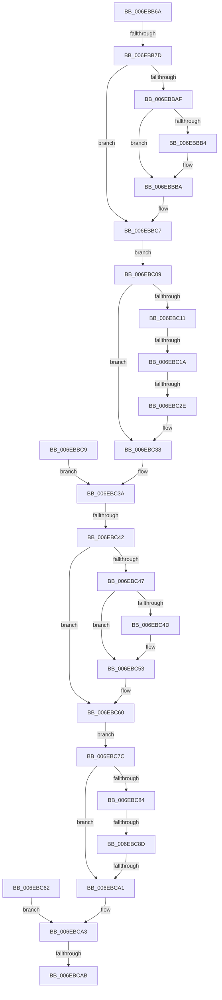

# sub_006EBB6A

- RVA: `0x006EBB6A`–`0x006EBCC4` (길이 `346` bytes)
- VA: `0x00000001406EBB6A`
- 실행 섹션: `.text`
- PDB 이름 있음: `아니요`; PDB Function 태그: `아니요`
- unwind 정보 RVA: `0x00098398`
- 디코드: `80`개 명령, `346/346` bytes 표시
- 미해석 바이트: `0` (있으면 어셈블리에 `.byte`로 보존)

> 이 문서는 커널 이미지의 기계어와 PDB 기호를 분석해 생성했습니다. 4번과 5번은 함수 원형과 자료형을 바이너리 사용 방식에서 추정한 C 해석이며 원본 소스 복구 결과는 아닙니다.

## 1. Dependencies

- 직접 호출 지점: **2**; 고유 호출 대상: **1**
- 직접 호출자로 확인된 함수: **0**
- RIP 상대 이미지 참조: **0**

### Outgoing calls
- `0x006EBBB4` → [ExRaiseDatatypeMisalignment](../../page/89/ExRaiseDatatypeMisalignment_function_00899FD0.md) (function, `0x00899FD0`)
- `0x006EBC4D` → [ExRaiseDatatypeMisalignment](../../page/89/ExRaiseDatatypeMisalignment_function_00899FD0.md) (function, `0x00899FD0`)

### Direct callers
- 이 함수 시작 RVA로 연결되는 직접 call은 확인되지 않았습니다. 간접 호출은 완전히 역산할 수 없습니다.

### Static image references
- 디코드된 RIP-relative 메모리 참조가 없습니다.

## 2. Other-region calls and transfers

- 다른 실행 섹션으로 향하는 call: **2**
  - `0x006EBBB4` → [ExRaiseDatatypeMisalignment](../../page/89/ExRaiseDatatypeMisalignment_function_00899FD0.md) (`.text` → `PAGE`)
  - `0x006EBC4D` → [ExRaiseDatatypeMisalignment](../../page/89/ExRaiseDatatypeMisalignment_function_00899FD0.md) (`.text` → `PAGE`)
- call이 아닌 외부 분기/꼬리 이동: **8**
  - `0x006EBB77` → [RtlpUnwindEpilogue + 0x13F](../3F/RtlpUnwindEpilogue_function_003F8E90.md) (`tail-transfer`)
  - `0x006EBC14` → [RtlpUnwindEpilogue + 0x205](../3F/RtlpUnwindEpilogue_function_003F8E90.md) (`tail-transfer`)
  - `0x006EBC28` → [RtlpUnwindEpilogue + 0x205](../3F/RtlpUnwindEpilogue_function_003F8E90.md) (`tail-transfer`)
  - `0x006EBC3C` → [RtlpUnwindEpilogue + 0x196](../3F/RtlpUnwindEpilogue_function_003F8E90.md) (`tail-transfer`)
  - `0x006EBC87` → [RtlpUnwindEpilogue + 0x205](../3F/RtlpUnwindEpilogue_function_003F8E90.md) (`tail-transfer`)
  - `0x006EBC9B` → [RtlpUnwindEpilogue + 0x205](../3F/RtlpUnwindEpilogue_function_003F8E90.md) (`tail-transfer`)
  - `0x006EBCA5` → [RtlpUnwindEpilogue + 0x196](../3F/RtlpUnwindEpilogue_function_003F8E90.md) (`tail-transfer`)
  - `0x006EBCBF` → [RtlpUnwindEpilogue + 0x22E](../3F/RtlpUnwindEpilogue_function_003F8E90.md) (`tail-transfer`)

## 3. Assembly (complete function range)

```asm
006EBB6A  8B C7                           mov eax, edi
006EBB6C  41 8A 4C 44 05                  mov cl, byte ptr [r12 + rax*2 + 5]
006EBB71  80 E1 0F                        and cl, 0xf
006EBB74  80 F9 0A                        cmp cl, 0xa
006EBB77  0F 85 52 D4 D0 FF               jne 0x1403f8fcf
006EBB7D  49 8B 91 98 00 00 00            mov rdx, qword ptr [r9 + 0x98]
006EBB84  48 89 94 24 90 00 00 00         mov qword ptr [rsp + 0x90], rdx
006EBB8C  4C 8D 42 18                     lea r8, [rdx + 0x18]
006EBB90  4C 89 84 24 A8 00 00 00         mov qword ptr [rsp + 0xa8], r8
006EBB98  4C 8B 9C 24 98 00 00 00         mov r11, qword ptr [rsp + 0x98]
006EBBA0  48 B9 FF FF FE FF FF 7F 00 00   movabs rcx, 0x7ffffffeffff
006EBBAA  4C 3B D9                        cmp r11, rcx
006EBBAD  77 18                           ja 0x1406ebbc7
006EBBAF  F6 C2 03                        test dl, 3
006EBBB2  74 06                           je 0x1406ebbba
006EBBB4  E8 17 E4 1A 00                  call 0x140899fd0
006EBBB9  CC                              int3
006EBBBA  48 8B C2                        mov rax, rdx
006EBBBD  48 3B D6                        cmp rdx, rsi
006EBBC0  48 0F 43 C6                     cmovae rax, rsi
006EBBC4  90                              nop
006EBBC5  8A 00                           mov al, byte ptr [rax]
006EBBC7  EB 40                           jmp 0x1406ebc09
006EBBC9  33 DB                           xor ebx, ebx
006EBBCB  48 B9 FF FF FE FF FF 7F 00 00   movabs rcx, 0x7ffffffeffff
006EBBD5  48 BE 00 00 FF FF FF 7F 00 00   movabs rsi, 0x7fffffff0000
006EBBDF  4C 8B 94 24 B8 00 00 00         mov r10, qword ptr [rsp + 0xb8]
006EBBE7  4C 8B 8C 24 B0 00 00 00         mov r9, qword ptr [rsp + 0xb0]
006EBBEF  48 8B 94 24 90 00 00 00         mov rdx, qword ptr [rsp + 0x90]
006EBBF7  4C 8B 84 24 A8 00 00 00         mov r8, qword ptr [rsp + 0xa8]
006EBBFF  4C 8B 9C 24 98 00 00 00         mov r11, qword ptr [rsp + 0x98]
006EBC07  EB 31                           jmp 0x1406ebc3a
006EBC09  49 8B 02                        mov rax, qword ptr [r10]
006EBC0C  48 85 C0                        test rax, rax
006EBC0F  74 27                           je 0x1406ebc38
006EBC11  48 3B 10                        cmp rdx, qword ptr [rax]
006EBC14  0F 82 7B D4 D0 FF               jb 0x1403f9095
006EBC1A  49 8B 42 08                     mov rax, qword ptr [r10 + 8]
006EBC1E  48 8B 08                        mov rcx, qword ptr [rax]
006EBC21  48 83 E9 08                     sub rcx, 8
006EBC25  48 3B D1                        cmp rdx, rcx
006EBC28  0F 87 67 D4 D0 FF               ja 0x1403f9095
006EBC2E  48 B9 FF FF FE FF FF 7F 00 00   movabs rcx, 0x7ffffffeffff
006EBC38  8B C3                           mov eax, ebx
006EBC3A  85 C0                           test eax, eax
006EBC3C  0F 88 E4 D3 D0 FF               js 0x1403f9026
006EBC42  4C 3B D9                        cmp r11, rcx
006EBC45  77 19                           ja 0x1406ebc60
006EBC47  41 F6 C0 03                     test r8b, 3
006EBC4B  74 06                           je 0x1406ebc53
006EBC4D  E8 7E E3 1A 00                  call 0x140899fd0
006EBC52  CC                              int3
006EBC53  49 8B C0                        mov rax, r8
006EBC56  4C 3B C6                        cmp r8, rsi
006EBC59  48 0F 43 C6                     cmovae rax, rsi
006EBC5D  90                              nop
006EBC5E  8A 00                           mov al, byte ptr [rax]
006EBC60  EB 1A                           jmp 0x1406ebc7c
006EBC62  4C 8B 8C 24 B0 00 00 00         mov r9, qword ptr [rsp + 0xb0]
006EBC6A  48 8B 94 24 90 00 00 00         mov rdx, qword ptr [rsp + 0x90]
006EBC72  4C 8B 84 24 A8 00 00 00         mov r8, qword ptr [rsp + 0xa8]
006EBC7A  EB 27                           jmp 0x1406ebca3
006EBC7C  49 8B 02                        mov rax, qword ptr [r10]
006EBC7F  48 85 C0                        test rax, rax
006EBC82  74 1D                           je 0x1406ebca1
006EBC84  4C 3B 00                        cmp r8, qword ptr [rax]
006EBC87  0F 82 08 D4 D0 FF               jb 0x1403f9095
006EBC8D  49 8B 42 08                     mov rax, qword ptr [r10 + 8]
006EBC91  48 8B 08                        mov rcx, qword ptr [rax]
006EBC94  48 83 E9 08                     sub rcx, 8
006EBC98  4C 3B C1                        cmp r8, rcx
006EBC9B  0F 87 F4 D3 D0 FF               ja 0x1403f9095
006EBCA1  8B C3                           mov eax, ebx
006EBCA3  85 C0                           test eax, eax
006EBCA5  0F 88 7B D3 D0 FF               js 0x1403f9026
006EBCAB  48 8B 02                        mov rax, qword ptr [rdx]
006EBCAE  49 89 81 F8 00 00 00            mov qword ptr [r9 + 0xf8], rax
006EBCB5  49 8B 00                        mov rax, qword ptr [r8]
006EBCB8  49 89 81 98 00 00 00            mov qword ptr [r9 + 0x98], rax
006EBCBF  E9 FA D3 D0 FF                  jmp 0x1403f90be
```

## 4. C-style interpretation (structured pseudocode)

```c
__int64 __fastcall sub_006EBB6A(__int64 a1, __int64 a2, __int64 a3, __int64 a4, __int64 a5, __int64 a6, __int64 a7, __int64 a8, __int64 a9, __int64 a10, __int64 a11, __int64 a12, __int64 a13, __int64 a14, __int64 a15, __int64 a16, __int64 a17, __int64 a18, __int64 a19)
{
    __int64 result;
    unsigned __int64 v_stack_p90;
    unsigned __int64 v_stack_p98;
    unsigned __int64 v_stack_pA8;
    unsigned __int64 v_stack_pB0;
    unsigned __int64 v_stack_pB8;

    a1 = (unsigned __int8)((*(unsigned __int8 *)(v_r12 + (unsigned int)((unsigned int)(v_rdi)) * 2 + 5)) & (15));
    v_stack_p90 = *(unsigned __int64 *)(a4 + 152);
    v_stack_pA8 = *(unsigned __int64 *)(a4 + 152) + 24;
    if (a19 > a1) goto loc_006EBBC7;
    result = (unsigned int)((unsigned int)(v_rdi));
    if ((((unsigned __int8)(*(unsigned __int64 *)(a4 + 152))) & (3)) != 0) {
        result = ExRaiseDatatypeMisalignment(a1, *(unsigned __int64 *)(a4 + 152), *(unsigned __int64 *)(a4 + 152) + 24, a4);
    }
    result = *(unsigned __int64 *)(a4 + 152);
    if ((*(unsigned __int64 *)(a4 + 152)) >= v_rsi) { result = v_rsi; }
loc_006EBBC7:
    goto loc_006EBC09;
loc_006EBC09:
    if (*(unsigned __int64 *)(v_r10) == 0) goto loc_006EBC38;
    a1 = (*(unsigned __int64 *)(*(unsigned __int64 *)(v_r10 + 8))) - (8);
loc_006EBC38:
loc_006EBC3A:
    if (a19 > a1) goto loc_006EBC60;
    result = (unsigned int)((unsigned int)(v_rbx));
    if ((((unsigned __int8)(*(unsigned __int64 *)(a4 + 152) + 24)) & (3)) != 0) {
        result = ExRaiseDatatypeMisalignment(a1, *(unsigned __int64 *)(a4 + 152), *(unsigned __int64 *)(a4 + 152) + 24, a4);
    }
    result = *(unsigned __int64 *)(a4 + 152) + 24;
    if ((*(unsigned __int64 *)(a4 + 152) + 24) >= v_rsi) { result = v_rsi; }
loc_006EBC60:
    goto loc_006EBC7C;
loc_006EBC7C:
    if (*(unsigned __int64 *)(v_r10) == 0) goto loc_006EBCA1;
    a1 = (*(unsigned __int64 *)(*(unsigned __int64 *)(v_r10 + 8))) - (8);
loc_006EBCA1:
loc_006EBCA3:
    *(unsigned __int64 *)(a4 + 248) = *(unsigned __int64 *)(*(unsigned __int64 *)(a4 + 152));
    *(unsigned __int64 *)(a4 + 152) = *(unsigned __int64 *)(*(unsigned __int64 *)(a4 + 152) + 24);
}
```

## 5. (Beta) C Style

```c
int64_t sub_006EBB6A(int64_t Arg1, int64_t Arg2, int64_t Arg3, void *Arg4, uint64_t Arg5, uint64_t Arg6, uint64_t Arg7, uint64_t Arg8, uint64_t Arg9, uint64_t Arg10, uint64_t Arg11, uint64_t Arg12, uint64_t Arg13, uint64_t Arg14, uint64_t Arg15, uint64_t Arg16, uint64_t Arg17, uint64_t Arg18, int64_t Arg19)
{
    uint8_t *arg4 = (uint8_t *)Arg4;

    int64_t result;
    uint64_t v_stack_p90;
    uint64_t v_stack_p98;
    uint64_t v_stack_pA8;
    uint64_t v_stack_pB0;
    uint64_t v_stack_pB8;

    Arg1 = (uint8_t)((*(uint8_t *)(local_r12 + (uint32_t)((uint32_t)(local_rdi)) * 2 + 0x5)) & (15));
    v_stack_p90 = *(uint64_t *)(arg4 + 0x98);
    v_stack_pA8 = *(uint64_t *)(arg4 + 0x98) + 24;
    if (Arg19 > Arg1) goto loc_006EBBC7;
    result = (uint32_t)((uint32_t)(local_rdi));
    if ((((uint8_t)(*(uint64_t *)(arg4 + 0x98))) & (3)) != 0) {
        result = ExRaiseDatatypeMisalignment(Arg1, *(uint64_t *)(arg4 + 0x98), *(uint64_t *)(arg4 + 0x98) + 24, Arg4);
    }
    result = *(uint64_t *)(arg4 + 0x98);
    if ((*(uint64_t *)(arg4 + 0x98)) >= local_rsi) { result = local_rsi; }
loc_006EBBC7:
    goto loc_006EBC09;
loc_006EBC09:
    if (*(uint64_t *)(local_r10) == 0) goto loc_006EBC38;
    Arg1 = (*(uint64_t *)(*(uint64_t *)(local_r10 + 0x8))) - (8);
loc_006EBC38:
loc_006EBC3A:
    if (Arg19 > Arg1) goto loc_006EBC60;
    result = (uint32_t)((uint32_t)(local_rbx));
    if ((((uint8_t)(*(uint64_t *)(arg4 + 0x98) + 24)) & (3)) != 0) {
        result = ExRaiseDatatypeMisalignment(Arg1, *(uint64_t *)(arg4 + 0x98), *(uint64_t *)(arg4 + 0x98) + 24, Arg4);
    }
    result = *(uint64_t *)(arg4 + 0x98) + 24;
    if ((*(uint64_t *)(arg4 + 0x98) + 24) >= local_rsi) { result = local_rsi; }
loc_006EBC60:
    goto loc_006EBC7C;
loc_006EBC7C:
    if (*(uint64_t *)(local_r10) == 0) goto loc_006EBCA1;
    Arg1 = (*(uint64_t *)(*(uint64_t *)(local_r10 + 0x8))) - (8);
loc_006EBCA1:
loc_006EBCA3:
    *(uint64_t *)(arg4 + 0xF8) = *(uint64_t *)(*(uint64_t *)(arg4 + 0x98));
    *(uint64_t *)(arg4 + 0x98) = *(uint64_t *)(*(uint64_t *)(arg4 + 0x98) + 0x18);
}
```

### 관측된 메모리 오프셋

구조체 형식이 확인되지 않은 접근은 인자 기준의 오프셋으로만 기록했습니다.

| 기준 인자 | 오프셋 표현 | 폭 (bit) | 접근 |
|---|---:|---:|---|
| `Arg4` | `+ 0x98` | `64` | `R` |

## 6. Execution-region graph

[열기: 2D/3D 그래프와 함수 탐색 컨트롤 패널](../../../control-panel.html?section=text&rva=0x006EBB6A&view=graph)

- 2D 그래프는 위에서 아래로 흐르고, 3D 그래프는 빈 공간을 드래그해 회전합니다. Shift+드래그는 이동, 휠은 확대·축소, 함수 노드 선택은 대상 보고서 이동입니다.

### Static fallback


