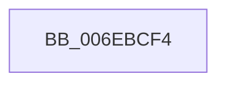

# sub_006EBCF4

- RVA: `0x006EBCF4`–`0x006EBD41` (길이 `77` bytes)
- VA: `0x00000001406EBCF4`
- 실행 섹션: `.text`
- PDB 이름 있음: `아니요`; PDB Function 태그: `아니요`
- unwind 정보 RVA: `0x000999A8`
- 디코드: `19`개 명령, `77/77` bytes 표시
- 미해석 바이트: `0` (있으면 어셈블리에 `.byte`로 보존)

> 이 문서는 커널 이미지의 기계어와 PDB 기호를 분석해 생성했습니다. 4번과 5번은 함수 원형과 자료형을 바이너리 사용 방식에서 추정한 C 해석이며 원본 소스 복구 결과는 아닙니다.

## 1. Dependencies

- 직접 호출 지점: **3**; 고유 호출 대상: **3**
- 직접 호출자로 확인된 함수: **0**
- RIP 상대 이미지 참조: **0**

### Outgoing calls
- `0x006EBCF4` → [IoGetRequestorProcess](../3F/IoGetRequestorProcess_function_003FD4E0.md) (function, `0x003FD4E0`)
- `0x006EBD11` → [FsRtlPrivateFastUnlockAll](../3F/FsRtlPrivateFastUnlockAll_function_003FD554.md) (function, `0x003FD554`)
- `0x006EBD36` → [FsRtlCompleteLockIrpReal](../49/FsRtlCompleteLockIrpReal_function_004973AC.md) (function, `0x004973AC`)

### Direct callers
- 이 함수 시작 RVA로 연결되는 직접 call은 확인되지 않았습니다. 간접 호출은 완전히 역산할 수 없습니다.

### Static image references
- 디코드된 RIP-relative 메모리 참조가 없습니다.

## 2. Other-region calls and transfers

- 다른 실행 섹션으로 향하는 call: **0**
- call이 아닌 외부 분기/꼬리 이동: **1**
  - `0x006EBD3C` → [FsRtlProcessFileLock + 0xA5](../3F/FsRtlProcessFileLock_function_003FD0E0.md) (`tail-transfer`)

## 3. Assembly (complete function range)

```asm
006EBCF4  E8 E7 17 D1 FF                  call 0x1403fd4e0
006EBCF9  48 8B 55 30                     mov rdx, qword ptr [rbp + 0x30]
006EBCFD  4C 8B C0                        mov r8, rax
006EBD00  44 8B 4D 10                     mov r9d, dword ptr [rbp + 0x10]
006EBD04  49 8B CF                        mov rcx, r15
006EBD07  4C 89 74 24 28                  mov qword ptr [rsp + 0x28], r14
006EBD0C  C6 44 24 20 01                  mov byte ptr [rsp + 0x20], 1
006EBD11  E8 3E 18 D1 FF                  call 0x1403fd554
006EBD16  48 83 64 24 28 00               and qword ptr [rsp + 0x28], 0
006EBD1C  48 8D 4C 24 60                  lea rcx, [rsp + 0x60]
006EBD21  48 89 4C 24 20                  mov qword ptr [rsp + 0x20], rcx
006EBD26  44 8B C8                        mov r9d, eax
006EBD29  49 8B 0F                        mov rcx, qword ptr [r15]
006EBD2C  4C 8B C6                        mov r8, rsi
006EBD2F  49 8B D6                        mov rdx, r14
006EBD32  89 44 24 60                     mov dword ptr [rsp + 0x60], eax
006EBD36  E8 71 B6 DA FF                  call 0x1404973ac
006EBD3B  90                              nop
006EBD3C  E9 44 14 D1 FF                  jmp 0x1403fd185
```

## 4. C-style interpretation (structured pseudocode)

```c
__int64 __fastcall sub_006EBCF4(__int64 a1, __int64 a2, __int64 a3, __int64 a4, __int64 a5, __int64 a6, __int64 a7, __int64 a8, __int64 a9, __int64 a10, __int64 a11, __int64 a12)
{
    __int64 result;
    unsigned __int8 v_stack_p20;
    unsigned __int64 v_stack_p28;
    unsigned int v_stack_p60;

    result = IoGetRequestorProcess(a1, a2, a3, a4);
    v_stack_p28 = v_r14;
    v_stack_p20 = 1;
    result = FsRtlPrivateFastUnlockAll(v_r15, *(unsigned __int64 *)(v_rbp + 48), result, (unsigned int)(*(unsigned int *)(v_rbp + 16)));
    v_stack_p20 = a12;
    v_stack_p60 = (unsigned int)(result);
    result = FsRtlCompleteLockIrpReal(*(unsigned __int64 *)(v_r15), v_r14, v_rsi, (unsigned int)((unsigned int)(result)));
}
```

## 5. (Beta) C Style

```c
int64_t sub_006EBCF4(int64_t Arg1, int64_t Arg2, int64_t Arg3, int64_t Arg4, int64_t Arg5, uint64_t Arg6, uint64_t Arg7, uint64_t Arg8, uint64_t Arg9, uint64_t Arg10, uint64_t Arg11, int64_t Arg12)
{
    int64_t result;
    uint8_t v_stack_p20;
    uint64_t v_stack_p28;
    uint32_t v_stack_p60;

    result = IoGetRequestorProcess(Arg1, Arg2, Arg3, Arg4);
    v_stack_p28 = local_r14;
    v_stack_p20 = 1;
    result = FsRtlPrivateFastUnlockAll(local_r15, *(uint64_t *)(local_rbp + 0x30), result, (uint32_t)(*(uint32_t *)(local_rbp + 0x10)));
    v_stack_p20 = Arg12;
    v_stack_p60 = (uint32_t)(result);
    result = FsRtlCompleteLockIrpReal(*(uint64_t *)(local_r15), local_r14, local_rsi, (uint32_t)((uint32_t)(result)));
}
```

## 6. Execution-region graph

[열기: 2D/3D 그래프와 함수 탐색 컨트롤 패널](../../../control-panel.html?section=text&rva=0x006EBCF4&view=graph)

- 2D 그래프는 위에서 아래로 흐르고, 3D 그래프는 빈 공간을 드래그해 회전합니다. Shift+드래그는 이동, 휠은 확대·축소, 함수 노드 선택은 대상 보고서 이동입니다.

### Static fallback


