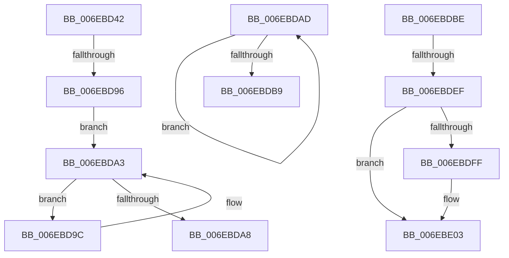

# sub_006EBD42

- RVA: `0x006EBD42`–`0x006EBE59` (길이 `279` bytes)
- VA: `0x00000001406EBD42`
- 실행 섹션: `.text`
- PDB 이름 있음: `아니요`; PDB Function 태그: `아니요`
- unwind 정보 RVA: `0x00099A38`
- 디코드: `69`개 명령, `279/279` bytes 표시
- 미해석 바이트: `0` (있으면 어셈블리에 `.byte`로 보존)

> 이 문서는 커널 이미지의 기계어와 PDB 기호를 분석해 생성했습니다. 4번과 5번은 함수 원형과 자료형을 바이너리 사용 방식에서 추정한 C 해석이며 원본 소스 복구 결과는 아닙니다.

## 1. Dependencies

- 직접 호출 지점: **10**; 고유 호출 대상: **7**
- 직접 호출자로 확인된 함수: **0**
- RIP 상대 이미지 참조: **2**

### Outgoing calls
- `0x006EBD48` → [KeReleaseSpinLock](../39/KeReleaseSpinLock_function_00392BA0.md) (function, `0x00392BA0`)
- `0x006EBD62` → [guard_dispatch_icall](../6B/guard_dispatch_icall_function_006BAAD0.md) (function, `0x006BAAD0`)
- `0x006EBD6A` → [KeAcquireSpinLockRaiseToDpc](../20/KeAcquireSpinLockRaiseToDpc_function_00208470.md) (function, `0x00208470`)
- `0x006EBD7C` → [ExFreeToNPagedLookasideList](../38/ExFreeToNPagedLookasideList_function_0038D9D0.md) (function, `0x0038D9D0`)
- `0x006EBDC3` → [KeAcquireQueuedSpinLock](../27/KeAcquireQueuedSpinLock_function_00273D80.md) (function, `0x00273D80`)
- `0x006EBDE1` → [KeReleaseQueuedSpinLock](../27/KeReleaseQueuedSpinLock_function_00272540.md) (function, `0x00272540`)
- `0x006EBE09` → [KeReleaseSpinLock](../39/KeReleaseSpinLock_function_00392BA0.md) (function, `0x00392BA0`)
- `0x006EBE31` → [FsRtlCompleteLockIrpReal](../49/FsRtlCompleteLockIrpReal_function_004973AC.md) (function, `0x004973AC`)
- `0x006EBE39` → [KeAcquireSpinLockRaiseToDpc](../20/KeAcquireSpinLockRaiseToDpc_function_00208470.md) (function, `0x00208470`)
- `0x006EBE4E` → [ExFreeToNPagedLookasideList](../38/ExFreeToNPagedLookasideList_function_0038D9D0.md) (function, `0x0038D9D0`)

### Direct callers
- 이 함수 시작 RVA로 연결되는 직접 call은 확인되지 않았습니다. 간접 호출은 완전히 역산할 수 없습니다.

### Static image references
- `0x006EBD72` → RVA `0x00E12200` (`.data`; read)
- `0x006EBE41` → RVA `0x00E12000` (`.data`; read)

## 2. Other-region calls and transfers

- 다른 실행 섹션으로 향하는 call: **0**
- call이 아닌 외부 분기/꼬리 이동: **5**
  - `0x006EBD90` → [FsRtlPrivateFastUnlockAll + 0x126](../3F/FsRtlPrivateFastUnlockAll_function_003FD554.md) (`tail-transfer`)
  - `0x006EBDA8` → [FsRtlPrivateFastUnlockAll + 0x126](../3F/FsRtlPrivateFastUnlockAll_function_003FD554.md) (`tail-transfer`)
  - `0x006EBDB9` → [FsRtlPrivateFastUnlockAll + 0x2F1](../3F/FsRtlPrivateFastUnlockAll_function_003FD554.md) (`tail-transfer`)
  - `0x006EBDE9` → [FsRtlPrivateFastUnlockAll + 0x28B](../3F/FsRtlPrivateFastUnlockAll_function_003FD554.md) (`tail-transfer`)
  - `0x006EBE54` → [FsRtlPrivateFastUnlockAll + 0x28E](../3F/FsRtlPrivateFastUnlockAll_function_003FD554.md) (`tail-transfer`)

## 3. Assembly (complete function range)

```asm
006EBD42  41 8A D4                        mov dl, r12b
006EBD45  49 8B CD                        mov rcx, r13
006EBD48  E8 53 6E CA FF                  call 0x140392ba0
006EBD4D  48 8B 5C 24 48                  mov rbx, qword ptr [rsp + 0x48]
006EBD52  48 8B 46 10                     mov rax, qword ptr [rsi + 0x10]
006EBD56  48 8B 8C 24 D8 00 00 00         mov rcx, qword ptr [rsp + 0xd8]
006EBD5E  48 8D 53 08                     lea rdx, [rbx + 8]
006EBD62  E8 69 ED FC FF                  call 0x1406baad0
006EBD67  49 8B CD                        mov rcx, r13
006EBD6A  E8 01 C7 B1 FF                  call 0x140208470
006EBD6F  48 8B D3                        mov rdx, rbx
006EBD72  48 8D 0D 87 64 72 00            lea rcx, [rip + 0x726487]
006EBD79  44 8A E0                        mov r12b, al
006EBD7C  E8 4F 1C CA FF                  call 0x14038d9d0
006EBD81  4C 8B 7E 20                     mov r15, qword ptr [rsi + 0x20]
006EBD85  40 88 BC 24 B0 00 00 00         mov byte ptr [rsp + 0xb0], dil
006EBD8D  4D 85 FF                        test r15, r15
006EBD90  0F 84 E4 18 D1 FF               je 0x1403fd67a
006EBD96  49 8B 47 08                     mov rax, qword ptr [r15 + 8]
006EBD9A  EB 07                           jmp 0x1406ebda3
006EBD9C  4C 8B F8                        mov r15, rax
006EBD9F  48 8B 40 08                     mov rax, qword ptr [rax + 8]
006EBDA3  48 85 C0                        test rax, rax
006EBDA6  75 F4                           jne 0x1406ebd9c
006EBDA8  E9 CD 18 D1 FF                  jmp 0x1403fd67a
006EBDAD  48 8B F8                        mov rdi, rax
006EBDB0  48 8B 40 08                     mov rax, qword ptr [rax + 8]
006EBDB4  48 85 C0                        test rax, rax
006EBDB7  75 F4                           jne 0x1406ebdad
006EBDB9  E9 87 1A D1 FF                  jmp 0x1403fd845
006EBDBE  B9 07 00 00 00                  mov ecx, 7
006EBDC3  E8 B8 7F B8 FF                  call 0x140273d80
006EBDC8  88 47 45                        mov byte ptr [rdi + 0x45], al
006EBDCB  33 ED                           xor ebp, ebp
006EBDCD  8B C5                           mov eax, ebp
006EBDCF  48 87 47 68                     xchg qword ptr [rdi + 0x68], rax
006EBDD3  40 38 6F 44                     cmp byte ptr [rdi + 0x44], bpl
006EBDD7  8A 57 45                        mov dl, byte ptr [rdi + 0x45]
006EBDDA  8D 4D 07                        lea ecx, [rbp + 7]
006EBDDD  48 0F 45 FD                     cmovne rdi, rbp
006EBDE1  E8 5A 67 B8 FF                  call 0x140272540
006EBDE6  48 85 FF                        test rdi, rdi
006EBDE9  0F 84 F0 19 D1 FF               je 0x1403fd7df
006EBDEF  48 89 6F 38                     mov qword ptr [rdi + 0x38], rbp
006EBDF3  48 8B 03                        mov rax, qword ptr [rbx]
006EBDF6  49 89 06                        mov qword ptr [r14], rax
006EBDF9  48 3B 5E 38                     cmp rbx, qword ptr [rsi + 0x38]
006EBDFD  75 04                           jne 0x1406ebe03
006EBDFF  4C 89 76 38                     mov qword ptr [rsi + 0x38], r14
006EBE03  41 8A D4                        mov dl, r12b
006EBE06  49 8B CD                        mov rcx, r13
006EBE09  E8 92 6D CA FF                  call 0x140392ba0
006EBE0E  48 8B 53 10                     mov rdx, qword ptr [rbx + 0x10]
006EBE12  48 8D 84 24 B0 00 00 00         lea rax, [rsp + 0xb0]
006EBE1A  48 8B 4E 08                     mov rcx, qword ptr [rsi + 8]
006EBE1E  41 B9 7E 00 00 C0               mov r9d, 0xc000007e
006EBE24  48 89 6C 24 28                  mov qword ptr [rsp + 0x28], rbp
006EBE29  4C 8B C7                        mov r8, rdi
006EBE2C  48 89 44 24 20                  mov qword ptr [rsp + 0x20], rax
006EBE31  E8 76 B5 DA FF                  call 0x1404973ac
006EBE36  49 8B CD                        mov rcx, r13
006EBE39  E8 32 C6 B1 FF                  call 0x140208470
006EBE3E  48 8B D3                        mov rdx, rbx
006EBE41  48 8D 0D B8 61 72 00            lea rcx, [rip + 0x7261b8]
006EBE48  44 8A E0                        mov r12b, al
006EBE4B  4D 8B F7                        mov r14, r15
006EBE4E  E8 7D 1B CA FF                  call 0x14038d9d0
006EBE53  90                              nop
006EBE54  E9 89 19 D1 FF                  jmp 0x1403fd7e2
```

## 4. C-style interpretation (structured pseudocode)

```c
__int64 __fastcall sub_006EBD42(__int64 a1, __int64 a2, __int64 a3, __int64 a4, __int64 a5, __int64 a6, __int64 a7, __int64 a8, __int64 a9, __int64 a10, __int64 a11, __int64 a12, __int64 a13, __int64 a14, __int64 a15, __int64 a16, __int64 a17, __int64 a18, __int64 a19, __int64 a20, __int64 a21, __int64 a22, __int64 a23, __int64 a24, __int64 a25, __int64 a26, __int64 a27)
{
    __int64 result;
    unsigned __int64 v_stack_p20;
    unsigned __int64 v_stack_p28;
    unsigned __int8 v_stack_pB0;

    result = KeReleaseSpinLock(v_r13, (unsigned __int8)(v_r12), a3, a4);
    result = guard_dispatch_icall(a27, a9 + 8, a3, a4);
    result = KeAcquireSpinLockRaiseToDpc(v_r13, a9 + 8, a3, a4);
    result = ExFreeToNPagedLookasideList(v_rip + 7496839, a9, a3, a4);
    v_stack_pB0 = (unsigned __int8)(v_rdi);
    goto loc_006EBDA3;
loc_006EBD9C:
loc_006EBDA3:
    if (*(unsigned __int64 *)(*(unsigned __int64 *)(*(unsigned __int64 *)(v_rsi + 32) + 8) + 8) != 0) goto loc_006EBD9C;
}
```

## 5. (Beta) C Style

```c
int64_t sub_006EBD42(int64_t Arg1, int64_t Arg2, int64_t Arg3, int64_t Arg4, uint64_t Arg5, uint64_t Arg6, uint64_t Arg7, uint64_t Arg8, void *Arg9, uint64_t Arg10, uint64_t Arg11, uint64_t Arg12, uint64_t Arg13, uint64_t Arg14, uint64_t Arg15, uint64_t Arg16, uint64_t Arg17, uint64_t Arg18, uint64_t Arg19, uint64_t Arg20, uint64_t Arg21, uint64_t Arg22, uint64_t Arg23, uint64_t Arg24, uint64_t Arg25, uint64_t Arg26, int64_t Arg27)
{
    uint8_t *arg9 = (uint8_t *)Arg9;

    int64_t result;
    uint64_t v_stack_p20;
    uint64_t v_stack_p28;
    uint8_t v_stack_pB0;

    result = KeReleaseSpinLock(local_r13, (uint8_t)(local_r12), Arg3, Arg4);
    result = guard_dispatch_icall(Arg27, Arg9 + 8, Arg3, Arg4);
    result = KeAcquireSpinLockRaiseToDpc(local_r13, Arg9 + 8, Arg3, Arg4);
    result = ExFreeToNPagedLookasideList(v_rip + 7496839, Arg9, Arg3, Arg4);
    v_stack_pB0 = (uint8_t)(local_rdi);
    goto loc_006EBDA3;
loc_006EBD9C:
loc_006EBDA3:
    if (*(uint64_t *)(*(uint64_t *)(*(uint64_t *)(local_rsi + 0x20) + 0x8) + 0x8) != 0) goto loc_006EBD9C;
}
```

### 관측된 메모리 오프셋

구조체 형식이 확인되지 않은 접근은 인자 기준의 오프셋으로만 기록했습니다.

| 기준 인자 | 오프셋 표현 | 폭 (bit) | 접근 |
|---|---:|---:|---|
| `Arg9` | `+ 0x8` | `64` | `R` |

## 6. Execution-region graph

[열기: 2D/3D 그래프와 함수 탐색 컨트롤 패널](../../../control-panel.html?section=text&rva=0x006EBD42&view=graph)

- 2D 그래프는 위에서 아래로 흐르고, 3D 그래프는 빈 공간을 드래그해 회전합니다. Shift+드래그는 이동, 휠은 확대·축소, 함수 노드 선택은 대상 보고서 이동입니다.

### Static fallback


