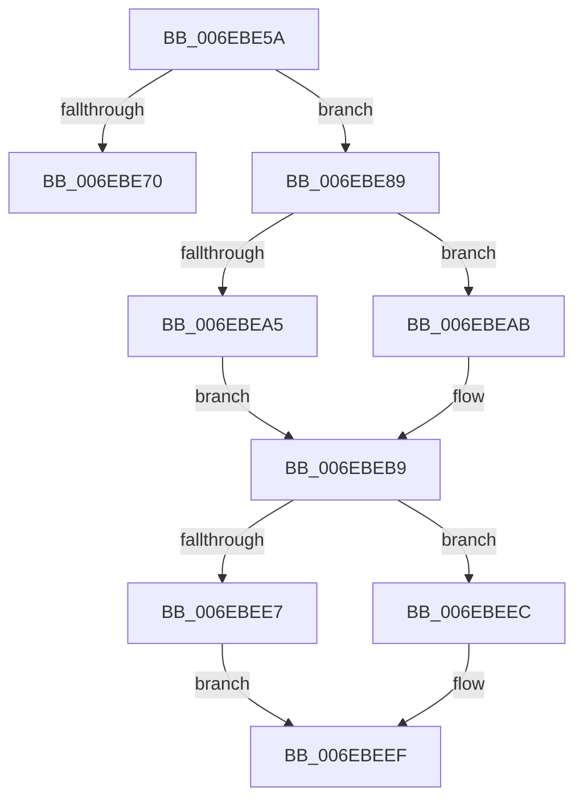

# sub_006EBE5A

- RVA: `0x006EBE5A`–`0x006EBEFC` (길이 `162` bytes)
- VA: `0x00000001406EBE5A`
- 실행 섹션: `.text`
- PDB 이름 있음: `아니요`; PDB Function 태그: `아니요`
- unwind 정보 RVA: `0x00099A68`
- 디코드: `45`개 명령, `162/162` bytes 표시
- 미해석 바이트: `0` (있으면 어셈블리에 `.byte`로 보존)

> 이 문서는 커널 이미지의 기계어와 PDB 기호를 분석해 생성했습니다. 4번과 5번은 함수 원형과 자료형을 바이너리 사용 방식에서 추정한 C 해석이며 원본 소스 복구 결과는 아닙니다.

## 1. Dependencies

- 직접 호출 지점: **2**; 고유 호출 대상: **2**
- 직접 호출자로 확인된 함수: **0**
- RIP 상대 이미지 참조: **1**

### Outgoing calls
- `0x006EBE61` → [ExAllocateFromNPagedLookasideList](../38/ExAllocateFromNPagedLookasideList_function_0038E6C0.md) (function, `0x0038E6C0`)
- `0x006EBEAE` → [RtlRealSuccessor](../38/RtlRealSuccessor_function_0038DF40.md) (function, `0x0038DF40`)

### Direct callers
- 이 함수 시작 RVA로 연결되는 직접 call은 확인되지 않았습니다. 간접 호출은 완전히 역산할 수 없습니다.

### Static image references
- `0x006EBE5A` → RVA `0x00E11F80` (`.data`; read)

## 2. Other-region calls and transfers

- 다른 실행 섹션으로 향하는 call: **0**
- call이 아닌 외부 분기/꼬리 이동: **2**
  - `0x006EBE84` → [FsRtlSplitLocks + 0x66](../3F/FsRtlSplitLocks_function_003FD8DC.md) (`tail-transfer`)
  - `0x006EBEF7` → [FsRtlSplitLocks + 0x74](../3F/FsRtlSplitLocks_function_003FD8DC.md) (`tail-transfer`)

## 3. Assembly (complete function range)

```asm
006EBE5A  48 8D 0D 1F 61 72 00            lea rcx, [rip + 0x72611f]
006EBE61  E8 5A 28 CA FF                  call 0x14038e6c0
006EBE66  33 D2                           xor edx, edx
006EBE68  4C 8B F8                        mov r15, rax
006EBE6B  48 85 C0                        test rax, rax
006EBE6E  75 19                           jne 0x1406ebe89
006EBE70  38 55 08                        cmp byte ptr [rbp + 8], dl
006EBE73  44 8D 40 01                     lea r8d, [rax + 1]
006EBE77  48 8B 4C 24 50                  mov rcx, qword ptr [rsp + 0x50]
006EBE7C  45 0F 45 E8                     cmovne r13d, r8d
006EBE80  44 88 45 08                     mov byte ptr [rbp + 8], r8b
006EBE84  E9 B9 1A D1 FF                  jmp 0x1403fd942
006EBE89  4C 8D 70 18                     lea r14, [rax + 0x18]
006EBE8D  4D 89 36                        mov qword ptr [r14], r14
006EBE90  49 89 56 08                     mov qword ptr [r14 + 8], rdx
006EBE94  49 89 56 10                     mov qword ptr [r14 + 0x10], rdx
006EBE98  88 50 08                        mov byte ptr [rax + 8], dl
006EBE9B  48 8D 45 18                     lea rax, [rbp + 0x18]
006EBE9F  48 39 55 28                     cmp qword ptr [rbp + 0x28], rdx
006EBEA3  75 06                           jne 0x1406ebeab
006EBEA5  4C 89 70 10                     mov qword ptr [rax + 0x10], r14
006EBEA9  EB 0E                           jmp 0x1406ebeb9
006EBEAB  48 8B C8                        mov rcx, rax
006EBEAE  E8 8D 20 CA FF                  call 0x14038df40
006EBEB3  33 D2                           xor edx, edx
006EBEB5  4C 89 70 08                     mov qword ptr [rax + 8], r14
006EBEB9  49 89 06                        mov qword ptr [r14], rax
006EBEBC  4D 8B F7                        mov r14, r15
006EBEBF  49 8B 04 24                     mov rax, qword ptr [r12]
006EBEC3  49 89 07                        mov qword ptr [r15], rax
006EBEC6  49 89 14 24                     mov qword ptr [r12], rdx
006EBECA  48 8B 45 30                     mov rax, qword ptr [rbp + 0x30]
006EBECE  49 89 47 30                     mov qword ptr [r15 + 0x30], rax
006EBED2  48 8B 45 10                     mov rax, qword ptr [rbp + 0x10]
006EBED6  4C 89 65 30                     mov qword ptr [rbp + 0x30], r12
006EBEDA  49 89 47 10                     mov qword ptr [r15 + 0x10], rax
006EBEDE  48 89 5D 10                     mov qword ptr [rbp + 0x10], rbx
006EBEE2  45 85 ED                        test r13d, r13d
006EBEE5  75 05                           jne 0x1406ebeec
006EBEE7  88 55 08                        mov byte ptr [rbp + 8], dl
006EBEEA  EB 03                           jmp 0x1406ebeef
006EBEEC  44 8B EA                        mov r13d, edx
006EBEEF  48 8B 4C 24 50                  mov rcx, qword ptr [rsp + 0x50]
006EBEF4  49 8B EF                        mov rbp, r15
006EBEF7  E9 54 1A D1 FF                  jmp 0x1403fd950
```

## 4. C-style interpretation (structured pseudocode)

```c
__int64 __fastcall sub_006EBE5A(__int64 a1, int a2, __int64 a3, __int64 a4, __int64 a5, __int64 a6, __int64 a7, __int64 a8, __int64 a9, __int64 a10)
{
    __int64 result;
    __int64 v_r13;

    result = ExAllocateFromNPagedLookasideList(v_rip + 7495967, a2, a3, a4);
    a2 = 0;
    if (result != 0) goto loc_006EBE89;
    if ((*(unsigned __int8 *)(v_rbp + 8)) != 0) { v_r13 = (unsigned int)(result + 1); }
    *(unsigned __int8 *)(v_rbp + 8) = (unsigned __int8)(result + 1);
loc_006EBE89:
    *(unsigned __int64 *)(result + 24) = result + 24;
    *(unsigned __int64 *)(result + 24 + 8) = 0;
    *(unsigned __int64 *)(result + 24 + 16) = 0;
    *(unsigned __int8 *)(result + 8) = 0;
    if ((*(unsigned __int64 *)(v_rbp + 40)) != 0) goto loc_006EBEAB;
    *(unsigned __int64 *)(v_rbp + 24 + 16) = result + 24;
    goto loc_006EBEB9;
loc_006EBEAB:
    result = RtlRealSuccessor(v_rbp + 24, a2, result + 1, a4);
    a2 = 0;
    *(unsigned __int64 *)(result + 8) = result + 24;
loc_006EBEB9:
    *(unsigned __int64 *)(result + 24) = result;
    *(unsigned __int64 *)(result) = *(unsigned __int64 *)(v_r12);
    *(unsigned __int64 *)(v_r12) = 0;
    *(unsigned __int64 *)(result + 48) = *(unsigned __int64 *)(v_rbp + 48);
    *(unsigned __int64 *)(v_rbp + 48) = v_r12;
    *(unsigned __int64 *)(result + 16) = *(unsigned __int64 *)(v_rbp + 16);
    *(unsigned __int64 *)(v_rbp + 16) = v_rbx;
    if ((unsigned int)(v_r13) != 0) goto loc_006EBEEC;
    *(unsigned __int8 *)(v_rbp + 8) = 0;
    goto loc_006EBEEF;
loc_006EBEEC:
loc_006EBEEF:
}
```

## 5. (Beta) C Style

```c
int64_t sub_006EBE5A(int64_t Arg1, int32_t Arg2, int64_t Arg3, int64_t Arg4, uint64_t Arg5, uint64_t Arg6, uint64_t Arg7, uint64_t Arg8, uint64_t Arg9, int64_t Arg10)
{
    int64_t result;
    int64_t local_r13;

    result = ExAllocateFromNPagedLookasideList(v_rip + 7495967, Arg2, Arg3, Arg4);
    Arg2 = 0;
    if (result != 0) goto loc_006EBE89;
    if ((*(uint8_t *)(local_rbp + 0x8)) != 0) { local_r13 = (uint32_t)(result + 1); }
    *(uint8_t *)(local_rbp + 0x8) = (uint8_t)(result + 1);
loc_006EBE89:
    *(uint64_t *)(result + 0x18) = result + 24;
    *(uint64_t *)(result + 0x18 + 0x8) = 0;
    *(uint64_t *)(result + 0x18 + 0x10) = 0;
    *(uint8_t *)(result + 0x8) = 0;
    if ((*(uint64_t *)(local_rbp + 0x28)) != 0) goto loc_006EBEAB;
    *(uint64_t *)(local_rbp + 0x18 + 0x10) = result + 24;
    goto loc_006EBEB9;
loc_006EBEAB:
    result = RtlRealSuccessor(local_rbp + 24, Arg2, result + 1, Arg4);
    Arg2 = 0;
    *(uint64_t *)(result + 0x8) = result + 24;
loc_006EBEB9:
    *(uint64_t *)(result + 0x18) = result;
    *(uint64_t *)(result) = *(uint64_t *)(local_r12);
    *(uint64_t *)(local_r12) = 0;
    *(uint64_t *)(result + 0x30) = *(uint64_t *)(local_rbp + 0x30);
    *(uint64_t *)(local_rbp + 0x30) = local_r12;
    *(uint64_t *)(result + 0x10) = *(uint64_t *)(local_rbp + 0x10);
    *(uint64_t *)(local_rbp + 0x10) = local_rbx;
    if ((uint32_t)(local_r13) != 0) goto loc_006EBEEC;
    *(uint8_t *)(local_rbp + 0x8) = 0;
    goto loc_006EBEEF;
loc_006EBEEC:
loc_006EBEEF:
}
```

## 6. Execution-region graph

[열기: 2D/3D 그래프와 함수 탐색 컨트롤 패널](../../../control-panel.html?section=text&rva=0x006EBE5A&view=graph)

- 2D 그래프는 위에서 아래로 흐르고, 3D 그래프는 빈 공간을 드래그해 회전합니다. Shift+드래그는 이동, 휠은 확대·축소, 함수 노드 선택은 대상 보고서 이동입니다.

### Static fallback


