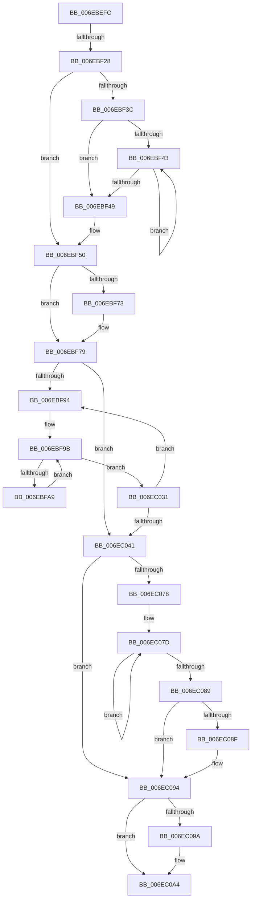

# sub_006EBEFC

- RVA: `0x006EBEFC`–`0x006EC0B0` (길이 `436` bytes)
- VA: `0x00000001406EBEFC`
- 실행 섹션: `.text`
- PDB 이름 있음: `아니요`; PDB Function 태그: `아니요`
- unwind 정보 RVA: `0x00099EBC`
- 디코드: `123`개 명령, `436/436` bytes 표시
- 미해석 바이트: `0` (있으면 어셈블리에 `.byte`로 보존)

> 이 문서는 커널 이미지의 기계어와 PDB 기호를 분석해 생성했습니다. 4번과 5번은 함수 원형과 자료형을 바이너리 사용 방식에서 추정한 C 해석이며 원본 소스 복구 결과는 아닙니다.

## 1. Dependencies

- 직접 호출 지점: **5**; 고유 호출 대상: **5**
- 직접 호출자로 확인된 함수: **0**
- RIP 상대 이미지 참조: **0**

### Outgoing calls
- `0x006EBF17` → [ExAllocatePool2](../../poolcode/B8/ExAllocatePool2_function_00B820F0.md) (function, `0x00B820F0`)
- `0x006EBF30` → [KeAcquireSpinLockAtDpcLevel](../20/KeAcquireSpinLockAtDpcLevel_function_00208430.md) (function, `0x00208430`)
- `0x006EC05E` → [KxReleaseSpinLock](../20/KxReleaseSpinLock_function_00206670.md) (function, `0x00206670`)
- `0x006EC08F` → [KiRemoveSystemWorkPriorityKick](../26/KiRemoveSystemWorkPriorityKick_function_002631D0.md) (function, `0x002631D0`)
- `0x006EC09F` → [ExFreePoolWithTag](../../poolcode/B8/ExFreePoolWithTag_function_00B82870.md) (function, `0x00B82870`)

### Direct callers
- 이 함수 시작 RVA로 연결되는 직접 call은 확인되지 않았습니다. 간접 호출은 완전히 역산할 수 없습니다.

### Static image references
- 디코드된 RIP-relative 메모리 참조가 없습니다.

## 2. Other-region calls and transfers

- 다른 실행 섹션으로 향하는 call: **2**
  - `0x006EBF17` → [ExAllocatePool2](../../poolcode/B8/ExAllocatePool2_function_00B820F0.md) (`.text` → `POOLCODE`)
  - `0x006EC09F` → [ExFreePoolWithTag](../../poolcode/B8/ExFreePoolWithTag_function_00B82870.md) (`.text` → `POOLCODE`)
- call이 아닌 외부 분기/꼬리 이동: **2**
  - `0x006EBF22` → [KiInsertNewDpcRuntime + 0x42](../3F/KiInsertNewDpcRuntime_function_003FE4CC.md) (`tail-transfer`)
  - `0x006EC0AB` → [KiInsertNewDpcRuntime + 0x42](../3F/KiInsertNewDpcRuntime_function_003FE4CC.md) (`tail-transfer`)

## 3. Assembly (complete function range)

```asm
006EBEFC  B8 04 00 00 00                  mov eax, 4
006EBF01  03 DB                           add ebx, ebx
006EBF03  3B D8                           cmp ebx, eax
006EBF05  41 B8 44 72 68 74               mov r8d, 0x74687244
006EBF0B  0F 42 D8                        cmovb ebx, eax
006EBF0E  8B D3                           mov edx, ebx
006EBF10  8D 48 3C                        lea ecx, [rax + 0x3c]
006EBF13  48 C1 E2 03                     shl rdx, 3
006EBF17  E8 D4 61 49 00                  call 0x140b820f0
006EBF1C  4C 8B F0                        mov r14, rax
006EBF1F  48 85 C0                        test rax, rax
006EBF22  0F 84 E6 25 D1 FF               je 0x1403fe50e
006EBF28  FA                              cli
006EBF29  49 8D 8F 50 38 00 00            lea rcx, [r15 + 0x3850]
006EBF30  E8 FB C4 B1 FF                  call 0x140208430
006EBF35  8D 4B FF                        lea ecx, [rbx - 1]
006EBF38  85 CB                           test ebx, ecx
006EBF3A  74 14                           je 0x1406ebf50
006EBF3C  83 C9 FF                        or ecx, 0xffffffff
006EBF3F  85 DB                           test ebx, ebx
006EBF41  74 06                           je 0x1406ebf49
006EBF43  FF C1                           inc ecx
006EBF45  D1 EB                           shr ebx, 1
006EBF47  75 FA                           jne 0x1406ebf43
006EBF49  BB 01 00 00 00                  mov ebx, 1
006EBF4E  D3 E3                           shl ebx, cl
006EBF50  B8 00 00 00 04                  mov eax, 0x4000000
006EBF55  3B D8                           cmp ebx, eax
006EBF57  0F 47 D8                        cmova ebx, eax
006EBF5A  48 8B C6                        mov rax, rsi
006EBF5D  48 83 C8 01                     or rax, 1
006EBF61  8B CB                           mov ecx, ebx
006EBF63  49 8D 14 DE                     lea rdx, [r14 + rbx*8]
006EBF67  4C 3B F2                        cmp r14, rdx
006EBF6A  48 0F 47 CD                     cmova rcx, rbp
006EBF6E  48 85 C9                        test rcx, rcx
006EBF71  74 06                           je 0x1406ebf79
006EBF73  49 8B FE                        mov rdi, r14
006EBF76  F3 48 AB                        rep stosq qword ptr [rdi], rax
006EBF79  8B 46 04                        mov eax, dword ptr [rsi + 4]
006EBF7C  4D 8B CC                        mov r9, r12
006EBF7F  8B C8                           mov ecx, eax
006EBF81  8B FD                           mov edi, ebp
006EBF83  83 E1 1F                        and ecx, 0x1f
006EBF86  49 D3 E1                        shl r9, cl
006EBF89  A9 E0 FF FF FF                  test eax, 0xffffffe0
006EBF8E  0F 86 AD 00 00 00               jbe 0x1406ec041
006EBF94  4C 8B 5E 08                     mov r11, qword ptr [rsi + 8]
006EBF98  44 8B D7                        mov r10d, edi
006EBF9B  4F 8B 04 D3                     mov r8, qword ptr [r11 + r10*8]
006EBF9F  41 F6 C0 01                     test r8b, 1
006EBFA3  0F 85 88 00 00 00               jne 0x1406ec031
006EBFA9  49 8B 00                        mov rax, qword ptr [r8]
006EBFAC  4B 89 04 D3                     mov qword ptr [r11 + r10*8], rax
006EBFB0  49 8B 40 08                     mov rax, qword ptr [r8 + 8]
006EBFB4  49 23 C1                        and rax, r9
006EBFB7  48 89 44 24 60                  mov qword ptr [rsp + 0x60], rax
006EBFBC  0F B6 C0                        movzx eax, al
006EBFBF  48 05 CB 5D B1 00               add rax, 0xb15dcb
006EBFC5  48 6B C8 25                     imul rcx, rax, 0x25
006EBFC9  0F B6 44 24 61                  movzx eax, byte ptr [rsp + 0x61]
006EBFCE  48 03 C8                        add rcx, rax
006EBFD1  0F B6 44 24 62                  movzx eax, byte ptr [rsp + 0x62]
006EBFD6  48 6B D1 25                     imul rdx, rcx, 0x25
006EBFDA  48 03 D0                        add rdx, rax
006EBFDD  0F B6 44 24 63                  movzx eax, byte ptr [rsp + 0x63]
006EBFE2  48 6B CA 25                     imul rcx, rdx, 0x25
006EBFE6  48 03 C8                        add rcx, rax
006EBFE9  0F B6 44 24 64                  movzx eax, byte ptr [rsp + 0x64]
006EBFEE  48 6B D1 25                     imul rdx, rcx, 0x25
006EBFF2  48 03 D0                        add rdx, rax
006EBFF5  0F B6 44 24 65                  movzx eax, byte ptr [rsp + 0x65]
006EBFFA  48 6B CA 25                     imul rcx, rdx, 0x25
006EBFFE  48 03 C8                        add rcx, rax
006EC001  0F B6 44 24 66                  movzx eax, byte ptr [rsp + 0x66]
006EC006  48 6B D1 25                     imul rdx, rcx, 0x25
006EC00A  48 03 D0                        add rdx, rax
006EC00D  0F B6 44 24 67                  movzx eax, byte ptr [rsp + 0x67]
006EC012  48 6B CA 25                     imul rcx, rdx, 0x25
006EC016  8D 53 FF                        lea edx, [rbx - 1]
006EC019  48 03 C1                        add rax, rcx
006EC01C  8B C0                           mov eax, eax
006EC01E  48 23 D0                        and rdx, rax
006EC021  49 8B 04 D6                     mov rax, qword ptr [r14 + rdx*8]
006EC025  49 89 00                        mov qword ptr [r8], rax
006EC028  4D 89 04 D6                     mov qword ptr [r14 + rdx*8], r8
006EC02C  E9 6A FF FF FF                  jmp 0x1406ebf9b
006EC031  8B 46 04                        mov eax, dword ptr [rsi + 4]
006EC034  FF C7                           inc edi
006EC036  C1 E8 05                        shr eax, 5
006EC039  3B F8                           cmp edi, eax
006EC03B  0F 82 53 FF FF FF               jb 0x1406ebf94
006EC041  8B 46 04                        mov eax, dword ptr [rsi + 4]
006EC044  49 8D 8F 50 38 00 00            lea rcx, [r15 + 0x3850]
006EC04B  48 8B 6E 08                     mov rbp, qword ptr [rsi + 8]
006EC04F  83 E0 1F                        and eax, 0x1f
006EC052  C1 E3 05                        shl ebx, 5
006EC055  0B C3                           or eax, ebx
006EC057  4C 89 76 08                     mov qword ptr [rsi + 8], r14
006EC05B  89 46 04                        mov dword ptr [rsi + 4], eax
006EC05E  E8 0D A6 B1 FF                  call 0x140206670
006EC063  65 48 8B 0C 25 20 00 00 00      mov rcx, qword ptr gs:[0x20]
006EC06C  48 8B B9 B8 8E 00 00            mov rdi, qword ptr [rcx + 0x8eb8]
006EC073  48 85 FF                        test rdi, rdi
006EC076  74 1C                           je 0x1406ec094
006EC078  0F 0D 0F                        prefetchw byte ptr [rdi]
006EC07B  8B 07                           mov eax, dword ptr [rdi]
006EC07D  8B D0                           mov edx, eax
006EC07F  0F BA F2 15                     btr edx, 0x15
006EC083  F0 0F B1 17                     lock cmpxchg dword ptr [rdi], edx
006EC087  75 F4                           jne 0x1406ec07d
006EC089  0F BA E0 15                     bt eax, 0x15
006EC08D  73 05                           jae 0x1406ec094
006EC08F  E8 3C 71 B7 FF                  call 0x1402631d0
006EC094  FB                              sti
006EC095  48 85 ED                        test rbp, rbp
006EC098  74 0A                           je 0x1406ec0a4
006EC09A  33 D2                           xor edx, edx
006EC09C  48 8B CD                        mov rcx, rbp
006EC09F  E8 CC 67 49 00                  call 0x140b82870
006EC0A4  48 8B 7C 24 68                  mov rdi, qword ptr [rsp + 0x68]
006EC0A9  33 ED                           xor ebp, ebp
006EC0AB  E9 5E 24 D1 FF                  jmp 0x1403fe50e
```

## 4. C-style interpretation (structured pseudocode)

```c
__int64 __fastcall sub_006EBEFC(__int64 a1, __int64 a2, __int64 a3, __int64 a4, __int64 a5, __int64 a6, __int64 a7, __int64 a8, __int64 a9, __int64 a10, __int64 a11, __int64 a12, __int64 a13)
{
    __int64 result;
    __int64 v_rbp;
    __int64 v_rbx;
    __int64 v_rdi;
    unsigned __int64 v_stack_p60;
    unsigned __int8 v_stack_p61;
    unsigned __int8 v_stack_p62;
    unsigned __int8 v_stack_p63;
    unsigned __int8 v_stack_p64;
    unsigned __int8 v_stack_p65;
    unsigned __int8 v_stack_p66;
    unsigned __int8 v_stack_p67;

    v_rbx = (unsigned int)((v_rbx) + ((unsigned int)(v_rbx)));
    if (((unsigned int)(v_rbx)) < 4) { v_rbx = 4; }
    a2 = ((unsigned int)((unsigned int)(v_rbx))) << (3);
    result = ExAllocatePool2(4 + 60, a2, (unsigned int)(0x74687244ULL), a4);
    result = KeAcquireSpinLockAtDpcLevel(v_r15 + 14416, a2, (unsigned int)(0x74687244ULL), a4);
    if ((((unsigned int)(v_rbx)) & ((unsigned int)(v_rbx - 1))) == 0) goto loc_006EBF50;
    a1 = (unsigned int)((v_rbx - 1) | (0xFFFFFFFFULL));
    if ((unsigned int)(v_rbx) == 0) goto loc_006EBF49;
loc_006EBF43:
    a1 = (unsigned int)((a1) + 1);
    v_rbx = (unsigned int)((v_rbx) >> (1));
    if (condition_is_not_equal) goto loc_006EBF43;
loc_006EBF49:
    v_rbx = (unsigned int)((1) << ((unsigned __int8)(a1)));
loc_006EBF50:
    if (((unsigned int)(v_rbx)) > ((unsigned int)((unsigned int)(0x4000000ULL)))) { v_rbx = (unsigned int)((unsigned int)(0x4000000ULL)); }
    result = (v_rsi) | (1);
    a1 = (unsigned int)((unsigned int)(v_rbx));
    if (result > (result + v_rbx * 8)) { a1 = v_rbp; }
    if (a1 != 0) {
        v_rdi = result;
    }
    a1 = (unsigned int)(((unsigned int)((unsigned int)((unsigned int)(*(unsigned int *)(v_rsi + 4))))) & (31));
    a4 = (v_r12) << ((unsigned __int8)(a1));
    if (condition_is_below_or_equal) goto loc_006EC041;
loc_006EBF94:
loc_006EBF9B:
    if ((((unsigned __int8)(*(unsigned __int64 *)(*(unsigned __int64 *)(v_rsi + 8) + (unsigned int)((unsigned int)((unsigned int)((unsigned int)(v_rbp)))) * 8))) & (1)) != 0) goto loc_006EC031;
    *(unsigned __int64 *)(*(unsigned __int64 *)(v_rsi + 8) + (unsigned int)((unsigned int)((unsigned int)((unsigned int)(v_rbp)))) * 8) = *(unsigned __int64 *)(*(unsigned __int64 *)(*(unsigned __int64 *)(v_rsi + 8) + (unsigned int)((unsigned int)((unsigned int)((unsigned int)(v_rbp)))) * 8));
    result = (*(unsigned __int64 *)(*(unsigned __int64 *)(*(unsigned __int64 *)(v_rsi + 8) + (unsigned int)((unsigned int)((unsigned int)((unsigned int)(v_rbp)))) * 8) + 8)) & (a4);
    v_stack_p60 = result;
    result = ((unsigned __int8)(result)) + (0xB15DCBULL);
    a1 = (a1) * (result);
    a1 = (a1) + (v_stack_p61);
    a2 = (result + v_rbx * 8) * (a1);
    a2 = (a2) + (v_stack_p62);
    a1 = (a1) * (a2);
    a1 = (a1) + (v_stack_p63);
    a2 = (a2) * (a1);
    a2 = (a2) + (v_stack_p64);
    a1 = (a1) * (a2);
    a1 = (a1) + (v_stack_p65);
    a2 = (a2) * (a1);
    a2 = (a2) + (v_stack_p66);
    a1 = (a1) * (a2);
    result = (v_stack_p67) + (a1);
    a2 = (v_rbx - 1) & ((unsigned int)((unsigned int)(result)));
    *(unsigned __int64 *)(*(unsigned __int64 *)(*(unsigned __int64 *)(v_rsi + 8) + (unsigned int)((unsigned int)((unsigned int)((unsigned int)(v_rbp)))) * 8)) = *(unsigned __int64 *)(result + a2 * 8);
    *(unsigned __int64 *)(result + a2 * 8) = *(unsigned __int64 *)(*(unsigned __int64 *)(v_rsi + 8) + (unsigned int)((unsigned int)((unsigned int)((unsigned int)(v_rbp)))) * 8);
    goto loc_006EBF9B;
loc_006EC031:
    v_rdi = (unsigned int)(((unsigned int)((unsigned int)(v_rbp))) + 1);
    result = (unsigned int)(((unsigned int)(*(unsigned int *)(v_rsi + 4))) >> (5));
    if (((unsigned int)(v_rdi)) < ((unsigned int)(result))) goto loc_006EBF94;
loc_006EC041:
    result = (unsigned int)(((unsigned int)(*(unsigned int *)(v_rsi + 4))) & (31));
    v_rbx = (unsigned int)((v_rbx) << (5));
    result = (unsigned int)((result) | ((unsigned int)(v_rbx)));
    *(unsigned __int64 *)(v_rsi + 8) = result;
    *(unsigned int *)(v_rsi + 4) = (unsigned int)(result);
    result = KxReleaseSpinLock(v_r15 + 14416, a2, *(unsigned __int64 *)(*(unsigned __int64 *)(v_rsi + 8) + (unsigned int)((unsigned int)((unsigned int)((unsigned int)(v_rbp)))) * 8), a4);
    if (*(unsigned __int64 *)(*(unsigned __int64 *)(gs_base + (0 + 32)) + 36536) == 0) goto loc_006EC094;
loc_006EC07D:
    if (*(unsigned __int64 *)(*(unsigned __int64 *)(gs_base + (0 + 32)) + 36536) != 0) goto loc_006EC07D;
    result = (unsigned int)(*(unsigned int *)(*(unsigned __int64 *)(*(unsigned __int64 *)(gs_base + (0 + 32)) + 36536)));
    if (!(condition_is_above_or_equal)) {
        result = KiRemoveSystemWorkPriorityKick(*(unsigned __int64 *)(gs_base + (0 + 32)), (unsigned int)((unsigned int)((unsigned int)(*(unsigned int *)(*(unsigned __int64 *)(*(unsigned __int64 *)(gs_base + (0 + 32)) + 36536))))), *(unsigned __int64 *)(*(unsigned __int64 *)(v_rsi + 8) + (unsigned int)((unsigned int)((unsigned int)((unsigned int)(v_rbp)))) * 8), a4);
    }
    if (*(unsigned __int64 *)(v_rsi + 8) != 0) {
        a2 = 0;
        a1 = *(unsigned __int64 *)(v_rsi + 8);
        result = ExFreePoolWithTag(a1, a2, *(unsigned __int64 *)(*(unsigned __int64 *)(v_rsi + 8) + (unsigned int)((unsigned int)((unsigned int)((unsigned int)(v_rbp)))) * 8), a4);
    }
    v_rbp = 0;
}
```

## 5. (Beta) C Style

```c
int64_t sub_006EBEFC(int64_t Arg1, int64_t Arg2, int64_t Arg3, int64_t Arg4, uint64_t Arg5, uint64_t Arg6, uint64_t Arg7, uint64_t Arg8, uint64_t Arg9, uint64_t Arg10, uint64_t Arg11, uint64_t Arg12, int64_t Arg13)
{
    int64_t result;
    int64_t local_rbp;
    int64_t local_rbx;
    int64_t local_rdi;
    uint64_t v_stack_p60;
    uint8_t v_stack_p61;
    uint8_t v_stack_p62;
    uint8_t v_stack_p63;
    uint8_t v_stack_p64;
    uint8_t v_stack_p65;
    uint8_t v_stack_p66;
    uint8_t v_stack_p67;

    local_rbx = (uint32_t)((local_rbx) + ((uint32_t)(local_rbx)));
    if (((uint32_t)(local_rbx)) < 4) { local_rbx = 4; }
    Arg2 = ((uint32_t)((uint32_t)(local_rbx))) << (3);
    result = ExAllocatePool2(4 + 60, Arg2, (uint32_t)(0x74687244ULL), Arg4);
    result = KeAcquireSpinLockAtDpcLevel(local_r15 + 14416, Arg2, (uint32_t)(0x74687244ULL), Arg4);
    if ((((uint32_t)(local_rbx)) & ((uint32_t)(local_rbx - 1))) == 0) goto loc_006EBF50;
    Arg1 = (uint32_t)((local_rbx - 1) | (0xFFFFFFFFULL));
    if ((uint32_t)(local_rbx) == 0) goto loc_006EBF49;
loc_006EBF43:
    Arg1 = (uint32_t)((Arg1) + 1);
    local_rbx = (uint32_t)((local_rbx) >> (1));
    if (condition_is_not_equal) goto loc_006EBF43;
loc_006EBF49:
    local_rbx = (uint32_t)((1) << ((uint8_t)(Arg1)));
loc_006EBF50:
    if (((uint32_t)(local_rbx)) > ((uint32_t)((uint32_t)(0x4000000ULL)))) { local_rbx = (uint32_t)((uint32_t)(0x4000000ULL)); }
    result = (local_rsi) | (1);
    Arg1 = (uint32_t)((uint32_t)(local_rbx));
    if (result > (result + local_rbx * 8)) { Arg1 = local_rbp; }
    if (Arg1 != 0) {
        local_rdi = result;
    }
    Arg1 = (uint32_t)(((uint32_t)((uint32_t)((uint32_t)(*(uint32_t *)(local_rsi + 0x4))))) & (31));
    Arg4 = (local_r12) << ((uint8_t)(Arg1));
    if (condition_is_below_or_equal) goto loc_006EC041;
loc_006EBF94:
loc_006EBF9B:
    if ((((uint8_t)(*(uint64_t *)(*(uint64_t *)(local_rsi + 0x8) + (uint32_t)((uint32_t)((uint32_t)((uint32_t)(local_rbp)))) * 8))) & (1)) != 0) goto loc_006EC031;
    *(uint64_t *)(*(uint64_t *)(local_rsi + 0x8) + (uint32_t)((uint32_t)((uint32_t)((uint32_t)(local_rbp)))) * 8) = *(uint64_t *)(*(uint64_t *)(*(uint64_t *)(local_rsi + 0x8) + (uint32_t)((uint32_t)((uint32_t)((uint32_t)(local_rbp)))) * 8));
    result = (*(uint64_t *)(*(uint64_t *)(*(uint64_t *)(local_rsi + 0x8) + (uint32_t)((uint32_t)((uint32_t)((uint32_t)(local_rbp)))) * 8) + 0x8)) & (Arg4);
    v_stack_p60 = result;
    result = ((uint8_t)(result)) + (0xB15DCBULL);
    Arg1 = (Arg1) * (result);
    Arg1 = (Arg1) + (v_stack_p61);
    Arg2 = (result + local_rbx * 8) * (Arg1);
    Arg2 = (Arg2) + (v_stack_p62);
    Arg1 = (Arg1) * (Arg2);
    Arg1 = (Arg1) + (v_stack_p63);
    Arg2 = (Arg2) * (Arg1);
    Arg2 = (Arg2) + (v_stack_p64);
    Arg1 = (Arg1) * (Arg2);
    Arg1 = (Arg1) + (v_stack_p65);
    Arg2 = (Arg2) * (Arg1);
    Arg2 = (Arg2) + (v_stack_p66);
    Arg1 = (Arg1) * (Arg2);
    result = (v_stack_p67) + (Arg1);
    Arg2 = (local_rbx - 1) & ((uint32_t)((uint32_t)(result)));
    *(uint64_t *)(*(uint64_t *)(*(uint64_t *)(local_rsi + 0x8) + (uint32_t)((uint32_t)((uint32_t)((uint32_t)(local_rbp)))) * 8)) = *(uint64_t *)(result + Arg2 * 8);
    *(uint64_t *)(result + Arg2 * 8) = *(uint64_t *)(*(uint64_t *)(local_rsi + 0x8) + (uint32_t)((uint32_t)((uint32_t)((uint32_t)(local_rbp)))) * 8);
    goto loc_006EBF9B;
loc_006EC031:
    local_rdi = (uint32_t)(((uint32_t)((uint32_t)(local_rbp))) + 1);
    result = (uint32_t)(((uint32_t)(*(uint32_t *)(local_rsi + 0x4))) >> (5));
    if (((uint32_t)(local_rdi)) < ((uint32_t)(result))) goto loc_006EBF94;
loc_006EC041:
    result = (uint32_t)(((uint32_t)(*(uint32_t *)(local_rsi + 0x4))) & (31));
    local_rbx = (uint32_t)((local_rbx) << (5));
    result = (uint32_t)((result) | ((uint32_t)(local_rbx)));
    *(uint64_t *)(local_rsi + 0x8) = result;
    *(uint32_t *)(local_rsi + 0x4) = (uint32_t)(result);
    result = KxReleaseSpinLock(local_r15 + 14416, Arg2, *(uint64_t *)(*(uint64_t *)(local_rsi + 0x8) + (uint32_t)((uint32_t)((uint32_t)((uint32_t)(local_rbp)))) * 8), Arg4);
    if (*(uint64_t *)(*(uint64_t *)(gs_base + (0 + 0x20)) + 0x8EB8) == 0) goto loc_006EC094;
loc_006EC07D:
    if (*(uint64_t *)(*(uint64_t *)(gs_base + (0 + 0x20)) + 0x8EB8) != 0) goto loc_006EC07D;
    result = (uint32_t)(*(uint32_t *)(*(uint64_t *)(*(uint64_t *)(gs_base + (0 + 0x20)) + 0x8EB8)));
    if (!(condition_is_above_or_equal)) {
        result = KiRemoveSystemWorkPriorityKick(*(uint64_t *)(gs_base + (0 + 0x20)), (uint32_t)((uint32_t)((uint32_t)(*(uint32_t *)(*(uint64_t *)(*(uint64_t *)(gs_base + (0 + 0x20)) + 0x8EB8))))), *(uint64_t *)(*(uint64_t *)(local_rsi + 0x8) + (uint32_t)((uint32_t)((uint32_t)((uint32_t)(local_rbp)))) * 8), Arg4);
    }
    if (*(uint64_t *)(local_rsi + 0x8) != 0) {
        Arg2 = 0;
        Arg1 = *(uint64_t *)(local_rsi + 0x8);
        result = ExFreePoolWithTag(Arg1, Arg2, *(uint64_t *)(*(uint64_t *)(local_rsi + 0x8) + (uint32_t)((uint32_t)((uint32_t)((uint32_t)(local_rbp)))) * 8), Arg4);
    }
    local_rbp = 0;
}
```

## 6. Execution-region graph

[열기: 2D/3D 그래프와 함수 탐색 컨트롤 패널](../../../control-panel.html?section=text&rva=0x006EBEFC&view=graph)

- 2D 그래프는 위에서 아래로 흐르고, 3D 그래프는 빈 공간을 드래그해 회전합니다. Shift+드래그는 이동, 휠은 확대·축소, 함수 노드 선택은 대상 보고서 이동입니다.

### Static fallback


