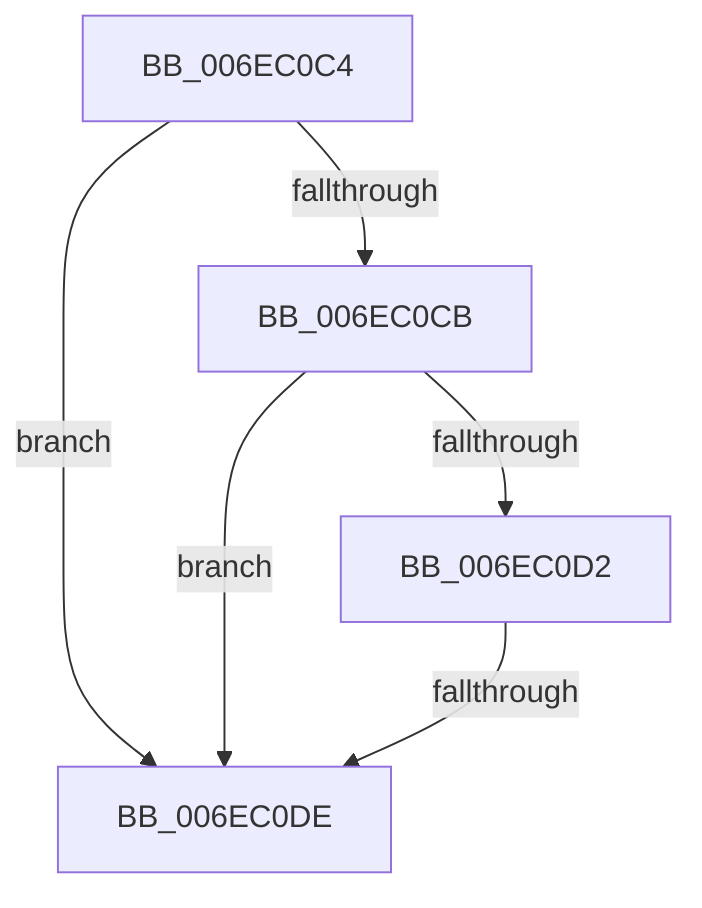

# sub_006EC0C4

- RVA: `0x006EC0C4`–`0x006EC100` (길이 `60` bytes)
- VA: `0x00000001406EC0C4`
- 실행 섹션: `.text`
- PDB 이름 있음: `아니요`; PDB Function 태그: `아니요`
- unwind 정보 RVA: `0x0009A1D4`
- 디코드: `19`개 명령, `60/60` bytes 표시
- 미해석 바이트: `0` (있으면 어셈블리에 `.byte`로 보존)

> 이 문서는 커널 이미지의 기계어와 PDB 기호를 분석해 생성했습니다. 4번과 5번은 함수 원형과 자료형을 바이너리 사용 방식에서 추정한 C 해석이며 원본 소스 복구 결과는 아닙니다.

## 1. Dependencies

- 직접 호출 지점: **0**; 고유 호출 대상: **0**
- 직접 호출자로 확인된 함수: **0**
- RIP 상대 이미지 참조: **0**

### Outgoing calls
- 직접 디코드된 call 명령이 없습니다.

### Direct callers
- 이 함수 시작 RVA로 연결되는 직접 call은 확인되지 않았습니다. 간접 호출은 완전히 역산할 수 없습니다.

### Static image references
- 디코드된 RIP-relative 메모리 참조가 없습니다.

## 2. Other-region calls and transfers

- 다른 실행 섹션으로 향하는 call: **0**
- call이 아닌 외부 분기/꼬리 이동: **2**
  - `0x006EC0D8` → [SepRemoveAceFromTokenDefaultDacl + 0x88](../40/SepRemoveAceFromTokenDefaultDacl_function_0040018C.md) (`tail-transfer`)
  - `0x006EC0FB` → [SepRemoveAceFromTokenDefaultDacl + 0x4C](../40/SepRemoveAceFromTokenDefaultDacl_function_0040018C.md) (`tail-transfer`)

## 3. Assembly (complete function range)

```asm
006EC0C4  8D 41 FB                        lea eax, [rcx - 5]
006EC0C7  3C 03                           cmp al, 3
006EC0C9  76 13                           jbe 0x1406ec0de
006EC0CB  8D 41 F5                        lea eax, [rcx - 0xb]
006EC0CE  3C 01                           cmp al, 1
006EC0D0  76 0C                           jbe 0x1406ec0de
006EC0D2  80 E9 0F                        sub cl, 0xf
006EC0D5  80 F9 01                        cmp cl, 1
006EC0D8  0F 87 36 41 D1 FF               ja 0x140400214
006EC0DE  8B 4B 08                        mov ecx, dword ptr [rbx + 8]
006EC0E1  8B C1                           mov eax, ecx
006EC0E3  83 E0 02                        and eax, 2
006EC0E6  83 E1 01                        and ecx, 1
006EC0E9  48 C1 E0 03                     shl rax, 3
006EC0ED  48 83 C8 0C                     or rax, 0xc
006EC0F1  48 C1 E1 04                     shl rcx, 4
006EC0F5  48 03 C3                        add rax, rbx
006EC0F8  48 03 C8                        add rcx, rax
006EC0FB  E9 D8 40 D1 FF                  jmp 0x1404001d8
```

## 4. C-style interpretation (structured pseudocode)

```c
__int64 __fastcall sub_006EC0C4(__int64 a1)
{
    __int64 result;

    if (((unsigned __int8)(a1 - 5)) <= 3) goto loc_006EC0DE;
    if (((unsigned __int8)(a1 - 11)) <= 1) goto loc_006EC0DE;
    a1 = (unsigned __int8)((a1) - (15));
loc_006EC0DE:
    result = (unsigned int)(((unsigned int)((unsigned int)((unsigned int)(*(unsigned int *)(v_rbx + 8))))) & (2));
    a1 = (unsigned int)(((unsigned int)(*(unsigned int *)(v_rbx + 8))) & (1));
    result = (result) << (3);
    result = (result) | (12);
    a1 = (a1) << (4);
    result = (result) + (v_rbx);
    a1 = (a1) + (result);
}
```

## 5. (Beta) C Style

```c
int64_t sub_006EC0C4(void *Arg1)
{
    uint8_t *arg1 = (uint8_t *)Arg1;

    int64_t result;

    if (((uint8_t)(Arg1 - 5)) <= 3) goto loc_006EC0DE;
    if (((uint8_t)(Arg1 - 11)) <= 1) goto loc_006EC0DE;
    Arg1 = (uint8_t)((Arg1) - (15));
loc_006EC0DE:
    result = (uint32_t)(((uint32_t)((uint32_t)((uint32_t)(*(uint32_t *)(local_rbx + 0x8))))) & (2));
    Arg1 = (uint32_t)(((uint32_t)(*(uint32_t *)(local_rbx + 0x8))) & (1));
    result = (result) << (3);
    result = (result) | (12);
    Arg1 = (Arg1) << (4);
    result = (result) + (local_rbx);
    Arg1 = (Arg1) + (result);
}
```

### 관측된 메모리 오프셋

구조체 형식이 확인되지 않은 접근은 인자 기준의 오프셋으로만 기록했습니다.

| 기준 인자 | 오프셋 표현 | 폭 (bit) | 접근 |
|---|---:|---:|---|
| `Arg1` | `- 0xB` | `32` | `R` |
| `Arg1` | `- 0x5` | `32` | `R` |

## 6. Execution-region graph

[열기: 2D/3D 그래프와 함수 탐색 컨트롤 패널](../../../control-panel.html?section=text&rva=0x006EC0C4&view=graph)

- 2D 그래프는 위에서 아래로 흐르고, 3D 그래프는 빈 공간을 드래그해 회전합니다. Shift+드래그는 이동, 휠은 확대·축소, 함수 노드 선택은 대상 보고서 이동입니다.

### Static fallback


