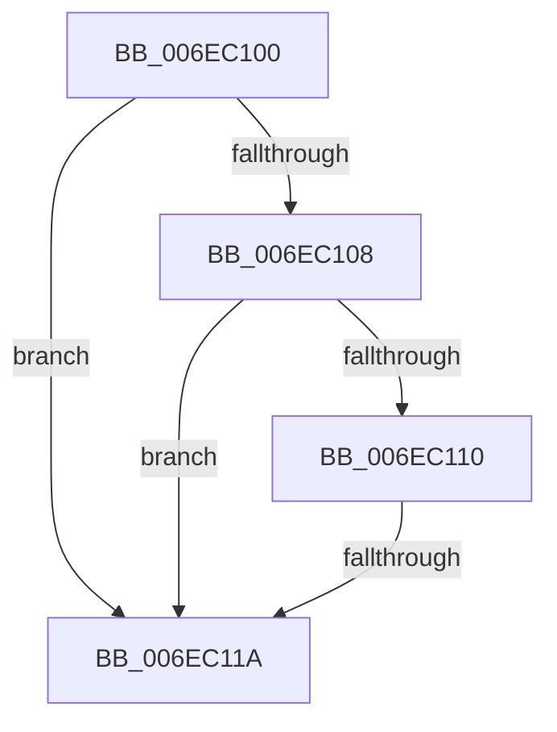

# sub_006EC100

- RVA: `0x006EC100`–`0x006EC139` (길이 `57` bytes)
- VA: `0x00000001406EC100`
- 실행 섹션: `.text`
- PDB 이름 있음: `아니요`; PDB Function 태그: `아니요`
- unwind 정보 RVA: `0x0009A240`
- 디코드: `18`개 명령, `57/57` bytes 표시
- 미해석 바이트: `0` (있으면 어셈블리에 `.byte`로 보존)

> 이 문서는 커널 이미지의 기계어와 PDB 기호를 분석해 생성했습니다. 4번과 5번은 함수 원형과 자료형을 바이너리 사용 방식에서 추정한 C 해석이며 원본 소스 복구 결과는 아닙니다.

## 1. Dependencies

- 직접 호출 지점: **0**; 고유 호출 대상: **0**
- 직접 호출자로 확인된 함수: **0**
- RIP 상대 이미지 참조: **0**

### Outgoing calls
- 직접 디코드된 call 명령이 없습니다.

### Direct callers
- 이 함수 시작 RVA로 연결되는 직접 call은 확인되지 않았습니다. 간접 호출은 완전히 역산할 수 없습니다.

### Static image references
- 디코드된 RIP-relative 메모리 참조가 없습니다.

## 2. Other-region calls and transfers

- 다른 실행 섹션으로 향하는 call: **0**
- call이 아닌 외부 분기/꼬리 이동: **2**
  - `0x006EC114` → [RtlFindAceBySid + 0xAA](../40/RtlFindAceBySid_function_004004E0.md) (`tail-transfer`)
  - `0x006EC134` → [RtlFindAceBySid + 0x49](../40/RtlFindAceBySid_function_004004E0.md) (`tail-transfer`)

## 3. Assembly (complete function range)

```asm
006EC100  8D 48 FB                        lea ecx, [rax - 5]
006EC103  80 F9 03                        cmp cl, 3
006EC106  76 12                           jbe 0x1406ec11a
006EC108  8D 48 F5                        lea ecx, [rax - 0xb]
006EC10B  80 F9 01                        cmp cl, 1
006EC10E  76 0A                           jbe 0x1406ec11a
006EC110  2C 0F                           sub al, 0xf
006EC112  3C 01                           cmp al, 1
006EC114  0F 87 70 44 D1 FF               ja 0x14040058a
006EC11A  8B 43 08                        mov eax, dword ptr [rbx + 8]
006EC11D  8B C8                           mov ecx, eax
006EC11F  83 E1 02                        and ecx, 2
006EC122  83 E0 01                        and eax, 1
006EC125  48 C1 E1 03                     shl rcx, 3
006EC129  48 83 C9 0C                     or rcx, 0xc
006EC12D  48 C1 E0 04                     shl rax, 4
006EC131  48 03 C8                        add rcx, rax
006EC134  E9 F0 43 D1 FF                  jmp 0x140400529
```

## 4. C-style interpretation (structured pseudocode)

```c
__int64 __fastcall sub_006EC100(void)
{
    __int64 result;

    if (((unsigned __int8)(result - 5)) <= 3) goto loc_006EC11A;
    if (((unsigned __int8)(result - 11)) <= 1) goto loc_006EC11A;
    result = (unsigned __int8)((result) - (15));
loc_006EC11A:
    a1 = (unsigned int)(((unsigned int)((unsigned int)((unsigned int)(*(unsigned int *)(v_rbx + 8))))) & (2));
    result = (unsigned int)(((unsigned int)(*(unsigned int *)(v_rbx + 8))) & (1));
    a1 = (a1) << (3);
    a1 = (a1) | (12);
    result = (result) << (4);
    a1 = (a1) + (result);
}
```

## 5. (Beta) C Style

```c
void sub_006EC100(void)
{
    int64_t result;

    if (((uint8_t)(result - 5)) <= 3) goto loc_006EC11A;
    if (((uint8_t)(result - 11)) <= 1) goto loc_006EC11A;
    result = (uint8_t)((result) - (15));
loc_006EC11A:
    a1 = (uint32_t)(((uint32_t)((uint32_t)((uint32_t)(*(uint32_t *)(local_rbx + 0x8))))) & (2));
    result = (uint32_t)(((uint32_t)(*(uint32_t *)(local_rbx + 0x8))) & (1));
    a1 = (a1) << (3);
    a1 = (a1) | (12);
    result = (result) << (4);
    a1 = (a1) + (result);
}
```

## 6. Execution-region graph

[열기: 2D/3D 그래프와 함수 탐색 컨트롤 패널](../../../control-panel.html?section=text&rva=0x006EC100&view=graph)

- 2D 그래프는 위에서 아래로 흐르고, 3D 그래프는 빈 공간을 드래그해 회전합니다. Shift+드래그는 이동, 휠은 확대·축소, 함수 노드 선택은 대상 보고서 이동입니다.

### Static fallback


