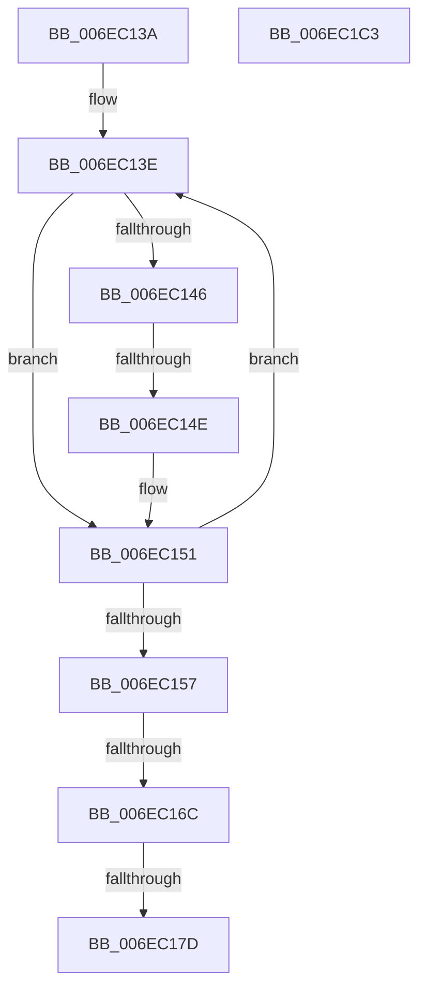

# sub_006EC13A

- RVA: `0x006EC13A`–`0x006EC1FF` (길이 `197` bytes)
- VA: `0x00000001406EC13A`
- 실행 섹션: `.text`
- PDB 이름 있음: `아니요`; PDB Function 태그: `아니요`
- unwind 정보 RVA: `0x0009A680`
- 디코드: `49`개 명령, `197/197` bytes 표시
- 미해석 바이트: `0` (있으면 어셈블리에 `.byte`로 보존)

> 이 문서는 커널 이미지의 기계어와 PDB 기호를 분석해 생성했습니다. 4번과 5번은 함수 원형과 자료형을 바이너리 사용 방식에서 추정한 C 해석이며 원본 소스 복구 결과는 아닙니다.

## 1. Dependencies

- 직접 호출 지점: **1**; 고유 호출 대상: **1**
- 직접 호출자로 확인된 함수: **0**
- RIP 상대 이미지 참조: **1**

### Outgoing calls
- `0x006EC1F4` → [DbgPrintEx](../35/DbgPrintEx_function_00359290.md) (function, `0x00359290`)

### Direct callers
- 이 함수 시작 RVA로 연결되는 직접 call은 확인되지 않았습니다. 간접 호출은 완전히 역산할 수 없습니다.

### Static image references
- `0x006EC1E8` → RVA `0x006C7DA0` (` ?? ::FNODOBFM::`string'`; read)

## 2. Other-region calls and transfers

- 다른 실행 섹션으로 향하는 call: **0**
- call이 아닌 외부 분기/꼬리 이동: **5**
  - `0x006EC148` → [CcAcquireByteRangeForWrite + 0xF2](../40/CcAcquireByteRangeForWrite_function_00401E74.md) (`tail-transfer`)
  - `0x006EC166` → [CcAcquireByteRangeForWrite + 0xF2](../40/CcAcquireByteRangeForWrite_function_00401E74.md) (`tail-transfer`)
  - `0x006EC177` → [CcAcquireByteRangeForWrite + 0xF2](../40/CcAcquireByteRangeForWrite_function_00401E74.md) (`tail-transfer`)
  - `0x006EC1BE` → [CcAcquireByteRangeForWrite + 0x872](../40/CcAcquireByteRangeForWrite_function_00401E74.md) (`tail-transfer`)
  - `0x006EC1FA` → [CcAcquireByteRangeForWrite + 0x1E3](../40/CcAcquireByteRangeForWrite_function_00401E74.md) (`tail-transfer`)

## 3. Assembly (complete function range)

```asm
006EC13A  49 8D 42 10                     lea rax, [r10 + 0x10]
006EC13E  4D 8B 3F                        mov r15, qword ptr [r15]
006EC141  4C 3B F8                        cmp r15, rax
006EC144  75 0B                           jne 0x1406ec151
006EC146  85 C9                           test ecx, ecx
006EC148  0F 85 18 5E D1 FF               jne 0x140401f66
006EC14E  4D 8B 3F                        mov r15, qword ptr [r15]
006EC151  41 39 7F 20                     cmp dword ptr [r15 + 0x20], edi
006EC155  74 E7                           je 0x1406ec13e
006EC157  45 8B 47 18                     mov r8d, dword ptr [r15 + 0x18]
006EC15B  4D 8B 57 10                     mov r10, qword ptr [r15 + 0x10]
006EC15F  4B 8D 04 10                     lea rax, [r8 + r10]
006EC163  48 3B D8                        cmp rbx, rax
006EC166  0F 8C FA 5D D1 FF               jl 0x140401f66
006EC16C  41 8B 57 1C                     mov edx, dword ptr [r15 + 0x1c]
006EC170  4A 8D 04 12                     lea rax, [rdx + r10]
006EC174  4C 3B F0                        cmp r14, rax
006EC177  0F 8F E9 5D D1 FF               jg 0x140401f66
006EC17D  49 8B 4F 28                     mov rcx, qword ptr [r15 + 0x28]
006EC181  41 8B C0                        mov eax, r8d
006EC184  48 C1 E8 05                     shr rax, 5
006EC188  4C 8D 1C 81                     lea r11, [rcx + rax*4]
006EC18C  4C 89 5C 24 70                  mov qword ptr [rsp + 0x70], r11
006EC191  48 C1 EA 05                     shr rdx, 5
006EC195  48 8D 04 91                     lea rax, [rcx + rdx*4]
006EC199  48 89 44 24 60                  mov qword ptr [rsp + 0x60], rax
006EC19E  45 8B F0                        mov r14d, r8d
006EC1A1  B8 E0 FF FF FF                  mov eax, 0xffffffe0
006EC1A6  4C 23 F0                        and r14, rax
006EC1A9  4D 03 F2                        add r14, r10
006EC1AC  41 8B D0                        mov edx, r8d
006EC1AF  48 89 54 24 68                  mov qword ptr [rsp + 0x68], rdx
006EC1B4  4C 8B 54 24 78                  mov r10, qword ptr [rsp + 0x78]
006EC1B9  4C 8B 44 24 60                  mov r8, qword ptr [rsp + 0x60]
006EC1BE  E9 23 65 D1 FF                  jmp 0x1404026e6
006EC1C3  4C 8B CF                        mov r9, rdi
006EC1C6  41 8B 47 20                     mov eax, dword ptr [r15 + 0x20]
006EC1CA  89 44 24 40                     mov dword ptr [rsp + 0x40], eax
006EC1CE  4C 89 7C 24 38                  mov qword ptr [rsp + 0x38], r15
006EC1D3  4C 89 74 24 30                  mov qword ptr [rsp + 0x30], r14
006EC1D8  4C 89 6C 24 28                  mov qword ptr [rsp + 0x28], r13
006EC1DD  8B 9C 24 70 01 00 00            mov ebx, dword ptr [rsp + 0x170]
006EC1E4  89 5C 24 20                     mov dword ptr [rsp + 0x20], ebx
006EC1E8  4C 8D 05 B1 BB FD FF            lea r8, [rip - 0x2444f]
006EC1EF  33 D2                           xor edx, edx
006EC1F1  8D 4A 7F                        lea ecx, [rdx + 0x7f]
006EC1F4  E8 97 D0 C6 FF                  call 0x140359290
006EC1F9  90                              nop
006EC1FA  E9 58 5E D1 FF                  jmp 0x140402057
```

## 4. C-style interpretation (structured pseudocode)

```c
__int64 __fastcall sub_006EC13A(int a1, __int64 a2, __int64 a3, __int64 a4, __int64 a5, __int64 a6, __int64 a7, __int64 a8, __int64 a9, __int64 a10, __int64 a11, __int64 a12, __int64 a13, __int64 a14, __int64 a15)
{
    __int64 result;
    __int64 v_r14;
    unsigned int v_stack_p170;
    unsigned int v_stack_p20;
    unsigned __int64 v_stack_p28;
    unsigned __int64 v_stack_p30;
    unsigned __int64 v_stack_p38;
    unsigned int v_stack_p40;
    unsigned __int64 v_stack_p60;
    unsigned __int64 v_stack_p68;
    unsigned __int64 v_stack_p70;

loc_006EC13E:
    if ((*(unsigned __int64 *)(v_r15)) != (v_r10 + 16)) goto loc_006EC151;
loc_006EC151:
    if ((*(unsigned int *)(*(unsigned __int64 *)(*(unsigned __int64 *)(v_r15)) + 32)) == ((unsigned int)(v_rdi))) goto loc_006EC13E;
    result = ((unsigned int)((unsigned int)((unsigned int)(*(unsigned int *)(*(unsigned __int64 *)(*(unsigned __int64 *)(v_r15)) + 24))))) >> (5);
    v_stack_p70 = *(unsigned __int64 *)(*(unsigned __int64 *)(*(unsigned __int64 *)(v_r15)) + 40) + result * 4;
    a2 = ((unsigned int)(*(unsigned int *)(*(unsigned __int64 *)(*(unsigned __int64 *)(v_r15)) + 28))) >> (5);
    v_stack_p60 = *(unsigned __int64 *)(*(unsigned __int64 *)(*(unsigned __int64 *)(v_r15)) + 40) + a2 * 4;
    v_r14 = ((unsigned int)((unsigned int)((unsigned int)(*(unsigned int *)(*(unsigned __int64 *)(*(unsigned __int64 *)(v_r15)) + 24))))) & ((unsigned int)(0xFFFFFFE0ULL));
    v_r14 = (v_r14) + (*(unsigned __int64 *)(*(unsigned __int64 *)(*(unsigned __int64 *)(v_r15)) + 16));
    v_stack_p68 = (unsigned int)((unsigned int)((unsigned int)(*(unsigned int *)(*(unsigned __int64 *)(*(unsigned __int64 *)(v_r15)) + 24))));
}
```

## 5. (Beta) C Style

```c
int64_t sub_006EC13A(int32_t Arg1, int64_t Arg2, int64_t Arg3, int64_t Arg4, uint64_t Arg5, uint64_t Arg6, uint64_t Arg7, uint64_t Arg8, uint64_t Arg9, uint64_t Arg10, uint64_t Arg11, int64_t Arg12, uint64_t Arg13, uint64_t Arg14, int64_t Arg15)
{
    int64_t result;
    int64_t local_r14;
    uint32_t v_stack_p170;
    uint32_t v_stack_p20;
    uint64_t v_stack_p28;
    uint64_t v_stack_p30;
    uint64_t v_stack_p38;
    uint32_t v_stack_p40;
    uint64_t v_stack_p60;
    uint64_t v_stack_p68;
    uint64_t v_stack_p70;

loc_006EC13E:
    if ((*(uint64_t *)(local_r15)) != (local_r10 + 16)) goto loc_006EC151;
loc_006EC151:
    if ((*(uint32_t *)(*(uint64_t *)(*(uint64_t *)(local_r15)) + 0x20)) == ((uint32_t)(local_rdi))) goto loc_006EC13E;
    result = ((uint32_t)((uint32_t)((uint32_t)(*(uint32_t *)(*(uint64_t *)(*(uint64_t *)(local_r15)) + 0x18))))) >> (5);
    v_stack_p70 = *(uint64_t *)(*(uint64_t *)(*(uint64_t *)(local_r15)) + 0x28) + result * 4;
    Arg2 = ((uint32_t)(*(uint32_t *)(*(uint64_t *)(*(uint64_t *)(local_r15)) + 0x1C))) >> (5);
    v_stack_p60 = *(uint64_t *)(*(uint64_t *)(*(uint64_t *)(local_r15)) + 0x28) + Arg2 * 4;
    local_r14 = ((uint32_t)((uint32_t)((uint32_t)(*(uint32_t *)(*(uint64_t *)(*(uint64_t *)(local_r15)) + 0x18))))) & ((uint32_t)(0xFFFFFFE0ULL));
    local_r14 = (local_r14) + (*(uint64_t *)(*(uint64_t *)(*(uint64_t *)(local_r15)) + 0x10));
    v_stack_p68 = (uint32_t)((uint32_t)((uint32_t)(*(uint32_t *)(*(uint64_t *)(*(uint64_t *)(local_r15)) + 0x18))));
}
```

## 6. Execution-region graph

[열기: 2D/3D 그래프와 함수 탐색 컨트롤 패널](../../../control-panel.html?section=text&rva=0x006EC13A&view=graph)

- 2D 그래프는 위에서 아래로 흐르고, 3D 그래프는 빈 공간을 드래그해 회전합니다. Shift+드래그는 이동, 휠은 확대·축소, 함수 노드 선택은 대상 보고서 이동입니다.

### Static fallback


