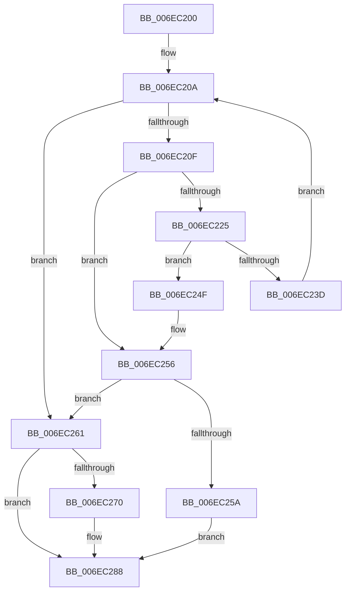

# sub_006EC200

- RVA: `0x006EC200`–`0x006EC29A` (길이 `154` bytes)
- VA: `0x00000001406EC200`
- 실행 섹션: `.text`
- PDB 이름 있음: `아니요`; PDB Function 태그: `아니요`
- unwind 정보 RVA: `0x0009A6F4`
- 디코드: `42`개 명령, `154/154` bytes 표시
- 미해석 바이트: `0` (있으면 어셈블리에 `.byte`로 보존)

> 이 문서는 커널 이미지의 기계어와 PDB 기호를 분석해 생성했습니다. 4번과 5번은 함수 원형과 자료형을 바이너리 사용 방식에서 추정한 C 해석이며 원본 소스 복구 결과는 아닙니다.

## 1. Dependencies

- 직접 호출 지점: **3**; 고유 호출 대상: **3**
- 직접 호출자로 확인된 함수: **0**
- RIP 상대 이미지 참조: **0**

### Outgoing calls
- `0x006EC21B` → [MiAllocateModWriterEntry](../47/MiAllocateModWriterEntry_function_0047A718.md) (function, `0x0047A718`)
- `0x006EC283` → [KeSetEvent](../33/KeSetEvent_function_0033F310.md) (function, `0x0033F310`)
- `0x006EC28E` → [MiUnlockPartitionMappedWriter](../40/MiUnlockPartitionMappedWriter_function_004030EC.md) (function, `0x004030EC`)

### Direct callers
- 이 함수 시작 RVA로 연결되는 직접 call은 확인되지 않았습니다. 간접 호출은 완전히 역산할 수 없습니다.

### Static image references
- 디코드된 RIP-relative 메모리 참조가 없습니다.

## 2. Other-region calls and transfers

- 다른 실행 섹션으로 향하는 call: **0**
- call이 아닌 외부 분기/꼬리 이동: **1**
  - `0x006EC295` → [MiAllocateMappedWriterMdls + 0x22](../40/MiAllocateMappedWriterMdls_function_00403058.md) (`tail-transfer`)

## 3. Assembly (complete function range)

```asm
006EC200  33 F6                           xor esi, esi
006EC202  89 8B 98 02 00 00               mov dword ptr [rbx + 0x298], ecx
006EC208  33 FF                           xor edi, edi
006EC20A  83 FF 04                        cmp edi, 4
006EC20D  73 52                           jae 0x1406ec261
006EC20F  BA 10 00 00 00                  mov edx, 0x10
006EC214  48 8B CB                        mov rcx, rbx
006EC217  44 8D 42 F1                     lea r8d, [rdx - 0xf]
006EC21B  E8 F8 E4 D8 FF                  call 0x14047a718
006EC220  48 85 C0                        test rax, rax
006EC223  74 31                           je 0x1406ec256
006EC225  83 48 28 01                     or dword ptr [rax + 0x28], 1
006EC229  48 8D 8B A8 02 00 00            lea rcx, [rbx + 0x2a8]
006EC230  48 89 58 38                     mov qword ptr [rax + 0x38], rbx
006EC234  48 8B 51 08                     mov rdx, qword ptr [rcx + 8]
006EC238  48 39 0A                        cmp qword ptr [rdx], rcx
006EC23B  75 12                           jne 0x1406ec24f
006EC23D  48 89 08                        mov qword ptr [rax], rcx
006EC240  FF C7                           inc edi
006EC242  48 89 50 08                     mov qword ptr [rax + 8], rdx
006EC246  48 89 02                        mov qword ptr [rdx], rax
006EC249  48 89 41 08                     mov qword ptr [rcx + 8], rax
006EC24D  EB BB                           jmp 0x1406ec20a
006EC24F  B9 03 00 00 00                  mov ecx, 3
006EC254  CD 29                           int 0x29
006EC256  85 FF                           test edi, edi
006EC258  75 07                           jne 0x1406ec261
006EC25A  BE 9A 00 00 C0                  mov esi, 0xc000009a
006EC25F  EB 27                           jmp 0x1406ec288
006EC261  80 BB D0 02 00 00 00            cmp byte ptr [rbx + 0x2d0], 0
006EC268  89 BB 9C 02 00 00               mov dword ptr [rbx + 0x29c], edi
006EC26E  74 18                           je 0x1406ec288
006EC270  48 8D 8B B8 02 00 00            lea rcx, [rbx + 0x2b8]
006EC277  C6 83 D0 02 00 00 00            mov byte ptr [rbx + 0x2d0], 0
006EC27E  45 33 C0                        xor r8d, r8d
006EC281  33 D2                           xor edx, edx
006EC283  E8 88 30 C5 FF                  call 0x14033f310
006EC288  48 8B D5                        mov rdx, rbp
006EC28B  48 8B CB                        mov rcx, rbx
006EC28E  E8 59 6E D1 FF                  call 0x1404030ec
006EC293  8B C6                           mov eax, esi
006EC295  E9 E0 6D D1 FF                  jmp 0x14040307a
```

## 4. C-style interpretation (structured pseudocode)

```c
__int64 __fastcall sub_006EC200(int a1)
{
    __int64 result;
    __int64 v_rdi;
    __int64 v_rsi;

    v_rsi = 0;
    *(unsigned int *)(v_rbx + 664) = a1;
    v_rdi = 0;
loc_006EC20A:
    if (0 >= 4) goto loc_006EC261;
    result = MiAllocateModWriterEntry(v_rbx, 16, 16 - 15, a4);
    if (result == 0) goto loc_006EC256;
    *(unsigned __int64 *)(result + 56) = v_rbx;
    if ((*(unsigned __int64 *)(*(unsigned __int64 *)(v_rbx + 680 + 8))) != (v_rbx + 680)) goto loc_006EC24F;
    *(unsigned __int64 *)(result) = v_rbx + 680;
    v_rdi = (unsigned int)((v_rdi) + 1);
    *(unsigned __int64 *)(result + 8) = *(unsigned __int64 *)(v_rbx + 680 + 8);
    *(unsigned __int64 *)(*(unsigned __int64 *)(v_rbx + 680 + 8)) = result;
    *(unsigned __int64 *)(v_rbx + 680 + 8) = result;
    goto loc_006EC20A;
loc_006EC24F:
loc_006EC256:
    if ((unsigned int)(v_rdi) != 0) goto loc_006EC261;
    goto loc_006EC288;
loc_006EC261:
    *(unsigned int *)(v_rbx + 668) = (unsigned int)(v_rdi);
    if ((*(unsigned __int8 *)(v_rbx + 720)) != 0) {
        a1 = v_rbx + 696;
        *(unsigned __int8 *)(v_rbx + 720) = 0;
        a3 = 0;
        a2 = 0;
        result = KeSetEvent(a1, a2, a3, a4);
    }
    result = MiUnlockPartitionMappedWriter(v_rbx, v_rbp, a3, a4);
}
```

## 5. (Beta) C Style

```c
int64_t sub_006EC200(int32_t Arg1)
{
    int64_t result;
    int64_t local_rdi;
    int64_t local_rsi;

    local_rsi = 0;
    *(uint32_t *)(local_rbx + 0x298) = Arg1;
    local_rdi = 0;
loc_006EC20A:
    if (0 >= 4) goto loc_006EC261;
    result = MiAllocateModWriterEntry(local_rbx, 16, 16 - 15, a4);
    if (result == 0) goto loc_006EC256;
    *(uint64_t *)(result + 0x38) = local_rbx;
    if ((*(uint64_t *)(*(uint64_t *)(local_rbx + 0x2A8 + 0x8))) != (local_rbx + 680)) goto loc_006EC24F;
    *(uint64_t *)(result) = local_rbx + 680;
    local_rdi = (uint32_t)((local_rdi) + 1);
    *(uint64_t *)(result + 0x8) = *(uint64_t *)(local_rbx + 0x2A8 + 0x8);
    *(uint64_t *)(*(uint64_t *)(local_rbx + 0x2A8 + 0x8)) = result;
    *(uint64_t *)(local_rbx + 0x2A8 + 0x8) = result;
    goto loc_006EC20A;
loc_006EC24F:
loc_006EC256:
    if ((uint32_t)(local_rdi) != 0) goto loc_006EC261;
    goto loc_006EC288;
loc_006EC261:
    *(uint32_t *)(local_rbx + 0x29C) = (uint32_t)(local_rdi);
    if ((*(uint8_t *)(local_rbx + 0x2D0)) != 0) {
        Arg1 = local_rbx + 696;
        *(uint8_t *)(local_rbx + 0x2D0) = 0;
        a3 = 0;
        a2 = 0;
        result = KeSetEvent(Arg1, a2, a3, a4);
    }
    result = MiUnlockPartitionMappedWriter(local_rbx, local_rbp, a3, a4);
}
```

## 6. Execution-region graph

[열기: 2D/3D 그래프와 함수 탐색 컨트롤 패널](../../../control-panel.html?section=text&rva=0x006EC200&view=graph)

- 2D 그래프는 위에서 아래로 흐르고, 3D 그래프는 빈 공간을 드래그해 회전합니다. Shift+드래그는 이동, 휠은 확대·축소, 함수 노드 선택은 대상 보고서 이동입니다.

### Static fallback


