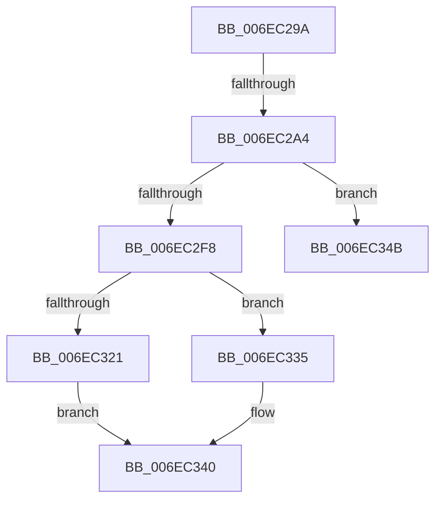

# sub_006EC29A

- RVA: `0x006EC29A`–`0x006EC35F` (길이 `197` bytes)
- VA: `0x00000001406EC29A`
- 실행 섹션: `.text`
- PDB 이름 있음: `아니요`; PDB Function 태그: `아니요`
- unwind 정보 RVA: `0x0009A740`
- 디코드: `43`개 명령, `197/197` bytes 표시
- 미해석 바이트: `0` (있으면 어셈블리에 `.byte`로 보존)

> 이 문서는 커널 이미지의 기계어와 PDB 기호를 분석해 생성했습니다. 4번과 5번은 함수 원형과 자료형을 바이너리 사용 방식에서 추정한 C 해석이며 원본 소스 복구 결과는 아닙니다.

## 1. Dependencies

- 직접 호출 지점: **5**; 고유 호출 대상: **4**
- 직접 호출자로 확인된 함수: **0**
- RIP 상대 이미지 참조: **0**

### Outgoing calls
- `0x006EC2CF` → [KeReleaseInStackQueuedSpinLock](../34/KeReleaseInStackQueuedSpinLock_function_00342CE0.md) (function, `0x00342CE0`)
- `0x006EC2E8` → [CcAllocateWorkQueueEntry](../35/CcAllocateWorkQueueEntry_function_0035710C.md) (function, `0x0035710C`)
- `0x006EC30A` → [KeAcquireInStackQueuedSpinLock](../27/KeAcquireInStackQueuedSpinLock_function_002757A0.md) (function, `0x002757A0`)
- `0x006EC340` → [CcPostWorkQueue](../35/CcPostWorkQueue_function_00356808.md) (function, `0x00356808`)
- `0x006EC34B` → [KeAcquireInStackQueuedSpinLock](../27/KeAcquireInStackQueuedSpinLock_function_002757A0.md) (function, `0x002757A0`)

### Direct callers
- 이 함수 시작 RVA로 연결되는 직접 call은 확인되지 않았습니다. 간접 호출은 완전히 역산할 수 없습니다.

### Static image references
- 디코드된 RIP-relative 메모리 참조가 없습니다.

## 2. Other-region calls and transfers

- 다른 실행 섹션으로 향하는 call: **0**
- call이 아닌 외부 분기/꼬리 이동: **3**
  - `0x006EC29E` → [CcNotifyOfMappedWrite + 0x1A5](../40/CcNotifyOfMappedWrite_function_0040338C.md) (`tail-transfer`)
  - `0x006EC346` → [CcNotifyOfMappedWrite + 0x2BD](../40/CcNotifyOfMappedWrite_function_0040338C.md) (`tail-transfer`)
  - `0x006EC35A` → [CcNotifyOfMappedWrite + 0x1A5](../40/CcNotifyOfMappedWrite_function_0040338C.md) (`tail-transfer`)

## 3. Assembly (complete function range)

```asm
006EC29A  48 39 46 30                     cmp qword ptr [rsi + 0x30], rax
006EC29E  0F 8E 8D 72 D1 FF               jle 0x140403531
006EC2A4  8B 46 70                        mov eax, dword ptr [rsi + 0x70]
006EC2A7  48 8D 4D EF                     lea rcx, [rbp - 0x11]
006EC2AB  89 86 C8 00 00 00               mov dword ptr [rsi + 0xc8], eax
006EC2B1  41 01 86 D0 03 00 00            add dword ptr [r14 + 0x3d0], eax
006EC2B8  8B 86 C8 00 00 00               mov eax, dword ptr [rsi + 0xc8]
006EC2BE  41 01 86 30 04 00 00            add dword ptr [r14 + 0x430], eax
006EC2C5  83 8E 98 00 00 00 20            or dword ptr [rsi + 0x98], 0x20
006EC2CC  FF 46 70                        inc dword ptr [rsi + 0x70]
006EC2CF  E8 0C 6A C5 FF                  call 0x140342ce0
006EC2D4  4C 8D 4D D7                     lea r9, [rbp - 0x29]
006EC2D8  4D 8B C5                        mov r8, r13
006EC2DB  49 8B D7                        mov rdx, r15
006EC2DE  4D 8D A6 00 03 00 00            lea r12, [r14 + 0x300]
006EC2E5  49 8B CE                        mov rcx, r14
006EC2E8  E8 1F AE C6 FF                  call 0x14035710c
006EC2ED  48 8D 55 EF                     lea rdx, [rbp - 0x11]
006EC2F1  49 8B CC                        mov rcx, r12
006EC2F4  85 C0                           test eax, eax
006EC2F6  78 53                           js 0x1406ec34b
006EC2F8  48 8B 7D D7                     mov rdi, qword ptr [rbp - 0x29]
006EC2FC  C7 87 80 00 00 00 02 00 00 00   mov dword ptr [rdi + 0x80], 2
006EC306  48 89 77 10                     mov qword ptr [rdi + 0x10], rsi
006EC30A  E8 91 94 B8 FF                  call 0x1402757a0
006EC30F  FF 4E 70                        dec dword ptr [rsi + 0x70]
006EC312  48 8B CF                        mov rcx, rdi
006EC315  F7 86 98 00 00 00 00 00 01 00   test dword ptr [rsi + 0x98], 0x10000
006EC31F  74 14                           je 0x1406ec335
006EC321  48 8B C7                        mov rax, rdi
006EC324  49 8D 55 48                     lea rdx, [r13 + 0x48]
006EC328  48 83 C8 01                     or rax, 1
006EC32C  48 89 86 F8 01 00 00            mov qword ptr [rsi + 0x1f8], rax
006EC333  EB 0B                           jmp 0x1406ec340
006EC335  48 89 BE F8 01 00 00            mov qword ptr [rsi + 0x1f8], rdi
006EC33C  49 8D 55 68                     lea rdx, [r13 + 0x68]
006EC340  E8 C3 A4 C6 FF                  call 0x140356808
006EC345  90                              nop
006EC346  E9 FE 72 D1 FF                  jmp 0x140403649
006EC34B  E8 50 94 B8 FF                  call 0x1402757a0
006EC350  83 A6 98 00 00 00 DF            and dword ptr [rsi + 0x98], 0xffffffdf
006EC357  FF 4E 70                        dec dword ptr [rsi + 0x70]
006EC35A  E9 D2 71 D1 FF                  jmp 0x140403531
```

## 4. C-style interpretation (structured pseudocode)

```c
__int64 __fastcall sub_006EC29A(void)
{
    __int64 result;

    *(unsigned int *)(v_rsi + 200) = (unsigned int)((unsigned int)(*(unsigned int *)(v_rsi + 112)));
    result = KeReleaseInStackQueuedSpinLock(v_rbp - 17, a2, a3, a4);
    result = CcAllocateWorkQueueEntry(v_r14, v_r15, v_r13, v_rbp - 41);
    if (sign_flag) goto loc_006EC34B;
    *(unsigned int *)(*(unsigned __int64 *)(v_rbp - 41) + 128) = 2;
    *(unsigned __int64 *)(*(unsigned __int64 *)(v_rbp - 41) + 16) = v_rsi;
    result = KeAcquireInStackQueuedSpinLock(v_r14 + 768, v_rbp - 17, v_r13, v_rbp - 41);
    if (((*(unsigned int *)(v_rsi + 152)) & (0x10000ULL)) == 0) goto loc_006EC335;
    result = (*(unsigned __int64 *)(v_rbp - 41)) | (1);
    *(unsigned __int64 *)(v_rsi + 504) = result;
    goto loc_006EC340;
loc_006EC335:
    *(unsigned __int64 *)(v_rsi + 504) = *(unsigned __int64 *)(v_rbp - 41);
loc_006EC340:
    result = CcPostWorkQueue(*(unsigned __int64 *)(v_rbp - 41), v_r13 + 104, v_r13, v_rbp - 41);
loc_006EC34B:
    result = KeAcquireInStackQueuedSpinLock(*(unsigned __int64 *)(v_rbp - 41), v_r13 + 104, v_r13, v_rbp - 41);
}
```

## 5. (Beta) C Style

```c
void sub_006EC29A(void)
{
    int64_t result;

    *(uint32_t *)(local_rsi + 0xC8) = (uint32_t)((uint32_t)(*(uint32_t *)(local_rsi + 0x70)));
    result = KeReleaseInStackQueuedSpinLock(local_rbp - 17, a2, a3, a4);
    result = CcAllocateWorkQueueEntry(local_r14, local_r15, local_r13, local_rbp - 41);
    if (sign_flag) goto loc_006EC34B;
    *(uint32_t *)(*(uint64_t *)(local_rbp - 0x29) + 0x80) = 2;
    *(uint64_t *)(*(uint64_t *)(local_rbp - 0x29) + 0x10) = local_rsi;
    result = KeAcquireInStackQueuedSpinLock(local_r14 + 768, local_rbp - 17, local_r13, local_rbp - 41);
    if (((*(uint32_t *)(local_rsi + 0x98)) & (0x10000ULL)) == 0) goto loc_006EC335;
    result = (*(uint64_t *)(local_rbp - 0x29)) | (1);
    *(uint64_t *)(local_rsi + 0x1F8) = result;
    goto loc_006EC340;
loc_006EC335:
    *(uint64_t *)(local_rsi + 0x1F8) = *(uint64_t *)(local_rbp - 0x29);
loc_006EC340:
    result = CcPostWorkQueue(*(uint64_t *)(local_rbp - 0x29), local_r13 + 104, local_r13, local_rbp - 41);
loc_006EC34B:
    result = KeAcquireInStackQueuedSpinLock(*(uint64_t *)(local_rbp - 0x29), local_r13 + 104, local_r13, local_rbp - 41);
}
```

## 6. Execution-region graph

[열기: 2D/3D 그래프와 함수 탐색 컨트롤 패널](../../../control-panel.html?section=text&rva=0x006EC29A&view=graph)

- 2D 그래프는 위에서 아래로 흐르고, 3D 그래프는 빈 공간을 드래그해 회전합니다. Shift+드래그는 이동, 휠은 확대·축소, 함수 노드 선택은 대상 보고서 이동입니다.

### Static fallback


