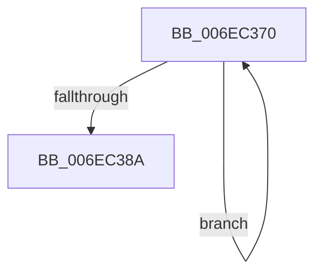

# sub_006EC370

- RVA: `0x006EC370`–`0x006EC38F` (길이 `31` bytes)
- VA: `0x00000001406EC370`
- 실행 섹션: `.text`
- PDB 이름 있음: `아니요`; PDB Function 태그: `아니요`
- unwind 정보 RVA: `0x0009A7C4`
- 디코드: `8`개 명령, `31/31` bytes 표시
- 미해석 바이트: `0` (있으면 어셈블리에 `.byte`로 보존)

> 이 문서는 커널 이미지의 기계어와 PDB 기호를 분석해 생성했습니다. 4번과 5번은 함수 원형과 자료형을 바이너리 사용 방식에서 추정한 C 해석이며 원본 소스 복구 결과는 아닙니다.

## 1. Dependencies

- 직접 호출 지점: **1**; 고유 호출 대상: **1**
- 직접 호출자로 확인된 함수: **0**
- RIP 상대 이미지 참조: **1**

### Outgoing calls
- `0x006EC37B` → [KeDelayExecutionThread](../20/KeDelayExecutionThread_function_00209550.md) (function, `0x00209550`)

### Direct callers
- 이 함수 시작 RVA로 연결되는 직접 call은 확인되지 않았습니다. 간접 호출은 완전히 역산할 수 없습니다.

### Static image references
- `0x006EC370` → RVA `0x00010780` (`.rdata`; read)

## 2. Other-region calls and transfers

- 다른 실행 섹션으로 향하는 call: **0**
- call이 아닌 외부 분기/꼬리 이동: **1**
  - `0x006EC38A` → [MiMappedPageWriter + 0x2E1](../40/MiMappedPageWriter_function_00404AC0.md) (`tail-transfer`)

## 3. Assembly (complete function range)

```asm
006EC370  4C 8D 05 09 44 92 FF            lea r8, [rip - 0x6dbbf7]
006EC377  33 D2                           xor edx, edx
006EC379  33 C9                           xor ecx, ecx
006EC37B  E8 D0 D1 B1 FF                  call 0x140209550
006EC380  8B 83 A0 02 00 00               mov eax, dword ptr [rbx + 0x2a0]
006EC386  85 C0                           test eax, eax
006EC388  75 E6                           jne 0x1406ec370
006EC38A  E9 12 8A D1 FF                  jmp 0x140404da1
```

## 4. C-style interpretation (structured pseudocode)

```c
__int64 __fastcall sub_006EC370(int a1, int a2)
{
    __int64 result;

    a2 = 0;
    a1 = 0;
    result = KeDelayExecutionThread(a1, a2, v_rip - 7191543, a4);
    if ((unsigned int)((unsigned int)(*(unsigned int *)(v_rbx + 672))) != 0) goto loc_006EC370;
}
```

## 5. (Beta) C Style

```c
int64_t sub_006EC370(int32_t Arg1, int32_t Arg2)
{
    int64_t result;

    Arg2 = 0;
    Arg1 = 0;
    result = KeDelayExecutionThread(Arg1, Arg2, v_rip - 7191543, a4);
    if ((uint32_t)((uint32_t)(*(uint32_t *)(local_rbx + 0x2A0))) != 0) goto loc_006EC370;
}
```

## 6. Execution-region graph

[열기: 2D/3D 그래프와 함수 탐색 컨트롤 패널](../../../control-panel.html?section=text&rva=0x006EC370&view=graph)

- 2D 그래프는 위에서 아래로 흐르고, 3D 그래프는 빈 공간을 드래그해 회전합니다. Shift+드래그는 이동, 휠은 확대·축소, 함수 노드 선택은 대상 보고서 이동입니다.

### Static fallback


