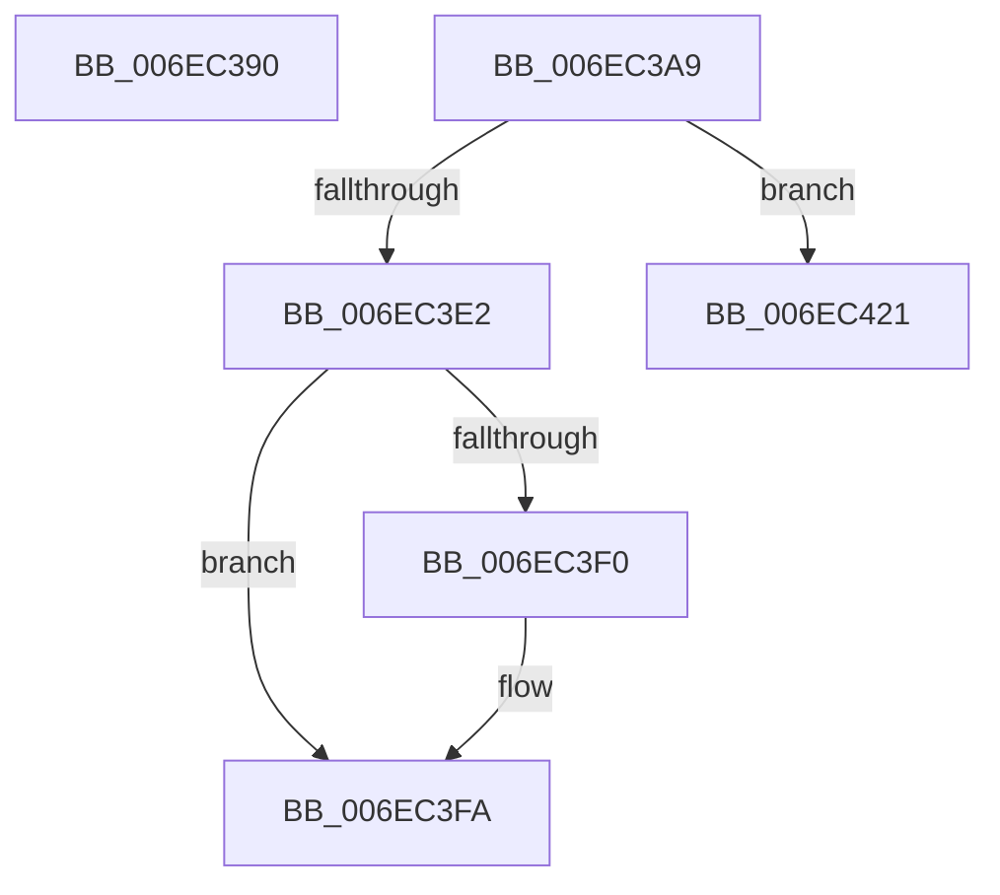

# sub_006EC390

- RVA: `0x006EC390`–`0x006EC43C` (길이 `172` bytes)
- VA: `0x00000001406EC390`
- 실행 섹션: `.text`
- PDB 이름 있음: `아니요`; PDB Function 태그: `아니요`
- unwind 정보 RVA: `0x0009A7F4`
- 디코드: `48`개 명령, `172/172` bytes 표시
- 미해석 바이트: `0` (있으면 어셈블리에 `.byte`로 보존)

> 이 문서는 커널 이미지의 기계어와 PDB 기호를 분석해 생성했습니다. 4번과 5번은 함수 원형과 자료형을 바이너리 사용 방식에서 추정한 C 해석이며 원본 소스 복구 결과는 아닙니다.

## 1. Dependencies

- 직접 호출 지점: **6**; 고유 호출 대상: **6**
- 직접 호출자로 확인된 함수: **0**
- RIP 상대 이미지 참조: **0**

### Outgoing calls
- `0x006EC395` → [MiReleaseSpinLockExclusive](../24/MiReleaseSpinLockExclusive_function_002482C0.md) (function, `0x002482C0`)
- `0x006EC3AE` → [MiUnlinkPageFromListEx](../28/MiUnlinkPageFromListEx_function_00287590.md) (function, `0x00287590`)
- `0x006EC3F5` → [MiClearPfnImageVerified](../40/MiClearPfnImageVerified_function_00407000.md) (function, `0x00407000`)
- `0x006EC3FC` → [MiMakeDemandZeroPte](../33/MiMakeDemandZeroPte_function_00337A00.md) (function, `0x00337A00`)
- `0x006EC412` → [MiDereferenceControlAreaPfnList](../2A/MiDereferenceControlAreaPfnList_function_002A45E8.md) (function, `0x002A45E8`)
- `0x006EC436` → [KeBugCheckEx](../4F/KeBugCheckEx_function_004FD660.md) (function, `0x004FD660`)

### Direct callers
- 이 함수 시작 RVA로 연결되는 직접 call은 확인되지 않았습니다. 간접 호출은 완전히 역산할 수 없습니다.

### Static image references
- 디코드된 RIP-relative 메모리 참조가 없습니다.

## 2. Other-region calls and transfers

- 다른 실행 섹션으로 향하는 call: **0**
- call이 아닌 외부 분기/꼬리 이동: **2**
  - `0x006EC3A4` → [MiGatherMappedPages + 0x53](../40/MiGatherMappedPages_function_00404E80.md) (`tail-transfer`)
  - `0x006EC41C` → [MiGatherMappedPages + 0x48A](../40/MiGatherMappedPages_function_00404E80.md) (`tail-transfer`)

## 3. Assembly (complete function range)

```asm
006EC390  8A D0                           mov dl, al
006EC392  48 8B CE                        mov rcx, rsi
006EC395  E8 26 BF B5 FF                  call 0x1402482c0
006EC39A  48 BE FF FF FF FF 3F 00 00 00   movabs rsi, 0x3fffffffff
006EC3A4  E9 2A 8B D1 FF                  jmp 0x140404ed3
006EC3A9  33 D2                           xor edx, edx
006EC3AB  48 8B CF                        mov rcx, rdi
006EC3AE  E8 DD B1 B9 FF                  call 0x140287590
006EC3B3  48 8B 5F 10                     mov rbx, qword ptr [rdi + 0x10]
006EC3B7  48 C1 EB 05                     shr rbx, 5
006EC3BB  83 E3 1F                        and ebx, 0x1f
006EC3BE  8B C3                           mov eax, ebx
006EC3C0  83 E0 05                        and eax, 5
006EC3C3  3C 05                           cmp al, 5
006EC3C5  0F 95 C1                        setne cl
006EC3C8  F7 46 38 00 08 00 00            test dword ptr [rsi + 0x38], 0x800
006EC3CF  0F 94 C0                        sete al
006EC3D2  22 C8                           and cl, al
006EC3D4  B8 04 00 00 00                  mov eax, 4
006EC3D9  84 D8                           test al, bl
006EC3DB  0F 94 C0                        sete al
006EC3DE  84 C8                           test al, cl
006EC3E0  75 3F                           jne 0x1406ec421
006EC3E2  48 8B 47 28                     mov rax, qword ptr [rdi + 0x28]
006EC3E6  48 C1 E8 3C                     shr rax, 0x3c
006EC3EA  24 07                           and al, 7
006EC3EC  3C 03                           cmp al, 3
006EC3EE  75 0A                           jne 0x1406ec3fa
006EC3F0  33 D2                           xor edx, edx
006EC3F2  48 8B CF                        mov rcx, rdi
006EC3F5  E8 06 AC D1 FF                  call 0x140407000
006EC3FA  8B CB                           mov ecx, ebx
006EC3FC  E8 FF B5 C4 FF                  call 0x140337a00
006EC401  33 D2                           xor edx, edx
006EC403  48 89 47 10                     mov qword ptr [rdi + 0x10], rax
006EC407  48 8B CE                        mov rcx, rsi
006EC40A  44 8D 4A 03                     lea r9d, [rdx + 3]
006EC40E  44 8D 42 01                     lea r8d, [rdx + 1]
006EC412  E8 D1 81 BB FF                  call 0x1402a45e8
006EC417  BA 08 00 00 00                  mov edx, 8
006EC41C  E9 E9 8E D1 FF                  jmp 0x14040530a
006EC421  48 83 64 24 20 00               and qword ptr [rsp + 0x20], 0
006EC427  45 33 C9                        xor r9d, r9d
006EC42A  4C 8B C7                        mov r8, rdi
006EC42D  BA 40 88 00 00                  mov edx, 0x8840
006EC432  41 8D 49 1A                     lea ecx, [r9 + 0x1a]
006EC436  E8 25 12 E1 FF                  call 0x1404fd660
006EC43B  CC                              int3
```

## 4. C-style interpretation (structured pseudocode)

```c
__int64 __fastcall sub_006EC390(void)
{
    __int64 result;
    unsigned __int64 v_stack_p20;

    result = MiReleaseSpinLockExclusive(v_rsi, (unsigned __int8)(result), a3, a4);
}
```

## 5. (Beta) C Style

```c
void sub_006EC390(void)
{
    int64_t result;
    uint64_t v_stack_p20;

    result = MiReleaseSpinLockExclusive(local_rsi, (uint8_t)(result), a3, a4);
}
```

## 6. Execution-region graph

[열기: 2D/3D 그래프와 함수 탐색 컨트롤 패널](../../../control-panel.html?section=text&rva=0x006EC390&view=graph)

- 2D 그래프는 위에서 아래로 흐르고, 3D 그래프는 빈 공간을 드래그해 회전합니다. Shift+드래그는 이동, 휠은 확대·축소, 함수 노드 선택은 대상 보고서 이동입니다.

### Static fallback


